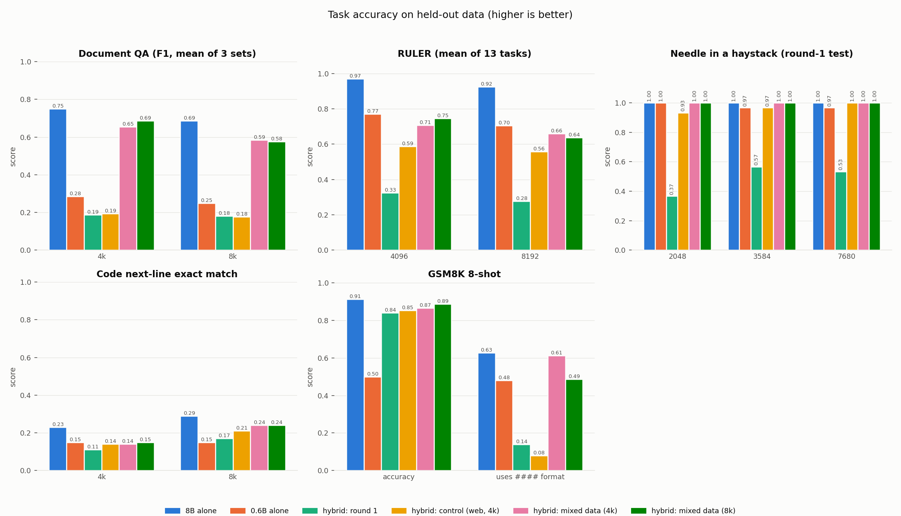
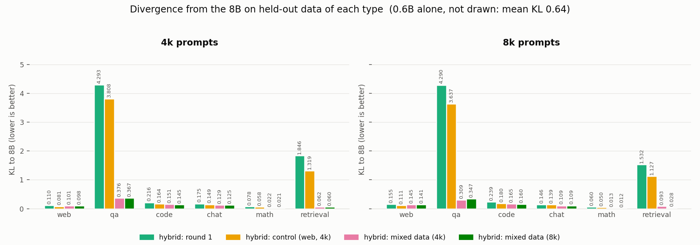
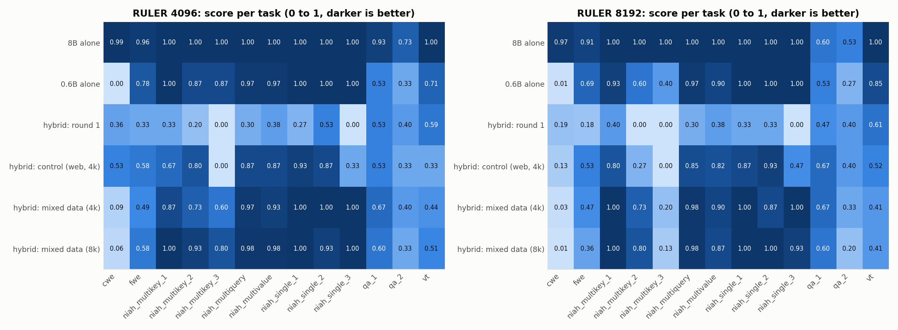
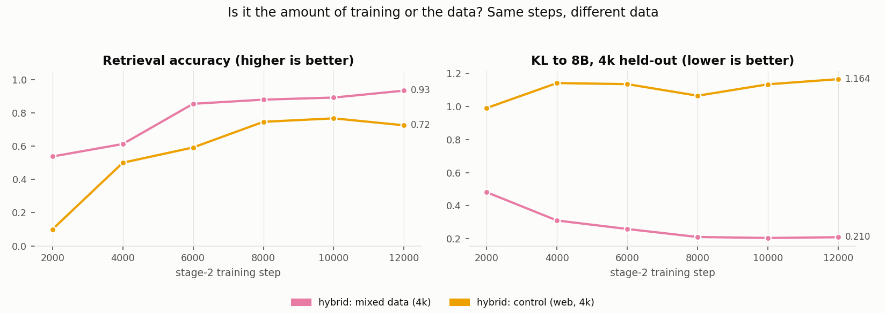
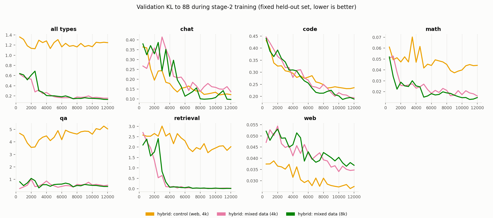
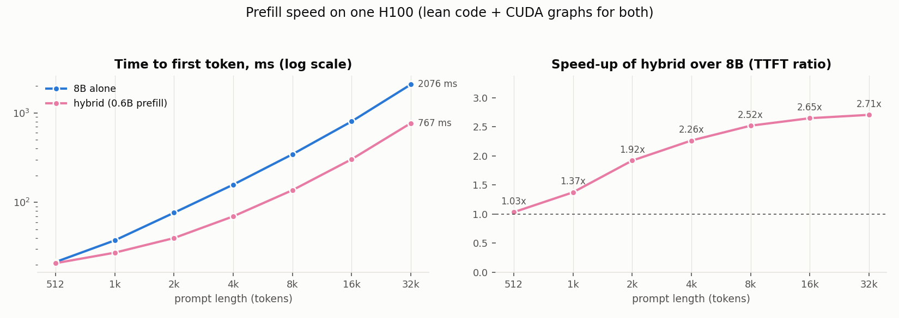

# 小模型 Prefill 大模型：第二轮实验报告

2026-10-13 · Kai Sheng · 模型对 Qwen3-0.6B → Qwen3-8B · 接续 `REPORT_2026-10-12_progress.md`

> **状态**：第二轮的三组训练和全部测试都已完成（任务 27891410，10 月 13 日 21:09 结束，没有报错）。本报告取代同名的阶段版本，所有数字都来自最终测试 `results/round2/`。

## 摘要

**整体效果**：用混合数据训练后，混合方案（0.6B prefill + projector + 8B decode）在大多数任务上接近 8B，而且明显好于 0.6B 单独。下表用当前最好的"混合数据 8k"组，以 8B 为 100%：

| 任务 | 4k prompt | 8k prompt | 0.6B 单独（4k） |
|---|---|---|---|
| 大海捞针 | 100% | 100% | 97% |
| GSM8K（约 2k prompt） | 97% | — | 55% |
| 文档问答 F1（3 个数据集平均） | 92% | 84% | 38% |
| 代码下一行精确匹配 | 65% | 83% | 65% |
| RULER 平均 | 77% | 69% | 79% |
| **首 token 加速** | **2.26 倍** | **2.52 倍** | — |

- **换训练数据是这一轮最大的改进**：只用网页数据训练时，问答 F1 只有 0.19，比 0.6B 单独的 0.28 还低。换成混合数据后升到 0.65 到 0.69，8B 是 0.75。
- **第一轮的大海捞针问题已经解决**：三个长度都是 100%，第一轮只有 37% 到 57%。
- **现在最主要的问题有两个**：
  1. **长 prompt 中细节记不准**：RULER 仍低于 0.6B 单独，4k 时 0.75 对 0.77，8k 时 0.64 对 0.70。找一处信息已基本没问题，差距集中在汇总全文、多跳追踪和在相似干扰项中精确复制长字符串上。
  2. **8k 训练几乎没有带来提升**：8k 组和 4k 组在 8k prompt 上的表现基本相同。原因是 8k 组只有约 15% 的训练步用到了超过 4k 的 prompt。
- **速度**：2k 以上的 prompt 加速约 2 到 2.7 倍，符合当前预期，不是现阶段的重点。

## 1. 实验设置

三组都从第一轮阶段一的 projector 出发，阶段二各训练 12000 步，是第一轮的 4 倍。训练目标是让混合方案预测的回复分布接近 8B，回复由 8B 自己生成。

| 组 | 训练数据 | prompt 长度 |
|---|---|---|
| 对照组 | 只有网页，2 万条 | 最长 4k |
| 混合数据 4k | 网页 25%、长文档问答 20%、代码 15%、对话 15%、数学 10%、合成检索 15%，共 2 万条 | 最长 4k |
| 混合数据 8k | 同上，再加 6000 条 4k 到 8k 的长 prompt | 最长 8k，长度逐步放开 |

测试只用训练没见过的数据：各数据集的验证集、未参与训练的代码仓库、按哈希划分出的数学题，以及标准测试集 RULER。

**样本量和噪声**：RULER 每个子任务 15 例，问答每格 100 例，代码 100 例，GSM8K 150 例，大海捞针每格 30 例。GSM8K 的标准误约 ±2.5 个百分点，RULER 平均分约 ±3 个百分点。同一个模型在阶段测试和最终测试中跑了两次，RULER 平均分相差最多 0.016，单个子任务最多相差 0.13。所以**差距小于 3 个百分点的比较不能下结论**，包括下文 8k 组和 4k 组之间的大部分差异。

## 2. 结果

### 2.1 各类数据上与 8B 的差距

在每类数据的留出 prompt 上，让 8B 先生成回复，再比较各配置预测这段回复时与 8B 的 KL。越低越接近 8B。每格 40 条。

| 配置 | 网页 | 问答 | 代码 | 对话 | 数学 | 检索 | 平均 |
|---|---|---|---|---|---|---|---|
| 0.6B 单独 | 0.421 | 1.669 | 0.354 | 0.885 | 0.187 | 0.212 | 0.621 |
| 第一轮 | 0.110 | 4.293 | 0.216 | 0.175 | 0.078 | 1.846 | 1.120 |
| 对照组 | **0.081** | 3.808 | 0.164 | 0.149 | 0.058 | 1.319 | 0.930 |
| 混合数据 4k | 0.101 | 0.376 | 0.151 | 0.129 | 0.022 | 0.062 | 0.140 |
| 混合数据 8k | 0.098 | **0.367** | **0.145** | **0.125** | **0.021** | **0.060** | **0.136** |

上表是 4k prompt。8k prompt 的结论相同，混合数据 8k 组平均 0.133，4k 组 0.139。8k 组唯一明显更好的是 8k prompt 上的检索，0.028 对 0.093。

- 只用网页训练时，问答和检索的 KL 比 0.6B 单独还高。混合数据把这两类都降到了 0.6B 单独以下。
- 问答仍是 KL 最高的一类，约为其他类型的 2 到 3 倍。
- 混合数据组在网页上比对照组略差，0.098 对 0.081，因为网页只占训练数据的 25%。

### 2.2 文档问答

在 SQuAD v2、HotpotQA、TriviaQA 的验证集上，把文档拼成 4k 或 8k 的长 prompt，问一个问题，用 F1 评分。

| 配置 | SQuAD 4k | HotpotQA 4k | TriviaQA 4k | SQuAD 8k | HotpotQA 8k | TriviaQA 8k |
|---|---|---|---|---|---|---|
| 8B 单独 | 0.804 | 0.702 | 0.742 | 0.746 | 0.582 | 0.732 |
| 0.6B 单独 | 0.257 | 0.235 | 0.362 | 0.253 | 0.171 | 0.322 |
| 第一轮 | 0.214 | 0.147 | 0.204 | 0.212 | 0.110 | 0.225 |
| 对照组 | 0.214 | 0.140 | 0.225 | 0.214 | 0.103 | 0.210 |
| 混合数据 4k | 0.675 | 0.581 | 0.704 | 0.648 | 0.405 | 0.703 |
| 混合数据 8k | 0.742 | 0.598 | 0.719 | 0.620 | 0.417 | 0.692 |

- **对照组和第一轮的问题主要是不按要求回答，而不是找不到答案**。它们的精确匹配都是 0，但回答中包含正确答案的比例和混合数据组差不多，例如 SQuAD 4k 上 0.71 对 0.75，TriviaQA 4k 上 0.79 对 0.74。也就是说它们找到了答案，但没有按"简短回答"的要求输出，而是写了一大段。GSM8K 上也有同样的现象（第 2.4 节）。只用网页训练的 projector 会削弱 8B 遵守指令的能力，混合数据中的问答和对话数据把这一点修好了。
- **混合数据组在单文档问答上已接近 8B**：TriviaQA 0.70 到 0.72，8B 0.73 到 0.74。
- **长的多跳问答差距最大**：8k 的 HotpotQA 只有 0.41 到 0.42，8B 0.58。HotpotQA 需要把两篇文档中的信息连起来。

### 2.3 RULER

RULER 是标准的长上下文测试，13 个子任务，每个 15 例。为了减少噪声，下表把子任务分成 4 组取平均。

| 配置 | 检索类（8 个子任务） | 汇总类（cwe、fwe） | 变量追踪 | 文档问答 | **平均** |
|---|---|---|---|---|---|
| **4k** | | | | | |
| 8B 单独 | 1.00 | 0.97 | 1.00 | 0.83 | **0.970** |
| 0.6B 单独 | 0.96 | 0.39 | 0.71 | 0.43 | **0.771** |
| 对照组 | 0.67 | 0.55 | 0.33 | 0.43 | 0.588 |
| 混合数据 4k | 0.89 | 0.29 | 0.44 | 0.53 | 0.707 |
| 混合数据 8k | 0.95 | 0.32 | 0.51 | 0.47 | 0.747 |
| **8k** | | | | | |
| 8B 单独 | 1.00 | 0.94 | 1.00 | 0.57 | **0.924** |
| 0.6B 单独 | 0.85 | 0.35 | 0.85 | 0.40 | **0.704** |
| 对照组 | 0.62 | 0.33 | 0.52 | 0.53 | 0.557 |
| 混合数据 4k | 0.84 | 0.25 | 0.41 | 0.50 | 0.661 |
| 混合数据 8k | 0.84 | 0.18 | 0.41 | 0.40 | 0.638 |

- **检索类追上了 0.6B 单独**：单针、多值、多查询基本全对。最难的多键检索 3（答案是 uuid）在 8k 时仍只有 0.13 到 0.20，8B 是 1.00。
- **汇总类和变量追踪是主要短板**，而且**混合方案比 0.6B 单独还差**。变量追踪 8k 时 0.41，0.6B 单独 0.85。这说明 projector 在把 0.6B 的表示转成 8B 的 KV 时丢掉了一部分信息，不完全是 0.6B 的能力上限。训练数据中没有这两类任务。
- **一个没解释的现象**：高频词统计（cwe）在 4k 时，对照组 0.53，混合数据组只有 0.06 到 0.09。混合数据让这项变差了。测试没有保存生成文本，目前无法判断原因。

### 2.4 GSM8K 和代码补全

| 配置 | GSM8K 准确率 | GSM8K 遵守 #### 格式 | 代码 4k 精确匹配 | 代码 8k 精确匹配 |
|---|---|---|---|---|
| 8B 单独 | 0.913 | 0.627 | 0.230 | 0.290 |
| 0.6B 单独 | 0.500 | 0.480 | 0.150 | 0.150 |
| 第一轮 | 0.840 | 0.140 | 0.110 | 0.170 |
| 对照组 | 0.853 | 0.080 | 0.140 | 0.210 |
| 混合数据 4k | 0.867 | 0.613 | 0.140 | 0.240 |
| 混合数据 8k | **0.887** | 0.487 | **0.150** | **0.240** |

- **GSM8K**：混合数据 8k 组 0.887，与 8B 的 0.913 相差在噪声范围内。0.6B 单独只有 0.50。这一项说明推理主要发生在 8B 的 decode 阶段，混合方案保留了大部分能力。对照组遵守答案格式的比例只有 8%，同样是遵守指令的问题。
- **代码是被忽视的短板**：4k 时混合方案只和 0.6B 单独一样，0.15 对 8B 的 0.23。8k 时好一些，0.24 对 0.29。代码的 KL 也是混合数据组中第二高的一类。

### 2.5 是训练量还是数据

对照组和混合数据 4k 组每 2000 步存一次权重，分别测检索准确率（RULER 4k 检索子任务加大海捞针，共 60 例）和 4k 留出数据上的平均 KL。

| 训练步数 | 2000 | 4000 | 6000 | 8000 | 10000 | 12000 |
|---|---|---|---|---|---|---|
| 检索准确率，对照组 | 0.10 | 0.50 | 0.59 | 0.75 | 0.77 | 0.73 |
| 检索准确率，混合数据 | 0.54 | 0.61 | 0.85 | 0.88 | 0.89 | 0.93 |
| 平均 KL，对照组 | 0.99 | 1.14 | 1.13 | 1.06 | 1.13 | 1.16 |
| 平均 KL，混合数据 | 0.48 | 0.31 | 0.26 | 0.21 | 0.21 | 0.21 |

- 训练量对简单检索有用：对照组的检索准确率从 0.10 涨到约 0.75。
- 但数据决定上限：对照组 8000 步后不再提高，KL 一直在 1.1 左右。混合数据组的 KL 在 8000 步后也不再下降，检索准确率还在缓慢上升，但 60 例的噪声约 ±4 个百分点。
- 结论：**在现有数据上继续加训练步数，收益不大**。要提高需要改数据或训练目标。

### 2.6 训练过程

固定留出验证集上与 8B 的 KL。每类只有 2 条验证序列，曲线噪声较大。

- 两个混合数据组的检索 KL 都在约 4000 步内从 2.5 降到接近 0。
- 对照组的问答 KL 随训练从 3.6 升到 5.0，越训越偏。
- 8k 组的长度上限在第 6000 步左右才放开到 8k，之后每批只有约 24% 的 prompt 超过 4k。全程算下来，只有约 15%，即约 1800 步，用到了 4k 以上的 prompt。

## 3. 速度

projector 结构没有变化，速度与上一份报告相同。H100，batch size 1，首 token 延迟：

| prompt 长度 | 512 | 2k | 4k | 8k | 32k |
|---|---|---|---|---|---|
| 混合方案相对 8B 的加速比 | 1.03 倍 | 1.92 倍 | 2.26 倍 | 2.52 倍 | 2.71 倍 |

0.6B 本身只比 8B 快 3.6 到 4.8 倍，所以这对模型的加速上限也就在这个范围。

## 4. 现在的问题

按重要性排序：

1. **汇总、多跳类任务比 0.6B 单独还差**。RULER 平均分低于 0.6B 单独，变量追踪 8k 时 0.41 对 0.85，8k 的 HotpotQA 0.42 对 8B 的 0.58。0.6B 自己能做的部分在转换中丢了，说明 projector 或训练目标还有改进空间。训练数据中也没有这类任务。
2. **8k 训练没有起到作用**。8k 组只有约 1800 步用到 4k 以上的 prompt，长样本也只有 6000 条。8k 组和 4k 组在 8k prompt 上的差别都在噪声范围内，RULER 8k 甚至略低。
3. **代码补全没有超过 0.6B 单独**（4k 时）。之前没有注意到这一项。
4. **测试的样本量偏小，而且没保存生成文本**。RULER 每个子任务只有 15 例，同一模型重测单个子任务能差 0.13。高频词统计上对照组好于混合数据组的反常现象，因为没有生成文本而无法排查。
5. **训练成本**。8B 生成训练回复共用了约 13.5 小时，约占整个任务 28 小时的一半。
6. **网页文本有小幅退步**。混合数据组在网页上的 KL 比对照组高约 20%。影响不大，调整配比可以缓解。

速度（最多 2.7 倍）受 0.6B 本身只比 8B 快约 4 倍的限制，但约 2 倍的加速符合当前预期，暂不作为重点。

## 5. 下一步建议

1. **补汇总和多跳类训练数据**：加入合成的变量追踪、计数、多文档问答，并把超过 4k 的 prompt 提高到训练的 50% 左右，长样本增加到 2 万条以上。
2. **试验训练目标的改动**：中后层的 attention 匹配损失，或对关键 token 选择性地用 8B 重算。第一轮的诊断显示，修正中后层的 KV 就能救回大海捞针。
3. **改进测试**：RULER 每个子任务增加到 50 例以上，保存所有生成文本，给主要指标加置信区间。
4. **加快数据生成**：用 vLLM 批量生成 8B 的回复，代替现在逐条生成的方式，预计能把 13.5 小时缩短到几分之一。
5. 如果以后需要更高的加速比，再考虑 0.6B（或 1.7B）→ 32B。

当前推荐使用的权重是混合数据 8k 组（`checkpoints/r2_mix8k`），它和 4k 组基本持平，但在 8k 检索的 KL 上更好。

## 附录：文件位置

| 内容 | 位置 |
|---|---|
| 完整结果表格和图 | `results/round2/summary.md`、`results/round2/figures/` |
| 原始数字 | `results/round2/results.json` |
| 阶段测试结果（已被取代） | `results/round2_partial/` |
| 日志 | `logs/pf_round2-27891410.out`、`logs/pf_r2eval-27899124.out` |
| 权重 | `/scratch/drjieliu_root/drjieliu/shengkai/prefillLLM/checkpoints/r2_ctrl4k`、`r2_mix4k`、`r2_mix8k` |
