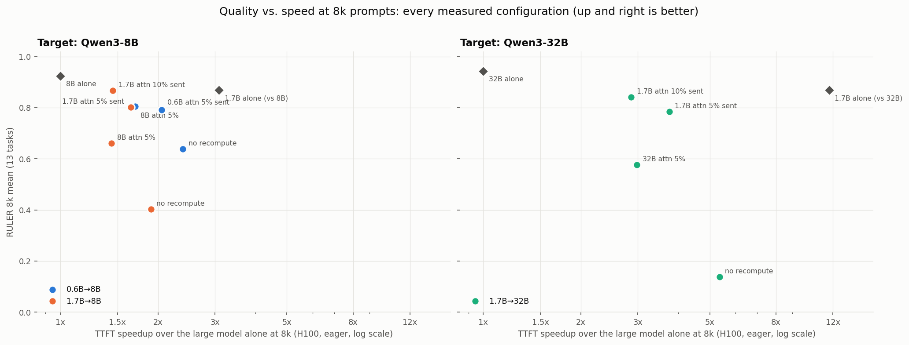
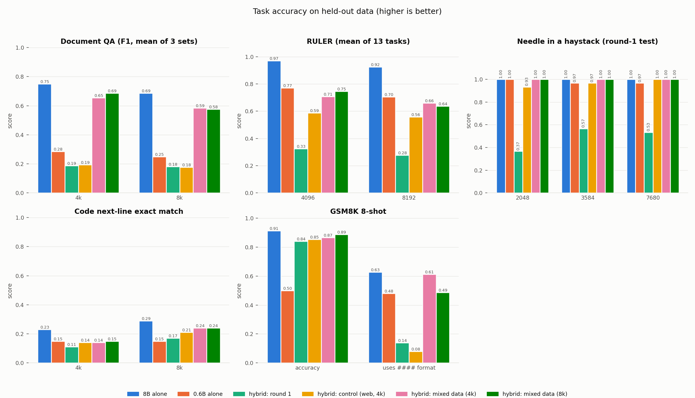
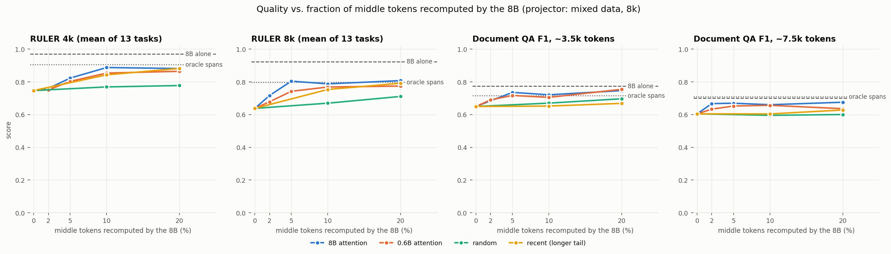
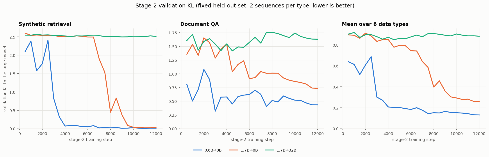

# 小模型 Prefill 大模型：阶段总结报告

2026-10-15 · Kai Sheng · 汇总 10 月 11 日至 15 日的全部实验，取代之前的三份报告（`REPORT_2026-10-12_*`、`REPORT_2026-10-13_round2.md`）

## 摘要

**目标**：用小模型读入长 prompt，再通过一个训练过的 projector 生成大模型的 KV 缓存，由大模型接着生成回答。希望在**基本不损失效果**的前提下，让首 token 延迟明显缩短。

**目前最好的结果**来自 0.6B 到 8B 这一组，配合"选择性重算"（用小模型的注意力挑出 10% 的句子，交给 8B 重新计算）：

| 指标 | 8B 单独 | 0.6B 单独 | 混合，不重算 | **混合 + 重算 10%** |
|---|---|---|---|---|
| RULER 4k / 8k | 0.970 / 0.918 | 0.771 / 0.704 | 0.736 / 0.640 | **0.897 / 0.846** |
| 问答 F1 4k / 8k | 0.772 / 0.702 | 0.285 / 0.248 | 0.645 / 0.601 | **0.720 / 0.665** |
| 大海捞针 | 100% | 97% 到 100% | 100% | **100%** |
| 首 token 加速（H100，8k） | 1 倍 | 约 4 倍 | 2.4 倍 | **约 1.8 倍** |

主要结论：

1. **训练数据是目前最有效的手段**：从纯网页换成混合数据后，问答 F1 从 0.19 升到 0.69，大海捞针从 37% 到 57% 升到 100%。
2. **选择性重算是第二有效的手段**：只让大模型重算 5% 到 10% 的 token，就补回了与 8B 差距的约 6 到 7 成；随机挑选几乎没有用，关键在于挑对位置。
3. **"接近无损"还没有做到**：最好的配置在 RULER 上仍比 8B 低约 7 个百分点，问答 F1 低约 4 到 5 个百分点。剩下的差距集中在需要汇总全文的任务（统计高频词）和在大量相似干扰项中精确抄写长字符串。
4. **换更大的模型组合，问题出在训练上，不是模型能力上**：1.7B 到 8B 不重算时反而比 0.6B 到 8B 差很多（RULER 8k 0.40 对 0.64）；1.7B 到 32B 的 projector 在 12000 步内始终没有学会检索（RULER 只有 0.14）。训练曲线显示，检索能力是在某一时刻突然学会的，模型组合越大，这个时刻越晚，32B 则一直没有出现。
5. **"小模型单独"是一个很强的对照组**：1.7B 单独在 RULER 上与最好的混合配置持平（0.89 / 0.87），而且比 8B 快 3 倍、比 32B 快 12 倍。混合方案的优势目前主要体现在文档问答和数学推理上。这一点决定了这个方法的卖点应该怎么讲（见第 4 节）。



## 1. 方法

```
① 小模型读完整个 prompt
② projector 把小模型每个位置、所有层的隐藏状态，转换成大模型每一层的输入，再经过大模型自己的 K/V 投影得到 KV 缓存
③ 开头 8 个 token 和最后 64 个 token（包含问题）始终由大模型自己计算
④（可选）选择性重算：给中间的每个 token 打分，选出得分最高的一部分，由大模型在原位置重新计算，覆盖 projector 的结果
⑤ 大模型用这份缓存开始生成回答
```

- **projector**：约 0.86 亿参数（0.6B 到 8B）。先把小模型各层做加权混合，再经过一个共享的两层网络，最后对大模型的每一层做低秩修正。两个语言模型都冻结，只训练 projector。
- **训练分两个阶段**：
  - 阶段一：让 projector 的输出在每一层上都接近大模型真实的隐藏状态，并让注意力输出也接近。
  - 阶段二：大模型先自己生成回复，再训练混合方案，使它预测这段回复时的分布接近大模型本身（KL 散度）。梯度穿过冻结的大模型回传到 projector。
- **选择性重算的打分方式**：
  - 小模型注意力：小模型读到结尾的问题时，最关注哪些位置。几乎不增加开销。
  - 大模型注意力：大模型先在 projector 的缓存上算一遍结尾，看它最关注哪些位置。需要多做一次大模型的前向。
  - 选择单位可以是单个 token、固定长度的块，或者整句。

## 2. 实验一览

| # | 日期 | 实验 | 模型组合 | 改动 | GPU 用时 | 结果目录 |
|---|---|---|---|---|---|---|
| 1 | 10-11 | 第一轮 | 0.6B 到 8B | 网页数据，阶段二 3000 步 | H100 3.6 小时 | `results/main/` |
| 2 | 10-12 | 速度优化 | 0.6B 到 8B | 精简的前向、合并的 projector、CUDA graph | H100 0.1 小时 | `results/speed_v2/` |
| 3 | 10-12 至 13 | 第二轮 | 0.6B 到 8B | 混合数据；4k 和 8k 两种长度；纯网页对照组；阶段二 12000 步 | H100 28 小时 | `results/round2/` |
| 4 | 10-13 | 选择性重算 | 0.6B 到 8B | 5 种打分方式，重算 2% 到 20% | H100 1.8 小时 | `results/recompute/` |
| 5 | 10-14 | 按块重算 | 0.6B 到 8B | 块大小 8 / 16 / 32 / 64、按句子 | L40S 3.1 小时 | `results/recompute_blocks/`、`results/recompute_speed/` |
| 6 | 10-14 | 深层交接 | 0.6B 到 8B | projector 负责前面的层，8B 自己算最后 k 层 | L40S 2.2 小时 | `results/deep_handoff/` |
| 7 | 10-14 | 换小模型 | 1.7B 到 8B | 与第二轮 8k 组的训练方法相同 | H100 7.6 小时 | `results/r3_small17/`、`results/r3_small17_v2/` |
| 8 | 10-14 至 15 | 换大模型 | 1.7B 到 32B | 同上；32B 拆在两张卡上训练 | 2 × H100 19.8 小时 | `results/r3_s17_to_32b/`、`results/r3_s17_to_32b_v2/` |

**测试集**：所有测试数据都没有参与训练。
- RULER：标准长上下文测试，13 个子任务，每个子任务 15 例。
- 文档问答：SQuAD v2、HotpotQA、TriviaQA 的验证集，拼成约 3.5k 或 7.5k token 的长 prompt，每格 50 到 100 例。
- 大海捞针：每个长度 30 例。
- GSM8K：8-shot，150 例。
- 代码下一行补全：用训练没见过的代码仓库，100 例。

**噪声**：RULER 平均分的波动约 ±0.03，单个子任务约 ±0.1；同一模型重测时单个子任务最多相差 0.13。所以小于 3 个百分点的差别不能下结论。

## 3. 各次实验的结果

### 3.1 第一轮：方案可行，但大海捞针失败，速度也不达标

0.6B 到 8B，训练数据只有网页文本（FineWeb-Edu 和 SlimPajama）。

| 指标 | 8B 单独 | 0.6B 单独 | 混合方案 |
|---|---|---|---|
| FineWeb 2k prompt 的困惑度 | 9.84 | 18.2 | 10.49 |
| 与 8B 的 KL（prompt 512 到 3584） | 0 | 0.78 到 0.84 | 0.07 到 0.14 |
| GSM8K（5-shot） | 94% | 无效\* | 90% |
| 大海捞针 | 100% | 100% | 47% 到 73% |
| 首 token 延迟，4k（HF 原生实现） | 155 ms | 35 ms | 121 ms |

\* 0.6B 在 5-shot 格式下答成了示例中的题目，这个数字无效。

- 在普通网页文本上，混合方案已经很接近 8B。
- **大海捞针是最大的问题**。诊断实验发现：只要把密码那几个 token 的 KV 换成 8B 真实的值，准确率就恢复到 100%；只修中层或只修后层也足够。错误大多是"差一位"的数字，例如 335178 答成 325178。

### 3.2 速度优化

第一轮用的是 HF 的原生实现，启动开销很大，2k 以下的 prompt 反而比 8B 慢。改写成精简的前向，把 projector 和 K/V 投影合并成一次矩阵乘法，并加上 CUDA graph 之后：

| prompt 长度 | 512 | 2k | 4k | 8k | 16k | 32k |
|---|---|---|---|---|---|---|
| 加速比（H100，CUDA graph） | 1.03 倍 | 1.92 倍 | 2.26 倍 | 2.52 倍 | 2.65 倍 | 2.71 倍 |

上限在于 0.6B 本身只比 8B 快 3.6 到 4.8 倍。小矩阵的运算效率比较低，而且 0.6B 的注意力宽度（16 头 × 128 维 = 2048）与 8B 相差不大。

### 3.3 第二轮：训练数据决定效果

三组都从第一轮阶段一的 projector 出发，阶段二各训练 12000 步：
- **对照组**：只用网页数据，prompt 最长 4k；
- **混合数据 4k**：网页 25%、长文档问答 20%、代码 15%、对话 15%、数学 10%、合成检索 15%，prompt 最长 4k；
- **混合数据 8k**：同上，另加 6000 条 4k 到 8k 的长 prompt。

| 配置 | 与 8B 的平均 KL（4k） | 问答 F1 4k / 8k | RULER 4k / 8k | 大海捞针（2k / 3.5k / 7.7k） | GSM8K | 代码精确匹配 4k / 8k |
|---|---|---|---|---|---|---|
| 8B 单独 | 0 | 0.749 / 0.686 | 0.970 / 0.924 | 100% / 100% / 100% | 0.913 | 0.23 / 0.29 |
| 0.6B 单独 | 0.621 | 0.285 / 0.248 | 0.771 / 0.704 | 100% / 97% / 97% | 0.500 | 0.15 / 0.15 |
| 第一轮 | 1.120 | 0.188 / 0.182 | 0.325 / 0.276 | 37% / 57% / 53% | 0.840 | 0.11 / 0.17 |
| 对照组（网页） | 0.930 | 0.193 / 0.176 | 0.588 / 0.557 | 93% / 97% / 100% | 0.853 | 0.14 / 0.21 |
| 混合数据 4k | 0.140 | 0.653 / 0.585 | 0.707 / 0.661 | 100% / 100% / 100% | 0.867 | 0.14 / 0.24 |
| 混合数据 8k | **0.136** | **0.686 / 0.576** | **0.747 / 0.638** | 100% / 100% / 100% | **0.887** | 0.15 / 0.24 |



- **换数据带来的提升远大于其他改动**。只用网页训练时，问答 F1 甚至低于 0.6B 单独。
- **只用网页训练会让 8B 不再遵守指令**：对照组和第一轮在问答上精确匹配是 0，但回答中包含正确答案的比例和混合数据组差不多，只是没有按要求简短作答；GSM8K 按格式作答的比例也只有 8%。混合数据中的问答和对话数据修好了这一点。
- **RULER 仍低于 0.6B 单独**，差距集中在汇总类任务（统计高频词 cwe、字频 fwe）、变量追踪和最难的多键检索。
- **8k 训练没有带来提升**：长度上限到第 6000 步左右才放开到 8k，只有约 15% 的训练步用到了 4k 以上的 prompt。
- **训练量不是瓶颈**：混合数据组的 KL 在第 8000 步后就不再下降。

### 3.4 选择性重算：挑对位置是关键

用混合数据 8k 组的 projector，不重新训练。

| 配置 | RULER 4k / 8k | 问答 F1 4k / 8k |
|---|---|---|
| 8B 单独 | 0.970 / 0.924 | 0.774 / 0.700 |
| 不重算 | 0.747 / 0.638 | 0.649 / 0.604 |
| 随机 10% / 20% | 0.769 / 0.670，0.777 / 0.711 | 0.670 / 0.595，0.697 / 0.600 |
| 最近的 token 10% / 20%（相当于加长尾部） | 0.843 / 0.753，0.882 / 0.792 | 0.652 / 0.604，0.668 / 0.628 |
| 0.6B 注意力 5% / 10% | 0.803 / 0.742，0.854 / 0.768 | 0.717 / 0.652，0.705 / 0.657 |
| 8B 注意力 2% | 0.760 / 0.716 | 0.684 / 0.667 |
| **8B 注意力 5%** | 0.823 / **0.804** | **0.735 / 0.669** |
| 8B 注意力 10% / 20% | 0.887 / 0.788，0.881 / 0.808 | 0.721 / 0.660，0.746 / 0.675 |
| 理想情况：直接重算答案所在位置（约 1% 到 9%） | 0.905 / 0.798 | 0.715 / 0.709 |



- **用注意力挑选效果明显，随机挑选几乎没用**。随机挑选对汇总类任务有帮助（这类任务需要全文每个位置都准），但会让检索类变差（大海捞针从 100% 降到 83% 到 97%），两者大部分抵消。
- **变量追踪和高频词统计改善最大**：变量追踪 8k 从 0.41 升到 1.00（重算 5%），高频词统计 4k 从 0.06 升到 0.82（重算 10%）。
- **重算 5% 到 10% 以后，效果基本不再提高**。
- **混合方案确实会增加幻觉，重算可以修好**。对问答的 300 道题做错误分类：

| 配置 | 正确 | 答了文中另一处的内容 | 答了文中没有的内容 |
|---|---|---|---|
| 8B 单独 | 81% | 14% | 5% |
| 不重算 | 68% | 20% | **11%** |
| 8B 注意力 5% | 75% | 18% | 6% |

- **新问题：只重算一部分 token，会让长字符串抄错**。不重算时，多键检索的错误是找错了位置，原样抄了另一个干扰项；重算后能找到正确位置，但抄到一半会跳到另一个相似的 uuid 上，拼出文中不存在的字符串（例如前半段来自正确答案，后半段来自干扰项）。原因是注意力只集中在答案开头附近，uuid 后半段仍是近似值。

### 3.5 按块重算：预算够时有帮助

把 prompt 切成固定长度的块，或按句子切，整块重算。L40S 上运行，参照组也在同一张卡上重跑。

| 配置 | RULER 4k / 8k | 多键检索 2、3（8k） | 汇总类（8k） | 变量追踪（4k） | 问答 F1 4k / 8k |
|---|---|---|---|---|---|
| 8B 单独 | 0.970 / 0.918 | 1.00 | 0.93 | 1.00 | 0.772 / 0.702 |
| 不重算 | 0.736 / 0.640 | 0.43 | 0.19 | 0.47 | 0.645 / 0.601 |
| 8B 注意力 5%，逐 token | 0.833 / 0.807 | 0.63 | 0.53 | 0.85 | 0.736 / 0.663 |
| 8B 注意力 5%，按句子 | 0.831 / 0.798 | 0.60 | 0.54 | 0.81 | 0.702 / 0.690 |
| 8B 注意力 10%，逐 token | 0.886 / 0.792 | 0.63 | 0.62 | 1.00 | 0.724 / 0.670 |
| 8B 注意力 10%，32 token 一块 | 0.911 / 0.836 | 0.70 | 0.63 | 0.79 | 0.735 / 0.672 |
| 8B 注意力 10%，按句子 | 0.891 / 0.841 | 0.73 | 0.60 | 1.00 | 0.730 / 0.681 |
| **0.6B 注意力 10%，按句子** | **0.897 / 0.846** | 0.70 | **0.67** | 1.00 | 0.720 / 0.665 |
| 0.6B 注意力 5%，按句子 | 0.844 / 0.791 | 0.57 | 0.55 | 0.81 | 0.693 / 0.679 |

- **重算 5% 时，按块选和逐 token 选差不多**；块越大，变量追踪越差，因为预算太少，大块能覆盖的位置太少。
- **重算 10% 时，按块或按句子选更好**：RULER 8k 从 0.79 升到约 0.84，提升主要来自多键检索。抄错拼出不存在字符串的情况从 16 例降到 9 例（共 60 例）。
- **0.6B 注意力加按句子切，效果与最好的配置持平**，打分几乎没有额外开销，是目前性价比最高的配置。

**速度**（H100，没有加 CUDA graph，相对 8B 单独）：

| 配置 | 4k | 8k | 16k | 32k |
|---|---|---|---|---|
| 不重算 | 2.10 倍 | 2.39 倍 | 2.55 倍 | 2.67 倍 |
| 随机 5% | 1.87 倍 | 2.14 倍 | 2.07 倍 | 1.95 倍 |
| 0.6B 注意力 5%，按句子 | 1.79 倍 | 2.05 倍 | 2.00 倍 | 1.91 倍 |
| 随机 10%（可以代表 0.6B 注意力 10% 的速度\*） | 1.79 倍 | 1.79 倍 | 1.65 倍 | 1.53 倍 |
| 8B 注意力 5%（逐 token 或按句子） | 1.40 倍 | 1.70 倍 | 1.76 倍 | 1.76 倍 |

\* 0.6B 注意力打分的开销只有几毫秒，所以速度和随机挑选相同比例时几乎一样。

### 3.6 深层交接：不重新训练时没有效果

想法是：projector 只负责大模型前面 36 − k 层，在第 36 − k 层把 projector 预测的隐藏状态交给 8B，由 8B 自己对全部 prompt 跑完最后 k 层。这次用的是现有的 projector，没有重新训练。

| 配置 | RULER 4k / 8k | 问答 F1 4k / 8k | 加速比（L40S，8k） |
|---|---|---|---|
| 不重算 | 0.736 / 0.640 | 0.645 / 0.601 | 3.18 倍 |
| 8B 跑最后 4 层 | 0.710 / 0.608 | 0.664 / 0.592 | 2.36 倍 |
| 8B 跑最后 8 层 | 0.696 / 0.612 | 0.649 / 0.583 | 1.94 倍 |
| 8B 跑最后 12 层 | 0.717 / 0.620 | 0.657 / 0.615 | 1.66 倍 |
| 8B 跑最后 24 层 | 0.707 / 0.671 | 0.331 / 0.272 | 1.13 倍 |
| 0.6B 注意力 10%，按句子 | 0.897 / 0.846 | 0.720 / 0.665 | 2.33 倍 |

- **在每一档速度下都不如选择性重算**。原因是：projector 训练的目标是让 K/V 准确，而不是让隐藏状态本身准确，交接处与真实隐藏状态的余弦相似度只有 0.62 到 0.81，误差在后面的层中会被放大。
- 如果要继续这个方向，需要以"8B 跑最后 k 层后的输出"为目标重新训练 projector。

### 3.7 换成 1.7B 小模型：不重算时反而更差

训练方法与第二轮混合数据 8k 组完全相同，训练数据也直接复用。

| 配置 | RULER 4k / 8k | 问答 F1 4k / 8k | 与 8B 的平均 KL（4k） | GSM8K | 代码精确匹配 4k | 加速比（H100，8k） |
|---|---|---|---|---|---|---|
| 8B 单独 | 0.970 / 0.924 | 0.774 / 0.700 | 0 | 0.913 | 0.23 | 1 倍 |
| 1.7B 单独 | 0.892 / 0.868 | 0.552 / 0.515 | 0.535 | 0.727 | 0.22 | 3.09 倍 |
| 1.7B 混合，不重算 | 0.492 / 0.403 | 0.517 / 0.474 | 0.270 | 0.847 | 0.08 | 1.90 倍 |
| 1.7B 混合，1.7B 注意力 5%，按句子 | 0.809 / 0.802 | 0.636 / 0.628 | — | — | — | 1.65 倍 |
| 1.7B 混合，1.7B 注意力 10%，按句子 | 0.892 / 0.867 | 0.704 / 0.674 | — | — | — | 1.45 倍 |
| 对比：0.6B 混合，不重算 | 0.747 / 0.638 | 0.649 / 0.604 | 0.136 | 0.887 | 0.15 | 2.39 倍 |

- **不重算时，1.7B 在每一项上都比 0.6B 差**，与 8B 的 KL 是 0.6B 的 2 倍。
- 重算 10% 后，两者效果相近，但 1.7B 更慢（1.45 倍，0.6B 约 1.8 倍）。
- **1.7B 单独就很强**：RULER 与最好的混合配置持平，速度是 8B 的 3 倍。混合方案只在问答（0.70 对 0.55）和 GSM8K（0.85 对 0.73）上更好。

### 3.8 1.7B 到 32B：projector 没有学会检索

32B 拆在两张 H100 上训练，测试在单张 H100 上进行。阶段二的训练回复沿用 8B 生成的数据，目标分布来自 32B。

| 配置 | RULER 4k / 8k | 问答包含率\* 4k / 8k | GSM8K | 代码精确匹配 4k | 加速比（H100，4k / 8k / 16k） |
|---|---|---|---|---|---|
| 32B 单独 | 0.976 / 0.943 | 0.773 / 0.733 | 0.967 | 0.28 | 1 倍 |
| 1.7B 单独 | 0.892 / 0.868 | 0.607 / 0.607 | 0.727 | 0.22 | 11.8 / 11.7 / 11.7 倍 |
| 混合，不重算 | 0.136 / 0.138 | 0.393 / 0.340 | 0.753 | 0.14 | 4.5 / 5.4 / 6.3 倍 |
| 32B 注意力 5% | 0.468 / 0.577 | 0.467 / 0.393 | — | — | 2.4 / 3.0 / 3.1 倍 |
| 32B 注意力 10%，按句子 | 0.682 / 0.706 | 0.533 / 0.427 | — | — | — |
| 1.7B 注意力 5%，按句子 | 0.761 / 0.784 | 0.567 / 0.620 | — | — | 3.4 / 3.8 / 3.8 倍 |
| **1.7B 注意力 10%，按句子** | **0.858 / 0.842** | **0.680 / 0.647** | — | — | **3.0 / 2.9 / 2.8 倍** |

\* 32B 习惯用完整的句子作答，按词计算的 F1 偏低（只有 0.64 / 0.60，比 8B 还低），所以这里改用"回答中是否包含正确答案"来比较。



- **不重算时几乎不可用**（RULER 只有 0.14）。
- **原因在训练**：上图显示，检索类数据上的验证 KL 都会在某一时刻突然下降，下降之后模型才真正学会从 prompt 中找信息。0.6B 到 8B 在约 3000 到 4000 步出现，1.7B 到 8B 推迟到约 7000 到 9500 步，**1.7B 到 32B 在 12000 步内始终没有出现**，一直停在约 2.5。问答也是同样的规律。
- **用 32B 的注意力挑 token 效果很差**，因为 projector 生成的缓存本身就不对，32B 在上面算出的注意力也找不到答案；用 1.7B 自己的注意力挑选，效果好得多。
- **速度方面，大模型越大，优势越明显**：不重算时快 4.5 到 6.3 倍，重算 10% 后仍快约 3 倍，而 0.6B 到 8B 重算后只剩约 1.8 倍。
- 但即使重算 10%，混合方案在 RULER 上仍不如 1.7B 单独（0.84 对 0.87），而 1.7B 单独快 12 倍。混合方案只在问答上更好（包含率 0.65 到 0.68 对 0.61），但离 32B 的 0.73 到 0.77 还有距离。

## 4. 现阶段的情况

**做到了的**：
- 0.6B 到 8B 加上选择性重算，在约 1.8 倍的加速下，RULER 达到 0.90 / 0.85，问答 F1 达到 0.72 / 0.67，大海捞针 100%，各项都明显好于 0.6B 单独。
- 找到了两个有效的手段：针对性的训练数据，以及用小模型自己的注意力挑选需要重算的句子。后者几乎不增加开销。
- 定位清楚了剩下的差距：一是需要全文信息的汇总类任务，误差分散在每个位置；二是在相似干扰项中精确抄写长字符串，误差集中在少数关键位置。

**没做到的**：
- **还不能称为"无损"**：与 8B 相比，RULER 差约 7 个百分点，问答差约 4 到 5 个百分点。
- **换更大的模型组合没有成功**：问题出在 projector 的训练上。小模型越强、大模型越大，projector 越难学会检索，32B 那组根本没有学会。
- **与"小模型单独"相比，优势不够稳定**：在 RULER 这类合成检索任务上，1.7B 单独已经和最好的混合配置一样好，而且快得多。混合方案目前的优势主要在文档问答和数学推理上。

**对卖点的影响**：如果要讲"小模型加速大模型、效果不降"，审稿人一定会问：在同样的速度下，为什么不直接用小模型？所以结论必须在**速度相同的条件下与小模型单独比较**，并且测试集要以真实任务为主（文档问答、推理、LongBench 等），而不只是 RULER 这类合成任务。目前在 0.6B 到 8B 这一组，0.6B 单独虽然更快（约 4 倍），但问答 F1 只有 0.29，RULER 0.77；混合方案以约 1.8 倍的加速换来了问答 0.72、RULER 0.90，质量上明显更好，这个权衡是成立的。到了 1.7B 这一级，小模型单独已经足够强，混合方案必须在问答和推理上拉开差距才有意义。

## 5. 可能的改进方向

按优先级排列。

### 5.1 让 projector 的训练在更大的模型组合上也能成功（最重要）

这是扩展到 32B 的前提，也可能直接提高 0.6B 到 8B 的效果。

1. **对小模型的隐藏状态做归一化**：训练刚开始时，1.7B 的误差是 0.6B 的约 10 倍（nmse 98 对 10），32B 那组是 59。输入的数值尺度过大，可能拖慢了收敛。可以在 projector 的输入端加一层 RMSNorm。
2. **调整训练配置**：大模型的 projector 参数是 0.6B 那组的 2 倍以上（1.83 亿对 0.86 亿），可以尝试更大的学习率、更长的阶段二，或者把检索数据放在训练前期或提高它的比例，促使检索能力更早学会。
3. **加入更密集的训练信号**：在阶段二同时加上中后层的注意力输出匹配损失。现在只在最终输出上算 KL，大部分回复 token 不依赖文档细节，信号太稀疏，这可能正是检索能力要等很久才突然学会的原因。
4. **为 32B 生成它自己的训练回复**：现在用的是 8B 生成的回复。用 vLLM 批量生成，耗时应该可以接受。

### 5.2 补充训练数据

| 现在的问题 | 对应的训练数据 |
|---|---|
| 长字符串抄错 | 逐字复述指定段落；在大量相似条目中查找某个 key 的值 |
| 多跳推理 | HotpotQA、2WikiMultihopQA、MuSiQue 的训练集；合成的变量赋值链 |
| 汇总全文 | 合成的计数、统计、"列出出现最多的词"等任务 |
| 长 prompt 训练不足 | 把 4k 以上的 prompt 提高到约 50% |

注意训练模板要与 RULER 的题型分开，避免只是学会了做测试题。另外，projector 只有约 1 亿参数，训练成本低，针对特定领域快速训练一个 projector 是这个方法的天然优势。

### 5.3 改进选择性重算

1. **让 projector 适应重算**：训练时就在前向中按注意力重算一部分 token，让 projector 学会在旁边有精确 KV 时也能前后一致。这直接针对"混在一起对不上"导致的抄错问题。
2. **混合选择**：大部分预算按注意力选句子（负责检索和多跳），小部分均匀分散在全文（负责汇总类任务）。
3. **生成时按需重算**：生成过程中，如果大模型的注意力落在了没重算过的句子上，就临时重算那一句，专门解决长字符串的抄写问题。只影响生成速度，不影响首 token 延迟。
4. **工程优化**：重算路径目前还没有加 CUDA graph，长 prompt 下的带 mask 的注意力也可以换成 FlexAttention，预计可以把重算的开销降下来。

### 5.4 改进测试

1. 加入 LongBench 等真实任务的测试集，RULER 每个子任务增加到 50 例以上。
2. 加入无答案的问题（SQuAD v2 本身就有），直接衡量"文中没有时会不会编答案"。
3. 加入"同一文档连续问多个问题"的测试。我们保留了全部 KV，不像只处理部分 token 的方法那样依赖当前的问题，这是一个可以突出的优势。
4. 问答改用对回答长度不敏感的指标（包含率，或用大模型打分），避免 32B 那样因为回答较长而被低估。
5. 加入同类方法作对照：小模型挑选 token、大模型只处理挑中部分的方法（Speculative Prefill 一类）、提示压缩（LLMLingua 一类）、稀疏注意力加速 prefill（MInference 一类）。

### 建议的下一步

1. 在 1.7B 到 8B 上验证 5.1 的第 1 到 3 项（输入归一化、调整配置、加入注意力匹配损失），看检索能力能否更早学会。这一组训练只需约 8 小时，验证成本低。
2. 有效的话，用同样的改动重训 1.7B 到 32B，并同时加入 5.2 的数据。
3. 在 0.6B 到 8B 上试验"让 projector 适应重算"和"混合选择"，争取把与 8B 的差距缩小到 1 到 2 个百分点。

## 附录

### A. 注意事项

- 第 3.5 节和第 3.6 节在 L40S 上运行，其余在 H100 上运行。同一配置在两种 GPU 上的质量结果一致（例如不重算的 RULER 4k：0.736 对 0.747），但加速比不同，L40S 上的加速比更高。所以本报告比较速度时都使用 H100 的数字。
- 没有特别说明的速度都是不加 CUDA graph 的结果；加上 CUDA graph 后，不重算的加速比会再高约 5% 到 10%。
- 第 3.5 节"0.6B 注意力 10%，按句子"的速度没有在 H100 上直接测过，用随机 10% 的速度代替。
- 32B 那组用 8B 生成的回复训练，对 32B 来说不是它自己的回复，这可能是效果差的原因之一。

### B. 文件位置

| 内容 | 位置 |
|---|---|
| 各次实验的完整表格和图 | `results/<实验>/summary.md`、`results/<实验>/figures/` |
| 原始数字 | `results/<实验>/results.json` |
| 每条测试的生成文本（第 4 到 8 次实验） | `results/<实验>/generations.jsonl` |
| 本报告的两张汇总图 | `results/summary_2026-10-15/figures/`，由 `scripts/plot_summary.py` 生成 |
| 日志 | `logs/` |
| 模型权重和 projector 检查点 | `/scratch/drjieliu_root/drjieliu/shengkai/prefillLLM/models/`、`.../checkpoints/` |
| 训练和测试的提交脚本 | `slurm/run_round2.slurm`、`slurm/run_r3_small17.slurm`、`slurm/run_r3_s17_to_32b.slurm`、`slurm/eval_*.slurm` |
