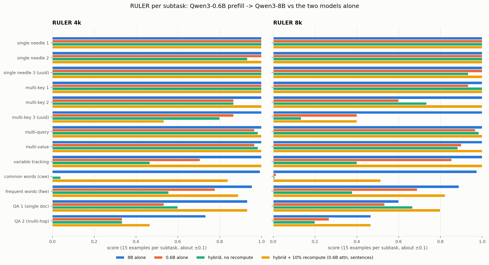

# Qwen3-0.6B prefill → Qwen3-8B：效果与差距分析

2026-10-21 · Kai Sheng · 只讨论 0.6B 到 8B 这一组。全部实验的总览见 `REPORT_2026-10-15_summary.md`

## 摘要

0.6B 读完整个 prompt，projector 把它的隐藏状态转换成 8B 的 KV 缓存，8B 接着生成回答。推荐配置是在此基础上**用 0.6B 的注意力挑出 10% 的句子交给 8B 重算**。与 8B 单独相比：

| 测试 | 8B 单独 | 推荐配置 | 达到 8B 的比例 | 不重算 | 0.6B 单独 |
|---|---|---|---|---|---|
| RULER 4k（13 个子任务平均） | 0.970 | 0.897 | 92% | 0.736 | 0.771 |
| RULER 8k | 0.918 | 0.846 | 92% | 0.640 | 0.704 |
| 文档问答 F1，约 3.5k token | 0.772 | 0.720 | 93% | 0.645 | 0.285 |
| 文档问答 F1，约 7.5k token | 0.702 | 0.665 | 95% | 0.601 | 0.248 |
| 大海捞针（2k / 3.5k / 7.7k） | 100% | 100% | 100% | 100% | 97% 到 100% |
| GSM8K（8-shot）\* | 0.907 | **0.920** | 101% | 0.860 | 0.500 |
| 代码下一行精确匹配 4k / 8k\* | 0.23 / 0.29 | 0.16 / 0.30 | 70% / 103% | 0.13 / 0.25 | 0.15 / 0.15 |
| 代码下一行相似度 4k / 8k\* | 0.613 / 0.639 | 0.613 / 0.644 | 100% / 101% | 0.542 / 0.597 | 0.578 / 0.536 |
| 首 token 加速（H100，4k / 8k / 32k） | 1 倍 | 约 1.8 / 1.8 / 1.5 倍 | — | 2.1 / 2.4 / 2.7 倍 | 约 4 倍 |

\* GSM8K 和代码补全的这几列来自 10 月 21 日在 L40S 上的补测，8B 单独和不重算也在同一次测试中重跑过；0.6B 单独来自第二轮（H100）。

结论：

1. **大部分能力已经接近 8B**：单条信息检索、多值和多查询检索、变量追踪、大海捞针、单文档问答（SQuAD、TriviaQA）、GSM8K 都与 8B 持平，代码补全的相似度也与 8B 相同。
2. **剩下的差距集中在 4 个地方**，按大小排列：
   - 统计全文高频词（cwe）：8k 时 0.51，8B 为 0.97；
   - 在大量相似干扰项中精确抄写 uuid（多键检索 3）：8k 时 0.40，8B 为 1.00；
   - 多跳问答（HotpotQA）：8k 时 0.50，8B 为 0.59；
   - 回答中编造文中没有的内容：7%，8B 为 4%。
3. **继续训练已经不起作用**：在原来 12000 步的基础上再训练 12000 步，各项结果都在噪声范围内。剩下的差距要靠改数据、改训练目标或改重算方式来解决。

## 1. 实验设置

| 项目 | 内容 |
|---|---|
| 模型 | 小模型 Qwen3-0.6B，大模型 Qwen3-8B，两者都冻结 |
| projector | 约 0.86 亿参数，逐 token 把 0.6B 各层的隐藏状态映射到 8B 每一层的输入，再经过 8B 自己的 K/V 投影 |
| 训练 | 阶段一：网页文本上做隐藏状态对齐，8000 步。阶段二：混合数据上做输出蒸馏，12000 步，prompt 最长 8k。混合数据的组成是网页 25%、长文档问答 20%、代码 15%、对话 15%、数学 10%、合成检索 15%，回复由 8B 自己生成 |
| 固定由 8B 计算的部分 | 开头 8 个 token、最后 64 个 token（包含问题） |
| 推荐配置的重算方式 | 0.6B 读到结尾的问题时，看它最关注哪些位置；以句子为单位，选出得分最高的 10% 的 token，由 8B 在原位置重新计算 |

**测试集**：所有测试数据都没有参与训练。
- RULER：标准长上下文测试，13 个子任务，每个子任务 15 例；
- 文档问答：SQuAD v2、HotpotQA、TriviaQA 的验证集，每格 50 例；
- 大海捞针：每个长度 30 例；
- GSM8K：150 例；
- 代码下一行补全：用训练没见过的代码仓库，每个长度 100 例。

**数据来源**：
- 质量结果来自同一次 L40S 上的测试（`results/recompute_blocks/`），8B 单独也在这次测试中重跑过，所以可以直接对比；
- 0.6B 单独、GSM8K、代码补全、KL 来自第二轮测试（`results/round2/`，H100）；
- 速度在 H100 上测量（`results/recompute_speed/`、`results/speed_v2/`）。

**噪声**：RULER 平均分约 ±0.03，单个子任务约 ±0.1，问答每格约 ±0.06。

## 2. 逐项对比

### 2.1 RULER



| 子任务 | 8B 单独（4k / 8k） | 0.6B 单独 | 不重算 | 重算 5%（按句子） | **重算 10%（按句子）** |
|---|---|---|---|---|---|
| 单针检索 1 / 2 / 3 | 1.00 / 1.00 | 1.00 / 1.00 | 0.93 到 1.00 | 1.00 / 1.00 | **1.00 / 1.00** |
| 多键检索 1 | 1.00 / 1.00 | 1.00 / 0.93 | 1.00 / 1.00 | 1.00 / 1.00 | **1.00 / 1.00** |
| 多键检索 2 | 1.00 / 1.00 | 0.87 / 0.60 | 0.87 / 0.73 | 1.00 / 1.00 | **1.00 / 1.00** |
| 多键检索 3（uuid） | 1.00 / 1.00 | 0.87 / 0.40 | 0.80 / 0.13 | 0.40 / 0.13 | **0.53 / 0.40** |
| 多查询检索 | 1.00 / 1.00 | 0.97 / 0.97 | 0.98 / 0.98 | 1.00 / 1.00 | **1.00 / 1.00** |
| 多值检索 | 1.00 / 1.00 | 0.97 / 0.90 | 0.98 / 0.88 | 0.97 / 0.98 | **1.00 / 1.00** |
| 变量追踪 | 1.00 / 1.00 | 0.71 / 0.85 | 0.47 / 0.40 | 0.81 / 1.00 | **1.00 / 1.00** |
| 高频词统计（cwe） | 0.99 / 0.97 | 0.00 / 0.01 | 0.04 / 0.01 | 0.72 / 0.30 | **0.84 / 0.51** |
| 字频统计（fwe） | 0.96 / 0.89 | 0.78 / 0.69 | 0.56 / 0.38 | 0.87 / 0.80 | **0.89 / 0.82** |
| 文档问答 1（单文档） | 0.93 / 0.60 | 0.53 / 0.53 | 0.60 / 0.67 | 0.73 / 0.73 | **0.93 / 0.80** |
| 文档问答 2（多跳） | 0.73 / 0.47 | 0.33 / 0.27 | 0.33 / 0.20 | 0.47 / 0.33 | **0.47 / 0.47** |
| **平均** | **0.970 / 0.918** | 0.771 / 0.704 | 0.736 / 0.640 | 0.844 / 0.791 | **0.897 / 0.846** |

- **13 个子任务中，有 9 个已经与 8B 持平**：单针检索、多键检索 1 和 2、多查询、多值、变量追踪，以及 4k 的单文档问答。
- **8k 的单文档问答（0.80 对 0.60）超过了 8B**，但只有 15 例，在噪声范围内，不能据此说比 8B 更好。
- **还有明显差距的是高频词统计、多键检索 3、多跳问答**，详见第 3 节。字频统计差 0.07，接近噪声范围。
- **多键检索 3 是唯一一个重算后反而变差的子任务**（4k 时不重算 0.80，重算 5% 只有 0.40），原因见第 3.2 节。

### 2.2 文档问答

每格 50 例。格中的数字是"F1 / 回答中包含正确答案的比例"。

| 数据集 | 8B 单独 | 不重算 | 重算 5%（按句子） | **重算 10%（按句子）** |
|---|---|---|---|---|
| SQuAD，约 3.5k | 0.87 / 0.92 | 0.76 / 0.76 | 0.85 / 0.80 | **0.87 / 0.88** |
| SQuAD，约 7.5k | 0.76 / 0.80 | 0.67 / 0.68 | 0.76 / 0.78 | **0.76 / 0.82** |
| TriviaQA，约 3.5k | 0.72 / 0.74 | 0.64 / 0.66 | 0.65 / 0.66 | **0.67 / 0.68** |
| TriviaQA，约 7.5k | 0.76 / 0.78 | 0.75 / 0.78 | 0.77 / 0.78 | **0.73 / 0.74** |
| HotpotQA，约 3.5k | 0.72 / 0.66 | 0.54 / 0.46 | 0.58 / 0.52 | **0.62 / 0.52** |
| HotpotQA，约 7.5k | 0.59 / 0.56 | 0.38 / 0.34 | 0.51 / 0.40 | **0.50 / 0.42** |

- **单文档问答（SQuAD、TriviaQA）已经与 8B 持平**，最多差 0.05，在噪声范围内。
- **多跳问答（HotpotQA）仍差 0.09 到 0.14 的 F1**。HotpotQA 需要把两篇文档中的信息联系起来，而重算只挑选了问题最关注的位置，第二跳所需的信息不一定被选中。

**错误类型**：共 300 题，回答的第一行既不含正确答案、F1 也低于 0.5 的算作错误。

| 配置 | 正确 | 答了文中另一处的内容 | 答了文中没有的内容 | 拒答 |
|---|---|---|---|---|
| 8B 单独 | 80% | 15% | 4% | 1% |
| 不重算 | 68% | 20% | **12%** | 0% |
| 重算 5%（按句子） | 74% | 18% | 7% | 0% |
| 重算 10%（按句子） | 76% | 17% | **7%** | 0% |

不重算时，回答文中没有的内容（编造）的比例是 8B 的 3 倍。重算后降到 7%，但仍比 8B 高约 3 个百分点。

### 2.3 大海捞针

在文章中插入一句"The secret passcode is 335178."，最后询问密码。所有配置在 2k、3.5k、7.7k 三个长度上都是 100%（每个长度 30 例）。第一轮只用网页数据训练时只有 37% 到 57%，这个问题在第二轮换成混合数据后就已经解决了。

### 2.4 GSM8K 和代码补全

在 L40S 上测试，8B 单独、不重算和重算配置都在同一次测试中运行；0.6B 单独来自第二轮（H100）。GSM8K 150 例，代码补全每个长度 100 例。

| 配置 | GSM8K 准确率 | 遵守 #### 格式 | 代码精确匹配 4k / 8k | 代码相似度 4k / 8k |
|---|---|---|---|---|
| 8B 单独 | 0.907 | 0.593 | 0.23 / 0.29 | 0.613 / 0.639 |
| 0.6B 单独 | 0.500 | 0.480 | 0.15 / 0.15 | 0.578 / 0.536 |
| 不重算 | 0.860 | 0.500 | 0.13 / 0.25 | 0.542 / 0.597 |
| 重算 5%（0.6B 注意力，按句子） | 0.900 | 0.707 | 0.18 / 0.32 | 0.606 / 0.648 |
| **重算 10%（0.6B 注意力，按句子）** | **0.920** | 0.693 | **0.16 / 0.30** | **0.613 / 0.644** |
| 重算 5%（8B 注意力） | 0.873 | 0.620 | 0.18 / 0.31 | 0.628 / 0.634 |

- **GSM8K 已经追平 8B**：重算 10% 时 0.920，8B 是 0.907，差别在 150 例的噪声范围内（约 ±2.5 个百分点）。不重算时是 0.860，差 4.7 个百分点。
- **代码补全基本追平**：重算后，相似度在两个长度上都与 8B 相同；8k 的精确匹配也与 8B 持平（0.30 对 0.29）。只有 4k 的精确匹配还低一些（0.16 到 0.18 对 0.23），100 例的噪声约 ±0.04，差距接近但略超出噪声范围。
- 第二轮在 H100 上测得的不重算结果（GSM8K 0.887、代码 0.15 / 0.24）与这次在 L40S 上的结果（0.860、0.13 / 0.25）略有差别，都在噪声范围内。

### 2.5 与 8B 的输出分布差距（KL）

在各类数据的留出 prompt 上，让 8B 先生成回复，再比较混合方案（不重算）预测这段回复时与 8B 的 KL。越低越接近 8B。每格 40 条。

| 数据类型 | 4k：KL / 首选 token 一致率 | 8k：KL | 0.6B 单独（4k）的 KL |
|---|---|---|---|
| 数学 | 0.021 / 97.5% | 0.012 | 0.187 |
| 检索 | 0.060 / 97.9% | 0.028 | 0.212 |
| 网页 | 0.098 / 91.6% | 0.141 | 0.421 |
| 对话 | 0.125 / 90.0% | 0.109 | 0.885 |
| 代码 | 0.145 / 92.8% | 0.160 | 0.354 |
| 文档问答 | **0.367 / 91.4%** | **0.347** | 1.669 |
| **平均** | **0.136** | **0.133** | 0.621 |

每一类都比 0.6B 单独更接近 8B，KL 只有 0.6B 单独的 1/9 到 1/2.4（代码类改善最少）。**文档问答类的 KL 最高**，约为其他类型的 2 到 3 倍，与第 2.2 节中问答仍有差距的结果一致。

### 2.6 速度

首 token 延迟，H100，相对 8B 单独的加速比：

| 配置 | 4k | 8k | 16k | 32k |
|---|---|---|---|---|
| 不重算（加 CUDA graph） | 2.26 倍 | 2.52 倍 | 2.65 倍 | 2.71 倍 |
| 不重算 | 2.10 倍 | 2.39 倍 | 2.55 倍 | 2.67 倍 |
| 重算 5%（0.6B 注意力，按句子） | 1.79 倍 | 2.05 倍 | 2.00 倍 | 1.91 倍 |
| 重算 10%（0.6B 注意力，按句子）\* | 约 1.79 倍 | 约 1.79 倍 | 约 1.65 倍 | 约 1.53 倍 |
| 重算 5%（8B 注意力） | 1.40 倍 | 1.70 倍 | 1.76 倍 | 1.76 倍 |

\* 这个配置没有在 H100 上直接测过，用"随机重算 10%"的速度代替。0.6B 注意力的打分只多花几毫秒，所以两者速度几乎一样。

- 除了第一行，其余都是不加 CUDA graph 的结果。重算的部分还没有加 CUDA graph，也还没用更高效的注意力实现，还有优化空间。
- **生成阶段的速度与 8B 完全一样**（每个 token 约 22 毫秒），因为生成仍由 8B 完成，只有 prefill 被加速。
- prompt 越长，重算的开销越大：被重算的 token 要对整个 prompt 做注意力。所以重算 10% 时，32k 下的加速比降到约 1.5 倍。

## 3. 仍有差距的地方

按与 8B 差距的大小排列。

### 3.1 统计全文高频词（cwe）：8k 时 0.51，8B 为 0.97

任务是在一长串单词中找出出现次数最多的 10 个词。看生成文本可以发现，模型通常能答对前几个词，然后开始**重复同一个词**：

```
正确答案：sunglasses, vegetation, heavy, sanctuary, collapse, algorithm, azimuth, intestine, trashy, pinpoint
重算 10% 的输出：1. intestine 2. algorithm 3. vegetation 4. trashy 5. summit 6. summit 7. summit 8. summit 9. summit 10. summit
```

- 原因：这个任务需要准确统计**全文每个位置**的词，误差分散在整个 prompt 上。重算 10% 只能修正一小部分位置，所以挑选方式再好也不能完全解决。随机重算对这个任务也有明显帮助，印证了这一点。
- 0.6B 单独在这个任务上是 0，所以 0.6B 自己的表示里也缺少这种计数信息。
- 训练数据中没有统计类的任务。

### 3.2 在相似干扰项中精确抄写 uuid（多键检索 3）：8k 时 0.40，8B 为 1.00

文中有很多形如"某个 key 对应的 uuid 是……"的句子，key 和 uuid 都很相似。按错误类型统计（多键检索 2 和 3，两个长度共 60 例）：

| 配置 | 正确 | 抄了另一个干扰项（找错位置） | 输出文中不存在的字符串（抄错） |
|---|---|---|---|
| 8B 单独 | 60 | 0 | 0 |
| 不重算 | 38 | 13 | 9 |
| 重算 5%（按句子） | 38 | 0 | 22 |
| 重算 10%（按句子） | 44 | 1 | 15 |

- **重算后，"找错位置"基本消失**，说明重算确实帮模型找到了正确的位置。
- **但"抄错"反而增多**：输出往往是前半段来自正确答案、后半段来自另一个 uuid，例如正确答案 `9ff3d397-7295-…`，输出 `9ff3d33d-4a29-4380-adc5-4709fa744ca5`。uuid 的 token 中，有的被重算成精确值，有的仍是近似值，8B 抄写时在近似的部分"跳"到了另一个相似的字符串上。按句子重算比逐 token 重算好（抄错 15 例对 16 到 22 例），但还没解决。

### 3.3 多跳问答（HotpotQA）：8k 时 F1 0.50，8B 为 0.59

需要先找到第一篇文档中的信息，再据此找第二篇。重算是根据问题本身的注意力来挑选位置的，第二跳要用的信息与问题的字面关系较弱，不容易被选中。不重算时差距更大（0.38）。

### 3.4 编造文中没有的内容：7%，8B 为 4%

见第 2.2 节。这与 3.2 节"抄错"的机制相同：近似的 KV 让模型生成了看起来合理但原文中并不存在的内容。

### 3.5 代码补全：4k 时精确匹配 0.16，8B 为 0.23（差距较小）

重算 10% 后，相似度与 8B 相同，8k 的精确匹配也与 8B 持平，只剩 4k 的精确匹配略低（100 例，接近噪声范围）。代码补全要求逐字符正确，对细节很敏感；不重算时，代码类的 KL（0.145）在各类数据中排第二。

### 3.6 为什么不能靠多训练解决

在原来 12000 步的基础上，用较低的学习率（1e-5 降到 1e-6）再训练了 12000 步（`results/r4_more_06_8/`，L40S）：

| 指标 | 12000 步 | 24000 步 |
|---|---|---|
| 不重算，RULER 4k / 8k | 0.736 / 0.640 | 0.763 / 0.663 |
| 重算 10%，RULER 4k / 8k | 0.897 / 0.846 | 0.888 / 0.847 |
| 不重算，问答 F1 4k / 8k | 0.645 / 0.601 | 0.635 / 0.611 |
| 与 8B 的平均 KL（4k / 8k） | 0.136 / 0.133 | 0.131 / 0.122 |
| GSM8K | 0.887 | 0.880 |
| 代码精确匹配 4k / 8k | 0.15 / 0.24 | 0.16 / 0.25 |

所有变化都在噪声范围内。按检查点画出的曲线显示，原来的训练在约 8000 步时就已经到顶。

需要注意一点：第一次接续训练时，学习率重新升到 5e-5，结果几百步内就破坏了已经学会的能力（检索类 KL 从 0.014 升到 0.24）。所以对已经训练好的 projector 做后续训练时，学习率必须保持在较低水平。

## 4. 原因归纳

剩下的差距可以归为两类：

| 类型 | 表现 | 对应的差距 | 有效的手段 |
|---|---|---|---|
| **分散的误差**：每个位置的 KV 都有一点偏差，需要全文信息的任务会累积出错 | 统计全文的词频，重复输出同一个词 | 3.1 | 提高 projector 本身的精度（训练数据、训练目标）；只重算一部分位置帮助有限 |
| **局部的误差**：关键位置的细节不够精确，或者精确值和近似值混在一起、前后对不上 | 抄错 uuid、编造内容、代码补全不准 | 3.2、3.4、3.5 | 更好的重算方式（重算完整的信息单元）；训练时就适应重算 |

多跳问答（3.3）两类原因都有：既需要找到第二跳的位置（挑选的问题），也需要那里的细节准确（精度的问题）。

## 5. 改进建议

按预期收益和成本排序。

1. **补充针对性的训练数据**（解决 3.1、3.2、3.3）。训练数据的改动是目前为止效果最大的手段：第二轮换数据后，问答 F1 从 0.19 升到 0.69。可以加入：
   - 计数和统计类任务，例如"某个词出现了几次"、"列出出现最多的词"；
   - 在大量相似条目中查找某个 key 的值，以及逐字复述指定的段落；
   - 多跳问答，例如 HotpotQA、2WikiMultihopQA、MuSiQue 的训练集，以及合成的变量赋值链。

   训练模板要与 RULER 的题型分开，避免只是学会了做测试题。
2. **让 projector 适应重算**（解决 3.2、3.4）：训练时就在前向中按注意力重算一部分句子，让 projector 学会在旁边有精确 KV 时也能前后一致。
3. **在阶段二加入中后层的注意力输出匹配损失**（解决 3.1 到 3.5）：现在只在最终输出上算 KL，大部分回复 token 不依赖文档细节，信号太稀疏。这个改动正在 1.7B 到 8B 上试验（job 27964135），有效的话可以直接用到 0.6B。
4. **改进重算方式**（解决 3.1、3.3）：
   - **混合选择**：大部分预算按注意力选句子，小部分均匀分散在全文，后者帮助统计类任务；
   - **两轮选择**：根据第一轮重算后 8B 的注意力，再选一次，帮助多跳问答；
   - **生成时按需重算**：生成过程中，如果 8B 的注意力落在没重算过的句子上，就临时重算那一句，专门解决抄写问题。
5. **速度优化**：重算部分加上 CUDA graph，注意力换成 FlexAttention，争取在重算 10% 时也能保持 2 倍左右的加速。
6. **补充测试**：加入 LongBench 等真实任务；RULER 每个子任务增加到 50 例以上；加入无答案的问题，直接衡量编造率。

## 附录：文件位置

| 内容 | 位置 |
|---|---|
| 质量对比（L40S，含 8B 单独） | `results/recompute_blocks/summary.md`、`results.json`、`generations.jsonl` |
| 0.6B 单独、GSM8K、代码补全、KL | `results/round2/` |
| 逐 token 重算和各种打分方式的对比 | `results/recompute/` |
| 速度 | `results/recompute_speed/`、`results/speed_v2/` |
| 继续训练 12000 步 | `results/r4_more_06_8/`、`results/r4_more_06_8_v2/` |
| 推荐配置的 GSM8K 和代码补全（L40S） | `results/r5_eval06/` |
| 本报告的图 | `results/report_06b/figures/`，由 `scripts/plot_06b_report.py` 生成 |
| projector 权重 | `/scratch/drjieliu_root/drjieliu/shengkai/prefillLLM/checkpoints/r2_mix8k/projector.pt` |
