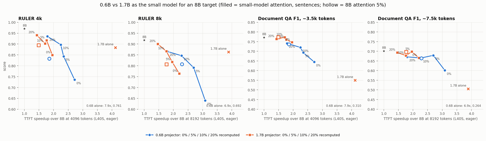

# 小模型用 0.6B 还是 1.7B（目标模型 Qwen3-8B）

2026-10-27 · Kai Sheng · 两种小模型在同一块 L40S、同一批测试题上逐项对比。与 SpecPrefill 的对比见 `REPORT_2026-10-27_specprefill.md`，0.6B 方案本身的分析见 `REPORT_2026-10-21_06B_to_8B.md`

## 摘要

小模型读完整个 prompt，projector 把它的隐藏状态转换成 8B 的 KV 缓存，再用小模型的注意力挑出一部分句子交给 8B 重算。小模型分别用 Qwen3-0.6B 和 Qwen3-1.7B：

| 配置 | RULER 4k / 8k | 问答 F1 4k / 8k | 问答编造率 | GSM8K | 首 token 加速 4k / 8k / 32k |
|---|---|---|---|---|---|
| 8B 单独 | 0.970 / 0.918 | 0.772 / 0.702 | 3.3% | 0.907 | 1 倍 |
| 0.6B，不重算 | 0.736 / 0.640 | 0.645 / 0.601 | 9.0% | 0.860 | **2.72 / 3.09 / 2.89** |
| 1.7B，不重算 | 0.849 / 0.764 | 0.746 / 0.666 | 7.3% | 0.880 | 1.96 / 2.20 / 2.21 |
| 0.6B，重算 10% | 0.897 / 0.846 | 0.720 / 0.665 | 5.3% | **0.920** | 2.25 / 2.28 / 1.85 |
| 1.7B，重算 10% | 0.902 / 0.867 | **0.773** / 0.678 | 4.7% | **0.920** | 1.71 / 1.76 / 1.54 |
| 0.6B 单独 | 0.761 / 0.692 | 0.310 / 0.264 | 10.0% | — | 7.91 / 6.86 / 4.27 |
| 1.7B 单独 | 0.884 / 0.864 | 0.550 / 0.506 | 5.7% | — | 4.12 / 3.89 / 3.14 |

结论：

1. **不重算时，1.7B 明显更好**：RULER 高 0.11 到 0.12，问答 F1 高 0.07 到 0.10。但它更慢，4k 时加速比从 2.72 倍降到 1.96 倍。
2. **重算 10% 后，差距基本消失**：RULER（0.897 / 0.846 对 0.902 / 0.867）和 GSM8K（都是 0.920）持平。只有 4k 的问答还高 0.05，主要来自多跳问答 HotpotQA。速度上，0.6B 仍然快约 30%。
3. **按相同速度比，0.6B 加更多重算与 1.7B 加更少重算效果相当**。0.6B 在 RULER 和速度的权衡上略好，1.7B 在问答上略好（第 4 节）。**目标是 8B 时，推荐用 0.6B**，它的速度范围更宽，最高可到约 3 倍，1.7B 最高只有约 2.2 倍。
4. **1.7B 单独在 RULER 上已经很强**：0.884 / 0.864，加速约 4 倍，RULER 和速度的权衡超过所有 1.7B 混合方案。混合方案的价值在问答（0.77 对 0.55）和 GSM8K 这类任务上。
5. **注意，两个 projector 的训练方法不同**：1.7B 用了输入归一化和注意力匹配损失，0.6B 没有。所以上面的差别不能完全归因于模型大小（第 1 节）。

## 1. 实验设置

| 项目 | 0.6B | 1.7B |
|---|---|---|
| projector | `r2_mix8k`（第二轮） | `r5_s17_normB`（第五轮） |
| 阶段一 | 网页文本上做隐藏状态对齐，8000 步 | 同左，另外先对小模型的隐藏状态做逐 token 的 RMS 归一化（`--in_norm`） |
| 阶段二 | 混合数据上做输出蒸馏，12000 步，prompt 最长 8k | 同左；另外在 8B 中后层加了注意力输出匹配损失（`--lambda_attn 1`） |
| 重算方式 | 小模型读到结尾的问题时，看它关注哪些位置；以句子为单位选出得分最高的 5%、10% 或 20%，由 8B 重算 | 同左 |
| 固定由 8B 计算的部分 | 开头 8 个 token、最后 64 个 token | 同左 |

**为什么两者的训练方法不同**：1.7B 用 0.6B 的训练方法时效果很差（第三轮，不重算 RULER 只有 0.492 / 0.403），加上输入归一化后才正常（第五轮）。0.6B 没有用新方法重新训练过，所以这次对比的是"两边目前最好的 projector"。不能排除 0.6B 用新方法后也会提高。

**数据来源**：
- 质量和速度都来自 `results/spec_06/` 和 `results/spec_17/`（L40S，作业 27983122）。
- 8B 注意力打分（重算 5%）和 GSM8K、代码补全来自同一次作业的 `results/cmp_06/` 和 `results/cmp_17/`。两组结果中相同的配置分数完全一致，说明测试是确定性的，可以合在一起看。
- 0.6B 的速度和大海捞针沿用了 10 月 23 日在 L40S 上那次被中断的运行。

**测试集**：
- RULER：13 个子任务，每个 15 例；
- 文档问答：SQuAD v2、HotpotQA、TriviaQA，每个来源、每个长度 50 例，共 300 题；
- 大海捞针：每个长度 30 例；
- GSM8K：150 例；
- 代码下一行补全：每个长度 100 例。

**编造率**：错误回答中，回答的内容在原文里找不到的比例，由 `scripts/analyze_qa_errors.py` 统计，口径见 SpecPrefill 报告第 1 节。

**噪声**：
- RULER 平均分约 ±0.03，单个子任务约 ±0.1；
- 问答 F1（三个来源平均）约 ±0.035，单个来源约 ±0.06；
- 编造率和 GSM8K 各约 ±2.5 个百分点。

## 2. 全部结果

实心点是用小模型的注意力挑选、按句子重算，标签是重算的比例；空心点是用 8B 的注意力挑选，重算 5%。

| 配置 | RULER 4k | RULER 8k | 问答 4k | 问答 8k | 编造率 | 加速 4k | 8k | 16k | 32k |
|---|---|---|---|---|---|---|---|---|---|
| 8B 单独 | 0.970 | 0.918 | 0.772 | 0.702 | 3.3% | 1.00 | 1.00 | 1.00 | 1.00 |
| **0.6B** 单独 | 0.761 | 0.692 | 0.310 | 0.264 | 10.0% | 7.91 | 6.86 | 5.34 | 4.27 |
| 0.6B 不重算 | 0.736 | 0.640 | 0.645 | 0.601 | 9.0% | 2.72 | 3.09 | 3.06 | 2.89 |
| 0.6B 重算 5% | 0.844 | 0.791 | 0.693 | 0.679 | 4.3% | 2.34 | 2.70 | 2.50 | 2.23 |
| 0.6B 重算 10% | 0.897 | 0.846 | 0.720 | 0.665 | 5.3% | 2.25 | 2.28 | 2.12 | 1.85 |
| 0.6B 重算 20% | 0.935 | 0.865 | 0.741 | 0.671 | 4.7% | 1.79 | 1.80 | 1.62 | 1.34 |
| 0.6B 重算 5%，8B 注意力打分 | 0.833 | 0.807 | 0.736 | 0.663 | 3.7% | 1.86 | 2.29 | 2.16 | 2.11 |
| **1.7B** 单独 | 0.884 | 0.864 | 0.550 | 0.506 | 5.7% | 4.12 | 3.89 | 3.32 | 3.14 |
| 1.7B 不重算 | 0.849 | 0.764 | 0.746 | 0.666 | 7.3% | 1.96 | 2.20 | 2.16 | 2.21 |
| 1.7B 重算 5% | 0.917 | 0.817 | 0.761 | 0.698 | 4.7% | 1.76 | 1.96 | 1.86 | 1.80 |
| 1.7B 重算 10% | 0.902 | 0.867 | 0.773 | 0.678 | 4.7% | 1.71 | 1.76 | 1.65 | 1.54 |
| 1.7B 重算 20% | 0.941 | 0.900 | 0.764 | 0.693 | 4.3% | 1.43 | 1.46 | 1.33 | 1.16 |
| 1.7B 重算 5%，8B 注意力打分 | 0.894 | 0.806 | 0.773 | 0.697 | 4.3% | 1.49 | 1.77 | 1.65 | 1.73 |

大海捞针：除 0.6B 单独在 3.5k 和 7.7k 时为 97% 外，所有配置在三个长度上都是 100%。

**GSM8K 和代码补全**（只测了不重算和重算 10%）：

| 配置 | GSM8K 准确率 | 遵守 #### 格式 | 代码精确匹配 4k / 8k | 代码相似度 4k / 8k |
|---|---|---|---|---|
| 8B 单独 | 0.907 | 0.593 | 0.23 / 0.29 | 0.613 / 0.639 |
| 0.6B 不重算 | 0.860 | 0.500 | 0.13 / 0.25 | 0.542 / 0.597 |
| 1.7B 不重算 | 0.880 | 0.627 | 0.16 / 0.28 | 0.589 / 0.601 |
| 0.6B 重算 10% | **0.920** | 0.693 | 0.16 / 0.30 | 0.613 / 0.644 |
| 1.7B 重算 10% | **0.920** | 0.727 | 0.18 / 0.29 | 0.618 / 0.641 |

不重算时，1.7B 在 GSM8K 和代码上都略好，但大多在噪声范围内。重算 10% 后两者完全持平，都与 8B 相当。

## 3. 不重算时，1.7B 好在哪里

RULER 子任务（不重算），后两列是小模型单独的结果：

| 子任务 | 8B 单独（4k / 8k） | 0.6B 不重算 | 1.7B 不重算 | 0.6B 单独 | 1.7B 单独 |
|---|---|---|---|---|---|
| 高频词统计（cwe） | 0.99 / 0.97 | 0.04 / 0.01 | **0.69 / 0.41** | 0.00 / 0.01 | 0.75 / 0.64 |
| 变量追踪 | 1.00 / 1.00 | 0.47 / 0.40 | **0.65 / 0.59** | 0.67 / 0.84 | 1.00 / 0.97 |
| 字频统计（fwe） | 0.96 / 0.89 | 0.56 / 0.38 | **0.67 / 0.58** | 0.76 / 0.69 | 0.82 / 0.73 |
| 多键检索 3（uuid） | 1.00 / 1.00 | 0.80 / 0.13 | 0.80 / **0.47** | 0.87 / 0.33 | 0.93 / 1.00 |
| 多键检索 2 | 1.00 / 1.00 | 0.87 / 0.73 | **1.00 / 1.00** | 0.87 / 0.53 | 0.87 / 0.87 |
| 单文档问答 | 0.93 / 0.60 | 0.60 / 0.67 | 0.80 / 0.67 | 0.53 / 0.53 | 0.73 / 0.60 |
| 多跳问答 | 0.73 / 0.47 | 0.33 / 0.20 | 0.47 / 0.33 | 0.27 / 0.27 | 0.40 / 0.47 |
| 平均 | 0.970 / 0.918 | 0.736 / 0.640 | 0.849 / 0.764 | 0.761 / 0.692 | 0.884 / 0.864 |

其余 6 个子任务（单针检索、多键检索 1、多查询、多值）两者都在 0.88 到 1.00 之间。

- **混合方案的能力，上限基本由小模型决定**。最明显的是高频词统计：0.6B 单独是 0，用 0.6B 的混合方案也只有 0.04；1.7B 单独是 0.75，用 1.7B 的混合方案就有 0.69。projector 只能把小模型已经算出来的信息转交给 8B，小模型自己没有的信息，它补不出来。
- **在变量追踪、高频词统计、字频统计、多键检索 3 上，混合方案都低于小模型单独**（例如 1.7B 的变量追踪：0.65 / 0.59 对 1.00 / 0.97）。所以 1.7B 不重算的 RULER 平均分（0.849 / 0.764）比 1.7B 单独（0.884 / 0.864）还低。转换后的 KV 会丢掉一部分小模型原有的信息。
- **问答类的结果恰好相反**：RULER 的两个问答子任务大多高于小模型单独，文档问答 F1 更是远高于小模型单独（1.7B：0.746 对 0.550），因为回答由 8B 生成，用的是 8B 的语言能力和知识。

## 4. 重算 10% 以后

| 指标 | 0.6B 重算 10% | 1.7B 重算 10% | 差别 |
|---|---|---|---|
| RULER 4k / 8k | 0.897 / 0.846 | 0.902 / 0.867 | +0.005 / +0.021，在噪声范围内 |
| 高频词统计 4k / 8k | 0.84 / 0.51 | 0.91 / 0.68 | 8k 时 +0.17 |
| 多键检索 3 4k / 8k | 0.53 / 0.40 | 0.53 / 0.60 | 8k 时 +0.20 |
| SQuAD F1 4k / 8k | 0.867 / 0.764 | 0.903 / 0.757 | 持平 |
| HotpotQA F1 4k / 8k | 0.619 / 0.500 | **0.715** / 0.539 | 4k 时 +0.10，追平 8B（0.724） |
| TriviaQA F1 4k / 8k | 0.673 / 0.732 | 0.700 / 0.739 | 持平 |
| 编造率 | 5.3% | 4.7% | 在噪声范围内 |
| GSM8K | 0.920 | 0.920 | 持平 |
| 加速 4k / 8k / 32k | **2.25 / 2.28 / 1.85** | 1.71 / 1.76 / 1.54 | 0.6B 快约 30% |

- 重算 10% 后，两者的 RULER 平均分、编造率、GSM8K 都持平。
- 1.7B 仍有优势的地方：
  - 8k 时的高频词统计和多键检索 3，但每个子任务只有 15 例，噪声约 ±0.1；
  - 4k 时的多跳问答（HotpotQA 0.715 对 0.619，50 例，噪声约 ±0.06）。这是最可信的一项差别。
- 多键检索 3 在两种小模型上都会因为重算变差（4k：不重算 0.80，重算 10% 后 0.53），这是部分重算导致的"拼接 uuid"问题，与小模型大小无关（见 10 月 21 日报告第 3.2 节）。

## 5. 在相同速度下比较

见第 2 节的图。选速度相近的几组：

| 速度相近的两组 | 速度 4k / 8k | RULER 4k / 8k | 问答 4k / 8k |
|---|---|---|---|
| 0.6B 重算 10% | 2.25 / 2.28 | **0.897 / 0.846** | 0.720 / 0.665 |
| 1.7B 不重算 | 1.96 / 2.20 | 0.849 / 0.764 | **0.746** / 0.666 |
| 0.6B 重算 20% | 1.79 / 1.80 | **0.935** / 0.865 | 0.741 / 0.671 |
| 1.7B 重算 10% | 1.71 / 1.76 | 0.902 / 0.867 | **0.773** / 0.678 |

- 速度相同时，**0.6B 加更多重算在 RULER 上更好或持平**，**1.7B 加更少重算在问答（特别是 4k）上略好**。
- **0.6B 能达到的速度范围更宽**：不重算时最高约 3 倍；1.7B 不重算也只有约 2.2 倍，比 0.6B 重算 10% 还慢。

**为什么 1.7B 更慢**：4k 时，1.7B 本身的 prefill 是 96 毫秒，0.6B 是 49 毫秒；"不重算"分别是 202 毫秒和 141 毫秒。两者花在 projector 和 8B 处理开头结尾上的时间差不多（约 105 和 93 毫秒），差别主要在小模型本身。4k 时，1.7B 单独的 prefill 时间是 8B 的约 1/4，0.6B 是约 1/8，所以小模型的开销对 1.7B 方案影响大得多。

**用 8B 的注意力打分没有优势**：在两种小模型上，重算 5% 时 RULER 都不比用小模型打分好（0.6B：0.833 / 0.807 对 0.844 / 0.791；1.7B：0.894 / 0.806 对 0.917 / 0.817），速度还更慢（8B 要先对转换后的 KV 做一次注意力）。它的编造率在各配置中最低（0.6B 3.7%），但与小模型打分的差距在噪声范围内。

## 6. 结论与建议

1. **目标是 8B 时，推荐用 0.6B**。重算 10% 后，0.6B 与 1.7B 的质量几乎一样，0.6B 快约 30%，速度范围也更宽。1.7B 唯一可信的优势是 4k 时的多跳问答。
2. **1.7B 更适合更大的目标模型**。目标是 32B 时，1.7B 和 32B 的参数量之比约为 1 : 19，比现在 0.6B → 8B 的约 1 : 14 还小，小模型的开销占比不再是问题，而 1.7B 更强的表示能力（第 3 节的高频词统计、变量追踪）才能体现出来。第六轮（1.7B → 32B，带输入归一化，作业 27972101，已在 10 月 23 日中止）就是为此设计的，建议重新提交。
3. **用新的训练方法重新训练 0.6B 的 projector**（输入归一化加注意力匹配损失）。这样可以：
   - 让这次对比在训练方法上公平；
   - 有可能提高 0.6B 在不重算时的质量，这是最快的那一档。
4. **1.7B 单独在 RULER 上就有 0.884 / 0.864**，加速约 4 倍。写论文时必须把"小模型单独"列为基线，并强调混合方案的价值在问答和 GSM8K 这类需要大模型能力的任务上，而不是 RULER 这类检索任务。

## 附录：文件位置

| 内容 | 位置 |
|---|---|
| 0.6B 全部配置（L40S） | `results/spec_06/summary.md`、`results.json`、`generations.jsonl`、`qa_errors.json` |
| 1.7B 全部配置（L40S） | `results/spec_17/`（同上） |
| 8B 注意力打分、GSM8K、代码补全（L40S） | `results/cmp_06/`、`results/cmp_17/` |
| 本报告的图 | `results/report_1027/figures/cmp_pareto.png`，由 `scripts/plot_report_1027.py` 生成 |
| 问答错误类型统计 | `scripts/analyze_qa_errors.py` |
| 运行脚本 | `slurm/eval_cmp_spec.slurm`（作业 27983122） |
| projector 权重 | `/scratch/drjieliu_root/drjieliu/shengkai/prefillLLM/checkpoints/r2_mix8k/projector.pt`、`.../r5_s17_normB/projector.pt` |

注意：各 `summary.md` 中速度表的标题写的是"H100"，实际是在 L40S 上测的（`scripts/eval_recompute.py` 第 328 行写死的标签）。
