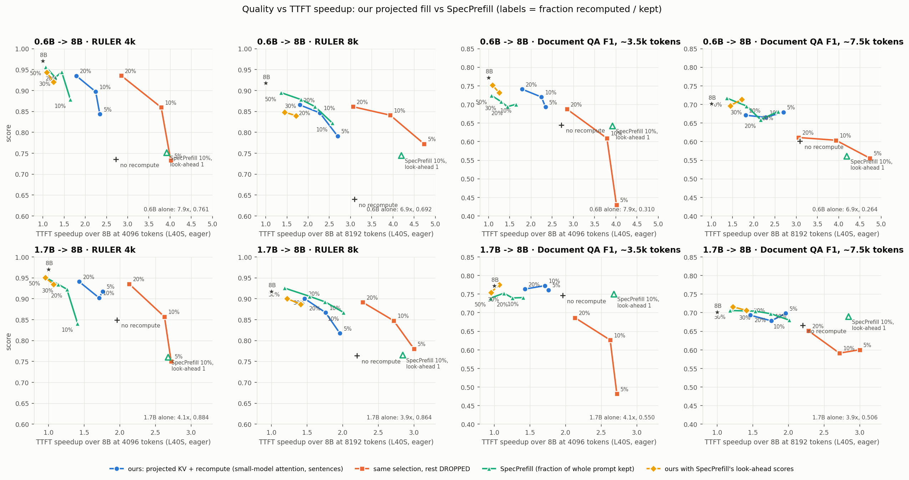
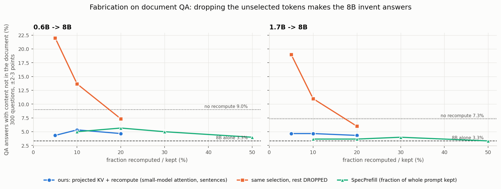

# 与 SpecPrefill 的对比（目标模型 Qwen3-8B）

2026-10-27 · Kai Sheng · 小模型分别用 0.6B 和 1.7B。0.6B 与 1.7B 之间的对比见 `REPORT_2026-10-27_06B_vs_17B.md`，0.6B 方案本身的分析见 `REPORT_2026-10-21_06B_to_8B.md`

## 摘要

SpecPrefill（ICML 2025）是与我们最接近的已发表方法：小模型读完整个 prompt，用注意力给 token 打分，**只把得分高的一部分交给大模型，其余直接丢掉**。我们的方法用同一个小模型挑选位置，但**没被选中的 token 不丢，而是由 projector 补上近似的 KV**。下面是两者在同一块 L40S、同一批测试题上的结果（0.6B → 8B）：

| 配置 | RULER 4k / 8k | 问答 F1 4k / 8k | 问答编造率 | GSM8K | 首 token 加速 4k / 8k / 16k / 32k |
|---|---|---|---|---|---|
| 8B 单独 | 0.970 / 0.918 | 0.772 / 0.702 | 3.3% | 0.907 | 1 倍 |
| **我们：重算 10%** | 0.897 / 0.846 | **0.720** / 0.665 | 5.3% | **0.920** | **2.25** / 2.28 / 2.12 / 1.85 |
| SpecPrefill 保留 10% | 0.879 / 0.822 | 0.701 / 0.681 | 5.0% | 0.847 | 1.65 / **2.57** / **3.03** / **3.04** |
| SpecPrefill 保留 20% | **0.944 / 0.862** | 0.694 / 0.659 | 5.7% | — | 1.45 / 2.16 / 2.47 / 2.44 |
| SpecPrefill 保留 30% | 0.931 / 0.878 | 0.708 / 0.696 | 5.0% | 0.867 | 1.29 / 1.83 / 2.01 / 2.02 |
| 对照：同样的选择，其余丢掉 | 0.860 / 0.841 | 0.609 / 0.604 | **13.7%** | 0.860 | 3.79 / 3.93 / 3.67 / 3.23 |

结论：

1. **按同样的速度比，我们没有全面胜过 SpecPrefill。**
   - 4k：我们更快（2.25 倍对 1.65 倍），质量也更好。但 SpecPrefill 在这个长度上的速度主要被 eager 模式下的 look-ahead 拖慢（第 6 节），换成 CUDA graph 后这个优势可能消失。
   - 8k：两者基本在同一条质量和速度的权衡曲线上。SpecPrefill 20% 的速度和我们 10% 差不多（2.16 倍对 2.28 倍），RULER 0.862 对 0.846，差距在噪声范围内。
   - 16k 以上：SpecPrefill 的加速明显更大（32k 时 3.0 倍对 1.85 倍）。这两个长度还没有测质量。
2. **明显的优势只有 GSM8K**：我们 0.920，与 8B 持平；SpecPrefill 是 0.847 到 0.867，而且几乎不按 `####` 格式作答（保留 10% 时只有 4%）。
3. **projector 的作用**：
   - 0.6B 时，它让"只看一次问题"的便宜打分方式达到了 SpecPrefill"往后看 8 步"打分的效果。SpecPrefill 只往后看 1 步时，问答 F1 只有 0.643 / 0.561，编造率 10.3%；我们同样只看一次，补上 projector 的 KV 后是 0.720 / 0.665，编造率 5.3%。1.7B 时这一点不成立：SpecPrefill 只往后看 1 步也已经很好（第 4 节）。
   - 但 SpecPrefill 正常用法（往后看 8 步）的编造率同样很低（5.0%），所以和它比，我们在编造率上没有优势。
4. **我们自己的对照组，在 RULER 上反而比我们更好**：同样用 0.6B 的注意力选句子、其余直接丢掉。保留 20% 时，RULER 0.936 / 0.861，加速 2.85 / 3.06 倍，速度和 RULER 分数都超过我们重算 10% 的方案。projector 的价值主要体现在问答、编造率和 GSM8K 上，在 RULER 上体现不出来。
5. **1.7B 作为小模型时结论相同**（第 2.2 节）。

## 1. 实验设置

| 项目 | 内容 |
|---|---|
| 模型 | 目标 Qwen3-8B；小模型 Qwen3-0.6B（projector `r2_mix8k`）或 Qwen3-1.7B（projector `r5_s17_normB`），全部冻结，不重新训练 |
| 硬件 | 一块 L40S。质量和速度都在同一次作业中测得（0.6B 的速度和大海捞针来自 10 月 23 日同一个脚本被中断的那次运行，也在 L40S 上，结果被沿用） |
| 速度测量方式 | HF eager 模式，不用 CUDA graph，首 token 延迟取 5 次平均，prompt 长度 4k / 8k / 16k / 32k |

比较的四类方法：

| 方法 | 小模型怎么打分 | 没被选中的 token | 比例的含义 |
|---|---|---|---|
| **我们** | 小模型读到结尾的问题时，看它关注哪些位置（只看一次） | 用 projector 补上 KV | 中间部分由 8B 重算的比例。开头 8 个、结尾 64 个 token 始终由 8B 计算 |
| **丢弃其余**（对照） | 与"我们"完全相同 | 丢掉 | 同上 |
| **SpecPrefill** | 按官方默认参数：小模型往后生成 8 个 token，把这些位置对 prompt 的注意力取平均；平均池化宽度 13；按 32 token 一块，取块内平均分 | 丢掉 | 整个 prompt 中保留的比例，不强制保留开头和结尾 |
| **我们 + SpecPrefill 打分** | 与 SpecPrefill 相同 | 用 projector 补上 KV | 中间部分重算的比例 |

SpecPrefill 是按 github.com/Jingyu6/speculative_prefill 的默认参数重新实现的，被保留的 token 保留原来的位置编号。

**测试集**：与 10 月 21 日的报告完全相同。
- RULER：13 个子任务，每个 15 例；
- 文档问答：SQuAD v2、HotpotQA、TriviaQA 三个来源，每个来源、每个长度各 50 例，共 300 题；
- 大海捞针：每个长度 30 例；
- GSM8K：8-shot，150 例；
- 代码下一行补全：每个长度 100 例。

**编造率**：在 300 道问答题中，回答文中没有的内容的比例。判断方法：回答的第一行不含正确答案、F1 低于 0.5 的算错；在错误回答中，如果回答的内容在原文里找不到（既不是原文的子串，也有原文中不存在的实词），就算编造。由 `scripts/analyze_qa_errors.py` 统计。这个规则判"在原文中"比 10 月 21 日报告用的规则宽一些，所以 8B 的编造率从 4% 变成 3.3%，两份报告的这个数字不能直接比较；正确率两次完全一致。

**噪声**：
- RULER 平均分约 ±0.03，单个子任务约 ±0.1；
- 问答 F1（三个来源平均）约 ±0.035；
- 编造率约 ±2.5 个百分点；
- GSM8K 约 ±2.5 个百分点；
- 代码精确匹配约 ±0.04。

## 2. 全部结果

图中越靠右上越好。横轴是相对 8B 单独的首 token 加速比，纵轴是质量。标签是重算或保留的比例。

### 2.1 0.6B → 8B

| 配置 | RULER 4k | RULER 8k | 问答 4k | 问答 8k | 编造率 | 加速 4k | 8k | 16k | 32k |
|---|---|---|---|---|---|---|---|---|---|
| 8B 单独 | 0.970 | 0.918 | 0.772 | 0.702 | 3.3% | 1.00 | 1.00 | 1.00 | 1.00 |
| 0.6B 单独 | 0.761 | 0.692 | 0.310 | 0.264 | 10.0% | 7.91 | 6.86 | 5.34 | 4.27 |
| 不重算 | 0.736 | 0.640 | 0.645 | 0.601 | 9.0% | 2.72 | 3.09 | 3.06 | 2.89 |
| **我们 5%** | 0.844 | 0.791 | 0.693 | 0.679 | 4.3% | 2.34 | 2.70 | 2.50 | 2.23 |
| **我们 10%** | 0.897 | 0.846 | 0.720 | 0.665 | 5.3% | 2.25 | 2.28 | 2.12 | 1.85 |
| **我们 20%** | 0.935 | 0.865 | 0.741 | 0.671 | 4.7% | 1.79 | 1.80 | 1.62 | 1.34 |
| 丢弃其余 5% | 0.733 | 0.772 | 0.430 | 0.556 | 22.0% | 4.02 | 4.73 | 4.13 | 3.62 |
| 丢弃其余 10% | 0.860 | 0.841 | 0.609 | 0.604 | 13.7% | 3.79 | 3.93 | 3.67 | 3.23 |
| 丢弃其余 20% | 0.936 | 0.861 | 0.687 | 0.611 | 7.3% | 2.85 | 3.06 | 2.85 | 2.57 |
| SpecPrefill 10% | 0.879 | 0.822 | 0.701 | 0.681 | 5.0% | 1.65 | 2.57 | 3.03 | 3.04 |
| SpecPrefill 20% | 0.944 | 0.862 | 0.694 | 0.659 | 5.7% | 1.45 | 2.16 | 2.47 | 2.44 |
| SpecPrefill 30% | 0.931 | 0.878 | 0.708 | 0.696 | 5.0% | 1.29 | 1.83 | 2.01 | 2.02 |
| SpecPrefill 50% | 0.956 | 0.895 | 0.724 | 0.717 | 4.0% | 1.07 | 1.36 | 1.43 | 1.45 |
| SpecPrefill 10%，只往后看 1 步 | 0.751 | 0.745 | 0.643 | 0.561 | 10.3% | 3.92 | 4.19 | 3.75 | 3.33 |
| 我们 + SpecPrefill 打分 10% | 0.920 | 0.840 | 0.732 | 0.713 | 5.3% | 1.25 | 1.72 | 1.85 | 1.77 |
| 我们 + SpecPrefill 打分 20% | 0.944 | 0.848 | 0.752 | 0.697 | 4.7% | 1.09 | 1.44 | 1.46 | 1.29 |

大海捞针：除"丢弃其余 5%"在 2k 时为 90%、0.6B 单独为 97% 外，所有配置在三个长度上都是 100%。

### 2.2 1.7B → 8B

| 配置 | RULER 4k | RULER 8k | 问答 4k | 问答 8k | 编造率 | 加速 4k | 8k | 16k | 32k |
|---|---|---|---|---|---|---|---|---|---|
| 8B 单独 | 0.970 | 0.918 | 0.772 | 0.702 | 3.3% | 1.00 | 1.00 | 1.00 | 1.00 |
| 1.7B 单独 | 0.884 | 0.864 | 0.550 | 0.506 | 5.7% | 4.12 | 3.89 | 3.32 | 3.14 |
| 不重算 | 0.849 | 0.764 | 0.746 | 0.666 | 7.3% | 1.96 | 2.20 | 2.16 | 2.21 |
| **我们 5%** | 0.917 | 0.817 | 0.761 | 0.698 | 4.7% | 1.76 | 1.96 | 1.86 | 1.80 |
| **我们 10%** | 0.902 | 0.867 | 0.773 | 0.678 | 4.7% | 1.71 | 1.76 | 1.65 | 1.54 |
| **我们 20%** | 0.941 | 0.900 | 0.764 | 0.693 | 4.3% | 1.43 | 1.46 | 1.33 | 1.16 |
| 丢弃其余 5% | 0.751 | 0.780 | 0.482 | 0.600 | 19.0% | 2.72 | 3.00 | 2.82 | 2.72 |
| 丢弃其余 10% | 0.857 | 0.847 | 0.626 | 0.591 | 11.0% | 2.63 | 2.72 | 2.58 | 2.49 |
| 丢弃其余 20% | 0.935 | 0.891 | 0.687 | 0.651 | 6.0% | 2.13 | 2.28 | 2.15 | 2.09 |
| SpecPrefill 10% | 0.841 | 0.867 | 0.741 | 0.680 | 3.7% | 1.41 | 2.01 | 2.26 | 2.41 |
| SpecPrefill 20% | 0.923 | 0.892 | 0.740 | 0.697 | 3.7% | 1.26 | 1.75 | 1.95 | 2.01 |
| SpecPrefill 30% | 0.935 | 0.906 | 0.752 | 0.704 | 4.0% | 1.13 | 1.53 | 1.64 | 1.71 |
| SpecPrefill 50% | 0.952 | 0.926 | 0.739 | 0.706 | 3.3% | 0.95 | 1.18 | 1.23 | 1.28 |
| SpecPrefill 10%，只往后看 1 步 | 0.760 | 0.765 | 0.751 | 0.690 | 4.3% | 2.67 | 2.84 | 2.65 | 2.57 |
| 我们 + SpecPrefill 打分 10% | 0.934 | 0.887 | 0.776 | 0.706 | 4.0% | 1.07 | 1.41 | 1.49 | 1.48 |
| 我们 + SpecPrefill 打分 20% | 0.951 | 0.900 | 0.754 | 0.716 | 4.0% | 0.95 | 1.22 | 1.23 | 1.13 |

大海捞针：所有配置在三个长度上都是 100%。

1.7B 本身更慢，所以所有方法的加速比都比 0.6B 低。几种方法之间的相对位置和 0.6B 时相同。

## 3. 在相同速度下比较

以 0.6B 为例，选速度最接近的几组：

| 长度 | 我们 | SpecPrefill | 谁更好 |
|---|---|---|---|
| 4k | 10%：2.25 倍，RULER 0.897，问答 0.720 | 最快的 10% 也只有 1.65 倍，RULER 0.879，问答 0.701 | 我们（eager 模式下） |
| 8k | 10%：2.28 倍，RULER 0.846，问答 0.665 | 20%：2.16 倍，RULER 0.862，问答 0.659 | 持平（差距在噪声范围内） |
| 8k | 5%：2.70 倍，RULER 0.791，问答 0.679 | 10%：2.57 倍，RULER 0.822，问答 0.681 | SpecPrefill 的 RULER 略高 |
| 16k、32k | 10%：2.12 倍、1.85 倍 | 10%：3.03 倍、3.04 倍 | SpecPrefill 快得多，但这两个长度还没测质量 |

两种方法的加速比随长度的变化方向相反：
- **SpecPrefill 越长越快**：丢掉 90% 的 token 后，8B 的计算量和注意力开销都按比例缩小；而 look-ahead 是一笔固定开销（约 135 毫秒，见第 6 节），prompt 越长占比越小。
- **我们越长越慢**：被重算的 token 要对整个 prompt 做注意力，长度越长这部分开销越大；projector 也要处理全部 token。

所以，"质量与速度的权衡"在 8k 以上更可能偏向 SpecPrefill。下一步要补 16k、32k 的质量测试，才能下结论。

## 4. projector 提供了什么：与"丢弃其余"对比

"丢弃其余"和"我们"挑选的 token 完全一样，唯一的区别是没被选中的 token 有没有 projector 补的 KV。所以这组对比能直接说明 projector 的作用。

| 指标（重算或保留 10%） | 0.6B：我们 | 0.6B：丢弃其余 | 1.7B：我们 | 1.7B：丢弃其余 |
|---|---|---|---|---|
| RULER 4k / 8k | 0.897 / 0.846 | 0.860 / 0.841 | 0.902 / 0.867 | 0.857 / 0.847 |
| 问答 F1 4k / 8k | **0.720 / 0.665** | 0.609 / 0.604 | **0.773 / 0.678** | 0.626 / 0.591 |
| 编造率 | **5.3%** | 13.7% | **4.7%** | 11.0% |
| GSM8K 准确率 / 遵守格式 | **0.920 / 0.693** | 0.860 / 0.173 | **0.920 / 0.727** | 0.853 / 0.207 |
| 代码精确匹配 4k / 8k | 0.16 / 0.30 | 0.15 / 0.27 | 0.18 / 0.29 | 0.15 / 0.28 |
| 加速 4k / 8k | 2.25 / 2.28 | **3.79 / 3.93** | 1.71 / 1.76 | **2.63 / 2.72** |

- **问答、编造率、GSM8K：projector 的作用很明显**。问答 F1 提高 0.06 到 0.15，编造率降到不到一半，GSM8K 提高 6 到 7 个百分点。丢掉其余 token 后，GSM8K 的格式遵守率从约 70% 跌到约 20%，说明模型看不全 few-shot 示例了。
- **RULER：作用很小**。4k 提高约 0.04，8k 几乎没有差别。RULER 的大部分子任务只需要找到一处信息，选中的部分已经够用。
- **代价是速度**：0.6B 时从 3.8 倍降到 2.3 倍。拆开来看，在 4k 时，"不重算"（141 毫秒）比"0.6B 单独"（49 毫秒）多出约 90 毫秒，这基本就是 projector 加上 8B 处理开头和结尾的开销，是 0.6B 本身 prefill 时间的近两倍。**projector 的计算开销是目前最大的优化对象。**
- **只看 RULER 和速度，"丢弃其余 20%"是所有方案中最好的**：0.936 / 0.861，2.85 / 3.06 倍，比我们的 10% 和 SpecPrefill 10% 都更快、RULER 更高；与 SpecPrefill 20% 的 RULER 持平，但快得多。这说明我们这种"只看一次"的打分方式本身就是一个比 SpecPrefill 更快的选择方法。不过它的问答（0.687 / 0.611）和编造率（7.3%）较差。

**与 SpecPrefill 比，编造率没有优势**：SpecPrefill 同样丢掉了其余 token，编造率却只有 5.0%（1.7B：3.7%），和我们差不多。区别在于打分方式：SpecPrefill 往后看 8 步，挑得更准。0.6B 时，如果它也只往后看 1 步，编造率就升到 10.3%，问答 F1 降到 0.643 / 0.561。所以对 0.6B 更准确的说法是：

> projector 让"只看一次"的便宜打分达到了"往后看 8 步"的效果（问答和编造率），并且在 GSM8K 上超过了两者。

但 1.7B 时，SpecPrefill 只往后看 1 步，问答已经有 0.751 / 0.690，编造率 4.3%，加速 2.67 / 2.84 倍，比我们 10%（0.773 / 0.678，4.7%，1.71 / 1.76 倍）更快，问答持平。只是 RULER 低很多（0.760 / 0.765 对 0.902 / 0.867）。也就是说，小模型越强，SpecPrefill 越不需要往后看多步，我们相对它的优势也越小。

把两者结合（我们 + SpecPrefill 打分）质量最好：0.6B 10% 时问答 0.732 / 0.713，是所有 10% 配置中最高的；1.7B 10% 时 RULER 0.934 / 0.887。但 eager 模式下的 look-ahead 太慢，只有 1.25 到 1.85 倍。

## 5. 分任务比较

### 5.1 RULER 子任务（0.6B，重算或保留 10%）

| 子任务 | 8B 单独 | 我们 | 丢弃其余 | SpecPrefill 10% | SpecPrefill 30% |
|---|---|---|---|---|---|
| 变量追踪 4k / 8k | 1.00 / 1.00 | **1.00 / 1.00** | 1.00 / 1.00 | 0.75 / 1.00 | 1.00 / 1.00 |
| 高频词统计 cwe 4k / 8k | 0.99 / 0.97 | **0.84** / 0.51 | 0.71 / 0.47 | 0.53 / 0.49 | 0.86 / 0.69 |
| 字频统计 fwe 4k / 8k | 0.96 / 0.89 | 0.89 / 0.82 | 0.84 / 0.80 | **0.93 / 0.96** | 0.98 / 0.93 |
| 多键检索 3（uuid）4k / 8k | 1.00 / 1.00 | 0.53 / 0.40 | 0.40 / 0.33 | **0.80** / 0.33 | 0.67 / 0.67 |
| 单文档问答 4k / 8k | 0.93 / 0.60 | 0.93 / 0.80 | 0.80 / 0.87 | 0.87 / 0.80 | 0.93 / 0.80 |
| 多跳问答 4k / 8k | 0.73 / 0.47 | 0.47 / 0.47 | 0.47 / 0.47 | 0.60 / 0.33 | 0.67 / 0.40 |

其余 7 个子任务（单针检索、多键检索 1 和 2、多查询、多值）在这几种配置下都是 0.92 到 1.00。

- **变量追踪和高频词统计：我们更好**。变量追踪需要沿着一串赋值链找下去，SpecPrefill 10% 在 4k 时会丢掉链中的某些环节（0.75）。高频词统计需要全文的信息，projector 补上的 KV 提供了没选中部分的信息（0.84 对 0.53）。
- **多键检索 3：SpecPrefill 更好**。在 1.7B 上差距更明显：8k 时 SpecPrefill 30% 是 1.00，我们 10% 是 0.60。这与 10 月 21 日报告的分析一致：我们的错误主要是"拼接"出的 uuid，即一部分 token 是重算的精确值，一部分是近似值，8B 抄写时在近似的部分跳到了另一个相似的 uuid 上。SpecPrefill 没有近似的 KV，所以不会出现这种拼接。
- **字频统计：SpecPrefill 更好**（0.93 / 0.96 对 0.89 / 0.82），原因还不清楚。

### 5.2 GSM8K 和代码补全

| 配置 | 0.6B：GSM8K / 遵守格式 | 1.7B：GSM8K / 遵守格式 | 0.6B：代码精确匹配 4k / 8k | 1.7B：代码精确匹配 4k / 8k |
|---|---|---|---|---|
| 8B 单独 | 0.907 / 0.593 | 0.907 / 0.593 | 0.23 / 0.29 | 0.23 / 0.29 |
| 不重算 | 0.860 / 0.500 | 0.880 / 0.627 | 0.13 / 0.25 | 0.16 / 0.28 |
| **我们 10%** | **0.920 / 0.693** | **0.920 / 0.727** | 0.16 / 0.30 | 0.18 / 0.29 |
| 丢弃其余 10% | 0.860 / 0.173 | 0.853 / 0.207 | 0.15 / 0.27 | 0.15 / 0.28 |
| SpecPrefill 10% | 0.847 / 0.040 | 0.827 / 0.020 | 0.19 / 0.28 | 0.21 / 0.28 |
| SpecPrefill 30% | 0.867 / 0.300 | 0.880 / 0.353 | 0.21 / 0.28 | 0.21 / 0.28 |

- **GSM8K：我们明显更好**，比 SpecPrefill 10% 高 7 到 9 个百分点，也比 SpecPrefill 30% 高约 4 到 5 个百分点。SpecPrefill 几乎不按 `####` 格式作答。我们的推测是，8 个示例的解题过程大部分被丢掉了，模型看不到完整的答题格式，但这次测试没有保存 GSM8K 的生成文本，无法直接验证。GSM8K 的 prompt 平均只有约 2000 token，是这次测试中最短的。
- **代码补全**：SpecPrefill 在 4k 时的精确匹配略高（0.19 到 0.21 对 0.16 到 0.18），在噪声范围内。8k 时几种方法持平。

## 6. 速度测量的公平性

这次所有方法的速度都是在 HF eager 模式下测的，没有用 CUDA graph。这对 SpecPrefill 明显不利：

- SpecPrefill 打分时，小模型要往后生成 8 个 token。eager 模式下，每一步 decode 都受 kernel 启动开销限制。比较往后看 8 步和 1 步：0.6B 时，4k 下 233 毫秒对 98 毫秒，8k 下 350 毫秒对 215 毫秒，32k 下 1659 毫秒对 1512 毫秒。**多出的 7 步固定花掉约 135 到 145 毫秒，与 prompt 长度几乎无关**，平均每步约 20 毫秒。
- 官方实现基于 vLLM，decode 用 CUDA graph，0.6B 每步只需几毫秒。粗略估计，用 CUDA graph 后 SpecPrefill 10% 在 4k 时可以从 1.65 倍提高到约 2.5 到 3 倍，接近或超过我们的 2.25 倍。这只是估计，没有实测。
- 我们的方法在 eager 模式下也有类似的开销，但比例小得多：10 月 12 日在 H100 上测过，给"不重算"加上 CUDA graph 后，4k 下的加速比只从 2.10 倍提高到 2.26 倍。

所以**在 4k 下，"我们比 SpecPrefill 快"这一点不够可靠**。要在论文中做速度对比，两边都必须用 CUDA graph（或都在 vLLM 中实现）后重新测量。

## 7. 结论与对论文的影响

1. **按 RULER 和速度来比，我们不能宣称优于 SpecPrefill**。8k 时两者基本持平，16k 以上 SpecPrefill 的速度优势很可能更大。我们自己的"丢弃其余"对照在这项上也比我们好。
2. **我们可以主张的优势**：
   - GSM8K（few-shot 推理）：0.920，与 8B 持平，SpecPrefill 是 0.85 到 0.87。
   - 需要全文信息的任务（高频词统计）和需要完整推理链的任务（变量追踪）。
   - 0.6B 时，projector 让便宜的单次打分在问答和编造率上达到往后看 8 步的效果（1.7B 时不成立）。
3. **对我们不利的点**：
   - 多键检索 3 的"拼接"错误是我们方法特有的，SpecPrefill 没有。
   - projector 的开销（4k 时约 90 毫秒）抵消了大部分速度优势。

## 8. 下一步

按重要性排序：

1. **公平的速度测量**：两种方法都加上 CUDA graph 后重测，至少覆盖 4k 到 32k。
2. **补长 prompt 的质量测试**：RULER 16k / 32k，加上 LongBench 等真实任务。SpecPrefill 的速度优势在长 prompt 上，必须知道我们在那里的质量是否更好。
3. **降低 projector 的开销**：例如只对部分层做投影、用低秩投影，或者让 projector 的计算与 8B 的重算并行。目标是接近"丢弃其余"的速度。
4. **把打分方式换成更好又便宜的**：SpecPrefill 打分加 projector 补 KV 的质量最好，问题只在 look-ahead 的速度。可以试往后看 2 到 4 步，或者用 CUDA graph 加速 look-ahead。
5. **加大样本量**：RULER 每个子任务增加到 50 例以上。现在 8k 下的大部分差距都在噪声范围内。
6. **与 RaReCache（arXiv 2610.11358）对比**：它也是"近似 KV + 部分重算"，是比 SpecPrefill 更直接的对照，还没有做。

## 附录：文件位置

| 内容 | 位置 |
|---|---|
| 0.6B 的全部结果（L40S） | `results/spec_06/summary.md`、`results.json`、`generations.jsonl`、`qa_errors.json` |
| 1.7B 的全部结果（L40S） | `results/spec_17/`（同上） |
| 本报告的图 | `results/report_1027/figures/`，由 `scripts/plot_report_1027.py` 生成 |
| 问答错误类型统计 | `scripts/analyze_qa_errors.py` |
| SpecPrefill 的实现 | `prefill/recompute.py`（`spec_importance`、`prefill_specprefill`）；测试 `tests/smoke_specprefill.py` |
| 运行脚本 | `slurm/eval_cmp_spec.slurm`（作业 27983122，2026-10-26 至 27，13.7 小时） |

注意：`summary.md` 中速度表的标题写的是"H100"，实际是在 L40S 上测的。这是 `scripts/eval_recompute.py` 第 328 行写死的标签，数字本身是 L40S 的。
