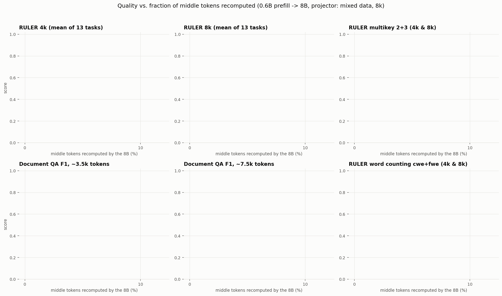

# 选择性重算实验

GPU：NVIDIA L40S；生成：2026-11-06 01:31:24；projector：混合数据 8k（第 12000 步）。小模型：0.6B，大模型：8B。开头 8 个和最后 64 个 token 始终由大模型计算；“重算比例”是中间部分由大模型重新计算的 token 占比。“丢弃其余”配置的选择方式与对应的重算配置完全相同，只是没选中的中间 token 被丢掉而不是用投影 KV 补上；SpecPrefill 是原论文方法（小模型打分，按 32 token 一块保留整段 prompt 的一部分，不强制保留开头和结尾，不用 projector），它的比例是整段 prompt 保留的比例。

## 总表

| 配置 | 实际重算比例（RULER 8k） | RULER 4k | RULER 8k | 问答 F1 4k | 问答 F1 8k | 大海捞针 |
|---|---|---|---|---|---|---|
| 0.6B 注意力 10%，按句子 | - | - | - | 0.729 | 0.659 | - |

## 问答 F1

| 配置 | squad 4k | hotpot 4k | trivia 4k | squad 8k | hotpot 8k | trivia 8k | 平均 4k | 平均 8k |
|---|---|---|---|---|---|---|---|---|
| 0.6B 注意力 10%，按句子 | 0.873 | 0.639 | 0.673 | 0.747 | 0.497 | 0.732 | 0.729 | 0.659 |
