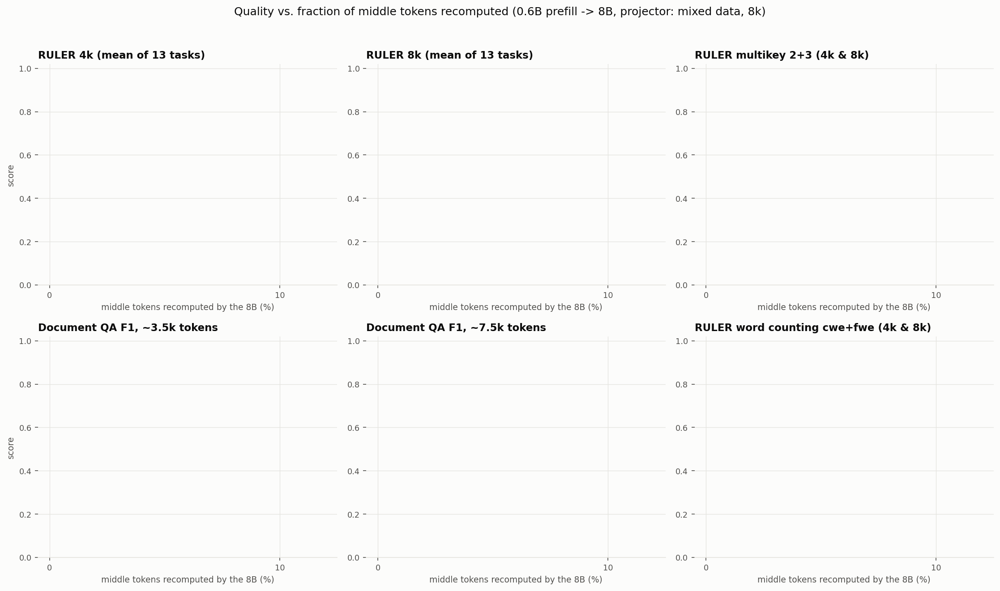

# 选择性重算实验

GPU：NVIDIA L40S；生成：2026-11-06 01:17:19；projector：混合数据 8k（第 12000 步）。小模型：0.6B，大模型：8B。开头 8 个和最后 64 个 token 始终由大模型计算；“重算比例”是中间部分由大模型重新计算的 token 占比。“丢弃其余”配置的选择方式与对应的重算配置完全相同，只是没选中的中间 token 被丢掉而不是用投影 KV 补上；SpecPrefill 是原论文方法（小模型打分，按 32 token 一块保留整段 prompt 的一部分，不强制保留开头和结尾，不用 projector），它的比例是整段 prompt 保留的比例。

## 总表

| 配置 | 实际重算比例（RULER 8k） | RULER 4k | RULER 8k | 问答 F1 4k | 问答 F1 8k | 大海捞针 |
|---|---|---|---|---|---|---|
| 混合，不重算 | - | - | - | - | - | - |
| 0.6B 注意力 10%，按句子 | - | - | - | - | - | - |

## 首 token 延迟（毫秒，L40S，所有方法都用 CUDA graph：固定形状的阶段整段回放，只有选择步骤 eager）

| 配置 | 4096 | 8192 | 16384 | 32768 |
|---|---|---|---|---|
| 8B 单独 | 392.3（1.00 倍） | 916.2（1.00 倍） | 2088.2（1.00 倍） | 5058.2（1.00 倍） |
| 0.6B 单独 | 47.9（8.18 倍） | 131.6（6.96 倍） | 399.9（5.22 倍） | 1196.4（4.23 倍） |
| 混合，不重算 | 97.7（4.01 倍） | 199.0（4.60 倍） | 513.6（4.07 倍） | 1401.1（3.61 倍） |
| 0.6B 注意力 10%，按句子 | 121.7（3.22 倍） | 281.2（3.26 倍） | 722.5（2.89 倍） | 2012.3（2.51 倍） |
| 0.6B 注意力 20%，按句子 | 159.1（2.47 倍） | 359.3（2.55 倍） | 931.1（2.24 倍） | 2550.0（1.98 倍） |
| SpecPrefill 保留整段 10% | 154.4（2.54 倍） | 307.4（2.98 倍） | 719.7（2.90 倍） | 1818.3（2.78 倍） |
| SpecPrefill 保留整段 20% | 189.0（2.08 倍） | 375.0（2.44 倍） | 877.8（2.38 倍） | 2224.1（2.27 倍） |
| SpecPrefill 保留整段 30% | 222.6（1.76 倍） | 452.1（2.03 倍） | 1088.0（1.92 倍） | 2681.7（1.89 倍） |

括号内是相对 8B 单独（同样用 CUDA graph）的加速比。graph 与 eager 的首 token logits 最大相对差（4096 token）：8B 单独 0.0e+00，0.6B 单独 0.0e+00，混合，不重算 0.0e+00，0.6B 注意力 10%，按句子 0.0e+00，0.6B 注意力 20%，按句子 0.0e+00，SpecPrefill 保留整段 10% 0.0e+00，SpecPrefill 保留整段 20% 0.0e+00，SpecPrefill 保留整段 30% 3.5e-02。

## 混合方案各阶段耗时（毫秒，L40S，eager）

每个阶段单独计时。“不重算”的首 token 时间 ≈ 小模型 prefill + projector + 开头/尾部；“重算 10%”≈ 小模型 prefill + 尾部打分 + projector + 重算调用。

| 阶段 | 4096 | 8192 | 16384 | 32768 |
|---|---|---|---|---|
| 0.6B prefill | 50.4 | 134.8 | 404.3 | 1194.2 |
| 0.6B prefill + 尾部打分 | 54.2 | 143.2 | 425.1 | 1255.1 |
| projector + KV（folded） | 19.2 | 33.4 | 67.2 | 135.3 |
| 8B 开头 + 尾部 | 35.3 | 39.0 | 46.6 | 61.7 |
| 8B 重算 10% 句子 + 开头 + 尾部 | 57.1 | 112.8 | 237.5 | 611.6 |
| 8B 单独 | 408.0 | 942.6 | 2159.4 | 5059.6 |
| 重算的 token 数 | 408 | 841 | 1644 | 3290 |
