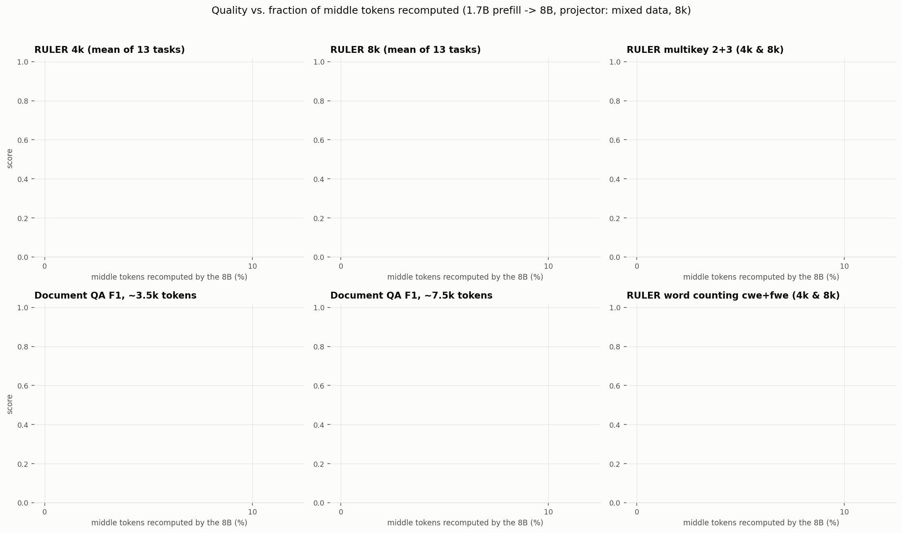

# 选择性重算实验

GPU：NVIDIA L40S；生成：2026-11-06 01:33:47；projector：混合数据 8k（第 12000 步）。小模型：1.7B，大模型：8B。开头 8 个和最后 64 个 token 始终由大模型计算；“重算比例”是中间部分由大模型重新计算的 token 占比。“丢弃其余”配置的选择方式与对应的重算配置完全相同，只是没选中的中间 token 被丢掉而不是用投影 KV 补上；SpecPrefill 是原论文方法（小模型打分，按 32 token 一块保留整段 prompt 的一部分，不强制保留开头和结尾，不用 projector），它的比例是整段 prompt 保留的比例。

## 总表

| 配置 | 实际重算比例（RULER 8k） | RULER 4k | RULER 8k | 问答 F1 4k | 问答 F1 8k | 大海捞针 |
|---|---|---|---|---|---|---|
| 混合，不重算 | - | - | - | - | - | - |
| 1.7B 注意力 10%，按句子 | - | - | - | - | - | - |

## 首 token 延迟（毫秒，L40S，所有方法都用 CUDA graph：固定形状的阶段整段回放，只有选择步骤 eager）

| 配置 | 4096 | 8192 | 16384 | 32768 |
|---|---|---|---|---|
| 8B 单独 | 403.6（1.00 倍） | 935.3（1.00 倍） | 2124.0（1.00 倍） | 5070.4（1.00 倍） |
| 1.7B 单独 | 96.0（4.20 倍） | 241.8（3.87 倍） | 642.2（3.31 倍） | 1627.1（3.12 倍） |
| 混合，不重算 | 151.0（2.67 倍） | 319.1（2.93 倍） | 777.9（2.73 倍） | 1872.4（2.71 倍） |
| 1.7B 注意力 10%，按句子 | 178.8（2.26 倍） | 403.9（2.32 倍） | 999.3（2.13 倍） | 2463.6（2.06 倍） |
| 1.7B 注意力 20%，按句子 | 216.9（1.86 倍） | 483.8（1.93 倍） | 1211.8（1.75 倍） | 3023.6（1.68 倍） |
| SpecPrefill 保留整段 10% | 225.8（1.79 倍） | 440.9（2.12 倍） | 985.1（2.16 倍） | 2276.7（2.23 倍） |
| SpecPrefill 保留整段 20% | 261.2（1.54 倍） | 512.4（1.83 倍） | 1133.8（1.87 倍） | 2681.0（1.89 倍） |
| SpecPrefill 保留整段 30% | 296.7（1.36 倍） | 590.7（1.58 倍） | 1350.5（1.57 倍） | 3131.6（1.62 倍） |

括号内是相对 8B 单独（同样用 CUDA graph）的加速比。graph 与 eager 的首 token logits 最大相对差（4096 token）：8B 单独 0.0e+00，1.7B 单独 0.0e+00，混合，不重算 0.0e+00，1.7B 注意力 10%，按句子 0.0e+00，1.7B 注意力 20%，按句子 0.0e+00，SpecPrefill 保留整段 10% 0.0e+00，SpecPrefill 保留整段 20% 6.1e-02，SpecPrefill 保留整段 30% 6.2e-02。

## 混合方案各阶段耗时（毫秒，L40S，eager）

每个阶段单独计时。“不重算”的首 token 时间 ≈ 小模型 prefill + projector + 开头/尾部；“重算 10%”≈ 小模型 prefill + 尾部打分 + projector + 重算调用。

| 阶段 | 4096 | 8192 | 16384 | 32768 |
|---|---|---|---|---|
| 1.7B prefill | 98.8 | 241.8 | 644.8 | 1640.8 |
| 1.7B prefill + 尾部打分 | 101.8 | 251.3 | 668.8 | 1697.3 |
| projector + KV（folded） | 24.6 | 41.4 | 83.7 | 169.3 |
| 8B 开头 + 尾部 | 35.2 | 39.0 | 46.6 | 61.7 |
| 8B 重算 10% 句子 + 开头 + 尾部 | 56.4 | 112.8 | 240.5 | 607.0 |
| 8B 单独 | 411.3 | 946.6 | 2159.2 | 5152.0 |
| 重算的 token 数 | 419 | 835 | 1641 | 3283 |
