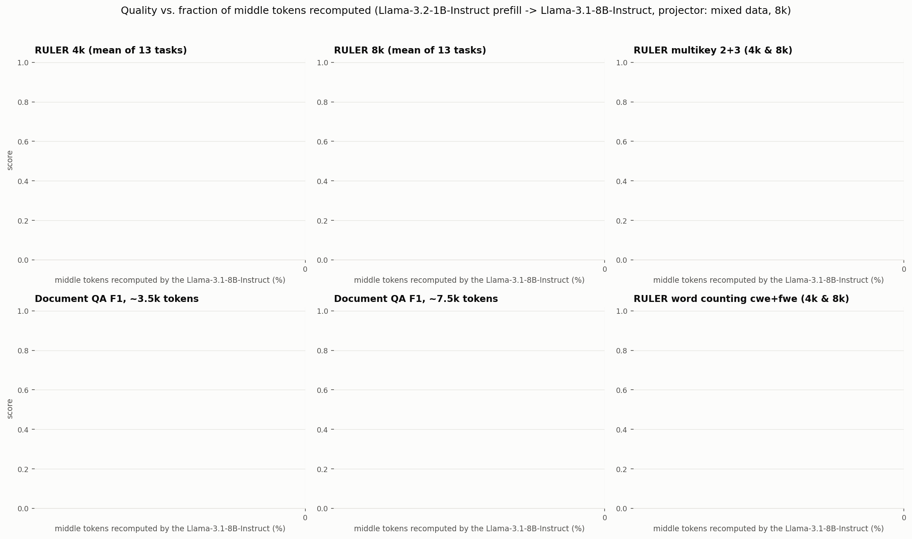

# 选择性重算实验

GPU：NVIDIA L40S；生成：2026-11-06 01:57:03；projector：混合数据 8k（第 12000 步）。小模型：Llama-3.2-1B-Instruct，大模型：Llama-3.1-8B-Instruct。开头 8 个和最后 64 个 token 始终由大模型计算；“重算比例”是中间部分由大模型重新计算的 token 占比。“丢弃其余”配置的选择方式与对应的重算配置完全相同，只是没选中的中间 token 被丢掉而不是用投影 KV 补上；SpecPrefill 是原论文方法（小模型打分，按 32 token 一块保留整段 prompt 的一部分，不强制保留开头和结尾，不用 projector），它的比例是整段 prompt 保留的比例。

## 总表

| 配置 | 实际重算比例（RULER 8k） | RULER 4k | RULER 8k | 问答 F1 4k | 问答 F1 8k | 大海捞针 |
|---|---|---|---|---|---|---|
| 混合，不重算 | - | - | - | - | - | - |

## 首 token 延迟（毫秒，L40S，所有方法都用 CUDA graph：固定形状的阶段整段回放，只有选择步骤 eager）

| 配置 | 4096 | 8192 | 16384 | 32768 |
|---|---|---|---|---|
| Llama-3.1-8B-Instruct 单独 | 376.7（1.00 倍） | 838.1（1.00 倍） | 1919.3（1.00 倍） | 4593.2（1.00 倍） |
| 混合，不重算 | 108.8（3.46 倍） | 208.0（4.03 倍） | 470.0（4.08 倍） | 1084.0（4.24 倍） |
| Llama-3.2-1B-Instruct 注意力 10%，按句子 | 142.0（2.65 倍） | 305.7（2.74 倍） | 762.9（2.52 倍） | 1973.3（2.33 倍） |
| Llama-3.2-1B-Instruct 注意力 20%，按句子 | 188.3（2.00 倍） | 412.9（2.03 倍） | 1038.4（1.85 倍） | 2931.9（1.57 倍） |

括号内是相对 Llama-3.1-8B-Instruct 单独（同样用 CUDA graph）的加速比。graph 与 eager 的首 token logits 最大相对差（4096 token）：Llama-3.1-8B-Instruct 单独 0.0e+00，混合，不重算 0.0e+00，Llama-3.2-1B-Instruct 注意力 10%，按句子 0.0e+00，Llama-3.2-1B-Instruct 注意力 20%，按句子 0.0e+00。

## 混合方案各阶段耗时（毫秒，L40S，eager）

每个阶段单独计时。“不重算”的首 token 时间 ≈ 小模型 prefill + projector + 开头/尾部；“重算 10%”≈ 小模型 prefill + 尾部打分 + projector + 重算调用。

| 阶段 | 4096 | 8192 | 16384 | 32768 |
|---|---|---|---|---|
| Llama-3.2-1B-Instruct prefill | 61.3 | 141.7 | 358.1 | 884.4 |
| Llama-3.2-1B-Instruct prefill + 尾部打分 | 65.3 | 151.1 | 384.8 | 940.0 |
| projector + KV（folded） | 18.2 | 32.6 | 65.1 | 130.3 |
| Llama-3.1-8B-Instruct 开头 + 尾部 | 34.3 | 39.5 | 50.0 | 71.0 |
| Llama-3.1-8B-Instruct 重算 10% 句子 + 开头 + 尾部 | 61.9 | 126.4 | 318.5 | 905.0 |
| Llama-3.1-8B-Instruct 单独 | 384.8 | 860.0 | 1919.3 | 4678.3 |
| 重算的 token 数 | 428 | 819 | 1636 | 3270 |
