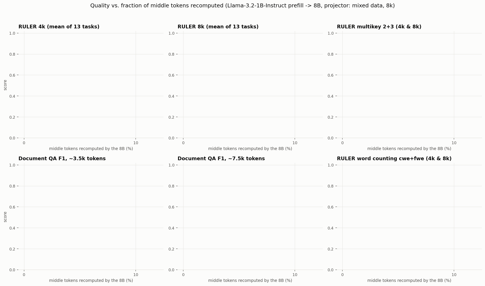

# 选择性重算实验

GPU：NVIDIA L40S；生成：2026-11-06 02:16:37；projector：混合数据 8k（第 12000 步）。小模型：Llama-3.2-1B-Instruct，大模型：8B。开头 8 个和最后 64 个 token 始终由大模型计算；“重算比例”是中间部分由大模型重新计算的 token 占比。“丢弃其余”配置的选择方式与对应的重算配置完全相同，只是没选中的中间 token 被丢掉而不是用投影 KV 补上；SpecPrefill 是原论文方法（小模型打分，按 32 token 一块保留整段 prompt 的一部分，不强制保留开头和结尾，不用 projector），它的比例是整段 prompt 保留的比例。

## 总表

| 配置 | 实际重算比例（RULER 8k） | RULER 4k | RULER 8k | 问答 F1 4k | 问答 F1 8k | 大海捞针 |
|---|---|---|---|---|---|---|
| 混合，不重算 | - | - | - | - | - | - |
| Llama-3.2-1B-Instruct 注意力 10%，按句子 | - | - | - | - | - | - |

## 首 token 延迟（毫秒，L40S，所有方法都用 CUDA graph：固定形状的阶段整段回放，只有选择步骤 eager）

| 配置 | 4096 | 8192 | 16384 | 32768 |
|---|---|---|---|---|
| 8B 单独 | 402.1（1.00 倍） | 930.1（1.00 倍） | 2092.7（1.00 倍） | 5038.5（1.00 倍） |
| 混合，不重算 | 110.1（3.65 倍） | 210.8（4.41 倍） | 471.5（4.44 倍） | 1082.1（4.66 倍） |
| Llama-3.2-1B-Instruct 注意力 10%，按句子 | 135.6（2.97 倍） | 292.0（3.19 倍） | 668.1（3.13 倍） | 1603.2（3.14 倍） |
| Llama-3.2-1B-Instruct 注意力 20%，按句子 | 175.2（2.30 倍） | 368.5（2.52 倍） | 864.0（2.42 倍） | 2129.9（2.37 倍） |
| SpecPrefill 保留整段 10% | 157.2（2.56 倍） | 292.7（3.18 倍） | 617.1（3.39 倍） | 1386.2（3.63 倍） |
| SpecPrefill 保留整段 20% | 192.7（2.09 倍） | 361.3（2.57 倍） | 772.4（2.71 倍） | 1807.2（2.79 倍） |
| SpecPrefill 保留整段 30% | 226.7（1.77 倍） | 440.6（2.11 倍） | 981.7（2.13 倍） | 2232.1（2.26 倍） |

括号内是相对 8B 单独（同样用 CUDA graph）的加速比。graph 与 eager 的首 token logits 最大相对差（4096 token）：8B 单独 0.0e+00，混合，不重算 0.0e+00，Llama-3.2-1B-Instruct 注意力 10%，按句子 0.0e+00，Llama-3.2-1B-Instruct 注意力 20%，按句子 0.0e+00，SpecPrefill 保留整段 10% 0.0e+00，SpecPrefill 保留整段 20% 0.0e+00，SpecPrefill 保留整段 30% 1.6e-02。

## 混合方案各阶段耗时（毫秒，L40S，eager）

每个阶段单独计时。“不重算”的首 token 时间 ≈ 小模型 prefill + projector + 开头/尾部；“重算 10%”≈ 小模型 prefill + 尾部打分 + projector + 重算调用。

| 阶段 | 4096 | 8192 | 16384 | 32768 |
|---|---|---|---|---|
| Llama-3.2-1B-Instruct prefill | 60.5 | 139.9 | 354.9 | 876.6 |
| Llama-3.2-1B-Instruct prefill + 尾部打分 | 63.5 | 149.1 | 381.0 | 928.3 |
| projector + KV（folded） | 19.7 | 34.7 | 70.4 | 142.7 |
| 8B 开头 + 尾部 | 35.2 | 39.0 | 46.7 | 61.6 |
| 8B 重算 10% 句子 + 开头 + 尾部 | 55.5 | 110.4 | 214.3 | 539.5 |
| 8B 单独 | 406.1 | 931.8 | 2140.1 | 5050.8 |
| 重算的 token 数 | 414 | 826 | 1637 | 3270 |
