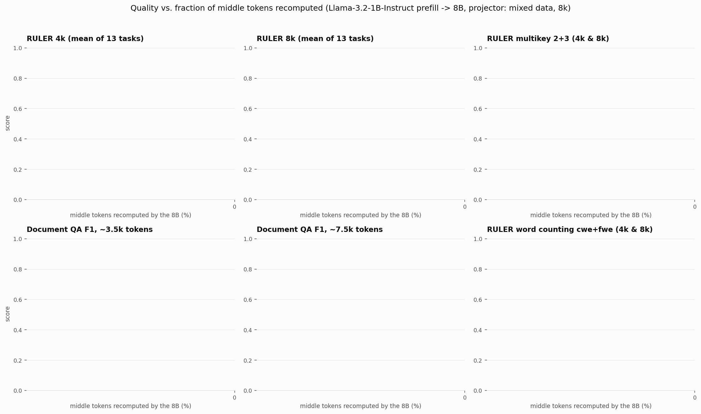

# 选择性重算实验

GPU：NVIDIA L40S；生成：2026-11-06 02:23:53；projector：混合数据 8k（第 12000 步）。小模型：Llama-3.2-1B-Instruct，大模型：8B。开头 8 个和最后 64 个 token 始终由大模型计算；“重算比例”是中间部分由大模型重新计算的 token 占比。“丢弃其余”配置的选择方式与对应的重算配置完全相同，只是没选中的中间 token 被丢掉而不是用投影 KV 补上；SpecPrefill 是原论文方法（小模型打分，按 32 token 一块保留整段 prompt 的一部分，不强制保留开头和结尾，不用 projector），它的比例是整段 prompt 保留的比例。

## 总表

| 配置 | 实际重算比例（RULER 8k） | RULER 4k | RULER 8k | 问答 F1 4k | 问答 F1 8k | 大海捞针 |
|---|---|---|---|---|---|---|
| 混合，不重算 | - | - | - | - | - | - |

## 首 token 延迟（毫秒，L40S，所有方法都用 CUDA graph：固定形状的阶段整段回放，只有选择步骤 eager）

| 配置 | 4096 | 8192 | 16384 | 32768 |
|---|---|---|---|---|
| 8B 单独 | 398.6（1.00 倍） | 923.4（1.00 倍） | 2069.5（1.00 倍） | 5039.5（1.00 倍） |
| 混合，不重算 | 113.1（3.52 倍） | 216.0（4.27 倍） | 481.2（4.30 倍） | 1099.9（4.58 倍） |
| Llama-3.2-1B-Instruct 注意力 10%，按句子 | 145.0（2.75 倍） | 324.1（2.85 倍） | 797.2（2.60 倍） | 2069.7（2.43 倍） |
| Llama-3.2-1B-Instruct 注意力 20%，按句子 | 189.9（2.10 倍） | 429.4（2.15 倍） | 1108.6（1.87 倍） | 3103.6（1.62 倍） |

括号内是相对 8B 单独（同样用 CUDA graph）的加速比。graph 与 eager 的首 token logits 最大相对差（4096 token）：8B 单独 0.0e+00，混合，不重算 0.0e+00，Llama-3.2-1B-Instruct 注意力 10%，按句子 0.0e+00，Llama-3.2-1B-Instruct 注意力 20%，按句子 0.0e+00。

## 混合方案各阶段耗时（毫秒，L40S，eager）

每个阶段单独计时。“不重算”的首 token 时间 ≈ 小模型 prefill + projector + 开头/尾部；“重算 10%”≈ 小模型 prefill + 尾部打分 + projector + 重算调用。

| 阶段 | 4096 | 8192 | 16384 | 32768 |
|---|---|---|---|---|
| Llama-3.2-1B-Instruct prefill | 60.8 | 140.0 | 360.1 | 883.3 |
| Llama-3.2-1B-Instruct prefill + 尾部打分 | 64.9 | 149.7 | 386.9 | 939.0 |
| projector + KV（folded） | 19.6 | 34.9 | 70.9 | 143.3 |
| 8B 开头 + 尾部 | 37.6 | 43.4 | 55.5 | 79.1 |
| 8B 重算 10% 句子 + 开头 + 尾部 | 64.3 | 140.6 | 344.3 | 997.9 |
| 8B 单独 | 406.8 | 935.7 | 2159.3 | 5093.4 |
| 重算的 token 数 | 414 | 826 | 1637 | 3270 |
