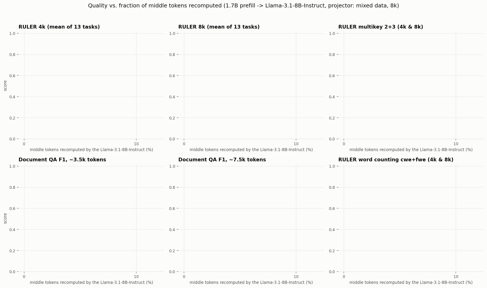

# 选择性重算实验

GPU：NVIDIA L40S；生成：2026-11-06 02:01:51；projector：混合数据 8k（第 12000 步）。小模型：1.7B，大模型：Llama-3.1-8B-Instruct。开头 8 个和最后 64 个 token 始终由大模型计算；“重算比例”是中间部分由大模型重新计算的 token 占比。“丢弃其余”配置的选择方式与对应的重算配置完全相同，只是没选中的中间 token 被丢掉而不是用投影 KV 补上；SpecPrefill 是原论文方法（小模型打分，按 32 token 一块保留整段 prompt 的一部分，不强制保留开头和结尾，不用 projector），它的比例是整段 prompt 保留的比例。

## 总表

| 配置 | 实际重算比例（RULER 8k） | RULER 4k | RULER 8k | 问答 F1 4k | 问答 F1 8k | 大海捞针 |
|---|---|---|---|---|---|---|
| 混合，不重算 | - | - | - | - | - | - |
| 1.7B 注意力 10%，按句子 | - | - | - | - | - | - |

## 首 token 延迟（毫秒，L40S，所有方法都用 CUDA graph：固定形状的阶段整段回放，只有选择步骤 eager）

| 配置 | 4096 | 8192 | 16384 | 32768 |
|---|---|---|---|---|
| Llama-3.1-8B-Instruct 单独 | 380.1（1.00 倍） | 853.2（1.00 倍） | 1919.4（1.00 倍） | 4631.0（1.00 倍） |
| 混合，不重算 | 146.7（2.59 倍） | 313.9（2.72 倍） | 764.2（2.51 倍） | 1848.5（2.51 倍） |
| 1.7B 注意力 10%，按句子 | 176.6（2.15 倍） | 392.2（2.18 倍） | 972.6（1.97 倍） | 2399.3（1.93 倍） |
| 1.7B 注意力 20%，按句子 | 212.8（1.79 倍） | 472.9（1.80 倍） | 1164.6（1.65 倍） | 2895.5（1.60 倍） |
| SpecPrefill 保留整段 10% | 225.8（1.68 倍） | 436.3（1.96 倍） | 974.1（1.97 倍） | 2237.4（2.07 倍） |
| SpecPrefill 保留整段 20% | 260.9（1.46 倍） | 503.5（1.69 倍） | 1124.7（1.71 倍） | 2605.9（1.78 倍） |
| SpecPrefill 保留整段 30% | 292.2（1.30 倍） | 578.5（1.48 倍） | 1309.9（1.47 倍） | 3003.9（1.54 倍） |

括号内是相对 Llama-3.1-8B-Instruct 单独（同样用 CUDA graph）的加速比。graph 与 eager 的首 token logits 最大相对差（4096 token）：Llama-3.1-8B-Instruct 单独 0.0e+00，混合，不重算 0.0e+00，1.7B 注意力 10%，按句子 0.0e+00，1.7B 注意力 20%，按句子 0.0e+00，SpecPrefill 保留整段 10% 0.0e+00，SpecPrefill 保留整段 20% 0.0e+00，SpecPrefill 保留整段 30% 2.8e-02。

## 混合方案各阶段耗时（毫秒，L40S，eager）

每个阶段单独计时。“不重算”的首 token 时间 ≈ 小模型 prefill + projector + 开头/尾部；“重算 10%”≈ 小模型 prefill + 尾部打分 + projector + 重算调用。

| 阶段 | 4096 | 8192 | 16384 | 32768 |
|---|---|---|---|---|
| 1.7B prefill | 98.6 | 239.7 | 637.7 | 1623.8 |
| 1.7B prefill + 尾部打分 | 101.9 | 247.7 | 660.8 | 1691.5 |
| projector + KV（folded） | 22.7 | 38.8 | 76.0 | 160.0 |
| Llama-3.1-8B-Instruct 开头 + 尾部 | 32.2 | 35.6 | 42.4 | 55.8 |
| Llama-3.1-8B-Instruct 重算 10% 句子 + 开头 + 尾部 | 54.7 | 105.5 | 223.0 | 551.1 |
| Llama-3.1-8B-Instruct 单独 | 384.4 | 854.9 | 1919.4 | 4598.3 |
| 重算的 token 数 | 402 | 827 | 1639 | 3290 |
