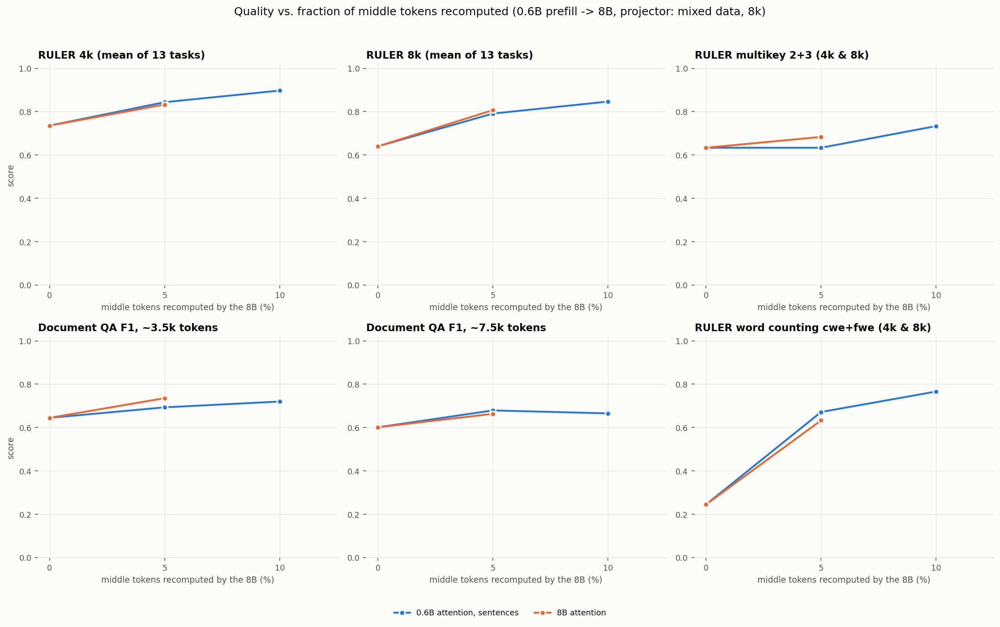

# 选择性重算实验

GPU：NVIDIA L40S；生成：2026-10-23 01:19:13；projector：混合数据 8k（第 12000 步）。小模型：0.6B，大模型：8B。开头 8 个和最后 64 个 token 始终由大模型计算；“重算比例”是中间部分由大模型重新计算的 token 占比。

## 总表

| 配置 | 实际重算比例（RULER 8k） | RULER 4k | RULER 8k | 问答 F1 4k | 问答 F1 8k | 大海捞针 |
|---|---|---|---|---|---|---|
| 混合，不重算 | 0.0% | 0.736 | 0.640 | 0.645 | 0.601 | 1.000 |
| 0.6B 注意力 5%，按句子 | 5.1% | 0.844 | 0.791 | 0.693 | 0.679 | 1.000 |
| 0.6B 注意力 10%，按句子 | 10.1% | 0.897 | 0.846 | 0.720 | 0.665 | 1.000 |
| 8B 注意力 5% | 5.0% | 0.833 | 0.807 | 0.736 | 0.663 | 1.000 |

## RULER 4096，按任务类型

| 配置 | 检索 | 汇总 | 变量追踪 | 问答 | 平均 |
|---|---|---|---|---|---|
| 混合，不重算 | 0.95 | 0.30 | 0.47 | 0.47 | 0.736 |
| 0.6B 注意力 5%，按句子 | 0.92 | 0.79 | 0.81 | 0.60 | 0.844 |
| 0.6B 注意力 10%，按句子 | 0.94 | 0.86 | 1.00 | 0.70 | 0.897 |
| 8B 注意力 5% | 0.91 | 0.74 | 0.85 | 0.60 | 0.833 |

RULER 4096 全部子任务

| 配置 | cwe | fwe | niah_multikey_1 | niah_multikey_2 | niah_multikey_3 | niah_multiquery | niah_multivalue | niah_single_1 | niah_single_2 | niah_single_3 | qa_1 | qa_2 | vt |
|---|---|---|---|---|---|---|---|---|---|---|---|---|---|
| 混合，不重算 | 0.04 | 0.56 | 1.00 | 0.87 | 0.80 | 0.98 | 0.98 | 1.00 | 0.93 | 1.00 | 0.60 | 0.33 | 0.47 |
| 0.6B 注意力 5%，按句子 | 0.72 | 0.87 | 1.00 | 1.00 | 0.40 | 1.00 | 0.97 | 1.00 | 1.00 | 1.00 | 0.73 | 0.47 | 0.81 |
| 0.6B 注意力 10%，按句子 | 0.84 | 0.89 | 1.00 | 1.00 | 0.53 | 1.00 | 1.00 | 1.00 | 1.00 | 1.00 | 0.93 | 0.47 | 1.00 |
| 8B 注意力 5% | 0.67 | 0.80 | 1.00 | 0.73 | 0.73 | 0.97 | 1.00 | 1.00 | 1.00 | 0.87 | 0.73 | 0.47 | 0.85 |

## RULER 8192，按任务类型

| 配置 | 检索 | 汇总 | 变量追踪 | 问答 | 平均 |
|---|---|---|---|---|---|
| 混合，不重算 | 0.83 | 0.19 | 0.40 | 0.43 | 0.640 |
| 0.6B 注意力 5%，按句子 | 0.89 | 0.55 | 1.00 | 0.53 | 0.791 |
| 0.6B 注意力 10%，按句子 | 0.93 | 0.67 | 1.00 | 0.63 | 0.846 |
| 8B 注意力 5% | 0.90 | 0.53 | 1.00 | 0.60 | 0.807 |

RULER 8192 全部子任务

| 配置 | cwe | fwe | niah_multikey_1 | niah_multikey_2 | niah_multikey_3 | niah_multiquery | niah_multivalue | niah_single_1 | niah_single_2 | niah_single_3 | qa_1 | qa_2 | vt |
|---|---|---|---|---|---|---|---|---|---|---|---|---|---|
| 混合，不重算 | 0.01 | 0.38 | 1.00 | 0.73 | 0.13 | 0.98 | 0.88 | 1.00 | 1.00 | 0.93 | 0.67 | 0.20 | 0.40 |
| 0.6B 注意力 5%，按句子 | 0.30 | 0.80 | 1.00 | 1.00 | 0.13 | 1.00 | 0.98 | 1.00 | 1.00 | 1.00 | 0.73 | 0.33 | 1.00 |
| 0.6B 注意力 10%，按句子 | 0.51 | 0.82 | 1.00 | 1.00 | 0.40 | 1.00 | 1.00 | 1.00 | 1.00 | 1.00 | 0.80 | 0.47 | 1.00 |
| 8B 注意力 5% | 0.35 | 0.71 | 1.00 | 0.87 | 0.40 | 1.00 | 0.97 | 1.00 | 1.00 | 1.00 | 0.80 | 0.40 | 1.00 |

## 问答 F1

| 配置 | squad 4k | hotpot 4k | trivia 4k | squad 8k | hotpot 8k | trivia 8k |
|---|---|---|---|---|---|---|
| 混合，不重算 | 0.759 | 0.537 | 0.638 | 0.671 | 0.378 | 0.754 |
| 0.6B 注意力 5%，按句子 | 0.847 | 0.579 | 0.653 | 0.761 | 0.509 | 0.767 |
| 0.6B 注意力 10%，按句子 | 0.867 | 0.619 | 0.673 | 0.764 | 0.500 | 0.732 |
| 8B 注意力 5% | 0.870 | 0.656 | 0.680 | 0.819 | 0.423 | 0.747 |

## 首 token 延迟（毫秒，H100，eager，不含 CUDA graph）

| 配置 | 4096 | 8192 | 16384 | 32768 |
|---|---|---|---|---|
| 8B 单独 | 380.0（1.00 倍） | 888.5（1.00 倍） | 2018.0（1.00 倍） | 5018.8（1.00 倍） |
| 0.6B 单独 | 48.7（7.81 倍） | 130.6（6.80 倍） | 394.0（5.12 倍） | 1144.1（4.39 倍） |
| 混合，不重算 | 141.8（2.68 倍） | 290.5（3.06 倍） | 688.0（2.93 倍） | 1715.5（2.93 倍） |
| 0.6B 注意力 5%，按句子 | 164.6（2.31 倍） | 332.1（2.68 倍） | 839.9（2.40 倍） | 2217.8（2.26 倍） |
| 0.6B 注意力 10%，按句子 | 170.7（2.23 倍） | 395.7（2.25 倍） | 988.9（2.04 倍） | 2683.8（1.87 倍） |
| 8B 注意力 5% | 204.8（1.86 倍） | 387.9（2.29 倍） | 936.3（2.16 倍） | 2383.4（2.11 倍） |

括号内是相对 8B 单独的加速比。
