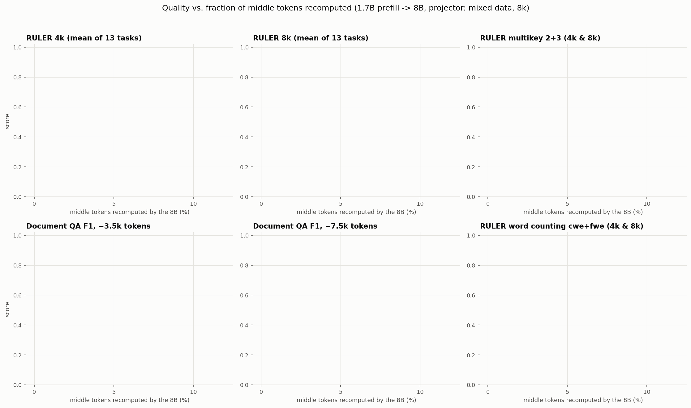
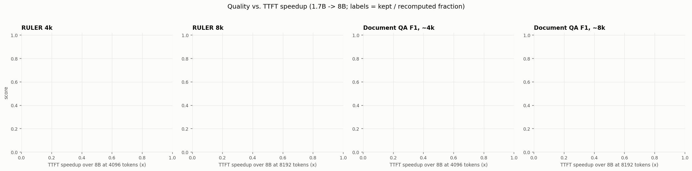

# 选择性重算实验

GPU：NVIDIA L40S；生成：2026-10-23 02:09:47；projector：混合数据 8k（第 12000 步）。小模型：1.7B，大模型：8B。开头 8 个和最后 64 个 token 始终由大模型计算；“重算比例”是中间部分由大模型重新计算的 token 占比。“丢弃其余”配置的选择方式与对应的重算配置完全相同，只是没选中的中间 token 被丢掉而不是用投影 KV 补上；SpecPrefill 是原论文方法（小模型打分，按 32 token 一块保留整段 prompt 的一部分，不强制保留开头和结尾，不用 projector），它的比例是整段 prompt 保留的比例。

## 总表

| 配置 | 实际重算比例（RULER 8k） | RULER 4k | RULER 8k | 问答 F1 4k | 问答 F1 8k | 大海捞针 |
|---|---|---|---|---|---|---|
| 混合，不重算 | - | - | - | - | - | - |
| 1.7B 注意力 5%，按句子 | - | - | - | - | - | - |
| 1.7B 注意力 10%，按句子 | - | - | - | - | - | - |
| 8B 注意力 5% | - | - | - | - | - | - |

## 首 token 延迟（毫秒，H100，eager，不含 CUDA graph）

| 配置 | 4096 | 8192 | 16384 | 32768 |
|---|---|---|---|---|
| 8B 单独 | 396.0（1.00 倍） | 920.2（1.00 倍） | 2028.1（1.00 倍） | 5038.3（1.00 倍） |
| 1.7B 单独 | 95.8（4.13 倍） | 238.2（3.86 倍） | 625.6（3.24 倍） | 1571.6（3.21 倍） |
| 混合，不重算 | 201.8（1.96 倍） | 424.5（2.17 倍） | 973.3（2.08 倍） | 2246.2（2.24 倍） |
| 1.7B 注意力 5%，按句子 | 225.8（1.75 倍） | 475.7（1.93 倍） | 1128.7（1.80 倍） | 2766.9（1.82 倍） |
| 1.7B 注意力 10%，按句子 | 231.0（1.71 倍） | 529.8（1.74 倍） | 1282.0（1.58 倍） | 3239.7（1.56 倍） |
| 8B 注意力 5% | 265.3（1.49 倍） | 520.5（1.77 倍） | 1226.0（1.65 倍） | 2909.8（1.73 倍） |

括号内是相对 8B 单独的加速比。
