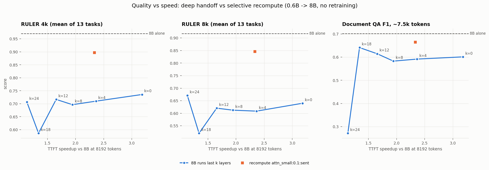
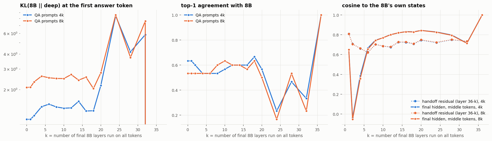

# 深层交接实验：小模型投影前面的层，大模型自己跑最后 k 层

GPU：NVIDIA L40S；生成：2026-10-14 15:53:06；projector：混合数据 8k（第 12000 步，未重新训练）。小模型：0.6B，大模型：8B（36 层）。开头 8 个和最后 64 个 token 始终由大模型完整计算。

“8B 跑最后 k 层”：中间 token 在前 36-k 层用 projector 预测的 KV；在第 36-k 层把 projector 预测的残差流交给 8B，由 8B 对全部 prompt token 跑完最后 k 层（深层 KV 是大模型自己算的）。k=0 就是原来的混合方案，k=36 就是 8B 单独。

## 总表

| 配置 | RULER 4k | RULER 8k | 问答 F1 4k | 问答 F1 8k | 大海捞针 | 加速 4k | 加速 8k | 加速 16k | 加速 32k |
|---|---|---|---|---|---|---|---|---|---|
| 8B 单独 | 0.970 | 0.918 | 0.772 | 0.702 | 1.000 | 1.00× | 1.00× | 1.00× | 1.00× |
| 混合，不重算 | 0.736 | 0.640 | 0.645 | 0.601 | 1.000 | 2.89× | 3.18× | 3.08× | 2.92× |
| 8B 跑最后 4 层（投影前 32 层） | 0.710 | 0.608 | 0.664 | 0.592 | 1.000 | 2.24× | 2.36× | 2.32× | 2.23× |
| 8B 跑最后 8 层（投影前 28 层） | 0.696 | 0.612 | 0.649 | 0.583 | 1.000 | 1.88× | 1.94× | 1.90× | 1.83× |
| 8B 跑最后 12 层（投影前 24 层） | 0.717 | 0.620 | 0.657 | 0.615 | 1.000 | 1.62× | 1.66× | 1.61× | 1.54× |
| 8B 跑最后 18 层（投影前 18 层） | 0.586 | 0.520 | 0.665 | 0.641 | 0.989 | 1.34× | 1.34× | 1.30× | 1.25× |
| 8B 跑最后 24 层（投影前 12 层） | 0.707 | 0.671 | 0.331 | 0.272 | 0.989 | 1.14× | 1.13× | 1.09× | 1.06× |
| 0.6B 注意力 10%，按句子 | 0.897 | 0.846 | 0.720 | 0.665 | 1.000 | 2.36× | 2.33× | 2.13× | 1.88× |

加速比是相对 8B 单独的首 token 延迟（NVIDIA L40S，eager，不含 CUDA graph）。

## RULER 4096，按任务类型

| 配置 | 检索 | 汇总 | 变量追踪 | 问答 | 平均 |
|---|---|---|---|---|---|
| 8B 单独 | 1.00 | 0.97 | 1.00 | 0.83 | 0.970 |
| 混合，不重算 | 0.95 | 0.30 | 0.47 | 0.47 | 0.736 |
| 8B 跑最后 4 层（投影前 32 层） | 0.94 | 0.14 | 0.44 | 0.50 | 0.710 |
| 8B 跑最后 8 层（投影前 28 层） | 0.93 | 0.25 | 0.16 | 0.47 | 0.696 |
| 8B 跑最后 12 层（投影前 24 层） | 0.95 | 0.28 | 0.08 | 0.53 | 0.717 |
| 8B 跑最后 18 层（投影前 18 层） | 0.68 | 0.44 | 0.20 | 0.57 | 0.586 |
| 8B 跑最后 24 层（投影前 12 层） | 0.75 | 0.76 | 0.71 | 0.50 | 0.707 |
| 0.6B 注意力 10%，按句子 | 0.94 | 0.86 | 1.00 | 0.70 | 0.897 |

RULER 4096 全部子任务

| 配置 | cwe | fwe | niah_multikey_1 | niah_multikey_2 | niah_multikey_3 | niah_multiquery | niah_multivalue | niah_single_1 | niah_single_2 | niah_single_3 | qa_1 | qa_2 | vt |
|---|---|---|---|---|---|---|---|---|---|---|---|---|---|
| 8B 单独 | 0.99 | 0.96 | 1.00 | 1.00 | 1.00 | 1.00 | 1.00 | 1.00 | 1.00 | 1.00 | 0.93 | 0.73 | 1.00 |
| 混合，不重算 | 0.04 | 0.56 | 1.00 | 0.87 | 0.80 | 0.98 | 0.98 | 1.00 | 0.93 | 1.00 | 0.60 | 0.33 | 0.47 |
| 8B 跑最后 4 层（投影前 32 层） | 0.07 | 0.22 | 1.00 | 0.87 | 0.73 | 0.98 | 0.98 | 1.00 | 0.93 | 1.00 | 0.67 | 0.33 | 0.44 |
| 8B 跑最后 8 层（投影前 28 层） | 0.09 | 0.40 | 0.87 | 0.93 | 0.80 | 0.97 | 0.97 | 1.00 | 0.93 | 1.00 | 0.60 | 0.33 | 0.16 |
| 8B 跑最后 12 层（投影前 24 层） | 0.15 | 0.42 | 0.93 | 0.93 | 0.87 | 0.92 | 0.95 | 1.00 | 1.00 | 1.00 | 0.73 | 0.33 | 0.08 |
| 8B 跑最后 18 层（投影前 18 层） | 0.23 | 0.64 | 0.80 | 0.67 | 0.07 | 0.88 | 0.87 | 1.00 | 0.73 | 0.40 | 0.67 | 0.47 | 0.20 |
| 8B 跑最后 24 层（投影前 12 层） | 0.65 | 0.87 | 0.93 | 0.53 | 0.13 | 0.92 | 0.92 | 1.00 | 1.00 | 0.53 | 0.53 | 0.47 | 0.71 |
| 0.6B 注意力 10%，按句子 | 0.84 | 0.89 | 1.00 | 1.00 | 0.53 | 1.00 | 1.00 | 1.00 | 1.00 | 1.00 | 0.93 | 0.47 | 1.00 |

## RULER 8192，按任务类型

| 配置 | 检索 | 汇总 | 变量追踪 | 问答 | 平均 |
|---|---|---|---|---|---|
| 8B 单独 | 1.00 | 0.93 | 1.00 | 0.53 | 0.918 |
| 混合，不重算 | 0.83 | 0.19 | 0.40 | 0.43 | 0.640 |
| 8B 跑最后 4 层（投影前 32 层） | 0.84 | 0.11 | 0.21 | 0.40 | 0.608 |
| 8B 跑最后 8 层（投影前 28 层） | 0.81 | 0.15 | 0.32 | 0.43 | 0.612 |
| 8B 跑最后 12 层（投影前 24 层） | 0.82 | 0.21 | 0.11 | 0.47 | 0.620 |
| 8B 跑最后 18 层（投影前 18 层） | 0.62 | 0.34 | 0.08 | 0.53 | 0.520 |
| 8B 跑最后 24 层（投影前 12 层） | 0.71 | 0.53 | 0.83 | 0.57 | 0.671 |
| 0.6B 注意力 10%，按句子 | 0.93 | 0.67 | 1.00 | 0.63 | 0.846 |

RULER 8192 全部子任务

| 配置 | cwe | fwe | niah_multikey_1 | niah_multikey_2 | niah_multikey_3 | niah_multiquery | niah_multivalue | niah_single_1 | niah_single_2 | niah_single_3 | qa_1 | qa_2 | vt |
|---|---|---|---|---|---|---|---|---|---|---|---|---|---|
| 8B 单独 | 0.97 | 0.89 | 1.00 | 1.00 | 1.00 | 1.00 | 1.00 | 1.00 | 1.00 | 1.00 | 0.60 | 0.47 | 1.00 |
| 混合，不重算 | 0.01 | 0.38 | 1.00 | 0.73 | 0.13 | 0.98 | 0.88 | 1.00 | 1.00 | 0.93 | 0.67 | 0.20 | 0.40 |
| 8B 跑最后 4 层（投影前 32 层） | 0.01 | 0.20 | 1.00 | 0.80 | 0.13 | 0.98 | 0.83 | 1.00 | 1.00 | 0.93 | 0.60 | 0.20 | 0.21 |
| 8B 跑最后 8 层（投影前 28 层） | 0.04 | 0.27 | 1.00 | 0.73 | 0.07 | 0.93 | 0.87 | 1.00 | 1.00 | 0.87 | 0.67 | 0.20 | 0.32 |
| 8B 跑最后 12 层（投影前 24 层） | 0.05 | 0.38 | 1.00 | 0.73 | 0.13 | 0.95 | 0.85 | 1.00 | 1.00 | 0.93 | 0.67 | 0.27 | 0.11 |
| 8B 跑最后 18 层（投影前 18 层） | 0.24 | 0.44 | 0.73 | 0.33 | 0.00 | 0.78 | 0.75 | 0.80 | 1.00 | 0.53 | 0.73 | 0.33 | 0.08 |
| 8B 跑最后 24 层（投影前 12 层） | 0.33 | 0.73 | 0.93 | 0.27 | 0.00 | 0.87 | 0.77 | 1.00 | 1.00 | 0.87 | 0.73 | 0.40 | 0.83 |
| 0.6B 注意力 10%，按句子 | 0.51 | 0.82 | 1.00 | 1.00 | 0.40 | 1.00 | 1.00 | 1.00 | 1.00 | 1.00 | 0.80 | 0.47 | 1.00 |

## 问答 F1

| 配置 | squad 4k | hotpot 4k | trivia 4k | squad 8k | hotpot 8k | trivia 8k |
|---|---|---|---|---|---|---|
| 8B 单独 | 0.873 | 0.724 | 0.720 | 0.757 | 0.586 | 0.762 |
| 混合，不重算 | 0.759 | 0.537 | 0.638 | 0.671 | 0.378 | 0.754 |
| 8B 跑最后 4 层（投影前 32 层） | 0.786 | 0.546 | 0.658 | 0.678 | 0.363 | 0.734 |
| 8B 跑最后 8 层（投影前 28 层） | 0.775 | 0.517 | 0.655 | 0.669 | 0.325 | 0.754 |
| 8B 跑最后 12 层（投影前 24 层） | 0.767 | 0.589 | 0.615 | 0.706 | 0.390 | 0.747 |
| 8B 跑最后 18 层（投影前 18 层） | 0.730 | 0.600 | 0.665 | 0.730 | 0.428 | 0.766 |
| 8B 跑最后 24 层（投影前 12 层） | 0.427 | 0.310 | 0.256 | 0.326 | 0.146 | 0.343 |
| 0.6B 注意力 10%，按句子 | 0.867 | 0.619 | 0.673 | 0.764 | 0.500 | 0.732 |

## 首 token 延迟（毫秒，NVIDIA L40S，eager）

| 配置 | 4096 | 8192 | 16384 | 32768 |
|---|---|---|---|---|
| 8B 单独 | 418.4（1.00 倍） | 945.7（1.00 倍） | 2159.5（1.00 倍） | 5157.5（1.00 倍） |
| 混合，不重算 | 145.0（2.89 倍） | 297.3（3.18 倍） | 700.1（3.08 倍） | 1766.1（2.92 倍） |
| 8B 跑最后 4 层（投影前 32 层） | 187.2（2.24 倍） | 400.1（2.36 倍） | 931.9（2.32 倍） | 2314.7（2.23 倍） |
| 8B 跑最后 8 层（投影前 28 层） | 222.6（1.88 倍） | 486.3（1.94 倍） | 1139.1（1.90 倍） | 2823.2（1.83 倍） |
| 8B 跑最后 12 层（投影前 24 层） | 258.4（1.62 倍） | 571.2（1.66 倍） | 1339.5（1.61 倍） | 3354.3（1.54 倍） |
| 8B 跑最后 18 层（投影前 18 层） | 311.3（1.34 倍） | 704.5（1.34 倍） | 1659.5（1.30 倍） | 4118.8（1.25 倍） |
| 8B 跑最后 24 层（投影前 12 层） | 366.2（1.14 倍） | 833.4（1.13 倍） | 1979.8（1.09 倍） | 4859.7（1.06 倍） |
| 0.6B 注意力 10%，按句子 | 177.0（2.36 倍） | 405.4（2.33 倍） | 1013.6（2.13 倍） | 2740.7（1.88 倍） |
| 0.6B 注意力 5%，按句子 | 168.9（2.48 倍） | 339.6（2.78 倍） | 859.9（2.51 倍） | 2265.0（2.28 倍） |
| 随机 5% | 165.0（2.54 倍） | 329.1（2.87 倍） | 835.3（2.59 倍） | 2207.8（2.34 倍） |

## k 扫描（诊断，问答 prompt）

KL / top-1：prompt 最后一个位置（第一个答案 token）的分布，相对 8B 单独。交接处余弦：projector 预测的第 36-k 层输入残差流 vs 8B 真实值（中间 token 平均）。最终余弦：最后一层（final norm 之后）隐状态 vs 真实值，分中间 token 和尾部 64 个 token。

**4k**

| k | 理论大模型开销 | KL | top-1 一致 | 交接处余弦 | 最终余弦（中间） | 最终余弦（尾部） |
|---|---|---|---|---|---|---|
| 0 | 0% | 1.123 | 0.63 | - | - | - |
| 1 | 3% | 1.123 | 0.63 | 0.809 | 0.652 | 0.882 |
| 2 | 6% | 1.207 | 0.60 | 0.708 | -0.038 | 0.891 |
| 4 | 11% | 1.435 | 0.53 | 0.662 | 0.385 | 0.891 |
| 6 | 17% | 1.509 | 0.53 | 0.622 | 0.666 | 0.891 |
| 8 | 22% | 1.429 | 0.53 | 0.703 | 0.745 | 0.894 |
| 10 | 28% | 1.394 | 0.57 | 0.685 | 0.770 | 0.891 |
| 12 | 33% | 1.403 | 0.60 | 0.675 | 0.802 | 0.902 |
| 14 | 39% | 1.594 | 0.60 | 0.725 | 0.818 | 0.906 |
| 16 | 44% | 1.320 | 0.60 | 0.724 | 0.832 | 0.905 |
| 18 | 50% | 1.327 | 0.67 | 0.707 | 0.830 | 0.904 |
| 20 | 56% | 2.174 | 0.57 | 0.745 | 0.844 | 0.909 |
| 24 | 67% | 8.430 | 0.23 | 0.720 | 0.828 | 0.895 |
| 28 | 78% | 4.177 | 0.47 | 0.749 | 0.797 | 0.888 |
| 32 | 89% | 5.847 | 0.33 | 0.733 | 0.716 | 0.824 |
| 36 | 100% | 0.000 | 1.00 | - | 1.000 | 1.000 |

**8k**

| k | 理论大模型开销 | KL | top-1 一致 | 交接处余弦 | 最终余弦（中间） | 最终余弦（尾部） |
|---|---|---|---|---|---|---|
| 0 | 0% | 2.093 | 0.53 | - | - | - |
| 1 | 3% | 2.096 | 0.53 | 0.809 | 0.650 | 0.894 |
| 2 | 6% | 2.331 | 0.53 | 0.706 | -0.055 | 0.897 |
| 4 | 11% | 2.605 | 0.53 | 0.663 | 0.358 | 0.899 |
| 6 | 17% | 2.521 | 0.53 | 0.621 | 0.654 | 0.902 |
| 8 | 22% | 2.489 | 0.60 | 0.703 | 0.742 | 0.904 |
| 10 | 28% | 2.484 | 0.63 | 0.686 | 0.771 | 0.901 |
| 12 | 33% | 2.685 | 0.60 | 0.678 | 0.801 | 0.912 |
| 14 | 39% | 2.409 | 0.60 | 0.727 | 0.820 | 0.918 |
| 16 | 44% | 2.552 | 0.57 | 0.727 | 0.830 | 0.917 |
| 18 | 50% | 2.045 | 0.63 | 0.711 | 0.828 | 0.916 |
| 20 | 56% | 2.786 | 0.50 | 0.749 | 0.844 | 0.920 |
| 24 | 67% | 8.571 | 0.17 | 0.724 | 0.826 | 0.903 |
| 28 | 78% | 3.749 | 0.53 | 0.751 | 0.795 | 0.897 |
| 32 | 89% | 7.608 | 0.23 | 0.734 | 0.714 | 0.833 |
| 36 | 100% | 0.000 | 1.00 | - | 1.000 | 1.000 |

