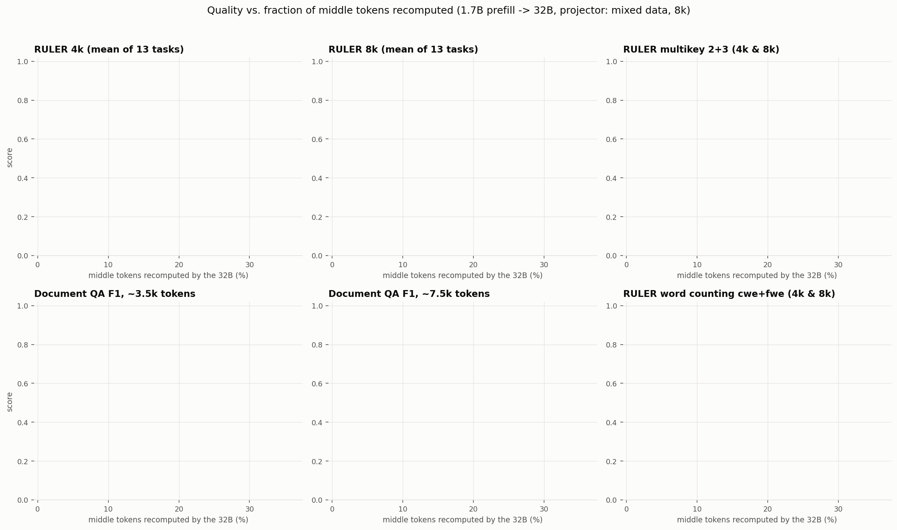

# 选择性重算实验

GPU：NVIDIA H100 80GB HBM3；生成：2026-10-31 17:09:56；projector：混合数据 8k（第 12000 步）。小模型：1.7B，大模型：32B。开头 8 个和最后 64 个 token 始终由大模型计算；“重算比例”是中间部分由大模型重新计算的 token 占比。“丢弃其余”配置的选择方式与对应的重算配置完全相同，只是没选中的中间 token 被丢掉而不是用投影 KV 补上；SpecPrefill 是原论文方法（小模型打分，按 32 token 一块保留整段 prompt 的一部分，不强制保留开头和结尾，不用 projector），它的比例是整段 prompt 保留的比例。

## 总表

| 配置 | 实际重算比例（RULER 8k） | RULER 4k | RULER 8k | 问答 F1 4k | 问答 F1 8k | 大海捞针 |
|---|---|---|---|---|---|---|
| 32B 单独 | 全部 | - | - | - | - | - |
| 1.7B 单独 | - | - | - | - | - | - |
| 混合，不重算 | - | - | - | - | - | - |
| 1.7B 注意力 10%，按句子 | - | - | - | - | - | - |
| 丢弃其余（不投影）：1.7B 注意力 20%，按句子 | - | - | - | - | - | - |
| SpecPrefill 保留整段 10% | - | - | - | - | - | - |
| SpecPrefill 保留整段 30% | - | - | - | - | - | - |

## 问答 F1，长 prompt（约 16k / 32k token）

| 配置 | squad 16k | hotpot 16k | trivia 16k | squad 32k | hotpot 32k | trivia 32k | 平均 16k | 平均 32k |
|---|---|---|---|---|---|---|---|---|
| 32B 单独 | 0.588 | 0.596 | 0.687 | - | - | - | 0.623 | - |
| 1.7B 单独 | 0.288 | 0.174 | 0.504 | - | - | - | 0.322 | - |
| 混合，不重算 | 0.614 | 0.535 | 0.705 | - | - | - | 0.618 | - |
| 1.7B 注意力 10%，按句子 | 0.669 | 0.593 | 0.764 | - | - | - | 0.675 | - |
| 丢弃其余（不投影）：1.7B 注意力 20%，按句子 | 0.670 | 0.622 | 0.690 | - | - | - | 0.661 | - |
| SpecPrefill 保留整段 10% | 0.689 | 0.556 | 0.694 | - | - | - | 0.646 | - |
| SpecPrefill 保留整段 30% | 0.599 | 0.639 | 0.634 | - | - | - | 0.624 | - |

## 大海捞针，长 prompt

| 配置 | 15872 |
|---|---|
| 32B 单独 | 1.00 |
| 1.7B 单独 | 1.00 |
| 混合，不重算 | 1.00 |
| 1.7B 注意力 10%，按句子 | 1.00 |
| 丢弃其余（不投影）：1.7B 注意力 20%，按句子 | 1.00 |
| SpecPrefill 保留整段 10% | 1.00 |
| SpecPrefill 保留整段 30% | 1.00 |
