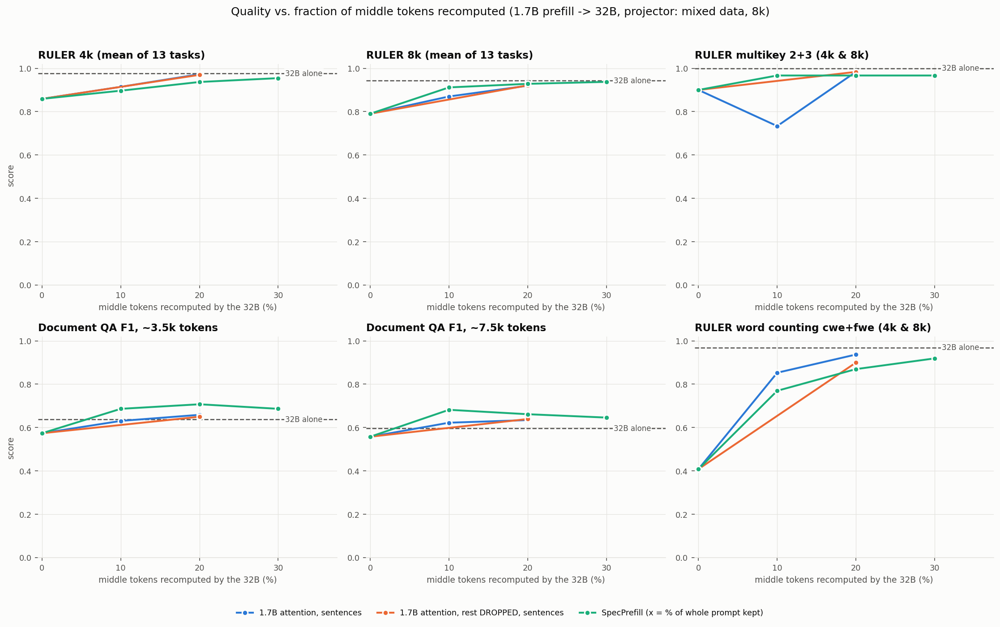

# 选择性重算实验

GPU：NVIDIA H100 80GB HBM3；生成：2026-10-31 11:03:40；projector：混合数据 8k（第 12000 步）。小模型：1.7B，大模型：32B。开头 8 个和最后 64 个 token 始终由大模型计算；“重算比例”是中间部分由大模型重新计算的 token 占比。“丢弃其余”配置的选择方式与对应的重算配置完全相同，只是没选中的中间 token 被丢掉而不是用投影 KV 补上；SpecPrefill 是原论文方法（小模型打分，按 32 token 一块保留整段 prompt 的一部分，不强制保留开头和结尾，不用 projector），它的比例是整段 prompt 保留的比例。

## 总表

| 配置 | 实际重算比例（RULER 8k） | RULER 4k | RULER 8k | 问答 F1 4k | 问答 F1 8k | 大海捞针 |
|---|---|---|---|---|---|---|
| 32B 单独 | 全部 | 0.976 | 0.943 | 0.638 | 0.596 | 1.000 |
| 1.7B 单独 | 0.0% | 0.892 | 0.868 | 0.552 | 0.515 | 1.000 |
| 混合，不重算 | 0.0% | 0.859 | 0.790 | 0.574 | 0.558 | 1.000 |
| 1.7B 注意力 10%，按句子 | 10.1% | 0.914 | 0.870 | 0.631 | 0.622 | 1.000 |
| 1.7B 注意力 20%，按句子 | 20.1% | 0.973 | 0.919 | 0.659 | 0.634 | 1.000 |
| 丢弃其余（不投影）：1.7B 注意力 20%，按句子 | 20.1% | 0.970 | 0.921 | 0.650 | 0.639 | 1.000 |
| SpecPrefill 保留整段 10% | 10.0% | 0.897 | 0.912 | 0.686 | 0.682 | 1.000 |
| SpecPrefill 保留整段 20% | 20.0% | 0.937 | 0.928 | 0.707 | 0.661 | 1.000 |
| SpecPrefill 保留整段 30% | 30.0% | 0.954 | 0.937 | 0.686 | 0.646 | 1.000 |

## RULER 4096，按任务类型

| 配置 | 检索 | 汇总 | 变量追踪 | 问答 | 平均 |
|---|---|---|---|---|---|
| 32B 单独 | 1.00 | 0.97 | 1.00 | 0.87 | 0.976 |
| 1.7B 单独 | 0.98 | 0.81 | 1.00 | 0.57 | 0.892 |
| 混合，不重算 | 0.99 | 0.43 | 0.79 | 0.80 | 0.859 |
| 1.7B 注意力 10%，按句子 | 0.92 | 0.94 | 1.00 | 0.83 | 0.914 |
| 1.7B 注意力 20%，按句子 | 1.00 | 1.00 | 1.00 | 0.83 | 0.973 |
| 丢弃其余（不投影）：1.7B 注意力 20%，按句子 | 1.00 | 0.94 | 1.00 | 0.87 | 0.970 |
| SpecPrefill 保留整段 10% | 0.96 | 0.77 | 0.81 | 0.80 | 0.897 |
| SpecPrefill 保留整段 20% | 0.98 | 0.87 | 1.00 | 0.80 | 0.937 |
| SpecPrefill 保留整段 30% | 0.99 | 0.91 | 1.00 | 0.83 | 0.954 |

RULER 4096 全部子任务

| 配置 | cwe | fwe | niah_multikey_1 | niah_multikey_2 | niah_multikey_3 | niah_multiquery | niah_multivalue | niah_single_1 | niah_single_2 | niah_single_3 | qa_1 | qa_2 | vt |
|---|---|---|---|---|---|---|---|---|---|---|---|---|---|
| 32B 单独 | 0.99 | 0.96 | 1.00 | 1.00 | 1.00 | 1.00 | 1.00 | 1.00 | 1.00 | 1.00 | 0.93 | 0.80 | 1.00 |
| 1.7B 单独 | 0.78 | 0.84 | 1.00 | 0.87 | 1.00 | 0.98 | 0.98 | 1.00 | 1.00 | 1.00 | 0.73 | 0.40 | 1.00 |
| 混合，不重算 | 0.24 | 0.62 | 1.00 | 1.00 | 0.93 | 0.98 | 1.00 | 1.00 | 1.00 | 1.00 | 0.93 | 0.67 | 0.79 |
| 1.7B 注意力 10%，按句子 | 0.95 | 0.93 | 1.00 | 1.00 | 0.40 | 1.00 | 0.93 | 1.00 | 1.00 | 1.00 | 0.93 | 0.73 | 1.00 |
| 1.7B 注意力 20%，按句子 | 0.99 | 1.00 | 1.00 | 1.00 | 1.00 | 1.00 | 0.98 | 1.00 | 1.00 | 1.00 | 0.87 | 0.80 | 1.00 |
| 丢弃其余（不投影）：1.7B 注意力 20%，按句子 | 0.93 | 0.96 | 1.00 | 1.00 | 1.00 | 1.00 | 0.98 | 1.00 | 1.00 | 1.00 | 1.00 | 0.73 | 1.00 |
| SpecPrefill 保留整段 10% | 0.65 | 0.89 | 1.00 | 1.00 | 0.87 | 0.87 | 0.97 | 1.00 | 1.00 | 1.00 | 0.93 | 0.67 | 0.81 |
| SpecPrefill 保留整段 20% | 0.83 | 0.91 | 1.00 | 1.00 | 0.87 | 0.97 | 1.00 | 1.00 | 1.00 | 1.00 | 0.93 | 0.67 | 1.00 |
| SpecPrefill 保留整段 30% | 0.91 | 0.91 | 1.00 | 1.00 | 0.93 | 0.98 | 1.00 | 1.00 | 1.00 | 1.00 | 0.93 | 0.73 | 1.00 |

## RULER 8192，按任务类型

| 配置 | 检索 | 汇总 | 变量追踪 | 问答 | 平均 |
|---|---|---|---|---|---|
| 32B 单独 | 1.00 | 0.96 | 1.00 | 0.67 | 0.943 |
| 1.7B 单独 | 0.98 | 0.68 | 0.97 | 0.57 | 0.868 |
| 混合，不重算 | 0.95 | 0.39 | 0.65 | 0.63 | 0.790 |
| 1.7B 注意力 10%，按句子 | 0.94 | 0.76 | 1.00 | 0.63 | 0.870 |
| 1.7B 注意力 20%，按句子 | 0.99 | 0.88 | 1.00 | 0.63 | 0.919 |
| 丢弃其余（不投影）：1.7B 注意力 20%，按句子 | 0.99 | 0.85 | 1.00 | 0.67 | 0.921 |
| SpecPrefill 保留整段 10% | 0.99 | 0.77 | 1.00 | 0.70 | 0.912 |
| SpecPrefill 保留整段 20% | 1.00 | 0.87 | 1.00 | 0.67 | 0.928 |
| SpecPrefill 保留整段 30% | 0.99 | 0.93 | 1.00 | 0.70 | 0.937 |

RULER 8192 全部子任务

| 配置 | cwe | fwe | niah_multikey_1 | niah_multikey_2 | niah_multikey_3 | niah_multiquery | niah_multivalue | niah_single_1 | niah_single_2 | niah_single_3 | qa_1 | qa_2 | vt |
|---|---|---|---|---|---|---|---|---|---|---|---|---|---|
| 32B 单独 | 0.99 | 0.93 | 1.00 | 1.00 | 1.00 | 1.00 | 1.00 | 1.00 | 1.00 | 1.00 | 0.80 | 0.53 | 1.00 |
| 1.7B 单独 | 0.61 | 0.76 | 1.00 | 0.87 | 1.00 | 1.00 | 0.95 | 1.00 | 1.00 | 1.00 | 0.67 | 0.47 | 0.97 |
| 混合，不重算 | 0.26 | 0.51 | 1.00 | 0.87 | 0.80 | 0.97 | 0.95 | 1.00 | 1.00 | 1.00 | 0.87 | 0.40 | 0.65 |
| 1.7B 注意力 10%，按句子 | 0.81 | 0.71 | 1.00 | 1.00 | 0.53 | 1.00 | 0.98 | 1.00 | 1.00 | 1.00 | 0.87 | 0.40 | 1.00 |
| 1.7B 注意力 20%，按句子 | 0.89 | 0.87 | 1.00 | 1.00 | 0.93 | 1.00 | 1.00 | 1.00 | 1.00 | 1.00 | 0.80 | 0.47 | 1.00 |
| 丢弃其余（不投影）：1.7B 注意力 20%，按句子 | 0.75 | 0.96 | 1.00 | 1.00 | 0.93 | 1.00 | 1.00 | 1.00 | 1.00 | 1.00 | 0.80 | 0.53 | 1.00 |
| SpecPrefill 保留整段 10% | 0.58 | 0.96 | 1.00 | 1.00 | 1.00 | 0.92 | 1.00 | 1.00 | 1.00 | 1.00 | 0.87 | 0.53 | 1.00 |
| SpecPrefill 保留整段 20% | 0.73 | 1.00 | 1.00 | 1.00 | 1.00 | 1.00 | 1.00 | 1.00 | 1.00 | 1.00 | 0.80 | 0.53 | 1.00 |
| SpecPrefill 保留整段 30% | 0.87 | 0.98 | 1.00 | 1.00 | 0.93 | 1.00 | 1.00 | 1.00 | 1.00 | 1.00 | 0.87 | 0.53 | 1.00 |

## 问答 F1

| 配置 | squad 4k | hotpot 4k | trivia 4k | squad 8k | hotpot 8k | trivia 8k | 平均 4k | 平均 8k |
|---|---|---|---|---|---|---|---|---|
| 32B 单独 | 0.665 | 0.644 | 0.603 | 0.619 | 0.526 | 0.642 | 0.638 | 0.596 |
| 1.7B 单独 | 0.611 | 0.541 | 0.503 | 0.599 | 0.393 | 0.552 | 0.552 | 0.515 |
| 混合，不重算 | 0.605 | 0.526 | 0.591 | 0.611 | 0.429 | 0.633 | 0.574 | 0.558 |
| 1.7B 注意力 10%，按句子 | 0.667 | 0.620 | 0.605 | 0.661 | 0.504 | 0.702 | 0.631 | 0.622 |
| 1.7B 注意力 20%，按句子 | 0.671 | 0.661 | 0.645 | 0.670 | 0.554 | 0.679 | 0.659 | 0.634 |
| 丢弃其余（不投影）：1.7B 注意力 20%，按句子 | 0.717 | 0.607 | 0.625 | 0.659 | 0.547 | 0.712 | 0.650 | 0.639 |
| SpecPrefill 保留整段 10% | 0.754 | 0.607 | 0.698 | 0.724 | 0.617 | 0.704 | 0.686 | 0.682 |
| SpecPrefill 保留整段 20% | 0.734 | 0.687 | 0.701 | 0.663 | 0.613 | 0.709 | 0.707 | 0.661 |
| SpecPrefill 保留整段 30% | 0.681 | 0.687 | 0.691 | 0.661 | 0.558 | 0.720 | 0.686 | 0.646 |

## GSM8K（8-shot，对话轮次形式）

| 配置 | 准确率 | 遵守 #### 格式 |
|---|---|---|
| 32B 单独 | 0.967 | 0.980 |
| 1.7B 单独 | 0.727 | 0.300 |
| 混合，不重算 | 0.933 | 0.680 |
| 1.7B 注意力 10%，按句子 | 0.947 | 0.953 |
| 1.7B 注意力 20%，按句子 | 0.947 | 0.973 |
| 丢弃其余（不投影）：1.7B 注意力 20%，按句子 | 0.933 | 0.607 |
| SpecPrefill 保留整段 10% | 0.887 | 0.067 |
| SpecPrefill 保留整段 20% | 0.913 | 0.473 |
| SpecPrefill 保留整段 30% | 0.947 | 0.747 |

## 代码下一行补全

| 配置 | 4k 精确匹配 | 4k 相似度 | 8k 精确匹配 | 8k 相似度 |
|---|---|---|---|---|
| 32B 单独 | 0.280 | 0.670 | 0.320 | 0.644 |
| 1.7B 单独 | 0.220 | 0.633 | 0.260 | 0.628 |
| 混合，不重算 | 0.220 | 0.645 | 0.260 | 0.602 |
| 1.7B 注意力 10%，按句子 | 0.230 | 0.657 | 0.330 | 0.657 |
| 1.7B 注意力 20%，按句子 | 0.240 | 0.664 | 0.330 | 0.673 |
| 丢弃其余（不投影）：1.7B 注意力 20%，按句子 | 0.220 | 0.643 | 0.330 | 0.659 |
| SpecPrefill 保留整段 10% | 0.230 | 0.634 | 0.310 | 0.647 |
| SpecPrefill 保留整段 20% | 0.260 | 0.662 | 0.330 | 0.655 |
| SpecPrefill 保留整段 30% | 0.270 | 0.672 | 0.310 | 0.653 |
