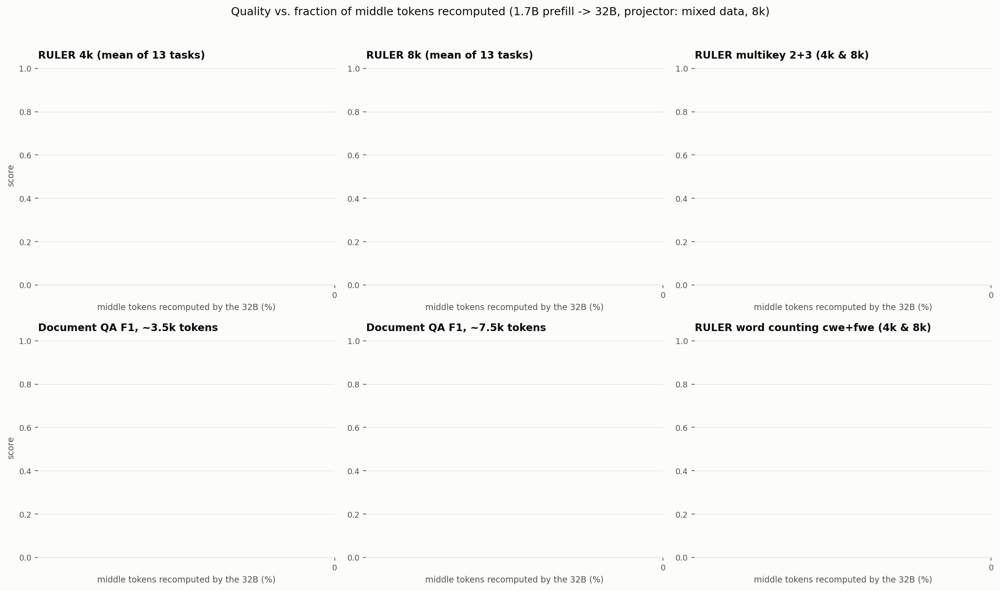

# 选择性重算实验

GPU：NVIDIA H100 80GB HBM3；生成：2026-10-31 17:05:42；projector：混合数据 8k（第 12000 步）。小模型：1.7B，大模型：32B。开头 8 个和最后 64 个 token 始终由大模型计算；“重算比例”是中间部分由大模型重新计算的 token 占比。“丢弃其余”配置的选择方式与对应的重算配置完全相同，只是没选中的中间 token 被丢掉而不是用投影 KV 补上；SpecPrefill 是原论文方法（小模型打分，按 32 token 一块保留整段 prompt 的一部分，不强制保留开头和结尾，不用 projector），它的比例是整段 prompt 保留的比例。

## 总表

| 配置 | 实际重算比例（RULER 8k） | RULER 4k | RULER 8k | 问答 F1 4k | 问答 F1 8k | 大海捞针 |
|---|---|---|---|---|---|---|
| 混合，不重算 | - | - | - | - | - | - |

## 首 token 延迟（毫秒，H100 80GB HBM3，所有方法都用 CUDA graph：固定形状的阶段整段回放，只有选择步骤 eager）

| 配置 | 4096 | 8192 |
|---|---|---|
| 32B 单独 | 600.2（1.00 倍） | 1280.4（1.00 倍） |
| 1.7B 单独 | 48.9（12.28 倍） | 108.2（11.83 倍） |
| 混合，不重算 | 131.1（4.58 倍） | 237.7（5.39 倍） |
| 1.7B 注意力 10%，按句子 | 197.2（3.04 倍） | 445.4（2.87 倍） |
| 1.7B 注意力 20%，按句子 | 282.0（2.13 倍） | 644.8（1.99 倍） |
| 丢弃其余（不投影）：1.7B 注意力 20%，按句子 | 189.7（3.16 倍） | 366.7（3.49 倍） |
| SpecPrefill 保留整段 10% | 191.2（3.14 倍） | 342.0（3.74 倍） |
| SpecPrefill 保留整段 20% | 248.5（2.42 倍） | 444.8（2.88 倍） |
| SpecPrefill 保留整段 30% | 300.1（2.00 倍） | 570.8（2.24 倍） |

括号内是相对 32B 单独（同样用 CUDA graph）的加速比。graph 与 eager 的首 token logits 最大相对差（4096 token）：32B 单独 0.0e+00，1.7B 单独 0.0e+00，混合，不重算 0.0e+00，1.7B 注意力 10%，按句子 0.0e+00，1.7B 注意力 20%，按句子 0.0e+00，丢弃其余（不投影）：1.7B 注意力 20%，按句子 0.0e+00，SpecPrefill 保留整段 10% 0.0e+00，SpecPrefill 保留整段 20% 0.0e+00，SpecPrefill 保留整段 30% 0.0e+00。
