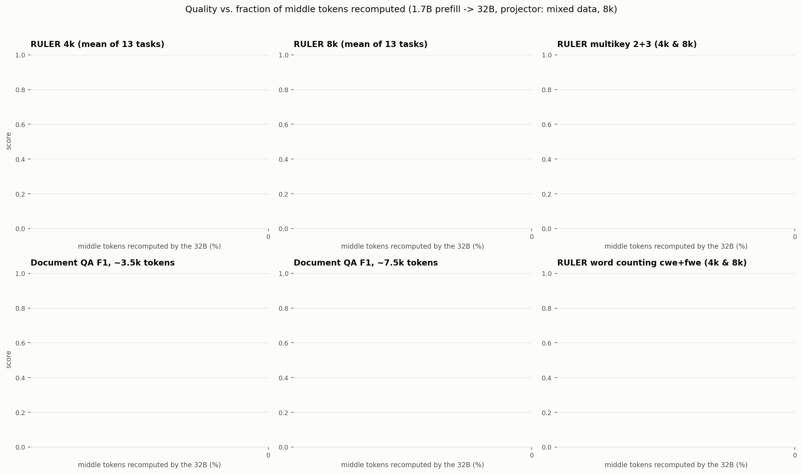
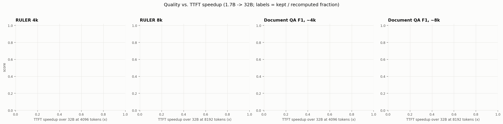

# 选择性重算实验

GPU：NVIDIA H100 80GB HBM3；生成：2026-10-31 17:07:28；projector：混合数据 8k（第 12000 步）。小模型：1.7B，大模型：32B。开头 8 个和最后 64 个 token 始终由大模型计算；“重算比例”是中间部分由大模型重新计算的 token 占比。“丢弃其余”配置的选择方式与对应的重算配置完全相同，只是没选中的中间 token 被丢掉而不是用投影 KV 补上；SpecPrefill 是原论文方法（小模型打分，按 32 token 一块保留整段 prompt 的一部分，不强制保留开头和结尾，不用 projector），它的比例是整段 prompt 保留的比例。

## 总表

| 配置 | 实际重算比例（RULER 8k） | RULER 4k | RULER 8k | 问答 F1 4k | 问答 F1 8k | 大海捞针 |
|---|---|---|---|---|---|---|
| 混合，不重算 | - | - | - | - | - | - |

## 首 token 延迟（毫秒，H100 80GB HBM3，eager；SpecPrefill 的 look-ahead 用 CUDA graph 回放）

| 配置 | 4096 | 8192 | 16384 |
|---|---|---|---|
| 32B 单独 | 601.8（1.00 倍） | 1279.8（1.00 倍） | 3010.7（1.00 倍） |
| 1.7B 单独 | 51.1（11.78 倍） | 110.6（11.57 倍） | 258.6（11.64 倍） |
| 混合，不重算 | 137.7（4.37 倍） | 245.4（5.21 倍） | 488.9（6.16 倍） |
| 1.7B 注意力 10%，按句子 | 205.2（2.93 倍） | 456.1（2.81 倍） | 1101.2（2.73 倍） |
| 1.7B 注意力 20%，按句子 | 289.6（2.08 倍） | 651.7（1.96 倍） | 1749.1（1.72 倍） |
| 丢弃其余（不投影）：1.7B 注意力 20%，按句子 | 194.1（3.10 倍） | 374.4（3.42 倍） | 777.9（3.87 倍） |
| SpecPrefill 保留整段 10% | 198.3（3.03 倍） | 349.5（3.66 倍） | 665.3（4.53 倍） |
| SpecPrefill 保留整段 20% | 254.7（2.36 倍） | 451.5（2.83 倍） | 905.2（3.33 倍） |
| SpecPrefill 保留整段 30% | 307.9（1.95 倍） | 575.5（2.22 倍） | 1173.1（2.57 倍） |

括号内是相对 32B 单独的加速比。
