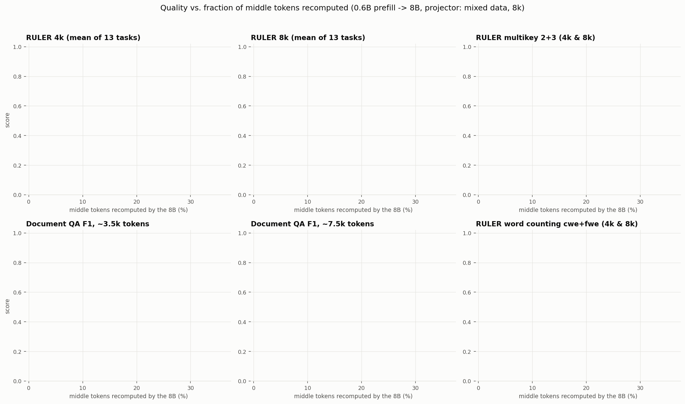

# 选择性重算实验

GPU：NVIDIA L40S；生成：2026-11-04 08:23:59；projector：混合数据 8k（第 12000 步）。小模型：0.6B，大模型：8B。开头 8 个和最后 64 个 token 始终由大模型计算；“重算比例”是中间部分由大模型重新计算的 token 占比。“丢弃其余”配置的选择方式与对应的重算配置完全相同，只是没选中的中间 token 被丢掉而不是用投影 KV 补上；SpecPrefill 是原论文方法（小模型打分，按 32 token 一块保留整段 prompt 的一部分，不强制保留开头和结尾，不用 projector），它的比例是整段 prompt 保留的比例。

## 总表

| 配置 | 实际重算比例（RULER 8k） | RULER 4k | RULER 8k | 问答 F1 4k | 问答 F1 8k | 大海捞针 |
|---|---|---|---|---|---|---|
| 8B 单独 | 全部 | - | - | - | - | - |
| 混合，不重算 | - | - | - | - | - | - |
| 0.6B 注意力 10%，按句子 | - | - | - | - | - | - |
| 丢弃其余（不投影）：0.6B 注意力 20%，按句子 | - | - | - | - | - | - |
| SpecPrefill 保留整段 10% | - | - | - | - | - | - |
| SpecPrefill 保留整段 30% | - | - | - | - | - | - |

## 问答 F1，长 prompt（约 16k / 32k token）

| 配置 | squad 16k | hotpot 16k | trivia 16k | squad 32k | hotpot 32k | trivia 32k | 平均 16k | 平均 32k |
|---|---|---|---|---|---|---|---|---|
| 8B 单独 | 0.700 | 0.621 | 0.826 | 0.555 | 0.468 | 0.759 | 0.716 | 0.594 |
| 混合，不重算 | 0.664 | 0.487 | 0.706 | 0.419 | 0.387 | 0.706 | 0.619 | 0.504 |
| 0.6B 注意力 10%，按句子 | 0.714 | 0.583 | 0.812 | 0.645 | 0.518 | 0.778 | 0.703 | 0.647 |
| 丢弃其余（不投影）：0.6B 注意力 20%，按句子 | 0.599 | 0.599 | 0.764 | 0.532 | 0.545 | 0.695 | 0.654 | 0.591 |
| SpecPrefill 保留整段 10% | 0.578 | 0.451 | 0.721 | 0.522 | 0.413 | 0.672 | 0.583 | 0.536 |
| SpecPrefill 保留整段 30% | 0.604 | 0.537 | 0.795 | 0.506 | 0.549 | 0.759 | 0.645 | 0.605 |

## 大海捞针，长 prompt

| 配置 | 15872 | 32256 |
|---|---|---|
| 8B 单独 | 1.00 | 1.00 |
| 混合，不重算 | 1.00 | 1.00 |
| 0.6B 注意力 10%，按句子 | 1.00 | 1.00 |
| 丢弃其余（不投影）：0.6B 注意力 20%，按句子 | 1.00 | 1.00 |
| SpecPrefill 保留整段 10% | 1.00 | 1.00 |
| SpecPrefill 保留整段 30% | 1.00 | 1.00 |
