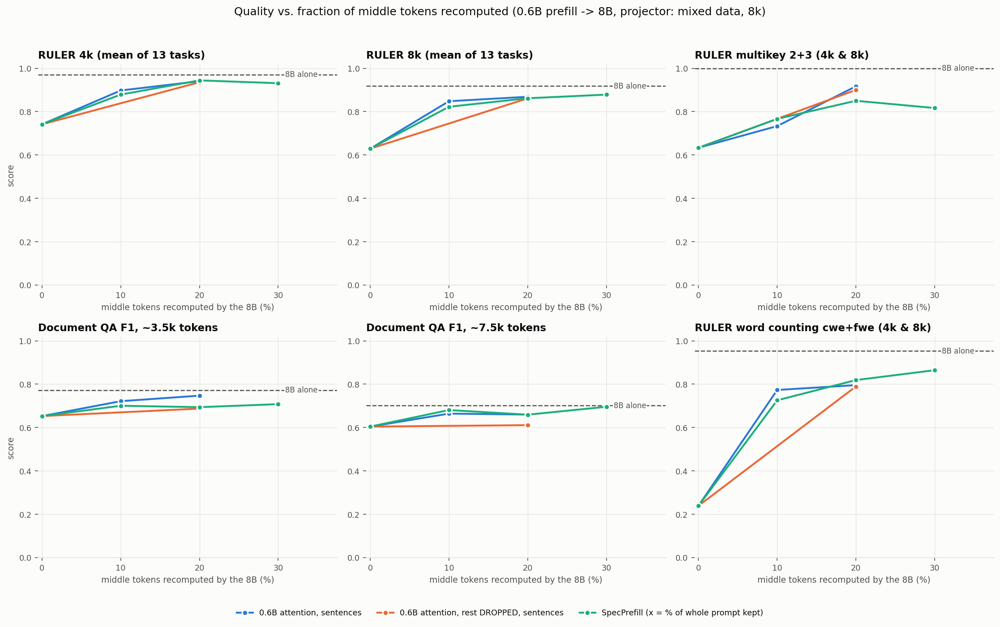

# 选择性重算实验

GPU：NVIDIA L40S；生成：2026-11-04 03:19:50；projector：混合数据 8k（第 12000 步）。小模型：0.6B，大模型：8B。开头 8 个和最后 64 个 token 始终由大模型计算；“重算比例”是中间部分由大模型重新计算的 token 占比。“丢弃其余”配置的选择方式与对应的重算配置完全相同，只是没选中的中间 token 被丢掉而不是用投影 KV 补上；SpecPrefill 是原论文方法（小模型打分，按 32 token 一块保留整段 prompt 的一部分，不强制保留开头和结尾，不用 projector），它的比例是整段 prompt 保留的比例。

## 总表

| 配置 | 实际重算比例（RULER 8k） | RULER 4k | RULER 8k | 问答 F1 4k | 问答 F1 8k | 大海捞针 |
|---|---|---|---|---|---|---|
| 8B 单独 | 全部 | 0.970 | 0.918 | 0.772 | 0.702 | 1.000 |
| 0.6B 单独 | 0.0% | 0.761 | 0.692 | 0.310 | 0.264 | 0.978 |
| 混合，不重算 | 0.0% | 0.742 | 0.629 | 0.653 | 0.604 | 1.000 |
| 0.6B 注意力 10%，按句子 | 10.1% | 0.898 | 0.848 | 0.722 | 0.664 | 1.000 |
| 0.6B 注意力 20%，按句子 | 20.1% | 0.940 | 0.869 | 0.747 | 0.660 | 1.000 |
| 丢弃其余（不投影）：0.6B 注意力 20%，按句子 | 20.1% | 0.936 | 0.861 | 0.687 | 0.611 | 1.000 |
| SpecPrefill 保留整段 10% | 10.0% | 0.879 | 0.822 | 0.701 | 0.681 | 1.000 |
| SpecPrefill 保留整段 20% | 20.0% | 0.944 | 0.862 | 0.694 | 0.659 | 1.000 |
| SpecPrefill 保留整段 30% | 30.0% | 0.931 | 0.878 | 0.708 | 0.696 | 1.000 |

## RULER 4096，按任务类型

| 配置 | 检索 | 汇总 | 变量追踪 | 问答 | 平均 |
|---|---|---|---|---|---|
| 8B 单独 | 1.00 | 0.97 | 1.00 | 0.83 | 0.970 |
| 0.6B 单独 | 0.96 | 0.38 | 0.67 | 0.40 | 0.761 |
| 混合，不重算 | 0.95 | 0.30 | 0.48 | 0.50 | 0.742 |
| 0.6B 注意力 10%，按句子 | 0.94 | 0.87 | 1.00 | 0.70 | 0.898 |
| 0.6B 注意力 20%，按句子 | 1.00 | 0.91 | 1.00 | 0.70 | 0.940 |
| 丢弃其余（不投影）：0.6B 注意力 20%，按句子 | 1.00 | 0.85 | 1.00 | 0.73 | 0.936 |
| SpecPrefill 保留整段 10% | 0.97 | 0.73 | 0.75 | 0.73 | 0.879 |
| SpecPrefill 保留整段 20% | 0.98 | 0.87 | 1.00 | 0.83 | 0.944 |
| SpecPrefill 保留整段 30% | 0.96 | 0.92 | 1.00 | 0.80 | 0.931 |

RULER 4096 全部子任务

| 配置 | cwe | fwe | niah_multikey_1 | niah_multikey_2 | niah_multikey_3 | niah_multiquery | niah_multivalue | niah_single_1 | niah_single_2 | niah_single_3 | qa_1 | qa_2 | vt |
|---|---|---|---|---|---|---|---|---|---|---|---|---|---|
| 8B 单独 | 0.99 | 0.96 | 1.00 | 1.00 | 1.00 | 1.00 | 1.00 | 1.00 | 1.00 | 1.00 | 0.93 | 0.73 | 1.00 |
| 0.6B 单独 | 0.00 | 0.76 | 1.00 | 0.87 | 0.87 | 0.97 | 0.97 | 1.00 | 1.00 | 1.00 | 0.53 | 0.27 | 0.67 |
| 混合，不重算 | 0.06 | 0.53 | 1.00 | 0.87 | 0.80 | 0.98 | 0.98 | 1.00 | 0.93 | 1.00 | 0.67 | 0.33 | 0.48 |
| 0.6B 注意力 10%，按句子 | 0.85 | 0.89 | 1.00 | 1.00 | 0.53 | 1.00 | 1.00 | 1.00 | 1.00 | 1.00 | 0.93 | 0.47 | 1.00 |
| 0.6B 注意力 20%，按句子 | 0.91 | 0.91 | 1.00 | 1.00 | 1.00 | 1.00 | 1.00 | 1.00 | 1.00 | 1.00 | 0.87 | 0.53 | 1.00 |
| 丢弃其余（不投影）：0.6B 注意力 20%，按句子 | 0.81 | 0.89 | 1.00 | 1.00 | 1.00 | 1.00 | 1.00 | 1.00 | 1.00 | 1.00 | 0.93 | 0.53 | 1.00 |
| SpecPrefill 保留整段 10% | 0.53 | 0.93 | 1.00 | 1.00 | 0.80 | 0.97 | 0.98 | 1.00 | 1.00 | 1.00 | 0.87 | 0.60 | 0.75 |
| SpecPrefill 保留整段 20% | 0.81 | 0.93 | 1.00 | 1.00 | 0.87 | 1.00 | 1.00 | 1.00 | 1.00 | 1.00 | 0.93 | 0.73 | 1.00 |
| SpecPrefill 保留整段 30% | 0.86 | 0.98 | 1.00 | 1.00 | 0.67 | 1.00 | 1.00 | 1.00 | 1.00 | 1.00 | 0.93 | 0.67 | 1.00 |

## RULER 8192，按任务类型

| 配置 | 检索 | 汇总 | 变量追踪 | 问答 | 平均 |
|---|---|---|---|---|---|
| 8B 单独 | 1.00 | 0.93 | 1.00 | 0.53 | 0.918 |
| 0.6B 单独 | 0.83 | 0.35 | 0.84 | 0.40 | 0.692 |
| 混合，不重算 | 0.83 | 0.18 | 0.40 | 0.40 | 0.629 |
| 0.6B 注意力 10%，按句子 | 0.93 | 0.68 | 1.00 | 0.63 | 0.848 |
| 0.6B 注意力 20%，按句子 | 0.96 | 0.68 | 1.00 | 0.63 | 0.869 |
| 丢弃其余（不投影）：0.6B 注意力 20%，按句子 | 0.95 | 0.73 | 1.00 | 0.57 | 0.861 |
| SpecPrefill 保留整段 10% | 0.89 | 0.72 | 1.00 | 0.57 | 0.822 |
| SpecPrefill 保留整段 20% | 0.94 | 0.77 | 1.00 | 0.57 | 0.862 |
| SpecPrefill 保留整段 30% | 0.95 | 0.81 | 1.00 | 0.60 | 0.878 |

RULER 8192 全部子任务

| 配置 | cwe | fwe | niah_multikey_1 | niah_multikey_2 | niah_multikey_3 | niah_multiquery | niah_multivalue | niah_single_1 | niah_single_2 | niah_single_3 | qa_1 | qa_2 | vt |
|---|---|---|---|---|---|---|---|---|---|---|---|---|---|
| 8B 单独 | 0.97 | 0.89 | 1.00 | 1.00 | 1.00 | 1.00 | 1.00 | 1.00 | 1.00 | 1.00 | 0.60 | 0.47 | 1.00 |
| 0.6B 单独 | 0.01 | 0.69 | 0.93 | 0.53 | 0.33 | 0.97 | 0.88 | 1.00 | 1.00 | 1.00 | 0.53 | 0.27 | 0.84 |
| 混合，不重算 | 0.01 | 0.36 | 1.00 | 0.73 | 0.13 | 0.98 | 0.83 | 1.00 | 1.00 | 0.93 | 0.60 | 0.20 | 0.40 |
| 0.6B 注意力 10%，按句子 | 0.51 | 0.84 | 1.00 | 1.00 | 0.40 | 1.00 | 1.00 | 1.00 | 1.00 | 1.00 | 0.80 | 0.47 | 1.00 |
| 0.6B 注意力 20%，按句子 | 0.58 | 0.78 | 1.00 | 1.00 | 0.67 | 1.00 | 1.00 | 1.00 | 1.00 | 1.00 | 0.80 | 0.47 | 1.00 |
| 丢弃其余（不投影）：0.6B 注意力 20%，按句子 | 0.57 | 0.89 | 1.00 | 1.00 | 0.60 | 1.00 | 1.00 | 1.00 | 1.00 | 1.00 | 0.73 | 0.40 | 1.00 |
| SpecPrefill 保留整段 10% | 0.49 | 0.96 | 0.93 | 0.93 | 0.33 | 0.92 | 1.00 | 1.00 | 1.00 | 1.00 | 0.80 | 0.33 | 1.00 |
| SpecPrefill 保留整段 20% | 0.58 | 0.96 | 1.00 | 0.93 | 0.60 | 1.00 | 1.00 | 1.00 | 1.00 | 1.00 | 0.73 | 0.40 | 1.00 |
| SpecPrefill 保留整段 30% | 0.69 | 0.93 | 1.00 | 0.93 | 0.67 | 1.00 | 1.00 | 1.00 | 1.00 | 1.00 | 0.80 | 0.40 | 1.00 |

## 问答 F1

| 配置 | squad 4k | hotpot 4k | trivia 4k | squad 8k | hotpot 8k | trivia 8k | 平均 4k | 平均 8k |
|---|---|---|---|---|---|---|---|---|
| 8B 单独 | 0.873 | 0.724 | 0.720 | 0.757 | 0.586 | 0.762 | 0.772 | 0.702 |
| 0.6B 单独 | 0.262 | 0.321 | 0.347 | 0.295 | 0.175 | 0.321 | 0.310 | 0.264 |
| 混合，不重算 | 0.783 | 0.537 | 0.638 | 0.681 | 0.378 | 0.754 | 0.653 | 0.604 |
| 0.6B 注意力 10%，按句子 | 0.872 | 0.619 | 0.673 | 0.743 | 0.517 | 0.732 | 0.722 | 0.664 |
| 0.6B 注意力 20%，按句子 | 0.870 | 0.711 | 0.660 | 0.737 | 0.495 | 0.747 | 0.747 | 0.660 |
| 丢弃其余（不投影）：0.6B 注意力 20%，按句子 | 0.772 | 0.661 | 0.629 | 0.676 | 0.493 | 0.664 | 0.687 | 0.611 |
| SpecPrefill 保留整段 10% | 0.812 | 0.596 | 0.694 | 0.782 | 0.569 | 0.691 | 0.701 | 0.681 |
| SpecPrefill 保留整段 20% | 0.811 | 0.588 | 0.683 | 0.783 | 0.504 | 0.691 | 0.694 | 0.659 |
| SpecPrefill 保留整段 30% | 0.824 | 0.642 | 0.658 | 0.809 | 0.574 | 0.704 | 0.708 | 0.696 |

## GSM8K（8-shot，对话轮次形式）

| 配置 | 准确率 | 遵守 #### 格式 |
|---|---|---|
| 8B 单独 | 0.907 | 0.593 |
| 0.6B 单独 | 0.487 | 0.447 |
| 混合，不重算 | 0.860 | 0.467 |
| 0.6B 注意力 10%，按句子 | 0.907 | 0.680 |
| 0.6B 注意力 20%，按句子 | 0.913 | 0.613 |
| 丢弃其余（不投影）：0.6B 注意力 20%，按句子 | 0.867 | 0.287 |
| SpecPrefill 保留整段 10% | 0.847 | 0.040 |
| SpecPrefill 保留整段 20% | 0.867 | 0.160 |
| SpecPrefill 保留整段 30% | 0.867 | 0.300 |

## 代码下一行补全

| 配置 | 4k 精确匹配 | 4k 相似度 | 8k 精确匹配 | 8k 相似度 |
|---|---|---|---|---|
| 8B 单独 | 0.230 | 0.613 | 0.290 | 0.639 |
| 0.6B 单独 | 0.150 | 0.592 | 0.150 | 0.532 |
| 混合，不重算 | 0.140 | 0.542 | 0.240 | 0.591 |
| 0.6B 注意力 10%，按句子 | 0.160 | 0.612 | 0.300 | 0.643 |
| 0.6B 注意力 20%，按句子 | 0.170 | 0.591 | 0.310 | 0.656 |
| 丢弃其余（不投影）：0.6B 注意力 20%，按句子 | 0.170 | 0.599 | 0.270 | 0.643 |
| SpecPrefill 保留整段 10% | 0.190 | 0.602 | 0.280 | 0.619 |
| SpecPrefill 保留整段 20% | 0.230 | 0.627 | 0.290 | 0.645 |
| SpecPrefill 保留整段 30% | 0.210 | 0.610 | 0.280 | 0.636 |
