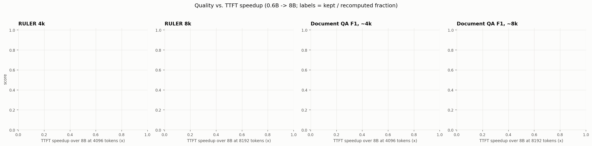

# 选择性重算实验

GPU：NVIDIA L40S；生成：2026-11-04 12:42:32；projector：混合数据 8k（第 12000 步）。小模型：0.6B，大模型：8B。开头 8 个和最后 64 个 token 始终由大模型计算；“重算比例”是中间部分由大模型重新计算的 token 占比。“丢弃其余”配置的选择方式与对应的重算配置完全相同，只是没选中的中间 token 被丢掉而不是用投影 KV 补上；SpecPrefill 是原论文方法（小模型打分，按 32 token 一块保留整段 prompt 的一部分，不强制保留开头和结尾，不用 projector），它的比例是整段 prompt 保留的比例。

## 总表

| 配置 | 实际重算比例（RULER 8k） | RULER 4k | RULER 8k | 问答 F1 4k | 问答 F1 8k | 大海捞针 |
|---|---|---|---|---|---|---|
| RaReCache 重算整段 0%，强制开头/尾部 | 0.9% | 0.257 | 0.216 | 0.203 | 0.220 | 0.911 |
| RaReCache 重算整段 10%，强制开头/尾部 | 10.7% | 0.326 | 0.250 | 0.394 | 0.343 | 0.878 |
| RaReCache 重算整段 30%，强制开头/尾部 | 30.4% | 0.409 | 0.296 | 0.516 | 0.506 | 0.867 |
| RaReCache 重算整段 50%，强制开头/尾部 | 50.3% | 0.455 | 0.427 | 0.623 | 0.554 | 0.778 |

## RULER 4096，按任务类型

| 配置 | 检索 | 汇总 | 变量追踪 | 问答 | 平均 |
|---|---|---|---|---|---|
| RaReCache 重算整段 0%，强制开头/尾部 | 0.30 | 0.19 | 0.00 | 0.27 | 0.257 |
| RaReCache 重算整段 10%，强制开头/尾部 | 0.27 | 0.39 | 0.73 | 0.27 | 0.326 |
| RaReCache 重算整段 30%，强制开头/尾部 | 0.27 | 0.60 | 1.00 | 0.47 | 0.409 |
| RaReCache 重算整段 50%，强制开头/尾部 | 0.28 | 0.73 | 1.00 | 0.60 | 0.455 |

RULER 4096 全部子任务

| 配置 | cwe | fwe | niah_multikey_1 | niah_multikey_2 | niah_multikey_3 | niah_multiquery | niah_multivalue | niah_single_1 | niah_single_2 | niah_single_3 | qa_1 | qa_2 | vt |
|---|---|---|---|---|---|---|---|---|---|---|---|---|---|
| RaReCache 重算整段 0%，强制开头/尾部 | 0.03 | 0.36 | 0.47 | 0.00 | 0.00 | 0.17 | 0.38 | 0.27 | 0.53 | 0.60 | 0.33 | 0.20 | 0.00 |
| RaReCache 重算整段 10%，强制开头/尾部 | 0.19 | 0.60 | 0.40 | 0.00 | 0.00 | 0.22 | 0.43 | 0.13 | 0.47 | 0.53 | 0.27 | 0.27 | 0.73 |
| RaReCache 重算整段 30%，强制开头/尾部 | 0.49 | 0.71 | 0.33 | 0.07 | 0.00 | 0.32 | 0.33 | 0.47 | 0.33 | 0.33 | 0.47 | 0.47 | 1.00 |
| RaReCache 重算整段 50%，强制开头/尾部 | 0.69 | 0.78 | 0.33 | 0.33 | 0.00 | 0.25 | 0.33 | 0.60 | 0.27 | 0.13 | 0.67 | 0.53 | 1.00 |

## RULER 8192，按任务类型

| 配置 | 检索 | 汇总 | 变量追踪 | 问答 | 平均 |
|---|---|---|---|---|---|
| RaReCache 重算整段 0%，强制开头/尾部 | 0.24 | 0.13 | 0.00 | 0.30 | 0.216 |
| RaReCache 重算整段 10%，强制开头/尾部 | 0.19 | 0.26 | 0.64 | 0.30 | 0.250 |
| RaReCache 重算整段 30%，强制开头/尾部 | 0.16 | 0.46 | 0.99 | 0.33 | 0.296 |
| RaReCache 重算整段 50%，强制开头/尾部 | 0.31 | 0.65 | 1.00 | 0.40 | 0.427 |

RULER 8192 全部子任务

| 配置 | cwe | fwe | niah_multikey_1 | niah_multikey_2 | niah_multikey_3 | niah_multiquery | niah_multivalue | niah_single_1 | niah_single_2 | niah_single_3 | qa_1 | qa_2 | vt |
|---|---|---|---|---|---|---|---|---|---|---|---|---|---|
| RaReCache 重算整段 0%，强制开头/尾部 | 0.02 | 0.24 | 0.27 | 0.00 | 0.00 | 0.18 | 0.17 | 0.33 | 0.47 | 0.53 | 0.40 | 0.20 | 0.00 |
| RaReCache 重算整段 10%，强制开头/尾部 | 0.13 | 0.40 | 0.27 | 0.00 | 0.00 | 0.18 | 0.17 | 0.20 | 0.47 | 0.20 | 0.33 | 0.27 | 0.64 |
| RaReCache 重算整段 30%，强制开头/尾部 | 0.37 | 0.56 | 0.20 | 0.00 | 0.00 | 0.18 | 0.15 | 0.33 | 0.40 | 0.00 | 0.47 | 0.20 | 0.99 |
| RaReCache 重算整段 50%，强制开头/尾部 | 0.66 | 0.64 | 0.20 | 0.53 | 0.00 | 0.28 | 0.23 | 0.73 | 0.47 | 0.00 | 0.47 | 0.33 | 1.00 |

## 问答 F1

| 配置 | squad 4k | hotpot 4k | trivia 4k | squad 8k | hotpot 8k | trivia 8k | 平均 4k | 平均 8k |
|---|---|---|---|---|---|---|---|---|
| RaReCache 重算整段 0%，强制开头/尾部 | 0.176 | 0.182 | 0.252 | 0.116 | 0.125 | 0.418 | 0.203 | 0.220 |
| RaReCache 重算整段 10%，强制开头/尾部 | 0.344 | 0.322 | 0.515 | 0.220 | 0.218 | 0.590 | 0.394 | 0.343 |
| RaReCache 重算整段 30%，强制开头/尾部 | 0.471 | 0.478 | 0.600 | 0.455 | 0.330 | 0.733 | 0.516 | 0.506 |
| RaReCache 重算整段 50%，强制开头/尾部 | 0.623 | 0.575 | 0.670 | 0.548 | 0.422 | 0.692 | 0.623 | 0.554 |

## GSM8K（8-shot，对话轮次形式）

| 配置 | 准确率 | 遵守 #### 格式 |
|---|---|---|
| RaReCache 重算整段 0%，强制开头/尾部 | 0.853 | 0.040 |
| RaReCache 重算整段 10%，强制开头/尾部 | 0.853 | 0.060 |
| RaReCache 重算整段 30%，强制开头/尾部 | 0.853 | 0.247 |
| RaReCache 重算整段 50%，强制开头/尾部 | 0.867 | 0.447 |

## 代码下一行补全

| 配置 | 4k 精确匹配 | 4k 相似度 | 8k 精确匹配 | 8k 相似度 |
|---|---|---|---|---|
| RaReCache 重算整段 0%，强制开头/尾部 | 0.130 | 0.484 | 0.120 | 0.523 |
| RaReCache 重算整段 10%，强制开头/尾部 | 0.130 | 0.497 | 0.120 | 0.509 |
| RaReCache 重算整段 30%，强制开头/尾部 | 0.130 | 0.540 | 0.150 | 0.565 |
| RaReCache 重算整段 50%，强制开头/尾部 | 0.190 | 0.611 | 0.220 | 0.587 |

## 首 token 延迟（毫秒，L40S，eager；SpecPrefill 的 look-ahead 用 CUDA graph 回放）

| 配置 | 4096 | 8192 | 16384 | 32768 |
|---|---|---|---|---|
| 8B 单独 | 389.0（1.00 倍） | 903.9（1.00 倍） | 2117.6（1.00 倍） | 5038.4（1.00 倍） |
| 混合，不重算 | 101.6（3.83 倍） | 206.0（4.39 倍） | 517.3（4.09 倍） | 1389.3（3.63 倍） |
| 0.6B 注意力 10%，按句子 | 133.0（2.92 倍） | 310.9（2.91 倍） | 819.6（2.58 倍） | 2347.5（2.15 倍） |
| SpecPrefill 保留整段 10% | 157.6（2.47 倍） | 307.0（2.94 倍） | 710.5（2.98 倍） | 1778.3（2.83 倍） |
| SpecPrefill 保留整段 30% | 224.4（1.73 倍） | 449.9（2.01 倍） | 1063.9（1.99 倍） | 2604.1（1.93 倍） |
| RaReCache 重算整段 0%，强制开头/尾部 | 160.5（2.42 倍） | 333.9（2.71 倍） | 775.3（2.73 倍） | 1895.9（2.66 倍） |
| RaReCache 重算整段 10%，强制开头/尾部 | 186.0（2.09 倍） | 422.2（2.14 倍） | 1060.1（2.00 倍） | 2804.9（1.80 倍） |
| RaReCache 重算整段 30%，强制开头/尾部 | 272.1（1.43 倍） | 633.3（1.43 倍） | 1703.2（1.24 倍） | 4872.0（1.03 倍） |
| RaReCache 重算整段 50%，强制开头/尾部 | 351.1（1.11 倍） | 871.9（1.04 倍） | 2432.6（0.87 倍） | 6878.3（0.73 倍） |

括号内是相对 8B 单独的加速比。
