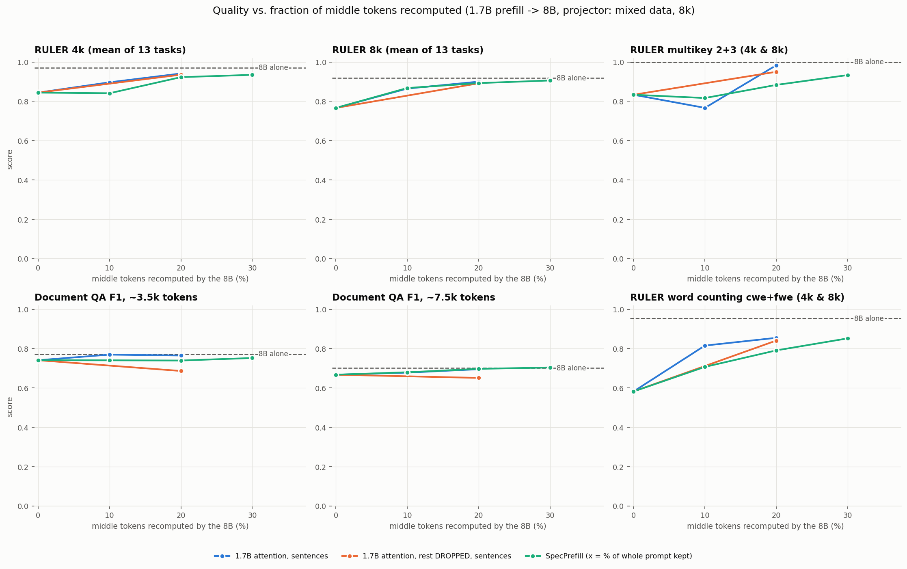

# 选择性重算实验

GPU：NVIDIA L40S；生成：2026-11-05 03:22:43；projector：混合数据 8k（第 12000 步）。小模型：1.7B，大模型：8B。开头 8 个和最后 64 个 token 始终由大模型计算；“重算比例”是中间部分由大模型重新计算的 token 占比。“丢弃其余”配置的选择方式与对应的重算配置完全相同，只是没选中的中间 token 被丢掉而不是用投影 KV 补上；SpecPrefill 是原论文方法（小模型打分，按 32 token 一块保留整段 prompt 的一部分，不强制保留开头和结尾，不用 projector），它的比例是整段 prompt 保留的比例。

## 总表

| 配置 | 实际重算比例（RULER 8k） | RULER 4k | RULER 8k | 问答 F1 4k | 问答 F1 8k | 大海捞针 |
|---|---|---|---|---|---|---|
| 8B 单独 | 全部 | 0.970 | 0.918 | 0.772 | 0.702 | 1.000 |
| 1.7B 单独 | 0.0% | 0.884 | 0.864 | 0.550 | 0.506 | 1.000 |
| 混合，不重算 | 0.0% | 0.844 | 0.766 | 0.741 | 0.667 | 1.000 |
| 1.7B 注意力 10%，按句子 | 10.1% | 0.897 | 0.865 | 0.770 | 0.678 | 1.000 |
| 1.7B 注意力 20%，按句子 | 20.1% | 0.941 | 0.900 | 0.765 | 0.695 | 1.000 |
| 丢弃其余（不投影）：1.7B 注意力 20%，按句子 | 20.1% | 0.935 | 0.891 | 0.687 | 0.651 | 1.000 |
| SpecPrefill 保留整段 10% | 10.0% | 0.841 | 0.867 | 0.741 | 0.680 | 1.000 |
| SpecPrefill 保留整段 20% | 20.0% | 0.923 | 0.892 | 0.740 | 0.697 | 1.000 |
| SpecPrefill 保留整段 30% | 30.0% | 0.935 | 0.906 | 0.752 | 0.704 | 1.000 |

## RULER 4096，按任务类型

| 配置 | 检索 | 汇总 | 变量追踪 | 问答 | 平均 |
|---|---|---|---|---|---|
| 8B 单独 | 1.00 | 0.97 | 1.00 | 0.83 | 0.970 |
| 1.7B 单独 | 0.97 | 0.79 | 1.00 | 0.57 | 0.884 |
| 混合，不重算 | 0.96 | 0.67 | 0.65 | 0.63 | 0.844 |
| 1.7B 注意力 10%，按句子 | 0.93 | 0.89 | 1.00 | 0.70 | 0.897 |
| 1.7B 注意力 20%，按句子 | 0.99 | 0.92 | 1.00 | 0.73 | 0.941 |
| 丢弃其余（不投影）：1.7B 注意力 20%，按句子 | 0.99 | 0.89 | 1.00 | 0.73 | 0.935 |
| SpecPrefill 保留整段 10% | 0.92 | 0.73 | 0.61 | 0.73 | 0.841 |
| SpecPrefill 保留整段 20% | 0.96 | 0.81 | 1.00 | 0.83 | 0.923 |
| SpecPrefill 保留整段 30% | 0.96 | 0.88 | 1.00 | 0.83 | 0.935 |

RULER 4096 全部子任务

| 配置 | cwe | fwe | niah_multikey_1 | niah_multikey_2 | niah_multikey_3 | niah_multiquery | niah_multivalue | niah_single_1 | niah_single_2 | niah_single_3 | qa_1 | qa_2 | vt |
|---|---|---|---|---|---|---|---|---|---|---|---|---|---|
| 8B 单独 | 0.99 | 0.96 | 1.00 | 1.00 | 1.00 | 1.00 | 1.00 | 1.00 | 1.00 | 1.00 | 0.93 | 0.73 | 1.00 |
| 1.7B 单独 | 0.75 | 0.82 | 1.00 | 0.87 | 0.93 | 1.00 | 0.98 | 1.00 | 1.00 | 1.00 | 0.73 | 0.40 | 1.00 |
| 混合，不重算 | 0.69 | 0.64 | 1.00 | 1.00 | 0.80 | 0.93 | 0.98 | 1.00 | 1.00 | 1.00 | 0.80 | 0.47 | 0.65 |
| 1.7B 注意力 10%，按句子 | 0.90 | 0.89 | 1.00 | 1.00 | 0.47 | 1.00 | 1.00 | 1.00 | 1.00 | 1.00 | 0.87 | 0.53 | 1.00 |
| 1.7B 注意力 20%，按句子 | 0.93 | 0.91 | 1.00 | 1.00 | 0.93 | 1.00 | 1.00 | 1.00 | 1.00 | 1.00 | 0.87 | 0.60 | 1.00 |
| 丢弃其余（不投影）：1.7B 注意力 20%，按句子 | 0.82 | 0.96 | 1.00 | 1.00 | 0.93 | 1.00 | 0.98 | 1.00 | 1.00 | 1.00 | 0.93 | 0.53 | 1.00 |
| SpecPrefill 保留整段 10% | 0.58 | 0.89 | 1.00 | 1.00 | 0.53 | 0.85 | 1.00 | 1.00 | 1.00 | 1.00 | 0.87 | 0.60 | 0.61 |
| SpecPrefill 保留整段 20% | 0.74 | 0.89 | 1.00 | 1.00 | 0.73 | 0.97 | 1.00 | 1.00 | 1.00 | 1.00 | 0.93 | 0.73 | 1.00 |
| SpecPrefill 保留整段 30% | 0.83 | 0.93 | 1.00 | 1.00 | 0.73 | 0.98 | 1.00 | 1.00 | 1.00 | 1.00 | 0.93 | 0.73 | 1.00 |

## RULER 8192，按任务类型

| 配置 | 检索 | 汇总 | 变量追踪 | 问答 | 平均 |
|---|---|---|---|---|---|
| 8B 单独 | 1.00 | 0.93 | 1.00 | 0.53 | 0.918 |
| 1.7B 单独 | 0.98 | 0.69 | 0.97 | 0.53 | 0.864 |
| 混合，不重算 | 0.92 | 0.50 | 0.59 | 0.50 | 0.766 |
| 1.7B 注意力 10%，按句子 | 0.95 | 0.74 | 1.00 | 0.60 | 0.865 |
| 1.7B 注意力 20%，按句子 | 1.00 | 0.79 | 1.00 | 0.57 | 0.900 |
| 丢弃其余（不投影）：1.7B 注意力 20%，按句子 | 0.98 | 0.79 | 1.00 | 0.57 | 0.891 |
| SpecPrefill 保留整段 10% | 0.96 | 0.68 | 1.00 | 0.63 | 0.867 |
| SpecPrefill 保留整段 20% | 0.97 | 0.77 | 1.00 | 0.63 | 0.892 |
| SpecPrefill 保留整段 30% | 1.00 | 0.82 | 1.00 | 0.57 | 0.906 |

RULER 8192 全部子任务

| 配置 | cwe | fwe | niah_multikey_1 | niah_multikey_2 | niah_multikey_3 | niah_multiquery | niah_multivalue | niah_single_1 | niah_single_2 | niah_single_3 | qa_1 | qa_2 | vt |
|---|---|---|---|---|---|---|---|---|---|---|---|---|---|
| 8B 单独 | 0.97 | 0.89 | 1.00 | 1.00 | 1.00 | 1.00 | 1.00 | 1.00 | 1.00 | 1.00 | 0.60 | 0.47 | 1.00 |
| 1.7B 单独 | 0.64 | 0.73 | 1.00 | 0.87 | 1.00 | 1.00 | 0.95 | 1.00 | 1.00 | 1.00 | 0.60 | 0.47 | 0.97 |
| 混合，不重算 | 0.41 | 0.58 | 0.93 | 1.00 | 0.53 | 1.00 | 0.92 | 1.00 | 1.00 | 1.00 | 0.67 | 0.33 | 0.59 |
| 1.7B 注意力 10%，按句子 | 0.67 | 0.80 | 1.00 | 1.00 | 0.60 | 1.00 | 0.97 | 1.00 | 1.00 | 1.00 | 0.80 | 0.40 | 1.00 |
| 1.7B 注意力 20%，按句子 | 0.76 | 0.82 | 1.00 | 1.00 | 1.00 | 1.00 | 0.98 | 1.00 | 1.00 | 1.00 | 0.73 | 0.40 | 1.00 |
| 丢弃其余（不投影）：1.7B 注意力 20%，按句子 | 0.63 | 0.96 | 1.00 | 0.93 | 0.93 | 1.00 | 1.00 | 1.00 | 1.00 | 1.00 | 0.73 | 0.40 | 1.00 |
| SpecPrefill 保留整段 10% | 0.43 | 0.93 | 1.00 | 1.00 | 0.73 | 0.92 | 1.00 | 1.00 | 1.00 | 1.00 | 0.73 | 0.53 | 1.00 |
| SpecPrefill 保留整段 20% | 0.58 | 0.96 | 1.00 | 1.00 | 0.80 | 1.00 | 1.00 | 1.00 | 1.00 | 1.00 | 0.80 | 0.47 | 1.00 |
| SpecPrefill 保留整段 30% | 0.69 | 0.96 | 1.00 | 1.00 | 1.00 | 1.00 | 1.00 | 1.00 | 1.00 | 1.00 | 0.73 | 0.40 | 1.00 |

## 问答 F1

| 配置 | squad 4k | hotpot 4k | trivia 4k | squad 8k | hotpot 8k | trivia 8k | 平均 4k | 平均 8k |
|---|---|---|---|---|---|---|---|---|
| 8B 单独 | 0.873 | 0.724 | 0.720 | 0.757 | 0.586 | 0.762 | 0.772 | 0.702 |
| 1.7B 单独 | 0.615 | 0.531 | 0.503 | 0.584 | 0.393 | 0.541 | 0.550 | 0.506 |
| 混合，不重算 | 0.816 | 0.717 | 0.690 | 0.746 | 0.531 | 0.726 | 0.741 | 0.667 |
| 1.7B 注意力 10%，按句子 | 0.903 | 0.706 | 0.700 | 0.757 | 0.539 | 0.739 | 0.770 | 0.678 |
| 1.7B 注意力 20%，按句子 | 0.887 | 0.708 | 0.700 | 0.751 | 0.580 | 0.755 | 0.765 | 0.695 |
| 丢弃其余（不投影）：1.7B 注意力 20%，按句子 | 0.769 | 0.635 | 0.655 | 0.739 | 0.526 | 0.689 | 0.687 | 0.651 |
| SpecPrefill 保留整段 10% | 0.817 | 0.705 | 0.700 | 0.804 | 0.524 | 0.712 | 0.741 | 0.680 |
| SpecPrefill 保留整段 20% | 0.823 | 0.712 | 0.684 | 0.805 | 0.562 | 0.724 | 0.740 | 0.697 |
| SpecPrefill 保留整段 30% | 0.824 | 0.748 | 0.685 | 0.800 | 0.590 | 0.722 | 0.752 | 0.704 |

## GSM8K（8-shot，对话轮次形式）

| 配置 | 准确率 | 遵守 #### 格式 |
|---|---|---|
| 8B 单独 | 0.907 | 0.593 |
| 1.7B 单独 | 0.740 | 0.293 |
| 混合，不重算 | 0.893 | 0.627 |
| 1.7B 注意力 10%，按句子 | 0.907 | 0.767 |
| 1.7B 注意力 20%，按句子 | 0.913 | 0.793 |
| 丢弃其余（不投影）：1.7B 注意力 20%，按句子 | 0.867 | 0.293 |
| SpecPrefill 保留整段 10% | 0.827 | 0.020 |
| SpecPrefill 保留整段 20% | 0.880 | 0.133 |
| SpecPrefill 保留整段 30% | 0.880 | 0.353 |

## 代码下一行补全

| 配置 | 4k 精确匹配 | 4k 相似度 | 8k 精确匹配 | 8k 相似度 |
|---|---|---|---|---|
| 8B 单独 | 0.230 | 0.613 | 0.290 | 0.639 |
| 1.7B 单独 | 0.200 | 0.622 | 0.260 | 0.624 |
| 混合，不重算 | 0.170 | 0.589 | 0.290 | 0.602 |
| 1.7B 注意力 10%，按句子 | 0.180 | 0.618 | 0.290 | 0.637 |
| 1.7B 注意力 20%，按句子 | 0.200 | 0.607 | 0.310 | 0.651 |
| 丢弃其余（不投影）：1.7B 注意力 20%，按句子 | 0.180 | 0.593 | 0.280 | 0.631 |
| SpecPrefill 保留整段 10% | 0.210 | 0.615 | 0.280 | 0.629 |
| SpecPrefill 保留整段 20% | 0.220 | 0.625 | 0.290 | 0.643 |
| SpecPrefill 保留整段 30% | 0.210 | 0.599 | 0.280 | 0.642 |
