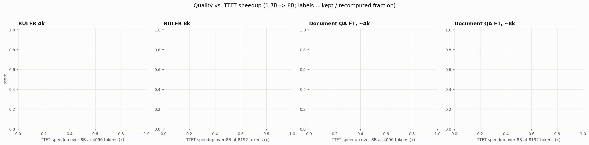

# 选择性重算实验

GPU：NVIDIA L40S；生成：2026-11-05 13:09:07；projector：混合数据 8k（第 12000 步）。小模型：1.7B，大模型：8B。开头 8 个和最后 64 个 token 始终由大模型计算；“重算比例”是中间部分由大模型重新计算的 token 占比。“丢弃其余”配置的选择方式与对应的重算配置完全相同，只是没选中的中间 token 被丢掉而不是用投影 KV 补上；SpecPrefill 是原论文方法（小模型打分，按 32 token 一块保留整段 prompt 的一部分，不强制保留开头和结尾，不用 projector），它的比例是整段 prompt 保留的比例。

## 总表

| 配置 | 实际重算比例（RULER 8k） | RULER 4k | RULER 8k | 问答 F1 4k | 问答 F1 8k | 大海捞针 |
|---|---|---|---|---|---|---|
| RaReCache 重算整段 0%，强制开头/尾部 | 0.9% | 0.474 | 0.403 | 0.298 | 0.312 | 1.000 |
| RaReCache 重算整段 10%，强制开头/尾部 | 10.7% | 0.594 | 0.543 | 0.434 | 0.452 | 1.000 |
| RaReCache 重算整段 30%，强制开头/尾部 | 30.5% | 0.649 | 0.593 | 0.585 | 0.572 | 1.000 |
| RaReCache 重算整段 50%，强制开头/尾部 | 50.3% | 0.682 | 0.639 | 0.680 | 0.619 | 0.978 |

## RULER 4096，按任务类型

| 配置 | 检索 | 汇总 | 变量追踪 | 问答 | 平均 |
|---|---|---|---|---|---|
| RaReCache 重算整段 0%，强制开头/尾部 | 0.59 | 0.35 | 0.00 | 0.37 | 0.474 |
| RaReCache 重算整段 10%，强制开头/尾部 | 0.62 | 0.57 | 0.95 | 0.33 | 0.594 |
| RaReCache 重算整段 30%，强制开头/尾部 | 0.61 | 0.80 | 1.00 | 0.47 | 0.649 |
| RaReCache 重算整段 50%，强制开头/尾部 | 0.61 | 0.91 | 1.00 | 0.57 | 0.682 |

RULER 4096 全部子任务

| 配置 | cwe | fwe | niah_multikey_1 | niah_multikey_2 | niah_multikey_3 | niah_multiquery | niah_multivalue | niah_single_1 | niah_single_2 | niah_single_3 | qa_1 | qa_2 | vt |
|---|---|---|---|---|---|---|---|---|---|---|---|---|---|
| RaReCache 重算整段 0%，强制开头/尾部 | 0.23 | 0.47 | 0.73 | 0.00 | 0.00 | 0.65 | 0.82 | 0.80 | 0.93 | 0.80 | 0.53 | 0.20 | 0.00 |
| RaReCache 重算整段 10%，强制开头/尾部 | 0.41 | 0.73 | 0.80 | 0.00 | 0.00 | 0.72 | 0.85 | 0.87 | 0.87 | 0.87 | 0.40 | 0.27 | 0.95 |
| RaReCache 重算整段 30%，强制开头/尾部 | 0.75 | 0.84 | 0.80 | 0.07 | 0.00 | 0.67 | 0.83 | 0.87 | 0.87 | 0.80 | 0.53 | 0.40 | 1.00 |
| RaReCache 重算整段 50%，强制开头/尾部 | 0.91 | 0.91 | 0.73 | 0.07 | 0.00 | 0.70 | 0.75 | 1.00 | 0.87 | 0.80 | 0.67 | 0.47 | 1.00 |

## RULER 8192，按任务类型

| 配置 | 检索 | 汇总 | 变量追踪 | 问答 | 平均 |
|---|---|---|---|---|---|
| RaReCache 重算整段 0%，强制开头/尾部 | 0.50 | 0.24 | 0.00 | 0.40 | 0.403 |
| RaReCache 重算整段 10%，强制开头/尾部 | 0.56 | 0.39 | 1.00 | 0.40 | 0.543 |
| RaReCache 重算整段 30%，强制开头/尾部 | 0.53 | 0.70 | 1.00 | 0.53 | 0.593 |
| RaReCache 重算整段 50%，强制开头/尾部 | 0.56 | 0.83 | 0.99 | 0.60 | 0.639 |

RULER 8192 全部子任务

| 配置 | cwe | fwe | niah_multikey_1 | niah_multikey_2 | niah_multikey_3 | niah_multiquery | niah_multivalue | niah_single_1 | niah_single_2 | niah_single_3 | qa_1 | qa_2 | vt |
|---|---|---|---|---|---|---|---|---|---|---|---|---|---|
| RaReCache 重算整段 0%，强制开头/尾部 | 0.10 | 0.38 | 0.73 | 0.00 | 0.00 | 0.48 | 0.62 | 0.67 | 0.60 | 0.87 | 0.60 | 0.20 | 0.00 |
| RaReCache 重算整段 10%，强制开头/尾部 | 0.27 | 0.51 | 0.93 | 0.00 | 0.00 | 0.60 | 0.62 | 0.80 | 0.67 | 0.87 | 0.53 | 0.27 | 1.00 |
| RaReCache 重算整段 30%，强制开头/尾部 | 0.71 | 0.69 | 0.87 | 0.00 | 0.00 | 0.62 | 0.63 | 0.87 | 0.67 | 0.60 | 0.73 | 0.33 | 1.00 |
| RaReCache 重算整段 50%，强制开头/尾部 | 0.93 | 0.73 | 0.87 | 0.20 | 0.00 | 0.68 | 0.58 | 0.87 | 0.73 | 0.53 | 0.80 | 0.40 | 0.99 |

## 问答 F1

| 配置 | squad 4k | hotpot 4k | trivia 4k | squad 8k | hotpot 8k | trivia 8k | 平均 4k | 平均 8k |
|---|---|---|---|---|---|---|---|---|
| RaReCache 重算整段 0%，强制开头/尾部 | 0.304 | 0.236 | 0.352 | 0.221 | 0.203 | 0.514 | 0.298 | 0.312 |
| RaReCache 重算整段 10%，强制开头/尾部 | 0.435 | 0.312 | 0.556 | 0.354 | 0.329 | 0.674 | 0.434 | 0.452 |
| RaReCache 重算整段 30%，强制开头/尾部 | 0.627 | 0.478 | 0.650 | 0.576 | 0.432 | 0.709 | 0.585 | 0.572 |
| RaReCache 重算整段 50%，强制开头/尾部 | 0.741 | 0.603 | 0.695 | 0.664 | 0.453 | 0.739 | 0.680 | 0.619 |

## GSM8K（8-shot，对话轮次形式）

| 配置 | 准确率 | 遵守 #### 格式 |
|---|---|---|
| RaReCache 重算整段 0%，强制开头/尾部 | 0.880 | 0.073 |
| RaReCache 重算整段 10%，强制开头/尾部 | 0.867 | 0.180 |
| RaReCache 重算整段 30%，强制开头/尾部 | 0.840 | 0.347 |
| RaReCache 重算整段 50%，强制开头/尾部 | 0.880 | 0.633 |

## 代码下一行补全

| 配置 | 4k 精确匹配 | 4k 相似度 | 8k 精确匹配 | 8k 相似度 |
|---|---|---|---|---|
| RaReCache 重算整段 0%，强制开头/尾部 | 0.140 | 0.502 | 0.150 | 0.533 |
| RaReCache 重算整段 10%，强制开头/尾部 | 0.140 | 0.538 | 0.140 | 0.529 |
| RaReCache 重算整段 30%，强制开头/尾部 | 0.150 | 0.568 | 0.210 | 0.579 |
| RaReCache 重算整段 50%，强制开头/尾部 | 0.160 | 0.602 | 0.250 | 0.615 |

## 首 token 延迟（毫秒，L40S，eager；SpecPrefill 的 look-ahead 用 CUDA graph 回放）

| 配置 | 4096 | 8192 | 16384 | 32768 |
|---|---|---|---|---|
| 8B 单独 | 398.7（1.00 倍） | 911.1（1.00 倍） | 2100.9（1.00 倍） | 5038.7（1.00 倍） |
| 混合，不重算 | 152.3（2.62 倍） | 317.8（2.87 倍） | 779.1（2.70 倍） | 1859.0（2.71 倍） |
| 1.7B 注意力 10%，按句子 | 183.8（2.17 倍） | 427.2（2.13 倍） | 1081.4（1.94 倍） | 2836.7（1.78 倍） |
| SpecPrefill 保留整段 10% | 223.9（1.78 倍） | 432.0（2.11 倍） | 969.5（2.17 倍） | 2239.7（2.25 倍） |
| SpecPrefill 保留整段 30% | 290.6（1.37 倍） | 577.0（1.58 倍） | 1327.7（1.58 倍） | 3074.3（1.64 倍） |
| RaReCache 重算整段 0%，强制开头/尾部 | 206.6（1.93 倍） | 441.7（2.06 倍） | 1017.9（2.06 倍） | 2330.4（2.16 倍） |
| RaReCache 重算整段 10%，强制开头/尾部 | 230.4（1.73 倍） | 529.7（1.72 倍） | 1301.0（1.61 倍） | 3237.3（1.56 倍） |
| RaReCache 重算整段 30%，强制开头/尾部 | 318.4（1.25 倍） | 742.3（1.23 倍） | 1949.1（1.08 倍） | 5331.7（0.95 倍） |
| RaReCache 重算整段 50%，强制开头/尾部 | 398.4（1.00 倍） | 985.6（0.92 倍） | 2673.6（0.79 倍） | 7370.8（0.68 倍） |

括号内是相对 8B 单独的加速比。
