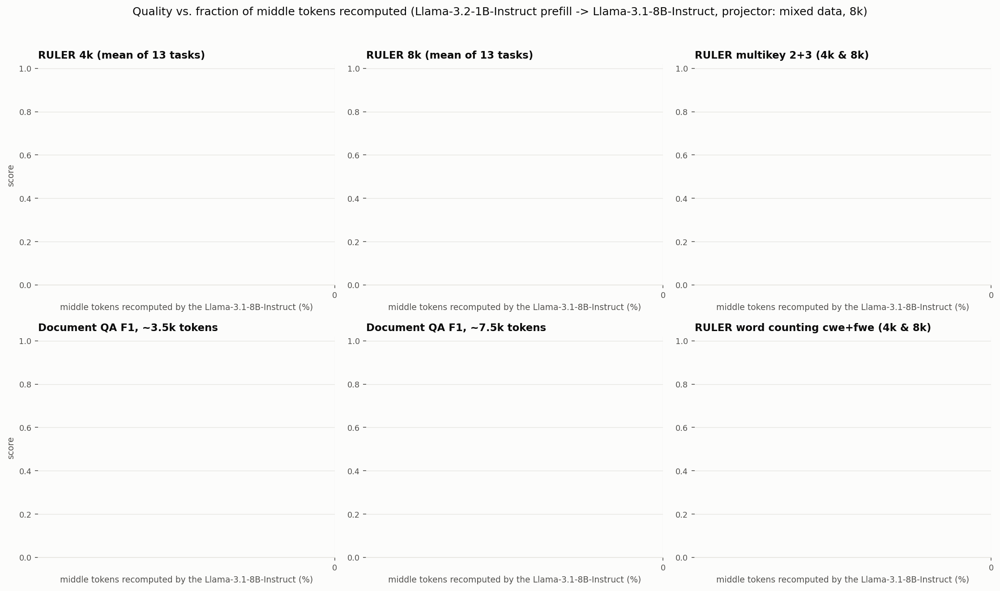

# 选择性重算实验

GPU：NVIDIA L40S；生成：2026-11-04 02:46:44；projector：混合数据 8k（第 12000 步）。小模型：Llama-3.2-1B-Instruct，大模型：Llama-3.1-8B-Instruct。开头 8 个和最后 64 个 token 始终由大模型计算；“重算比例”是中间部分由大模型重新计算的 token 占比。“丢弃其余”配置的选择方式与对应的重算配置完全相同，只是没选中的中间 token 被丢掉而不是用投影 KV 补上；SpecPrefill 是原论文方法（小模型打分，按 32 token 一块保留整段 prompt 的一部分，不强制保留开头和结尾，不用 projector），它的比例是整段 prompt 保留的比例。

## 总表

| 配置 | 实际重算比例（RULER 8k） | RULER 4k | RULER 8k | 问答 F1 4k | 问答 F1 8k | 大海捞针 |
|---|---|---|---|---|---|---|
| 混合，不重算 | - | - | - | - | - | - |

## 首 token 延迟（毫秒，L40S，所有方法都用 CUDA graph：固定形状的阶段整段回放，只有选择步骤 eager）

| 配置 | 4096 | 8192 | 16384 | 32768 |
|---|---|---|---|---|
| Llama-3.1-8B-Instruct 单独 | 381.5（1.00 倍） | 847.7（1.00 倍） | 1919.3（1.00 倍） | 4717.8（1.00 倍） |
| Llama-3.2-1B-Instruct 单独 | 60.1（6.35 倍） | 139.8（6.06 倍） | 354.5（5.41 倍） | 878.0（5.37 倍） |
| 混合，不重算 | 109.7（3.48 倍） | 209.8（4.04 倍） | 470.2（4.08 倍） | 1088.9（4.33 倍） |
| Llama-3.2-1B-Instruct 注意力 10%，按句子 | 143.8（2.65 倍） | 307.8（2.75 倍） | 761.0（2.52 倍） | 1981.9（2.38 倍） |
| Llama-3.2-1B-Instruct 注意力 20%，按句子 | 190.7（2.00 倍） | 414.7（2.04 倍） | 1039.4（1.85 倍） | 2963.8（1.59 倍） |
| 丢弃其余（不投影）：Llama-3.2-1B-Instruct 注意力 20%，按句子 | 151.1（2.53 倍） | 304.7（2.78 倍） | 686.3（2.80 倍） | 1599.8（2.95 倍） |
| SpecPrefill 保留整段 10% | 158.4（2.41 倍） | 293.0（2.89 倍） | 616.2（3.11 倍） | 1382.6（3.41 倍） |
| SpecPrefill 保留整段 20% | 191.1（2.00 倍） | 359.8（2.36 倍） | 763.4（2.51 倍） | 1745.6（2.70 倍） |
| SpecPrefill 保留整段 30% | 223.5（1.71 倍） | 432.1（1.96 倍） | 943.5（2.03 倍） | 2154.4（2.19 倍） |

括号内是相对 Llama-3.1-8B-Instruct 单独（同样用 CUDA graph）的加速比。graph 与 eager 的首 token logits 最大相对差（4096 token）：Llama-3.1-8B-Instruct 单独 0.0e+00，Llama-3.2-1B-Instruct 单独 0.0e+00，混合，不重算 0.0e+00，Llama-3.2-1B-Instruct 注意力 10%，按句子 0.0e+00，Llama-3.2-1B-Instruct 注意力 20%，按句子 0.0e+00，丢弃其余（不投影）：Llama-3.2-1B-Instruct 注意力 20%，按句子 0.0e+00，SpecPrefill 保留整段 10% 0.0e+00，SpecPrefill 保留整段 20% 0.0e+00，SpecPrefill 保留整段 30% 0.0e+00。
