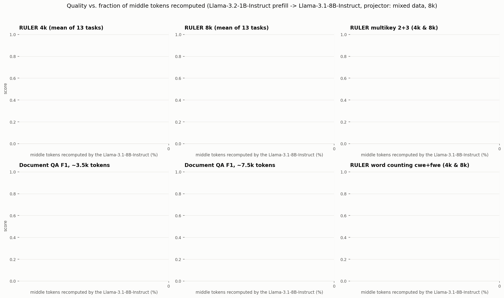

# 选择性重算实验

GPU：NVIDIA L40S；生成：2026-11-04 02:55:54；projector：混合数据 8k（第 12000 步）。小模型：Llama-3.2-1B-Instruct，大模型：Llama-3.1-8B-Instruct。开头 8 个和最后 64 个 token 始终由大模型计算；“重算比例”是中间部分由大模型重新计算的 token 占比。“丢弃其余”配置的选择方式与对应的重算配置完全相同，只是没选中的中间 token 被丢掉而不是用投影 KV 补上；SpecPrefill 是原论文方法（小模型打分，按 32 token 一块保留整段 prompt 的一部分，不强制保留开头和结尾，不用 projector），它的比例是整段 prompt 保留的比例。

## 总表

| 配置 | 实际重算比例（RULER 8k） | RULER 4k | RULER 8k | 问答 F1 4k | 问答 F1 8k | 大海捞针 |
|---|---|---|---|---|---|---|
| 混合，不重算 | - | - | - | - | - | - |

## 首 token 延迟（毫秒，L40S，所有方法都用 CUDA graph：固定形状的阶段整段回放，只有选择步骤 eager）

| 配置 | 4096 | 8192 | 16384 | 32768 |
|---|---|---|---|---|
| Llama-3.1-8B-Instruct 单独 | 363.8（1.00 倍） | 816.1（1.00 倍） | 1919.3（1.00 倍） | 4613.0（1.00 倍） |
| 混合，不重算 | 139.5（2.61 倍） | 274.7（2.97 倍） | 603.4（3.18 倍） | 1354.1（3.41 倍） |
| Llama-3.2-1B-Instruct 注意力 10%，按句子 | 168.3（2.16 倍） | 367.1（2.22 倍） | 895.2（2.14 倍） | 2247.6（2.05 倍） |
| Llama-3.2-1B-Instruct 注意力 20%，按句子 | 214.3（1.70 倍） | 470.9（1.73 倍） | 1172.8（1.64 倍） | 3194.9（1.44 倍） |

括号内是相对 Llama-3.1-8B-Instruct 单独（同样用 CUDA graph）的加速比。graph 与 eager 的首 token logits 最大相对差（4096 token）：Llama-3.1-8B-Instruct 单独 0.0e+00，混合，不重算 0.0e+00，Llama-3.2-1B-Instruct 注意力 10%，按句子 0.0e+00，Llama-3.2-1B-Instruct 注意力 20%，按句子 0.0e+00。
