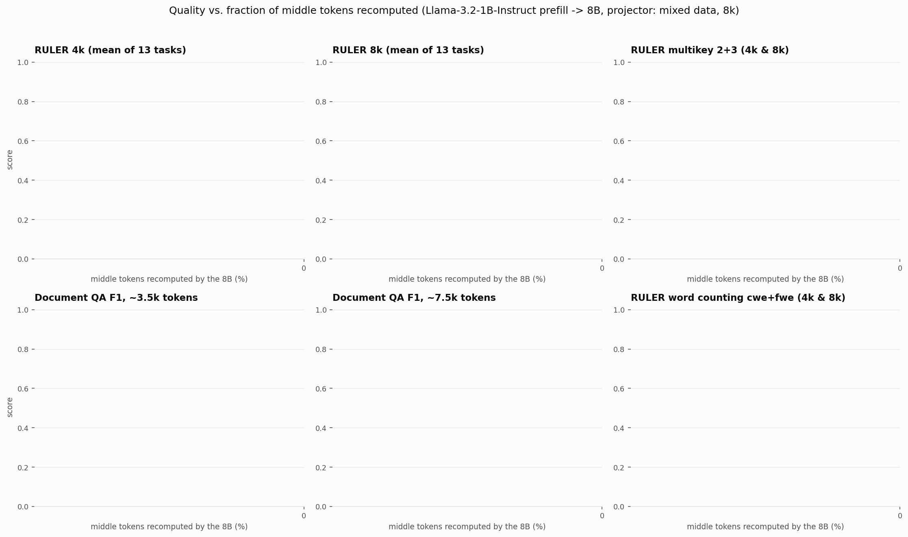

# 选择性重算实验

GPU：NVIDIA L40S；生成：2026-11-04 03:10:28；projector：混合数据 8k（第 12000 步）。小模型：Llama-3.2-1B-Instruct，大模型：8B。开头 8 个和最后 64 个 token 始终由大模型计算；“重算比例”是中间部分由大模型重新计算的 token 占比。“丢弃其余”配置的选择方式与对应的重算配置完全相同，只是没选中的中间 token 被丢掉而不是用投影 KV 补上；SpecPrefill 是原论文方法（小模型打分，按 32 token 一块保留整段 prompt 的一部分，不强制保留开头和结尾，不用 projector），它的比例是整段 prompt 保留的比例。

## 总表

| 配置 | 实际重算比例（RULER 8k） | RULER 4k | RULER 8k | 问答 F1 4k | 问答 F1 8k | 大海捞针 |
|---|---|---|---|---|---|---|
| 混合，不重算 | - | - | - | - | - | - |

## 首 token 延迟（毫秒，L40S，所有方法都用 CUDA graph：固定形状的阶段整段回放，只有选择步骤 eager）

| 配置 | 4096 | 8192 | 16384 | 32768 |
|---|---|---|---|---|
| 8B 单独 | 399.9（1.00 倍） | 906.2（1.00 倍） | 2159.5（1.00 倍） | 5058.4（1.00 倍） |
| 混合，不重算 | 112.7（3.55 倍） | 213.0（4.25 倍） | 476.4（4.53 倍） | 1099.1（4.60 倍） |
| Llama-3.2-1B-Instruct 注意力 10%，按句子 | 144.1（2.77 倍） | 322.5（2.81 倍） | 789.3（2.74 倍） | 2069.8（2.44 倍） |
| Llama-3.2-1B-Instruct 注意力 20%，按句子 | 189.2（2.11 倍） | 425.6（2.13 倍） | 1094.2（1.97 倍） | 3116.4（1.62 倍） |
| 丢弃其余（不投影）：Llama-3.2-1B-Instruct 注意力 20%，按句子 | 147.9（2.70 倍） | 306.7（2.95 倍） | 702.8（3.07 倍） | 1640.7（3.08 倍） |
| SpecPrefill 保留整段 10% | 158.3（2.53 倍） | 292.9（3.09 倍） | 617.5（3.50 倍） | 1399.9（3.61 倍） |
| SpecPrefill 保留整段 20% | 193.2（2.07 倍） | 360.3（2.52 倍） | 774.7（2.79 倍） | 1819.2（2.78 倍） |
| SpecPrefill 保留整段 30% | 227.3（1.76 倍） | 437.9（2.07 倍） | 974.4（2.22 倍） | 2236.2（2.26 倍） |

括号内是相对 8B 单独（同样用 CUDA graph）的加速比。graph 与 eager 的首 token logits 最大相对差（4096 token）：8B 单独 0.0e+00，混合，不重算 0.0e+00，Llama-3.2-1B-Instruct 注意力 10%，按句子 0.0e+00，Llama-3.2-1B-Instruct 注意力 20%，按句子 0.0e+00，丢弃其余（不投影）：Llama-3.2-1B-Instruct 注意力 20%，按句子 0.0e+00，SpecPrefill 保留整段 10% 0.0e+00，SpecPrefill 保留整段 20% 0.0e+00，SpecPrefill 保留整段 30% 1.6e-02。
