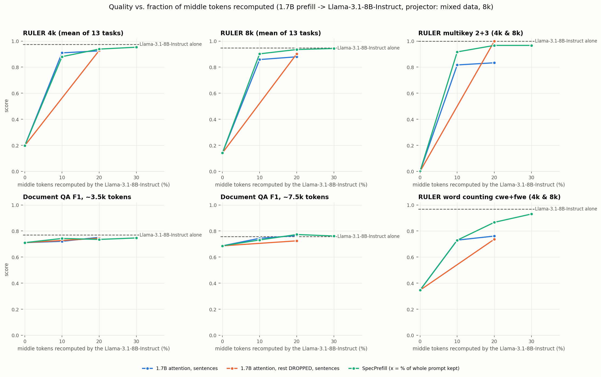

# 选择性重算实验

GPU：NVIDIA L40S；生成：2026-11-07 00:19:29；projector：混合数据 8k（第 12000 步）。小模型：1.7B，大模型：Llama-3.1-8B-Instruct。开头 8 个和最后 64 个 token 始终由大模型计算；“重算比例”是中间部分由大模型重新计算的 token 占比。“丢弃其余”配置的选择方式与对应的重算配置完全相同，只是没选中的中间 token 被丢掉而不是用投影 KV 补上；SpecPrefill 是原论文方法（小模型打分，按 32 token 一块保留整段 prompt 的一部分，不强制保留开头和结尾，不用 projector），它的比例是整段 prompt 保留的比例。

## 总表

| 配置 | 实际重算比例（RULER 8k） | RULER 4k | RULER 8k | 问答 F1 4k | 问答 F1 8k | 大海捞针 |
|---|---|---|---|---|---|---|
| Llama-3.1-8B-Instruct 单独 | 全部 | 0.974 | 0.947 | 0.770 | 0.757 | 1.000 |
| 混合，不重算 | 0.0% | 0.198 | 0.142 | 0.711 | 0.686 | 0.000 |
| 1.7B 注意力 10%，按句子 | 10.2% | 0.909 | 0.858 | 0.721 | 0.744 | 0.978 |
| 1.7B 注意力 20%，按句子 | 20.1% | 0.925 | 0.879 | 0.751 | 0.765 | 1.000 |
| 丢弃其余（不投影）：1.7B 注意力 20%，按句子 | 20.1% | 0.927 | 0.902 | 0.744 | 0.724 | 1.000 |
| SpecPrefill 保留整段 10% | 10.0% | 0.880 | 0.902 | 0.743 | 0.731 | 1.000 |
| SpecPrefill 保留整段 20% | 20.0% | 0.938 | 0.935 | 0.735 | 0.773 | 1.000 |
| SpecPrefill 保留整段 30% | 30.0% | 0.953 | 0.943 | 0.747 | 0.762 | 1.000 |

## RULER 4096，按任务类型

| 配置 | 检索 | 汇总 | 变量追踪 | 问答 | 平均 |
|---|---|---|---|---|---|
| Llama-3.1-8B-Instruct 单独 | 1.00 | 0.98 | 1.00 | 0.87 | 0.974 |
| 混合，不重算 | 0.03 | 0.49 | 0.07 | 0.67 | 0.198 |
| 1.7B 注意力 10%，按句子 | 0.96 | 0.85 | 0.89 | 0.77 | 0.909 |
| 1.7B 注意力 20%，按句子 | 0.96 | 0.87 | 0.97 | 0.83 | 0.925 |
| 丢弃其余（不投影）：1.7B 注意力 20%，按句子 | 1.00 | 0.78 | 0.99 | 0.77 | 0.927 |
| SpecPrefill 保留整段 10% | 0.95 | 0.74 | 0.95 | 0.70 | 0.880 |
| SpecPrefill 保留整段 20% | 0.98 | 0.89 | 0.99 | 0.80 | 0.938 |
| SpecPrefill 保留整段 30% | 0.98 | 0.95 | 0.99 | 0.83 | 0.953 |

RULER 4096 全部子任务

| 配置 | cwe | fwe | niah_multikey_1 | niah_multikey_2 | niah_multikey_3 | niah_multiquery | niah_multivalue | niah_single_1 | niah_single_2 | niah_single_3 | qa_1 | qa_2 | vt |
|---|---|---|---|---|---|---|---|---|---|---|---|---|---|
| Llama-3.1-8B-Instruct 单独 | 0.99 | 0.98 | 1.00 | 1.00 | 1.00 | 0.97 | 1.00 | 1.00 | 1.00 | 1.00 | 1.00 | 0.73 | 1.00 |
| 混合，不重算 | 0.46 | 0.51 | 0.07 | 0.00 | 0.00 | 0.00 | 0.00 | 0.00 | 0.13 | 0.00 | 0.87 | 0.47 | 0.07 |
| 1.7B 注意力 10%，按句子 | 0.81 | 0.89 | 1.00 | 1.00 | 0.80 | 1.00 | 0.90 | 1.00 | 1.00 | 1.00 | 0.93 | 0.60 | 0.89 |
| 1.7B 注意力 20%，按句子 | 0.82 | 0.91 | 1.00 | 0.93 | 0.73 | 1.00 | 0.98 | 1.00 | 1.00 | 1.00 | 1.00 | 0.67 | 0.97 |
| 丢弃其余（不投影）：1.7B 注意力 20%，按句子 | 0.62 | 0.93 | 1.00 | 1.00 | 1.00 | 1.00 | 0.98 | 1.00 | 1.00 | 1.00 | 1.00 | 0.53 | 0.99 |
| SpecPrefill 保留整段 10% | 0.61 | 0.87 | 1.00 | 1.00 | 0.80 | 0.82 | 1.00 | 1.00 | 1.00 | 1.00 | 0.93 | 0.47 | 0.95 |
| SpecPrefill 保留整段 20% | 0.87 | 0.91 | 1.00 | 1.00 | 0.87 | 0.97 | 1.00 | 1.00 | 1.00 | 1.00 | 0.93 | 0.67 | 0.99 |
| SpecPrefill 保留整段 30% | 0.97 | 0.93 | 1.00 | 1.00 | 0.87 | 0.97 | 1.00 | 1.00 | 1.00 | 1.00 | 1.00 | 0.67 | 0.99 |

## RULER 8192，按任务类型

| 配置 | 检索 | 汇总 | 变量追踪 | 问答 | 平均 |
|---|---|---|---|---|---|
| Llama-3.1-8B-Instruct 单独 | 1.00 | 0.95 | 1.00 | 0.70 | 0.947 |
| 混合，不重算 | 0.00 | 0.21 | 0.16 | 0.63 | 0.142 |
| 1.7B 注意力 10%，按句子 | 0.93 | 0.61 | 0.95 | 0.77 | 0.858 |
| 1.7B 注意力 20%，按句子 | 0.96 | 0.66 | 1.00 | 0.73 | 0.879 |
| 丢弃其余（不投影）：1.7B 注意力 20%，按句子 | 1.00 | 0.70 | 1.00 | 0.67 | 0.902 |
| SpecPrefill 保留整段 10% | 0.98 | 0.72 | 0.99 | 0.73 | 0.902 |
| SpecPrefill 保留整段 20% | 1.00 | 0.84 | 1.00 | 0.73 | 0.935 |
| SpecPrefill 保留整段 30% | 1.00 | 0.91 | 1.00 | 0.73 | 0.943 |

RULER 8192 全部子任务

| 配置 | cwe | fwe | niah_multikey_1 | niah_multikey_2 | niah_multikey_3 | niah_multiquery | niah_multivalue | niah_single_1 | niah_single_2 | niah_single_3 | qa_1 | qa_2 | vt |
|---|---|---|---|---|---|---|---|---|---|---|---|---|---|
| Llama-3.1-8B-Instruct 单独 | 0.95 | 0.96 | 1.00 | 1.00 | 1.00 | 1.00 | 1.00 | 1.00 | 1.00 | 1.00 | 0.87 | 0.53 | 1.00 |
| 混合，不重算 | 0.01 | 0.40 | 0.00 | 0.00 | 0.00 | 0.00 | 0.00 | 0.00 | 0.00 | 0.00 | 0.80 | 0.47 | 0.16 |
| 1.7B 注意力 10%，按句子 | 0.58 | 0.64 | 1.00 | 1.00 | 0.47 | 1.00 | 0.98 | 1.00 | 1.00 | 1.00 | 0.93 | 0.60 | 0.95 |
| 1.7B 注意力 20%，按句子 | 0.65 | 0.67 | 1.00 | 1.00 | 0.67 | 0.98 | 1.00 | 1.00 | 1.00 | 1.00 | 0.87 | 0.60 | 1.00 |
| 丢弃其余（不投影）：1.7B 注意力 20%，按句子 | 0.51 | 0.89 | 1.00 | 1.00 | 1.00 | 1.00 | 1.00 | 1.00 | 1.00 | 1.00 | 0.80 | 0.53 | 1.00 |
| SpecPrefill 保留整段 10% | 0.46 | 0.98 | 1.00 | 0.93 | 0.93 | 0.98 | 0.98 | 1.00 | 1.00 | 1.00 | 0.87 | 0.60 | 0.99 |
| SpecPrefill 保留整段 20% | 0.73 | 0.96 | 1.00 | 1.00 | 1.00 | 1.00 | 1.00 | 1.00 | 1.00 | 1.00 | 0.87 | 0.60 | 1.00 |
| SpecPrefill 保留整段 30% | 0.87 | 0.96 | 1.00 | 1.00 | 1.00 | 1.00 | 0.97 | 1.00 | 1.00 | 1.00 | 0.87 | 0.60 | 1.00 |

## 问答 F1

| 配置 | squad 4k | hotpot 4k | trivia 4k | squad 8k | hotpot 8k | trivia 8k | 平均 4k | 平均 8k |
|---|---|---|---|---|---|---|---|---|
| Llama-3.1-8B-Instruct 单独 | 0.829 | 0.647 | 0.833 | 0.787 | 0.585 | 0.900 | 0.770 | 0.757 |
| 混合，不重算 | 0.722 | 0.621 | 0.789 | 0.719 | 0.471 | 0.868 | 0.711 | 0.686 |
| 1.7B 注意力 10%，按句子 | 0.768 | 0.593 | 0.802 | 0.757 | 0.593 | 0.881 | 0.721 | 0.744 |
| 1.7B 注意力 20%，按句子 | 0.843 | 0.632 | 0.780 | 0.739 | 0.625 | 0.930 | 0.751 | 0.765 |
| 丢弃其余（不投影）：1.7B 注意力 20%，按句子 | 0.838 | 0.614 | 0.782 | 0.758 | 0.592 | 0.823 | 0.744 | 0.724 |
| SpecPrefill 保留整段 10% | 0.852 | 0.572 | 0.805 | 0.743 | 0.555 | 0.896 | 0.743 | 0.731 |
| SpecPrefill 保留整段 20% | 0.855 | 0.612 | 0.738 | 0.785 | 0.598 | 0.936 | 0.735 | 0.773 |
| SpecPrefill 保留整段 30% | 0.842 | 0.619 | 0.778 | 0.739 | 0.626 | 0.920 | 0.747 | 0.762 |

## GSM8K（8-shot，对话轮次形式）

| 配置 | 准确率 | 遵守 #### 格式 |
|---|---|---|
| Llama-3.1-8B-Instruct 单独 | 0.860 | 0.913 |
| 混合，不重算 | 0.780 | 0.893 |
| 1.7B 注意力 10%，按句子 | 0.860 | 0.927 |
| 1.7B 注意力 20%，按句子 | 0.867 | 0.900 |
| 丢弃其余（不投影）：1.7B 注意力 20%，按句子 | 0.780 | 0.007 |
| SpecPrefill 保留整段 10% | 0.780 | 0.020 |
| SpecPrefill 保留整段 20% | 0.800 | 0.013 |
| SpecPrefill 保留整段 30% | 0.800 | 0.213 |

## 代码下一行补全

| 配置 | 4k 精确匹配 | 4k 相似度 | 8k 精确匹配 | 8k 相似度 |
|---|---|---|---|---|
| Llama-3.1-8B-Instruct 单独 | 0.340 | 0.689 | 0.260 | 0.641 |
| 混合，不重算 | 0.250 | 0.645 | 0.160 | 0.564 |
| 1.7B 注意力 10%，按句子 | 0.310 | 0.667 | 0.250 | 0.624 |
| 1.7B 注意力 20%，按句子 | 0.320 | 0.681 | 0.270 | 0.641 |
| 丢弃其余（不投影）：1.7B 注意力 20%，按句子 | 0.310 | 0.680 | 0.270 | 0.631 |
| SpecPrefill 保留整段 10% | 0.300 | 0.638 | 0.240 | 0.613 |
| SpecPrefill 保留整段 20% | 0.300 | 0.672 | 0.260 | 0.624 |
| SpecPrefill 保留整段 30% | 0.330 | 0.697 | 0.260 | 0.627 |
