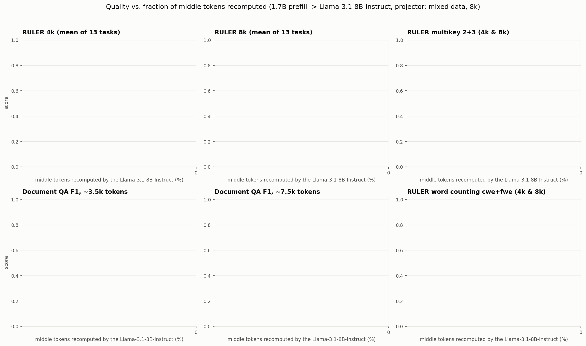

# 选择性重算实验

GPU：NVIDIA L40S；生成：2026-11-04 02:59:27；projector：混合数据 8k（第 12000 步）。小模型：1.7B，大模型：Llama-3.1-8B-Instruct。开头 8 个和最后 64 个 token 始终由大模型计算；“重算比例”是中间部分由大模型重新计算的 token 占比。“丢弃其余”配置的选择方式与对应的重算配置完全相同，只是没选中的中间 token 被丢掉而不是用投影 KV 补上；SpecPrefill 是原论文方法（小模型打分，按 32 token 一块保留整段 prompt 的一部分，不强制保留开头和结尾，不用 projector），它的比例是整段 prompt 保留的比例。

## 总表

| 配置 | 实际重算比例（RULER 8k） | RULER 4k | RULER 8k | 问答 F1 4k | 问答 F1 8k | 大海捞针 |
|---|---|---|---|---|---|---|
| 混合，不重算 | - | - | - | - | - | - |

## 首 token 延迟（毫秒，L40S，所有方法都用 CUDA graph：固定形状的阶段整段回放，只有选择步骤 eager）

| 配置 | 4096 | 8192 | 16384 | 32768 |
|---|---|---|---|---|
| Llama-3.1-8B-Instruct 单独 | 378.1（1.00 倍） | 846.8（1.00 倍） | 1919.0（1.00 倍） | 4620.8（1.00 倍） |
| 混合，不重算 | 147.8（2.56 倍） | 313.2（2.70 倍） | 761.0（2.52 倍） | 1839.3（2.51 倍） |
| 1.7B 注意力 10%，按句子 | 180.4（2.10 倍） | 413.6（2.05 倍） | 1049.2（1.83 倍） | 2739.3（1.69 倍） |
| 1.7B 注意力 20%，按句子 | 221.5（1.71 倍） | 515.2（1.64 倍） | 1329.0（1.44 倍） | 3674.3（1.26 倍） |
| 丢弃其余（不投影）：1.7B 注意力 20%，按句子 | 180.8（2.09 倍） | 397.5（2.13 倍） | 959.7（2.00 倍） | 2351.9（1.96 倍） |
| SpecPrefill 保留整段 10% | 224.3（1.69 倍） | 432.2（1.96 倍） | 960.9（2.00 倍） | 2228.7（2.07 倍） |
| SpecPrefill 保留整段 20% | 258.4（1.46 倍） | 497.0（1.70 倍） | 1106.7（1.73 倍） | 2578.8（1.79 倍） |
| SpecPrefill 保留整段 30% | 291.5（1.30 倍） | 572.4（1.48 倍） | 1286.3（1.49 倍） | 2991.1（1.54 倍） |

括号内是相对 Llama-3.1-8B-Instruct 单独（同样用 CUDA graph）的加速比。graph 与 eager 的首 token logits 最大相对差（4096 token）：Llama-3.1-8B-Instruct 单独 0.0e+00，混合，不重算 0.0e+00，1.7B 注意力 10%，按句子 0.0e+00，1.7B 注意力 20%，按句子 0.0e+00，丢弃其余（不投影）：1.7B 注意力 20%，按句子 0.0e+00，SpecPrefill 保留整段 10% 0.0e+00，SpecPrefill 保留整段 20% 0.0e+00，SpecPrefill 保留整段 30% 2.8e-02。
