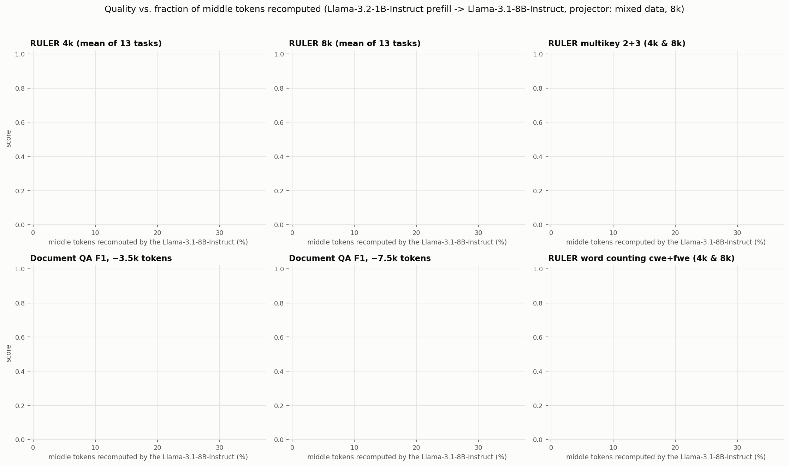

# 选择性重算实验

GPU：NVIDIA L40S；生成：2026-11-01 22:31:39；projector：混合数据 8k（第 12000 步）。小模型：Llama-3.2-1B-Instruct，大模型：Llama-3.1-8B-Instruct。开头 8 个和最后 64 个 token 始终由大模型计算；“重算比例”是中间部分由大模型重新计算的 token 占比。“丢弃其余”配置的选择方式与对应的重算配置完全相同，只是没选中的中间 token 被丢掉而不是用投影 KV 补上；SpecPrefill 是原论文方法（小模型打分，按 32 token 一块保留整段 prompt 的一部分，不强制保留开头和结尾，不用 projector），它的比例是整段 prompt 保留的比例。

## 总表

| 配置 | 实际重算比例（RULER 8k） | RULER 4k | RULER 8k | 问答 F1 4k | 问答 F1 8k | 大海捞针 |
|---|---|---|---|---|---|---|
| Llama-3.1-8B-Instruct 单独 | 全部 | - | - | - | - | - |
| Llama-3.2-1B-Instruct 单独 | - | - | - | - | - | - |
| 混合，不重算 | - | - | - | - | - | - |
| Llama-3.2-1B-Instruct 注意力 10%，按句子 | - | - | - | - | - | - |
| 丢弃其余（不投影）：Llama-3.2-1B-Instruct 注意力 20%，按句子 | - | - | - | - | - | - |
| SpecPrefill 保留整段 10% | - | - | - | - | - | - |
| SpecPrefill 保留整段 30% | - | - | - | - | - | - |

## 问答 F1，长 prompt（约 16k / 32k token）

| 配置 | squad 16k | hotpot 16k | trivia 16k | squad 32k | hotpot 32k | trivia 32k | 平均 16k | 平均 32k |
|---|---|---|---|---|---|---|---|---|
| Llama-3.1-8B-Instruct 单独 | 0.842 | 0.526 | 0.796 | 0.693 | 0.437 | 0.871 | 0.721 | 0.667 |
| Llama-3.2-1B-Instruct 单独 | 0.297 | 0.272 | 0.682 | 0.206 | 0.141 | 0.439 | 0.417 | 0.262 |
| 混合，不重算 | 0.624 | 0.432 | 0.804 | 0.455 | 0.261 | 0.892 | 0.620 | 0.536 |
| Llama-3.2-1B-Instruct 注意力 10%，按句子 | 0.756 | 0.548 | 0.842 | 0.585 | 0.388 | 0.853 | 0.715 | 0.609 |
| 丢弃其余（不投影）：Llama-3.2-1B-Instruct 注意力 20%，按句子 | 0.808 | 0.511 | 0.798 | 0.722 | 0.541 | 0.899 | 0.706 | 0.721 |
| SpecPrefill 保留整段 10% | 0.727 | 0.529 | 0.777 | 0.729 | 0.443 | 0.870 | 0.678 | 0.681 |
| SpecPrefill 保留整段 30% | 0.793 | 0.547 | 0.779 | 0.727 | 0.492 | 0.875 | 0.706 | 0.698 |

## 大海捞针，长 prompt

| 配置 | 15872 | 32256 |
|---|---|---|
| Llama-3.1-8B-Instruct 单独 | 1.00 | 1.00 |
| Llama-3.2-1B-Instruct 单独 | 0.43 | 0.00 |
| 混合，不重算 | 0.97 | 0.83 |
| Llama-3.2-1B-Instruct 注意力 10%，按句子 | 1.00 | 0.97 |
| 丢弃其余（不投影）：Llama-3.2-1B-Instruct 注意力 20%，按句子 | 1.00 | 1.00 |
| SpecPrefill 保留整段 10% | 0.97 | 0.47 |
| SpecPrefill 保留整段 30% | 1.00 | 0.90 |
