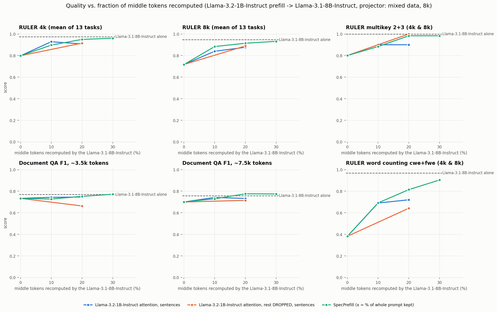

# 选择性重算实验

GPU：NVIDIA L40S；生成：2026-11-01 19:28:50；projector：混合数据 8k（第 12000 步）。小模型：Llama-3.2-1B-Instruct，大模型：Llama-3.1-8B-Instruct。开头 8 个和最后 64 个 token 始终由大模型计算；“重算比例”是中间部分由大模型重新计算的 token 占比。“丢弃其余”配置的选择方式与对应的重算配置完全相同，只是没选中的中间 token 被丢掉而不是用投影 KV 补上；SpecPrefill 是原论文方法（小模型打分，按 32 token 一块保留整段 prompt 的一部分，不强制保留开头和结尾，不用 projector），它的比例是整段 prompt 保留的比例。

## 总表

| 配置 | 实际重算比例（RULER 8k） | RULER 4k | RULER 8k | 问答 F1 4k | 问答 F1 8k | 大海捞针 |
|---|---|---|---|---|---|---|
| Llama-3.1-8B-Instruct 单独 | 全部 | 0.974 | 0.947 | 0.770 | 0.757 | 1.000 |
| Llama-3.2-1B-Instruct 单独 | 0.0% | 0.783 | 0.712 | 0.472 | 0.347 | 0.956 |
| 混合，不重算 | 0.0% | 0.798 | 0.717 | 0.733 | 0.700 | 1.000 |
| Llama-3.2-1B-Instruct 注意力 10%，按句子 | 10.1% | 0.928 | 0.840 | 0.743 | 0.742 | 1.000 |
| Llama-3.2-1B-Instruct 注意力 20%，按句子 | 20.1% | 0.908 | 0.877 | 0.746 | 0.732 | 1.000 |
| 丢弃其余（不投影）：Llama-3.2-1B-Instruct 注意力 20%，按句子 | 20.1% | 0.915 | 0.889 | 0.663 | 0.715 | 1.000 |
| SpecPrefill 保留整段 10% | 10.0% | 0.897 | 0.883 | 0.727 | 0.729 | 1.000 |
| SpecPrefill 保留整段 20% | 20.0% | 0.950 | 0.914 | 0.752 | 0.776 | 1.000 |
| SpecPrefill 保留整段 30% | 30.0% | 0.960 | 0.932 | 0.771 | 0.774 | 1.000 |

## RULER 4096，按任务类型

| 配置 | 检索 | 汇总 | 变量追踪 | 问答 | 平均 |
|---|---|---|---|---|---|
| Llama-3.1-8B-Instruct 单独 | 1.00 | 0.98 | 1.00 | 0.87 | 0.974 |
| Llama-3.2-1B-Instruct 单独 | 0.94 | 0.39 | 0.77 | 0.53 | 0.783 |
| 混合，不重算 | 0.95 | 0.46 | 0.51 | 0.67 | 0.798 |
| Llama-3.2-1B-Instruct 注意力 10%，按句子 | 0.99 | 0.82 | 0.93 | 0.80 | 0.928 |
| Llama-3.2-1B-Instruct 注意力 20%，按句子 | 0.98 | 0.82 | 0.91 | 0.70 | 0.908 |
| 丢弃其余（不投影）：Llama-3.2-1B-Instruct 注意力 20%，按句子 | 1.00 | 0.70 | 0.97 | 0.77 | 0.915 |
| SpecPrefill 保留整段 10% | 0.97 | 0.75 | 0.89 | 0.77 | 0.897 |
| SpecPrefill 保留整段 20% | 1.00 | 0.89 | 0.99 | 0.80 | 0.950 |
| SpecPrefill 保留整段 30% | 1.00 | 0.95 | 1.00 | 0.80 | 0.960 |

RULER 4096 全部子任务

| 配置 | cwe | fwe | niah_multikey_1 | niah_multikey_2 | niah_multikey_3 | niah_multiquery | niah_multivalue | niah_single_1 | niah_single_2 | niah_single_3 | qa_1 | qa_2 | vt |
|---|---|---|---|---|---|---|---|---|---|---|---|---|---|
| Llama-3.1-8B-Instruct 单独 | 0.99 | 0.98 | 1.00 | 1.00 | 1.00 | 0.97 | 1.00 | 1.00 | 1.00 | 1.00 | 1.00 | 0.73 | 1.00 |
| Llama-3.2-1B-Instruct 单独 | 0.01 | 0.78 | 1.00 | 1.00 | 0.67 | 0.98 | 0.97 | 1.00 | 0.93 | 1.00 | 0.73 | 0.33 | 0.77 |
| 混合，不重算 | 0.19 | 0.73 | 0.93 | 0.87 | 1.00 | 0.97 | 0.85 | 1.00 | 1.00 | 1.00 | 0.87 | 0.47 | 0.51 |
| Llama-3.2-1B-Instruct 注意力 10%，按句子 | 0.79 | 0.84 | 1.00 | 1.00 | 0.93 | 1.00 | 0.97 | 1.00 | 1.00 | 1.00 | 1.00 | 0.60 | 0.93 |
| Llama-3.2-1B-Instruct 注意力 20%，按句子 | 0.75 | 0.89 | 1.00 | 0.93 | 0.93 | 1.00 | 0.98 | 1.00 | 1.00 | 1.00 | 0.93 | 0.47 | 0.91 |
| 丢弃其余（不投影）：Llama-3.2-1B-Instruct 注意力 20%，按句子 | 0.59 | 0.82 | 1.00 | 1.00 | 1.00 | 0.98 | 1.00 | 1.00 | 1.00 | 1.00 | 1.00 | 0.53 | 0.97 |
| SpecPrefill 保留整段 10% | 0.63 | 0.87 | 1.00 | 1.00 | 0.73 | 1.00 | 1.00 | 1.00 | 1.00 | 1.00 | 0.93 | 0.60 | 0.89 |
| SpecPrefill 保留整段 20% | 0.82 | 0.96 | 1.00 | 1.00 | 1.00 | 0.98 | 1.00 | 1.00 | 1.00 | 1.00 | 0.93 | 0.67 | 0.99 |
| SpecPrefill 保留整段 30% | 0.95 | 0.96 | 1.00 | 1.00 | 1.00 | 1.00 | 0.98 | 1.00 | 1.00 | 1.00 | 0.93 | 0.67 | 1.00 |

## RULER 8192，按任务类型

| 配置 | 检索 | 汇总 | 变量追踪 | 问答 | 平均 |
|---|---|---|---|---|---|
| Llama-3.1-8B-Instruct 单独 | 1.00 | 0.95 | 1.00 | 0.70 | 0.947 |
| Llama-3.2-1B-Instruct 单独 | 0.89 | 0.31 | 0.67 | 0.43 | 0.712 |
| 混合，不重算 | 0.89 | 0.30 | 0.55 | 0.53 | 0.717 |
| Llama-3.2-1B-Instruct 注意力 10%，按句子 | 0.96 | 0.56 | 0.92 | 0.60 | 0.840 |
| Llama-3.2-1B-Instruct 注意力 20%，按句子 | 0.97 | 0.62 | 0.96 | 0.73 | 0.877 |
| 丢弃其余（不投影）：Llama-3.2-1B-Instruct 注意力 20%，按句子 | 1.00 | 0.58 | 1.00 | 0.70 | 0.889 |
| SpecPrefill 保留整段 10% | 0.97 | 0.63 | 0.99 | 0.73 | 0.883 |
| SpecPrefill 保留整段 20% | 0.99 | 0.74 | 1.00 | 0.73 | 0.914 |
| SpecPrefill 保留整段 30% | 0.99 | 0.86 | 1.00 | 0.73 | 0.932 |

RULER 8192 全部子任务

| 配置 | cwe | fwe | niah_multikey_1 | niah_multikey_2 | niah_multikey_3 | niah_multiquery | niah_multivalue | niah_single_1 | niah_single_2 | niah_single_3 | qa_1 | qa_2 | vt |
|---|---|---|---|---|---|---|---|---|---|---|---|---|---|
| Llama-3.1-8B-Instruct 单独 | 0.95 | 0.96 | 1.00 | 1.00 | 1.00 | 1.00 | 1.00 | 1.00 | 1.00 | 1.00 | 0.87 | 0.53 | 1.00 |
| Llama-3.2-1B-Instruct 单独 | 0.01 | 0.62 | 1.00 | 1.00 | 0.33 | 0.92 | 0.92 | 1.00 | 0.93 | 1.00 | 0.60 | 0.27 | 0.67 |
| 混合，不重算 | 0.07 | 0.53 | 1.00 | 1.00 | 0.33 | 0.95 | 0.82 | 1.00 | 1.00 | 1.00 | 0.60 | 0.47 | 0.55 |
| Llama-3.2-1B-Instruct 注意力 10%，按句子 | 0.37 | 0.76 | 1.00 | 1.00 | 0.67 | 1.00 | 1.00 | 1.00 | 1.00 | 1.00 | 0.67 | 0.53 | 0.92 |
| Llama-3.2-1B-Instruct 注意力 20%，按句子 | 0.46 | 0.78 | 1.00 | 0.93 | 0.80 | 1.00 | 1.00 | 1.00 | 1.00 | 1.00 | 0.87 | 0.60 | 0.96 |
| 丢弃其余（不投影）：Llama-3.2-1B-Instruct 注意力 20%，按句子 | 0.25 | 0.91 | 1.00 | 1.00 | 1.00 | 1.00 | 1.00 | 1.00 | 1.00 | 1.00 | 0.87 | 0.53 | 1.00 |
| SpecPrefill 保留整段 10% | 0.42 | 0.84 | 1.00 | 1.00 | 0.80 | 1.00 | 0.97 | 1.00 | 1.00 | 1.00 | 0.87 | 0.60 | 0.99 |
| SpecPrefill 保留整段 20% | 0.59 | 0.89 | 1.00 | 1.00 | 0.93 | 1.00 | 1.00 | 1.00 | 1.00 | 1.00 | 0.93 | 0.53 | 1.00 |
| SpecPrefill 保留整段 30% | 0.78 | 0.93 | 1.00 | 1.00 | 0.93 | 1.00 | 1.00 | 1.00 | 1.00 | 1.00 | 0.93 | 0.53 | 1.00 |

## 问答 F1

| 配置 | squad 4k | hotpot 4k | trivia 4k | squad 8k | hotpot 8k | trivia 8k | 平均 4k | 平均 8k |
|---|---|---|---|---|---|---|---|---|
| Llama-3.1-8B-Instruct 单独 | 0.829 | 0.647 | 0.833 | 0.787 | 0.585 | 0.900 | 0.770 | 0.757 |
| Llama-3.2-1B-Instruct 单独 | 0.445 | 0.315 | 0.655 | 0.302 | 0.205 | 0.534 | 0.472 | 0.347 |
| 混合，不重算 | 0.788 | 0.612 | 0.800 | 0.695 | 0.488 | 0.916 | 0.733 | 0.700 |
| Llama-3.2-1B-Instruct 注意力 10%，按句子 | 0.835 | 0.624 | 0.770 | 0.700 | 0.576 | 0.950 | 0.743 | 0.742 |
| Llama-3.2-1B-Instruct 注意力 20%，按句子 | 0.824 | 0.651 | 0.762 | 0.746 | 0.541 | 0.910 | 0.746 | 0.732 |
| 丢弃其余（不投影）：Llama-3.2-1B-Instruct 注意力 20%，按句子 | 0.709 | 0.541 | 0.739 | 0.701 | 0.566 | 0.877 | 0.663 | 0.715 |
| SpecPrefill 保留整段 10% | 0.782 | 0.595 | 0.804 | 0.724 | 0.524 | 0.940 | 0.727 | 0.729 |
| SpecPrefill 保留整段 20% | 0.819 | 0.591 | 0.846 | 0.782 | 0.604 | 0.940 | 0.752 | 0.776 |
| SpecPrefill 保留整段 30% | 0.836 | 0.630 | 0.847 | 0.752 | 0.630 | 0.940 | 0.771 | 0.774 |

## GSM8K（8-shot，对话轮次形式）

| 配置 | 准确率 | 遵守 #### 格式 |
|---|---|---|
| Llama-3.1-8B-Instruct 单独 | 0.860 | 0.913 |
| Llama-3.2-1B-Instruct 单独 | 0.433 | 0.893 |
| 混合，不重算 | 0.840 | 0.900 |
| Llama-3.2-1B-Instruct 注意力 10%，按句子 | 0.867 | 0.927 |
| Llama-3.2-1B-Instruct 注意力 20%，按句子 | 0.853 | 0.920 |
| 丢弃其余（不投影）：Llama-3.2-1B-Instruct 注意力 20%，按句子 | 0.827 | 0.107 |
| SpecPrefill 保留整段 10% | 0.793 | 0.020 |
| SpecPrefill 保留整段 20% | 0.827 | 0.060 |
| SpecPrefill 保留整段 30% | 0.800 | 0.187 |

## 代码下一行补全

| 配置 | 4k 精确匹配 | 4k 相似度 | 8k 精确匹配 | 8k 相似度 |
|---|---|---|---|---|
| Llama-3.1-8B-Instruct 单独 | 0.340 | 0.689 | 0.260 | 0.641 |
| Llama-3.2-1B-Instruct 单独 | 0.190 | 0.593 | 0.210 | 0.576 |
| 混合，不重算 | 0.260 | 0.660 | 0.200 | 0.592 |
| Llama-3.2-1B-Instruct 注意力 10%，按句子 | 0.300 | 0.671 | 0.260 | 0.634 |
| Llama-3.2-1B-Instruct 注意力 20%，按句子 | 0.310 | 0.682 | 0.270 | 0.639 |
| 丢弃其余（不投影）：Llama-3.2-1B-Instruct 注意力 20%，按句子 | 0.320 | 0.687 | 0.280 | 0.632 |
| SpecPrefill 保留整段 10% | 0.270 | 0.650 | 0.240 | 0.622 |
| SpecPrefill 保留整段 20% | 0.310 | 0.681 | 0.270 | 0.640 |
| SpecPrefill 保留整段 30% | 0.330 | 0.703 | 0.260 | 0.630 |
