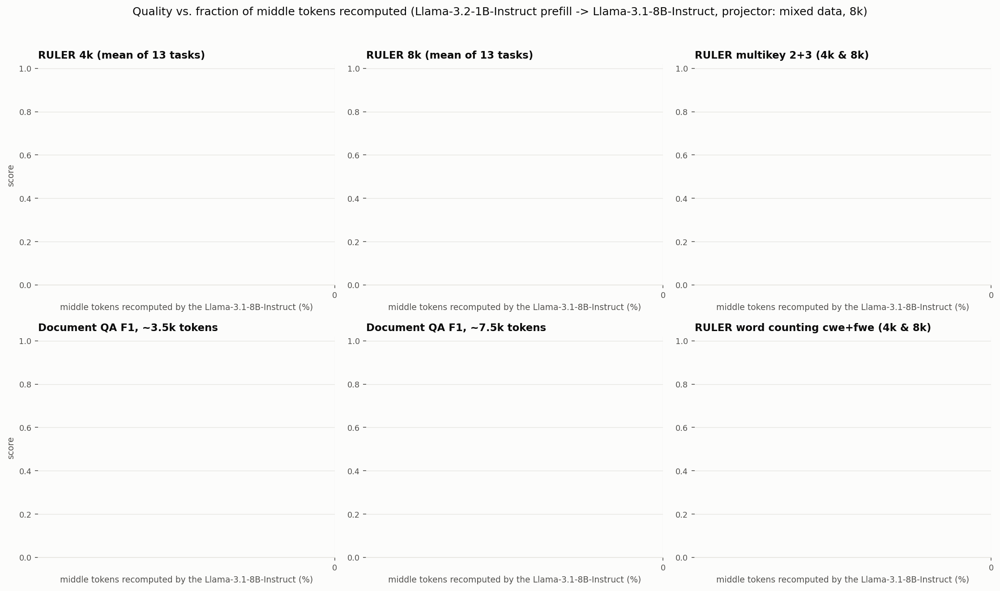
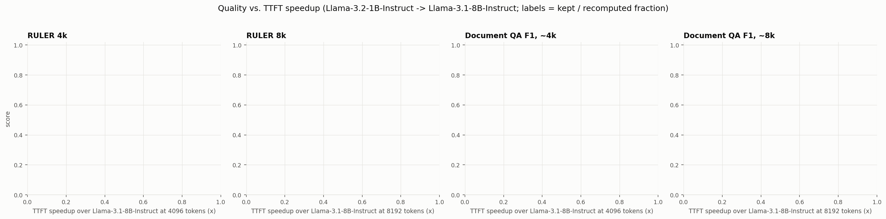

# 选择性重算实验

GPU：NVIDIA L40S；生成：2026-11-02 02:12:32；projector：混合数据 8k（第 12000 步）。小模型：Llama-3.2-1B-Instruct，大模型：Llama-3.1-8B-Instruct。开头 8 个和最后 64 个 token 始终由大模型计算；“重算比例”是中间部分由大模型重新计算的 token 占比。“丢弃其余”配置的选择方式与对应的重算配置完全相同，只是没选中的中间 token 被丢掉而不是用投影 KV 补上；SpecPrefill 是原论文方法（小模型打分，按 32 token 一块保留整段 prompt 的一部分，不强制保留开头和结尾，不用 projector），它的比例是整段 prompt 保留的比例。

## 总表

| 配置 | 实际重算比例（RULER 8k） | RULER 4k | RULER 8k | 问答 F1 4k | 问答 F1 8k | 大海捞针 |
|---|---|---|---|---|---|---|
| RaReCache 重算整段 0%，强制开头/尾部 | 0.9% | 0.133 | 0.133 | 0.269 | 0.359 | 0.189 |
| RaReCache 重算整段 10%，强制开头/尾部 | 10.6% | 0.220 | 0.200 | 0.536 | 0.539 | 0.178 |
| RaReCache 重算整段 30%，强制开头/尾部 | 30.4% | 0.283 | 0.280 | 0.638 | 0.627 | 0.344 |
| RaReCache 重算整段 50%，强制开头/尾部 | 50.3% | 0.420 | 0.372 | 0.670 | 0.712 | 0.567 |

## RULER 4096，按任务类型

| 配置 | 检索 | 汇总 | 变量追踪 | 问答 | 平均 |
|---|---|---|---|---|---|
| RaReCache 重算整段 0%，强制开头/尾部 | 0.08 | 0.22 | 0.01 | 0.30 | 0.133 |
| RaReCache 重算整段 10%，强制开头/尾部 | 0.09 | 0.24 | 0.83 | 0.40 | 0.220 |
| RaReCache 重算整段 30%，强制开头/尾部 | 0.11 | 0.43 | 0.77 | 0.60 | 0.283 |
| RaReCache 重算整段 50%，强制开头/尾部 | 0.20 | 0.62 | 0.99 | 0.80 | 0.420 |

RULER 4096 全部子任务

| 配置 | cwe | fwe | niah_multikey_1 | niah_multikey_2 | niah_multikey_3 | niah_multiquery | niah_multivalue | niah_single_1 | niah_single_2 | niah_single_3 | qa_1 | qa_2 | vt |
|---|---|---|---|---|---|---|---|---|---|---|---|---|---|
| RaReCache 重算整段 0%，强制开头/尾部 | 0.00 | 0.44 | 0.13 | 0.00 | 0.00 | 0.13 | 0.07 | 0.13 | 0.20 | 0.00 | 0.27 | 0.33 | 0.01 |
| RaReCache 重算整段 10%，强制开头/尾部 | 0.07 | 0.42 | 0.07 | 0.07 | 0.00 | 0.10 | 0.05 | 0.20 | 0.20 | 0.07 | 0.40 | 0.40 | 0.83 |
| RaReCache 重算整段 30%，强制开头/尾部 | 0.21 | 0.64 | 0.07 | 0.07 | 0.00 | 0.10 | 0.08 | 0.33 | 0.20 | 0.00 | 0.67 | 0.53 | 0.77 |
| RaReCache 重算整段 50%，强制开头/尾部 | 0.55 | 0.69 | 0.07 | 0.40 | 0.00 | 0.07 | 0.03 | 0.87 | 0.20 | 0.00 | 0.87 | 0.73 | 0.99 |

## RULER 8192，按任务类型

| 配置 | 检索 | 汇总 | 变量追踪 | 问答 | 平均 |
|---|---|---|---|---|---|
| RaReCache 重算整段 0%，强制开头/尾部 | 0.05 | 0.27 | 0.00 | 0.40 | 0.133 |
| RaReCache 重算整段 10%，强制开头/尾部 | 0.06 | 0.21 | 0.83 | 0.43 | 0.200 |
| RaReCache 重算整段 30%，强制开头/尾部 | 0.09 | 0.48 | 0.88 | 0.53 | 0.280 |
| RaReCache 重算整段 50%，强制开头/尾部 | 0.18 | 0.70 | 0.96 | 0.53 | 0.372 |

RULER 8192 全部子任务

| 配置 | cwe | fwe | niah_multikey_1 | niah_multikey_2 | niah_multikey_3 | niah_multiquery | niah_multivalue | niah_single_1 | niah_single_2 | niah_single_3 | qa_1 | qa_2 | vt |
|---|---|---|---|---|---|---|---|---|---|---|---|---|---|
| RaReCache 重算整段 0%，强制开头/尾部 | 0.00 | 0.53 | 0.00 | 0.00 | 0.00 | 0.12 | 0.02 | 0.20 | 0.07 | 0.00 | 0.60 | 0.20 | 0.00 |
| RaReCache 重算整段 10%，强制开头/尾部 | 0.07 | 0.36 | 0.07 | 0.00 | 0.00 | 0.13 | 0.02 | 0.20 | 0.07 | 0.00 | 0.53 | 0.33 | 0.83 |
| RaReCache 重算整段 30%，强制开头/尾部 | 0.39 | 0.58 | 0.00 | 0.00 | 0.00 | 0.12 | 0.02 | 0.60 | 0.00 | 0.00 | 0.60 | 0.47 | 0.88 |
| RaReCache 重算整段 50%，强制开头/尾部 | 0.64 | 0.76 | 0.00 | 0.40 | 0.00 | 0.03 | 0.05 | 0.93 | 0.00 | 0.00 | 0.53 | 0.53 | 0.96 |

## 问答 F1

| 配置 | squad 4k | hotpot 4k | trivia 4k | squad 8k | hotpot 8k | trivia 8k | 平均 4k | 平均 8k |
|---|---|---|---|---|---|---|---|---|
| RaReCache 重算整段 0%，强制开头/尾部 | 0.197 | 0.152 | 0.459 | 0.282 | 0.146 | 0.648 | 0.269 | 0.359 |
| RaReCache 重算整段 10%，强制开头/尾部 | 0.434 | 0.306 | 0.866 | 0.430 | 0.333 | 0.854 | 0.536 | 0.539 |
| RaReCache 重算整段 30%，强制开头/尾部 | 0.626 | 0.433 | 0.853 | 0.526 | 0.460 | 0.896 | 0.638 | 0.627 |
| RaReCache 重算整段 50%，强制开头/尾部 | 0.694 | 0.511 | 0.805 | 0.734 | 0.484 | 0.920 | 0.670 | 0.712 |

## GSM8K（8-shot，对话轮次形式）

| 配置 | 准确率 | 遵守 #### 格式 |
|---|---|---|
| RaReCache 重算整段 0%，强制开头/尾部 | 0.800 | 0.167 |
| RaReCache 重算整段 10%，强制开头/尾部 | 0.833 | 0.093 |
| RaReCache 重算整段 30%，强制开头/尾部 | 0.793 | 0.167 |
| RaReCache 重算整段 50%，强制开头/尾部 | 0.827 | 0.480 |

## 代码下一行补全

| 配置 | 4k 精确匹配 | 4k 相似度 | 8k 精确匹配 | 8k 相似度 |
|---|---|---|---|---|
| RaReCache 重算整段 0%，强制开头/尾部 | 0.160 | 0.558 | 0.120 | 0.547 |
| RaReCache 重算整段 10%，强制开头/尾部 | 0.170 | 0.559 | 0.140 | 0.540 |
| RaReCache 重算整段 30%，强制开头/尾部 | 0.210 | 0.605 | 0.130 | 0.568 |
| RaReCache 重算整段 50%，强制开头/尾部 | 0.260 | 0.661 | 0.210 | 0.606 |

## 首 token 延迟（毫秒，L40S，eager；SpecPrefill 的 look-ahead 用 CUDA graph 回放）

| 配置 | 4096 | 8192 | 16384 | 32768 |
|---|---|---|---|---|
| Llama-3.1-8B-Instruct 单独 | 371.2（1.00 倍） | 839.6（1.00 倍） | 1919.2（1.00 倍） | 4615.6（1.00 倍） |
| 混合，不重算 | 142.3（2.61 倍） | 279.4（3.00 倍） | 607.4（3.16 倍） | 1359.1（3.40 倍） |
| Llama-3.2-1B-Instruct 注意力 10%，按句子 | 172.3（2.15 倍） | 372.7（2.25 倍） | 896.1（2.14 倍） | 2243.1（2.06 倍） |
| SpecPrefill 保留整段 10% | 157.1（2.36 倍） | 289.9（2.90 倍） | 609.7（3.15 倍） | 1365.7（3.38 倍） |
| SpecPrefill 保留整段 30% | 222.4（1.67 倍） | 427.0（1.97 倍） | 930.1（2.06 倍） | 2119.5（2.18 倍） |
| RaReCache 重算整段 0%，强制开头/尾部 | 122.6（3.03 倍） | 251.6（3.34 倍） | 546.8（3.51 倍） | 1238.3（3.73 倍） |
| RaReCache 重算整段 10%，强制开头/尾部 | 150.1（2.47 倍） | 336.1（2.50 倍） | 810.2（2.37 倍） | 2071.9（2.23 倍） |
| RaReCache 重算整段 30%，强制开头/尾部 | 230.4（1.61 倍） | 534.8（1.57 倍） | 1391.6（1.38 倍） | 3959.0（1.17 倍） |
| RaReCache 重算整段 50%，强制开头/尾部 | 306.6（1.21 倍） | 757.5（1.11 倍） | 2060.1（0.93 倍） | 5831.2（0.79 倍） |

括号内是相对 Llama-3.1-8B-Instruct 单独的加速比。
