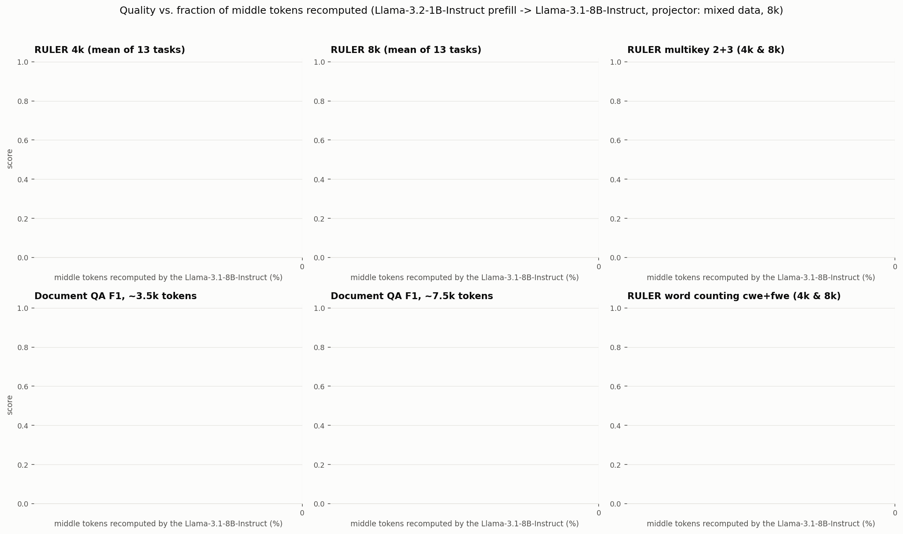

# 选择性重算实验

GPU：NVIDIA L40S；生成：2026-11-01 22:25:54；projector：混合数据 8k（第 12000 步）。小模型：Llama-3.2-1B-Instruct，大模型：Llama-3.1-8B-Instruct。开头 8 个和最后 64 个 token 始终由大模型计算；“重算比例”是中间部分由大模型重新计算的 token 占比。“丢弃其余”配置的选择方式与对应的重算配置完全相同，只是没选中的中间 token 被丢掉而不是用投影 KV 补上；SpecPrefill 是原论文方法（小模型打分，按 32 token 一块保留整段 prompt 的一部分，不强制保留开头和结尾，不用 projector），它的比例是整段 prompt 保留的比例。

## 总表

| 配置 | 实际重算比例（RULER 8k） | RULER 4k | RULER 8k | 问答 F1 4k | 问答 F1 8k | 大海捞针 |
|---|---|---|---|---|---|---|
| 混合，不重算 | - | - | - | - | - | - |

## 首 token 延迟（毫秒，L40S，所有方法都用 CUDA graph：固定形状的阶段整段回放，只有选择步骤 eager）

| 配置 | 4096 | 8192 | 16384 | 32768 |
|---|---|---|---|---|
| Llama-3.1-8B-Instruct 单独 | 375.6（1.00 倍） | 829.7（1.00 倍） | 1919.4（1.00 倍） | 4589.9（1.00 倍） |
| Llama-3.2-1B-Instruct 单独 | 58.6（6.41 倍） | 136.3（6.09 倍） | 346.4（5.54 倍） | 874.1（5.25 倍） |
| 混合，不重算 | 140.6（2.67 倍） | 276.6（3.00 倍） | 602.5（3.19 倍） | 1352.6（3.39 倍） |
| Llama-3.2-1B-Instruct 注意力 10%，按句子 | 171.8（2.19 倍） | 369.3（2.25 倍） | 895.9（2.14 倍） | 2243.4（2.05 倍） |
| Llama-3.2-1B-Instruct 注意力 20%，按句子 | 216.6（1.73 倍） | 474.4（1.75 倍） | 1163.9（1.65 倍） | 3175.7（1.45 倍） |
| 丢弃其余（不投影）：Llama-3.2-1B-Instruct 注意力 20%，按句子 | 148.2（2.53 倍） | 299.0（2.77 倍） | 687.3（2.79 倍） | 1598.9（2.87 倍） |
| SpecPrefill 保留整段 10% | 155.1（2.42 倍） | 288.2（2.88 倍） | 610.1（3.15 倍） | 1368.0（3.36 倍） |
| SpecPrefill 保留整段 20% | 187.6（2.00 倍） | 355.0（2.34 倍） | 758.2（2.53 倍） | 1725.3（2.66 倍） |
| SpecPrefill 保留整段 30% | 219.6（1.71 倍） | 426.5（1.95 倍） | 932.3（2.06 倍） | 2119.9（2.17 倍） |

括号内是相对 Llama-3.1-8B-Instruct 单独（同样用 CUDA graph）的加速比。graph 与 eager 的首 token logits 最大相对差（4096 token）：Llama-3.1-8B-Instruct 单独 0.0e+00，Llama-3.2-1B-Instruct 单独 0.0e+00，混合，不重算 0.0e+00，Llama-3.2-1B-Instruct 注意力 10%，按句子 0.0e+00，Llama-3.2-1B-Instruct 注意力 20%，按句子 0.0e+00，丢弃其余（不投影）：Llama-3.2-1B-Instruct 注意力 20%，按句子 0.0e+00，SpecPrefill 保留整段 10% 0.0e+00，SpecPrefill 保留整段 20% 0.0e+00，SpecPrefill 保留整段 30% 0.0e+00。
