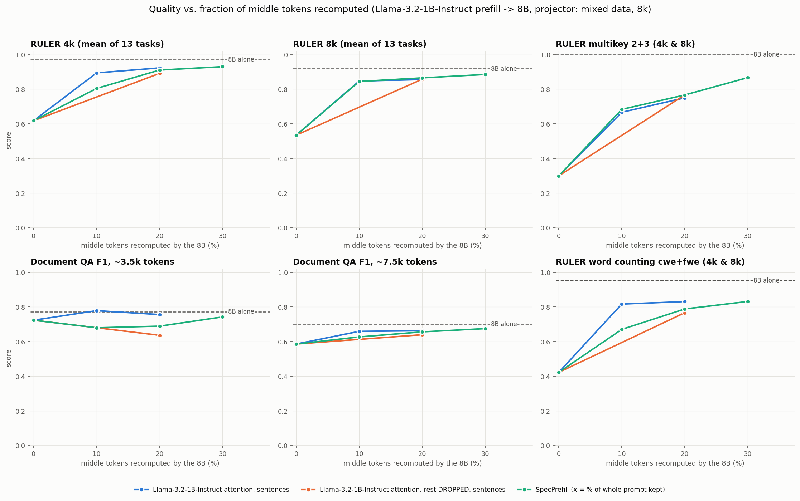

# 选择性重算实验

GPU：NVIDIA L40S；生成：2026-11-03 08:52:26；projector：混合数据 8k（第 12000 步）。小模型：Llama-3.2-1B-Instruct，大模型：8B。开头 8 个和最后 64 个 token 始终由大模型计算；“重算比例”是中间部分由大模型重新计算的 token 占比。“丢弃其余”配置的选择方式与对应的重算配置完全相同，只是没选中的中间 token 被丢掉而不是用投影 KV 补上；SpecPrefill 是原论文方法（小模型打分，按 32 token 一块保留整段 prompt 的一部分，不强制保留开头和结尾，不用 projector），它的比例是整段 prompt 保留的比例。

## 总表

| 配置 | 实际重算比例（RULER 8k） | RULER 4k | RULER 8k | 问答 F1 4k | 问答 F1 8k | 大海捞针 |
|---|---|---|---|---|---|---|
| 8B 单独 | 全部 | 0.970 | 0.918 | 0.772 | 0.702 | 1.000 |
| 混合，不重算 | 0.0% | 0.618 | 0.535 | 0.724 | 0.586 | 0.989 |
| Llama-3.2-1B-Instruct 注意力 10%，按句子 | 10.1% | 0.894 | 0.847 | 0.779 | 0.659 | 1.000 |
| Llama-3.2-1B-Instruct 注意力 20%，按句子 | 20.1% | 0.923 | 0.856 | 0.756 | 0.663 | 1.000 |
| 丢弃其余（不投影）：Llama-3.2-1B-Instruct 注意力 20%，按句子 | 20.1% | 0.891 | 0.857 | 0.637 | 0.640 | 1.000 |
| SpecPrefill 保留整段 10% | 10.0% | 0.804 | 0.845 | 0.680 | 0.627 | 0.944 |
| SpecPrefill 保留整段 20% | 20.0% | 0.911 | 0.865 | 0.689 | 0.656 | 0.978 |
| SpecPrefill 保留整段 30% | 30.0% | 0.930 | 0.885 | 0.743 | 0.675 | 0.989 |

## RULER 4096，按任务类型

| 配置 | 检索 | 汇总 | 变量追踪 | 问答 | 平均 |
|---|---|---|---|---|---|
| 8B 单独 | 1.00 | 0.97 | 1.00 | 0.83 | 0.970 |
| 混合，不重算 | 0.62 | 0.55 | 0.61 | 0.67 | 0.618 |
| Llama-3.2-1B-Instruct 注意力 10%，按句子 | 0.92 | 0.93 | 1.00 | 0.70 | 0.894 |
| Llama-3.2-1B-Instruct 注意力 20%，按句子 | 0.94 | 0.93 | 1.00 | 0.80 | 0.923 |
| 丢弃其余（不投影）：Llama-3.2-1B-Instruct 注意力 20%，按句子 | 0.95 | 0.79 | 1.00 | 0.70 | 0.891 |
| SpecPrefill 保留整段 10% | 0.90 | 0.72 | 0.45 | 0.67 | 0.804 |
| SpecPrefill 保留整段 20% | 0.93 | 0.85 | 1.00 | 0.83 | 0.911 |
| SpecPrefill 保留整段 30% | 0.97 | 0.84 | 1.00 | 0.83 | 0.930 |

RULER 4096 全部子任务

| 配置 | cwe | fwe | niah_multikey_1 | niah_multikey_2 | niah_multikey_3 | niah_multiquery | niah_multivalue | niah_single_1 | niah_single_2 | niah_single_3 | qa_1 | qa_2 | vt |
|---|---|---|---|---|---|---|---|---|---|---|---|---|---|
| 8B 单独 | 0.99 | 0.96 | 1.00 | 1.00 | 1.00 | 1.00 | 1.00 | 1.00 | 1.00 | 1.00 | 0.93 | 0.73 | 1.00 |
| 混合，不重算 | 0.37 | 0.73 | 0.53 | 0.53 | 0.40 | 0.68 | 0.43 | 0.67 | 0.87 | 0.87 | 0.93 | 0.40 | 0.61 |
| Llama-3.2-1B-Instruct 注意力 10%，按句子 | 0.88 | 0.98 | 1.00 | 1.00 | 0.40 | 1.00 | 0.97 | 1.00 | 1.00 | 1.00 | 0.93 | 0.47 | 1.00 |
| Llama-3.2-1B-Instruct 注意力 20%，按句子 | 0.89 | 0.98 | 1.00 | 0.93 | 0.60 | 1.00 | 1.00 | 1.00 | 1.00 | 1.00 | 0.93 | 0.67 | 1.00 |
| 丢弃其余（不投影）：Llama-3.2-1B-Instruct 注意力 20%，按句子 | 0.72 | 0.87 | 1.00 | 1.00 | 0.60 | 1.00 | 1.00 | 1.00 | 1.00 | 1.00 | 0.87 | 0.53 | 1.00 |
| SpecPrefill 保留整段 10% | 0.55 | 0.89 | 1.00 | 0.93 | 0.33 | 0.97 | 1.00 | 1.00 | 1.00 | 1.00 | 0.87 | 0.47 | 0.45 |
| SpecPrefill 保留整段 20% | 0.79 | 0.91 | 1.00 | 0.93 | 0.53 | 1.00 | 1.00 | 1.00 | 1.00 | 1.00 | 0.93 | 0.73 | 1.00 |
| SpecPrefill 保留整段 30% | 0.80 | 0.89 | 1.00 | 1.00 | 0.73 | 1.00 | 1.00 | 1.00 | 1.00 | 1.00 | 0.93 | 0.73 | 1.00 |

## RULER 8192，按任务类型

| 配置 | 检索 | 汇总 | 变量追踪 | 问答 | 平均 |
|---|---|---|---|---|---|
| 8B 单独 | 1.00 | 0.93 | 1.00 | 0.53 | 0.918 |
| 混合，不重算 | 0.60 | 0.29 | 0.59 | 0.50 | 0.535 |
| Llama-3.2-1B-Instruct 注意力 10%，按句子 | 0.91 | 0.70 | 1.00 | 0.67 | 0.847 |
| Llama-3.2-1B-Instruct 注意力 20%，按句子 | 0.93 | 0.73 | 1.00 | 0.60 | 0.856 |
| 丢弃其余（不投影）：Llama-3.2-1B-Instruct 注意力 20%，按句子 | 0.93 | 0.74 | 1.00 | 0.60 | 0.857 |
| SpecPrefill 保留整段 10% | 0.93 | 0.62 | 1.00 | 0.63 | 0.845 |
| SpecPrefill 保留整段 20% | 0.95 | 0.72 | 1.00 | 0.60 | 0.865 |
| SpecPrefill 保留整段 30% | 0.97 | 0.82 | 1.00 | 0.57 | 0.885 |

RULER 8192 全部子任务

| 配置 | cwe | fwe | niah_multikey_1 | niah_multikey_2 | niah_multikey_3 | niah_multiquery | niah_multivalue | niah_single_1 | niah_single_2 | niah_single_3 | qa_1 | qa_2 | vt |
|---|---|---|---|---|---|---|---|---|---|---|---|---|---|
| 8B 单独 | 0.97 | 0.89 | 1.00 | 1.00 | 1.00 | 1.00 | 1.00 | 1.00 | 1.00 | 1.00 | 0.60 | 0.47 | 1.00 |
| 混合，不重算 | 0.07 | 0.51 | 0.80 | 0.20 | 0.07 | 0.80 | 0.52 | 0.93 | 0.80 | 0.67 | 0.80 | 0.20 | 0.59 |
| Llama-3.2-1B-Instruct 注意力 10%，按句子 | 0.59 | 0.82 | 1.00 | 1.00 | 0.27 | 1.00 | 1.00 | 1.00 | 1.00 | 1.00 | 0.87 | 0.47 | 1.00 |
| Llama-3.2-1B-Instruct 注意力 20%，按句子 | 0.59 | 0.87 | 1.00 | 1.00 | 0.47 | 1.00 | 1.00 | 1.00 | 1.00 | 1.00 | 0.73 | 0.47 | 1.00 |
| 丢弃其余（不投影）：Llama-3.2-1B-Instruct 注意力 20%，按句子 | 0.55 | 0.93 | 1.00 | 1.00 | 0.47 | 1.00 | 1.00 | 1.00 | 1.00 | 1.00 | 0.73 | 0.47 | 1.00 |
| SpecPrefill 保留整段 10% | 0.45 | 0.80 | 1.00 | 1.00 | 0.47 | 1.00 | 1.00 | 1.00 | 1.00 | 1.00 | 0.80 | 0.47 | 1.00 |
| SpecPrefill 保留整段 20% | 0.56 | 0.89 | 1.00 | 1.00 | 0.60 | 1.00 | 1.00 | 1.00 | 1.00 | 1.00 | 0.87 | 0.33 | 1.00 |
| SpecPrefill 保留整段 30% | 0.73 | 0.91 | 1.00 | 1.00 | 0.73 | 1.00 | 1.00 | 1.00 | 1.00 | 1.00 | 0.73 | 0.40 | 1.00 |

## 问答 F1

| 配置 | squad 4k | hotpot 4k | trivia 4k | squad 8k | hotpot 8k | trivia 8k | 平均 4k | 平均 8k |
|---|---|---|---|---|---|---|---|---|
| 8B 单独 | 0.873 | 0.724 | 0.720 | 0.757 | 0.586 | 0.762 | 0.772 | 0.702 |
| 混合，不重算 | 0.800 | 0.651 | 0.719 | 0.657 | 0.374 | 0.727 | 0.724 | 0.586 |
| Llama-3.2-1B-Instruct 注意力 10%，按句子 | 0.910 | 0.703 | 0.723 | 0.752 | 0.463 | 0.762 | 0.779 | 0.659 |
| Llama-3.2-1B-Instruct 注意力 20%，按句子 | 0.882 | 0.710 | 0.677 | 0.725 | 0.538 | 0.726 | 0.756 | 0.663 |
| 丢弃其余（不投影）：Llama-3.2-1B-Instruct 注意力 20%，按句子 | 0.729 | 0.635 | 0.546 | 0.681 | 0.522 | 0.717 | 0.637 | 0.640 |
| SpecPrefill 保留整段 10% | 0.802 | 0.582 | 0.656 | 0.726 | 0.491 | 0.664 | 0.680 | 0.627 |
| SpecPrefill 保留整段 20% | 0.788 | 0.621 | 0.658 | 0.731 | 0.507 | 0.731 | 0.689 | 0.656 |
| SpecPrefill 保留整段 30% | 0.814 | 0.757 | 0.656 | 0.772 | 0.509 | 0.744 | 0.743 | 0.675 |

## GSM8K（8-shot，对话轮次形式）

| 配置 | 准确率 | 遵守 #### 格式 |
|---|---|---|
| 8B 单独 | 0.907 | 0.593 |
| 混合，不重算 | 0.900 | 0.507 |
| Llama-3.2-1B-Instruct 注意力 10%，按句子 | 0.900 | 0.673 |
| Llama-3.2-1B-Instruct 注意力 20%，按句子 | 0.913 | 0.773 |
| 丢弃其余（不投影）：Llama-3.2-1B-Instruct 注意力 20%，按句子 | 0.880 | 0.380 |
| SpecPrefill 保留整段 10% | 0.860 | 0.073 |
| SpecPrefill 保留整段 20% | 0.900 | 0.493 |
| SpecPrefill 保留整段 30% | 0.887 | 0.567 |

## 代码下一行补全

| 配置 | 4k 精确匹配 | 4k 相似度 | 8k 精确匹配 | 8k 相似度 |
|---|---|---|---|---|
| 8B 单独 | 0.230 | 0.613 | 0.290 | 0.639 |
| 混合，不重算 | 0.190 | 0.592 | 0.230 | 0.591 |
| Llama-3.2-1B-Instruct 注意力 10%，按句子 | 0.170 | 0.599 | 0.270 | 0.639 |
| Llama-3.2-1B-Instruct 注意力 20%，按句子 | 0.200 | 0.604 | 0.290 | 0.648 |
| 丢弃其余（不投影）：Llama-3.2-1B-Instruct 注意力 20%，按句子 | 0.180 | 0.588 | 0.270 | 0.636 |
| SpecPrefill 保留整段 10% | 0.180 | 0.619 | 0.280 | 0.647 |
| SpecPrefill 保留整段 20% | 0.240 | 0.623 | 0.290 | 0.640 |
| SpecPrefill 保留整段 30% | 0.220 | 0.602 | 0.280 | 0.643 |
