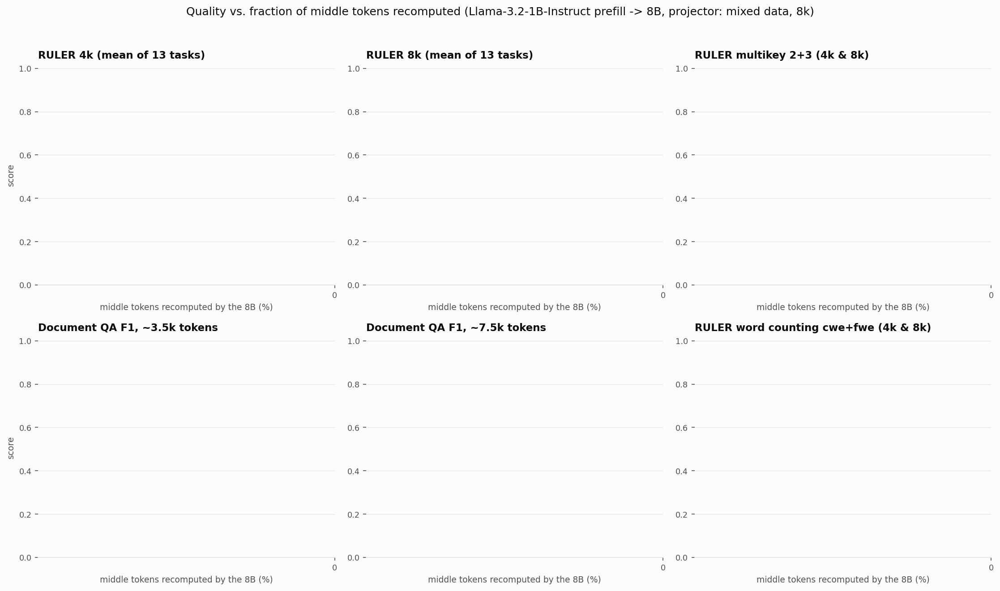
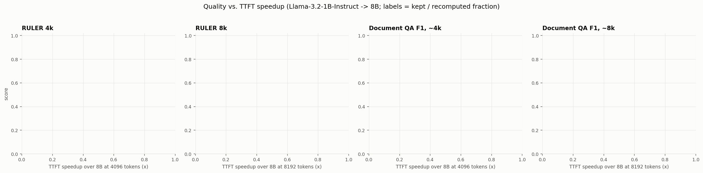

# 选择性重算实验

GPU：NVIDIA L40S；生成：2026-11-03 18:17:54；projector：混合数据 8k（第 12000 步）。小模型：Llama-3.2-1B-Instruct，大模型：8B。开头 8 个和最后 64 个 token 始终由大模型计算；“重算比例”是中间部分由大模型重新计算的 token 占比。“丢弃其余”配置的选择方式与对应的重算配置完全相同，只是没选中的中间 token 被丢掉而不是用投影 KV 补上；SpecPrefill 是原论文方法（小模型打分，按 32 token 一块保留整段 prompt 的一部分，不强制保留开头和结尾，不用 projector），它的比例是整段 prompt 保留的比例。

## 总表

| 配置 | 实际重算比例（RULER 8k） | RULER 4k | RULER 8k | 问答 F1 4k | 问答 F1 8k | 大海捞针 |
|---|---|---|---|---|---|---|
| RaReCache 重算整段 0%，强制开头/尾部 | 0.9% | 0.086 | 0.077 | 0.230 | 0.228 | 0.022 |
| RaReCache 重算整段 10%，强制开头/尾部 | 10.7% | 0.176 | 0.113 | 0.367 | 0.338 | 0.033 |
| RaReCache 重算整段 30%，强制开头/尾部 | 30.5% | 0.272 | 0.200 | 0.548 | 0.538 | 0.022 |
| RaReCache 重算整段 50%，强制开头/尾部 | 50.3% | 0.320 | 0.239 | 0.621 | 0.605 | 0.000 |

## RULER 4096，按任务类型

| 配置 | 检索 | 汇总 | 变量追踪 | 问答 | 平均 |
|---|---|---|---|---|---|
| RaReCache 重算整段 0%，强制开头/尾部 | 0.03 | 0.21 | 0.00 | 0.23 | 0.086 |
| RaReCache 重算整段 10%，强制开头/尾部 | 0.03 | 0.31 | 0.71 | 0.37 | 0.176 |
| RaReCache 重算整段 30%，强制开头/尾部 | 0.03 | 0.82 | 0.53 | 0.57 | 0.272 |
| RaReCache 重算整段 50%，强制开头/尾部 | 0.03 | 0.86 | 1.00 | 0.60 | 0.320 |

RULER 4096 全部子任务

| 配置 | cwe | fwe | niah_multikey_1 | niah_multikey_2 | niah_multikey_3 | niah_multiquery | niah_multivalue | niah_single_1 | niah_single_2 | niah_single_3 | qa_1 | qa_2 | vt |
|---|---|---|---|---|---|---|---|---|---|---|---|---|---|
| RaReCache 重算整段 0%，强制开头/尾部 | 0.24 | 0.18 | 0.07 | 0.00 | 0.00 | 0.00 | 0.03 | 0.00 | 0.13 | 0.00 | 0.27 | 0.20 | 0.00 |
| RaReCache 重算整段 10%，强制开头/尾部 | 0.44 | 0.18 | 0.07 | 0.00 | 0.00 | 0.00 | 0.03 | 0.00 | 0.13 | 0.00 | 0.40 | 0.33 | 0.71 |
| RaReCache 重算整段 30%，强制开头/尾部 | 0.97 | 0.67 | 0.07 | 0.00 | 0.00 | 0.00 | 0.03 | 0.00 | 0.13 | 0.00 | 0.67 | 0.47 | 0.53 |
| RaReCache 重算整段 50%，强制开头/尾部 | 0.99 | 0.73 | 0.07 | 0.00 | 0.00 | 0.00 | 0.03 | 0.00 | 0.13 | 0.00 | 0.73 | 0.47 | 1.00 |

## RULER 8192，按任务类型

| 配置 | 检索 | 汇总 | 变量追踪 | 问答 | 平均 |
|---|---|---|---|---|---|
| RaReCache 重算整段 0%，强制开头/尾部 | 0.00 | 0.16 | 0.00 | 0.33 | 0.077 |
| RaReCache 重算整段 10%，强制开头/尾部 | 0.00 | 0.27 | 0.19 | 0.37 | 0.113 |
| RaReCache 重算整段 30%，强制开头/尾部 | 0.00 | 0.73 | 0.27 | 0.43 | 0.200 |
| RaReCache 重算整段 50%，强制开头/尾部 | 0.00 | 0.79 | 0.60 | 0.47 | 0.239 |

RULER 8192 全部子任务

| 配置 | cwe | fwe | niah_multikey_1 | niah_multikey_2 | niah_multikey_3 | niah_multiquery | niah_multivalue | niah_single_1 | niah_single_2 | niah_single_3 | qa_1 | qa_2 | vt |
|---|---|---|---|---|---|---|---|---|---|---|---|---|---|
| RaReCache 重算整段 0%，强制开头/尾部 | 0.17 | 0.16 | 0.00 | 0.00 | 0.00 | 0.00 | 0.00 | 0.00 | 0.00 | 0.00 | 0.47 | 0.20 | 0.00 |
| RaReCache 重算整段 10%，强制开头/尾部 | 0.33 | 0.22 | 0.00 | 0.00 | 0.00 | 0.00 | 0.00 | 0.00 | 0.00 | 0.00 | 0.47 | 0.27 | 0.19 |
| RaReCache 重算整段 30%，强制开头/尾部 | 0.97 | 0.49 | 0.00 | 0.00 | 0.00 | 0.00 | 0.00 | 0.00 | 0.00 | 0.00 | 0.53 | 0.33 | 0.27 |
| RaReCache 重算整段 50%，强制开头/尾部 | 0.97 | 0.60 | 0.00 | 0.00 | 0.00 | 0.00 | 0.00 | 0.00 | 0.00 | 0.00 | 0.60 | 0.33 | 0.60 |

## 问答 F1

| 配置 | squad 4k | hotpot 4k | trivia 4k | squad 8k | hotpot 8k | trivia 8k | 平均 4k | 平均 8k |
|---|---|---|---|---|---|---|---|---|
| RaReCache 重算整段 0%，强制开头/尾部 | 0.202 | 0.217 | 0.270 | 0.096 | 0.116 | 0.472 | 0.230 | 0.228 |
| RaReCache 重算整段 10%，强制开头/尾部 | 0.376 | 0.277 | 0.448 | 0.254 | 0.143 | 0.617 | 0.367 | 0.338 |
| RaReCache 重算整段 30%，强制开头/尾部 | 0.561 | 0.425 | 0.660 | 0.474 | 0.445 | 0.696 | 0.548 | 0.538 |
| RaReCache 重算整段 50%，强制开头/尾部 | 0.684 | 0.491 | 0.690 | 0.679 | 0.417 | 0.719 | 0.621 | 0.605 |

## GSM8K（8-shot，对话轮次形式）

| 配置 | 准确率 | 遵守 #### 格式 |
|---|---|---|
| RaReCache 重算整段 0%，强制开头/尾部 | 0.787 | 0.027 |
| RaReCache 重算整段 10%，强制开头/尾部 | 0.847 | 0.073 |
| RaReCache 重算整段 30%，强制开头/尾部 | 0.847 | 0.280 |
| RaReCache 重算整段 50%，强制开头/尾部 | 0.860 | 0.560 |

## 代码下一行补全

| 配置 | 4k 精确匹配 | 4k 相似度 | 8k 精确匹配 | 8k 相似度 |
|---|---|---|---|---|
| RaReCache 重算整段 0%，强制开头/尾部 | 0.120 | 0.484 | 0.110 | 0.520 |
| RaReCache 重算整段 10%，强制开头/尾部 | 0.120 | 0.489 | 0.110 | 0.512 |
| RaReCache 重算整段 30%，强制开头/尾部 | 0.130 | 0.547 | 0.190 | 0.568 |
| RaReCache 重算整段 50%，强制开头/尾部 | 0.120 | 0.592 | 0.200 | 0.595 |

## 首 token 延迟（毫秒，L40S，eager；SpecPrefill 的 look-ahead 用 CUDA graph 回放）

| 配置 | 4096 | 8192 | 16384 | 32768 |
|---|---|---|---|---|
| 8B 单独 | 405.2（1.00 倍） | 935.7（1.00 倍） | 2159.4（1.00 倍） | 5147.1（1.00 倍） |
| 混合，不重算 | 160.1（2.53 倍） | 312.9（2.99 倍） | 682.9（3.16 倍） | 1489.9（3.45 倍） |
| Llama-3.2-1B-Instruct 注意力 10%，按句子 | 190.5（2.13 倍） | 418.2（2.24 倍） | 998.9（2.16 倍） | 2479.5（2.08 倍） |
| SpecPrefill 保留整段 10% | 160.4（2.53 倍） | 298.9（3.13 倍） | 631.5（3.42 倍） | 1408.9（3.65 倍） |
| SpecPrefill 保留整段 30% | 228.9（1.77 倍） | 445.6（2.10 倍） | 996.7（2.17 倍） | 2267.2（2.27 倍） |
| RaReCache 重算整段 0%，强制开头/尾部 | 133.2（3.04 倍） | 269.8（3.47 倍） | 588.5（3.67 倍） | 1306.2（3.94 倍） |
| RaReCache 重算整段 10%，强制开头/尾部 | 160.3（2.53 倍） | 361.1（2.59 倍） | 872.2（2.48 倍） | 2239.7（2.30 倍） |
| RaReCache 重算整段 30%，强制开头/尾部 | 244.1（1.66 倍） | 577.0（1.62 倍） | 1531.0（1.41 倍） | 4363.2（1.18 倍） |
| RaReCache 重算整段 50%，强制开头/尾部 | 333.0（1.22 倍） | 826.9（1.13 倍） | 2286.7（0.94 倍） | 6454.5（0.80 倍） |

括号内是相对 8B 单独的加速比。
