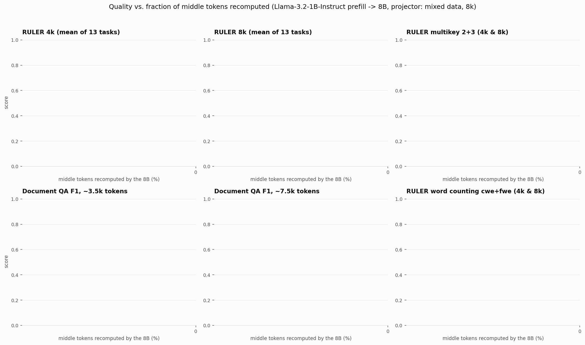

# 选择性重算实验

GPU：NVIDIA L40S；生成：2026-11-03 13:33:27；projector：混合数据 8k（第 12000 步）。小模型：Llama-3.2-1B-Instruct，大模型：8B。开头 8 个和最后 64 个 token 始终由大模型计算；“重算比例”是中间部分由大模型重新计算的 token 占比。“丢弃其余”配置的选择方式与对应的重算配置完全相同，只是没选中的中间 token 被丢掉而不是用投影 KV 补上；SpecPrefill 是原论文方法（小模型打分，按 32 token 一块保留整段 prompt 的一部分，不强制保留开头和结尾，不用 projector），它的比例是整段 prompt 保留的比例。

## 总表

| 配置 | 实际重算比例（RULER 8k） | RULER 4k | RULER 8k | 问答 F1 4k | 问答 F1 8k | 大海捞针 |
|---|---|---|---|---|---|---|
| 混合，不重算 | - | - | - | - | - | - |

## 首 token 延迟（毫秒，L40S，所有方法都用 CUDA graph：固定形状的阶段整段回放，只有选择步骤 eager）

| 配置 | 4096 | 8192 | 16384 | 32768 |
|---|---|---|---|---|
| 8B 单独 | 397.1（1.00 倍） | 936.2（1.00 倍） | 2120.7（1.00 倍） | 5082.9（1.00 倍） |
| 混合，不重算 | 158.1（2.51 倍） | 312.3（3.00 倍） | 674.9（3.14 倍） | 1488.3（3.42 倍） |
| Llama-3.2-1B-Instruct 注意力 10%，按句子 | 187.2（2.12 倍） | 420.0（2.23 倍） | 988.7（2.14 倍） | 2469.3（2.06 倍） |
| Llama-3.2-1B-Instruct 注意力 20%，按句子 | 232.8（1.71 倍） | 526.8（1.78 倍） | 1294.7（1.64 倍） | 3520.8（1.44 倍） |
| 丢弃其余（不投影）：Llama-3.2-1B-Instruct 注意力 20%，按句子 | 148.5（2.67 倍） | 310.5（3.02 倍） | 712.7（2.98 倍） | 1669.2（3.05 倍） |
| SpecPrefill 保留整段 10% | 159.5（2.49 倍） | 296.9（3.15 倍） | 624.5（3.40 倍） | 1403.3（3.62 倍） |
| SpecPrefill 保留整段 20% | 194.0（2.05 倍） | 365.9（2.56 倍） | 783.3（2.71 倍） | 1819.2（2.79 倍） |
| SpecPrefill 保留整段 30% | 228.2（1.74 倍） | 445.6（2.10 倍） | 989.6（2.14 倍） | 2265.7（2.24 倍） |

括号内是相对 8B 单独（同样用 CUDA graph）的加速比。graph 与 eager 的首 token logits 最大相对差（4096 token）：8B 单独 0.0e+00，混合，不重算 0.0e+00，Llama-3.2-1B-Instruct 注意力 10%，按句子 0.0e+00，Llama-3.2-1B-Instruct 注意力 20%，按句子 0.0e+00，丢弃其余（不投影）：Llama-3.2-1B-Instruct 注意力 20%，按句子 0.0e+00，SpecPrefill 保留整段 10% 0.0e+00，SpecPrefill 保留整段 20% 0.0e+00，SpecPrefill 保留整段 30% 1.6e-02。
