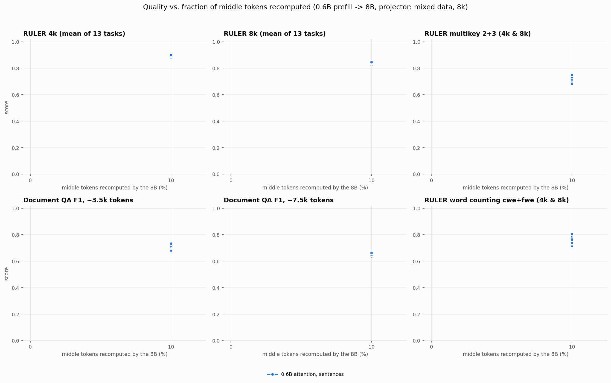

# 选择性重算实验

GPU：NVIDIA L40S；生成：2026-11-11 14:25:17；projector：混合数据 8k（第 12000 步）。小模型：0.6B，大模型：8B。开头 8 个和最后 64 个 token 始终由大模型计算；“重算比例”是中间部分由大模型重新计算的 token 占比。“丢弃其余”配置的选择方式与对应的重算配置完全相同，只是没选中的中间 token 被丢掉而不是用投影 KV 补上；SpecPrefill 是原论文方法（小模型打分，按 32 token 一块保留整段 prompt 的一部分，不强制保留开头和结尾，不用 projector），它的比例是整段 prompt 保留的比例。

## 总表

| 配置 | 实际重算比例（RULER 8k） | RULER 4k | RULER 8k | 问答 F1 4k | 问答 F1 8k | 大海捞针 |
|---|---|---|---|---|---|---|
| 0.6B 注意力 10%，按句子 | 10.1% | 0.897 | 0.846 | 0.719 | 0.663 | 1.000 |
| 0.6B 注意力 重算 10% + 投影其余的 75%（按注意力）+ 丢弃，按句子 | 10.1% | 0.899 | 0.836 | 0.733 | 0.650 | 1.000 |
| 0.6B 注意力 重算 10% + 投影其余的 50%（按注意力）+ 丢弃，按句子 | 10.1% | 0.897 | 0.841 | 0.703 | 0.647 | 1.000 |
| 0.6B 注意力 重算 10% + 投影其余的 25%（按注意力）+ 丢弃，按句子 | 10.1% | 0.890 | 0.825 | 0.709 | 0.637 | 1.000 |
| 丢弃其余（不投影）：0.6B 注意力 10%，按句子 | 10.1% | 0.860 | 0.841 | 0.609 | 0.604 | 1.000 |
| 0.6B 注意力 重算 10% + 投影其余的 50%（随机）+ 丢弃，按句子 | 10.1% | 0.881 | 0.842 | 0.681 | 0.660 | 1.000 |

## RULER 4096，按任务类型

| 配置 | 检索 | 汇总 | 变量追踪 | 问答 | 平均 |
|---|---|---|---|---|---|
| 0.6B 注意力 10%，按句子 | 0.94 | 0.86 | 1.00 | 0.70 | 0.897 |
| 0.6B 注意力 重算 10% + 投影其余的 75%（按注意力）+ 丢弃，按句子 | 0.95 | 0.84 | 1.00 | 0.70 | 0.899 |
| 0.6B 注意力 重算 10% + 投影其余的 50%（按注意力）+ 丢弃，按句子 | 0.95 | 0.84 | 1.00 | 0.70 | 0.897 |
| 0.6B 注意力 重算 10% + 投影其余的 25%（按注意力）+ 丢弃，按句子 | 0.94 | 0.82 | 1.00 | 0.70 | 0.890 |
| 丢弃其余（不投影）：0.6B 注意力 10%，按句子 | 0.92 | 0.78 | 1.00 | 0.63 | 0.860 |
| 0.6B 注意力 重算 10% + 投影其余的 50%（随机）+ 丢弃，按句子 | 0.92 | 0.90 | 1.00 | 0.63 | 0.881 |

RULER 4096 全部子任务

| 配置 | cwe | fwe | niah_multikey_1 | niah_multikey_2 | niah_multikey_3 | niah_multiquery | niah_multivalue | niah_single_1 | niah_single_2 | niah_single_3 | qa_1 | qa_2 | vt |
|---|---|---|---|---|---|---|---|---|---|---|---|---|---|
| 0.6B 注意力 10%，按句子 | 0.84 | 0.89 | 1.00 | 1.00 | 0.53 | 1.00 | 1.00 | 1.00 | 1.00 | 1.00 | 0.93 | 0.47 | 1.00 |
| 0.6B 注意力 重算 10% + 投影其余的 75%（按注意力）+ 丢弃，按句子 | 0.80 | 0.89 | 1.00 | 1.00 | 0.60 | 1.00 | 1.00 | 1.00 | 1.00 | 1.00 | 0.93 | 0.47 | 1.00 |
| 0.6B 注意力 重算 10% + 投影其余的 50%（按注意力）+ 丢弃，按句子 | 0.81 | 0.87 | 1.00 | 1.00 | 0.60 | 1.00 | 0.98 | 1.00 | 1.00 | 1.00 | 0.93 | 0.47 | 1.00 |
| 0.6B 注意力 重算 10% + 投影其余的 25%（按注意力）+ 丢弃，按句子 | 0.82 | 0.82 | 1.00 | 1.00 | 0.53 | 1.00 | 1.00 | 1.00 | 1.00 | 1.00 | 0.93 | 0.47 | 1.00 |
| 丢弃其余（不投影）：0.6B 注意力 10%，按句子 | 0.71 | 0.84 | 1.00 | 1.00 | 0.40 | 1.00 | 0.95 | 1.00 | 1.00 | 1.00 | 0.80 | 0.47 | 1.00 |
| 0.6B 注意力 重算 10% + 投影其余的 50%（随机）+ 丢弃，按句子 | 0.92 | 0.89 | 1.00 | 1.00 | 0.40 | 1.00 | 0.98 | 1.00 | 1.00 | 1.00 | 0.80 | 0.47 | 1.00 |

## RULER 8192，按任务类型

| 配置 | 检索 | 汇总 | 变量追踪 | 问答 | 平均 |
|---|---|---|---|---|---|
| 0.6B 注意力 10%，按句子 | 0.93 | 0.66 | 1.00 | 0.63 | 0.846 |
| 0.6B 注意力 重算 10% + 投影其余的 75%（按注意力）+ 丢弃，按句子 | 0.92 | 0.63 | 1.00 | 0.63 | 0.836 |
| 0.6B 注意力 重算 10% + 投影其余的 50%（按注意力）+ 丢弃，按句子 | 0.93 | 0.63 | 1.00 | 0.63 | 0.841 |
| 0.6B 注意力 重算 10% + 投影其余的 25%（按注意力）+ 丢弃，按句子 | 0.91 | 0.61 | 0.99 | 0.60 | 0.825 |
| 丢弃其余（不投影）：0.6B 注意力 10%，按句子 | 0.92 | 0.63 | 1.00 | 0.67 | 0.841 |
| 0.6B 注意力 重算 10% + 投影其余的 50%（随机）+ 丢弃，按句子 | 0.92 | 0.70 | 1.00 | 0.60 | 0.842 |

RULER 8192 全部子任务

| 配置 | cwe | fwe | niah_multikey_1 | niah_multikey_2 | niah_multikey_3 | niah_multiquery | niah_multivalue | niah_single_1 | niah_single_2 | niah_single_3 | qa_1 | qa_2 | vt |
|---|---|---|---|---|---|---|---|---|---|---|---|---|---|
| 0.6B 注意力 10%，按句子 | 0.51 | 0.82 | 1.00 | 1.00 | 0.40 | 1.00 | 1.00 | 1.00 | 1.00 | 1.00 | 0.80 | 0.47 | 1.00 |
| 0.6B 注意力 重算 10% + 投影其余的 75%（按注意力）+ 丢弃，按句子 | 0.45 | 0.82 | 1.00 | 1.00 | 0.33 | 1.00 | 1.00 | 1.00 | 1.00 | 1.00 | 0.80 | 0.47 | 1.00 |
| 0.6B 注意力 重算 10% + 投影其余的 50%（按注意力）+ 丢弃，按句子 | 0.44 | 0.82 | 1.00 | 1.00 | 0.40 | 1.00 | 1.00 | 1.00 | 1.00 | 1.00 | 0.80 | 0.47 | 1.00 |
| 0.6B 注意力 重算 10% + 投影其余的 25%（按注意力）+ 丢弃，按句子 | 0.43 | 0.80 | 1.00 | 1.00 | 0.33 | 1.00 | 0.98 | 1.00 | 1.00 | 1.00 | 0.73 | 0.47 | 0.99 |
| 丢弃其余（不投影）：0.6B 注意力 10%，按句子 | 0.47 | 0.80 | 1.00 | 1.00 | 0.33 | 1.00 | 1.00 | 1.00 | 1.00 | 1.00 | 0.87 | 0.47 | 1.00 |
| 0.6B 注意力 重算 10% + 投影其余的 50%（随机）+ 丢弃，按句子 | 0.59 | 0.82 | 1.00 | 1.00 | 0.33 | 1.00 | 1.00 | 1.00 | 1.00 | 1.00 | 0.80 | 0.40 | 1.00 |

## 问答 F1

| 配置 | squad 4k | hotpot 4k | trivia 4k | squad 8k | hotpot 8k | trivia 8k | 平均 4k | 平均 8k |
|---|---|---|---|---|---|---|---|---|
| 0.6B 注意力 10%，按句子 | 0.864 | 0.619 | 0.673 | 0.760 | 0.498 | 0.732 | 0.719 | 0.663 |
| 0.6B 注意力 重算 10% + 投影其余的 75%（按注意力）+ 丢弃，按句子 | 0.867 | 0.639 | 0.693 | 0.758 | 0.480 | 0.712 | 0.733 | 0.650 |
| 0.6B 注意力 重算 10% + 投影其余的 50%（按注意力）+ 丢弃，按句子 | 0.848 | 0.587 | 0.673 | 0.755 | 0.474 | 0.712 | 0.703 | 0.647 |
| 0.6B 注意力 重算 10% + 投影其余的 25%（按注意力）+ 丢弃，按句子 | 0.811 | 0.622 | 0.693 | 0.742 | 0.452 | 0.717 | 0.709 | 0.637 |
| 丢弃其余（不投影）：0.6B 注意力 10%，按句子 | 0.661 | 0.583 | 0.583 | 0.711 | 0.455 | 0.646 | 0.609 | 0.604 |
| 0.6B 注意力 重算 10% + 投影其余的 50%（随机）+ 丢弃，按句子 | 0.752 | 0.635 | 0.655 | 0.761 | 0.487 | 0.732 | 0.681 | 0.660 |

## GSM8K（8-shot，对话轮次形式）

| 配置 | 准确率 | 遵守 #### 格式 |
|---|---|---|
| 0.6B 注意力 10%，按句子 | 0.920 | 0.713 |
| 0.6B 注意力 重算 10% + 投影其余的 75%（按注意力）+ 丢弃，按句子 | 0.907 | 0.680 |
| 0.6B 注意力 重算 10% + 投影其余的 50%（按注意力）+ 丢弃，按句子 | 0.920 | 0.633 |
| 0.6B 注意力 重算 10% + 投影其余的 25%（按注意力）+ 丢弃，按句子 | 0.893 | 0.480 |
| 丢弃其余（不投影）：0.6B 注意力 10%，按句子 | 0.860 | 0.173 |
| 0.6B 注意力 重算 10% + 投影其余的 50%（随机）+ 丢弃，按句子 | 0.900 | 0.527 |

## 代码下一行补全

| 配置 | 4k 精确匹配 | 4k 相似度 | 8k 精确匹配 | 8k 相似度 |
|---|---|---|---|---|
| 0.6B 注意力 10%，按句子 | 0.160 | 0.612 | 0.300 | 0.644 |
| 0.6B 注意力 重算 10% + 投影其余的 75%（按注意力）+ 丢弃，按句子 | 0.150 | 0.608 | 0.300 | 0.643 |
| 0.6B 注意力 重算 10% + 投影其余的 50%（按注意力）+ 丢弃，按句子 | 0.150 | 0.612 | 0.300 | 0.641 |
| 0.6B 注意力 重算 10% + 投影其余的 25%（按注意力）+ 丢弃，按句子 | 0.170 | 0.611 | 0.290 | 0.645 |
| 丢弃其余（不投影）：0.6B 注意力 10%，按句子 | 0.150 | 0.594 | 0.270 | 0.619 |
| 0.6B 注意力 重算 10% + 投影其余的 50%（随机）+ 丢弃，按句子 | 0.180 | 0.604 | 0.300 | 0.647 |
