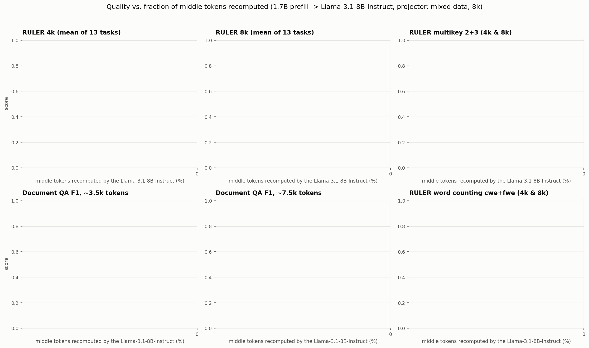
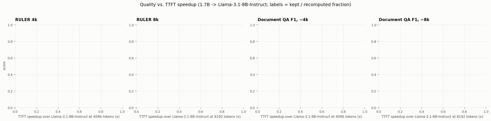

# 选择性重算实验

GPU：NVIDIA L40S；生成：2026-11-03 14:44:13；projector：混合数据 8k（第 12000 步）。小模型：1.7B，大模型：Llama-3.1-8B-Instruct。开头 8 个和最后 64 个 token 始终由大模型计算；“重算比例”是中间部分由大模型重新计算的 token 占比。“丢弃其余”配置的选择方式与对应的重算配置完全相同，只是没选中的中间 token 被丢掉而不是用投影 KV 补上；SpecPrefill 是原论文方法（小模型打分，按 32 token 一块保留整段 prompt 的一部分，不强制保留开头和结尾，不用 projector），它的比例是整段 prompt 保留的比例。

## 总表

| 配置 | 实际重算比例（RULER 8k） | RULER 4k | RULER 8k | 问答 F1 4k | 问答 F1 8k | 大海捞针 |
|---|---|---|---|---|---|---|
| RaReCache 重算整段 0%，强制开头/尾部 | 0.9% | 0.085 | 0.062 | 0.298 | 0.374 | 0.000 |
| RaReCache 重算整段 10%，强制开头/尾部 | 10.7% | 0.091 | 0.090 | 0.460 | 0.470 | 0.000 |
| RaReCache 重算整段 30%，强制开头/尾部 | 30.5% | 0.181 | 0.152 | 0.555 | 0.564 | 0.000 |
| RaReCache 重算整段 50%，强制开头/尾部 | 50.4% | 0.271 | 0.203 | 0.623 | 0.644 | 0.000 |

## RULER 4096，按任务类型

| 配置 | 检索 | 汇总 | 变量追踪 | 问答 | 平均 |
|---|---|---|---|---|---|
| RaReCache 重算整段 0%，强制开头/尾部 | 0.03 | 0.23 | 0.00 | 0.20 | 0.085 |
| RaReCache 重算整段 10%，强制开头/尾部 | 0.03 | 0.17 | 0.01 | 0.30 | 0.091 |
| RaReCache 重算整段 30%，强制开头/尾部 | 0.03 | 0.31 | 0.56 | 0.47 | 0.181 |
| RaReCache 重算整段 50%，强制开头/尾部 | 0.03 | 0.57 | 0.81 | 0.67 | 0.271 |

RULER 4096 全部子任务

| 配置 | cwe | fwe | niah_multikey_1 | niah_multikey_2 | niah_multikey_3 | niah_multiquery | niah_multivalue | niah_single_1 | niah_single_2 | niah_single_3 | qa_1 | qa_2 | vt |
|---|---|---|---|---|---|---|---|---|---|---|---|---|---|
| RaReCache 重算整段 0%，强制开头/尾部 | 0.00 | 0.47 | 0.07 | 0.00 | 0.00 | 0.00 | 0.03 | 0.00 | 0.13 | 0.00 | 0.20 | 0.20 | 0.00 |
| RaReCache 重算整段 10%，强制开头/尾部 | 0.07 | 0.27 | 0.07 | 0.00 | 0.00 | 0.00 | 0.03 | 0.00 | 0.13 | 0.00 | 0.27 | 0.33 | 0.01 |
| RaReCache 重算整段 30%，强制开头/尾部 | 0.20 | 0.42 | 0.07 | 0.00 | 0.00 | 0.00 | 0.03 | 0.00 | 0.13 | 0.00 | 0.53 | 0.40 | 0.56 |
| RaReCache 重算整段 50%，强制开头/尾部 | 0.43 | 0.71 | 0.07 | 0.00 | 0.00 | 0.00 | 0.03 | 0.00 | 0.13 | 0.00 | 0.73 | 0.60 | 0.81 |

## RULER 8192，按任务类型

| 配置 | 检索 | 汇总 | 变量追踪 | 问答 | 平均 |
|---|---|---|---|---|---|
| RaReCache 重算整段 0%，强制开头/尾部 | 0.00 | 0.20 | 0.00 | 0.20 | 0.062 |
| RaReCache 重算整段 10%，强制开头/尾部 | 0.00 | 0.17 | 0.16 | 0.33 | 0.090 |
| RaReCache 重算整段 30%，强制开头/尾部 | 0.00 | 0.29 | 0.65 | 0.37 | 0.152 |
| RaReCache 重算整段 50%，强制开头/尾部 | 0.00 | 0.48 | 0.75 | 0.47 | 0.203 |

RULER 8192 全部子任务

| 配置 | cwe | fwe | niah_multikey_1 | niah_multikey_2 | niah_multikey_3 | niah_multiquery | niah_multivalue | niah_single_1 | niah_single_2 | niah_single_3 | qa_1 | qa_2 | vt |
|---|---|---|---|---|---|---|---|---|---|---|---|---|---|
| RaReCache 重算整段 0%，强制开头/尾部 | 0.00 | 0.40 | 0.00 | 0.00 | 0.00 | 0.00 | 0.00 | 0.00 | 0.00 | 0.00 | 0.27 | 0.13 | 0.00 |
| RaReCache 重算整段 10%，强制开头/尾部 | 0.05 | 0.29 | 0.00 | 0.00 | 0.00 | 0.00 | 0.00 | 0.00 | 0.00 | 0.00 | 0.47 | 0.20 | 0.16 |
| RaReCache 重算整段 30%，强制开头/尾部 | 0.19 | 0.40 | 0.00 | 0.00 | 0.00 | 0.00 | 0.00 | 0.00 | 0.00 | 0.00 | 0.53 | 0.20 | 0.65 |
| RaReCache 重算整段 50%，强制开头/尾部 | 0.38 | 0.58 | 0.00 | 0.00 | 0.00 | 0.00 | 0.00 | 0.00 | 0.00 | 0.00 | 0.60 | 0.33 | 0.75 |

## 问答 F1

| 配置 | squad 4k | hotpot 4k | trivia 4k | squad 8k | hotpot 8k | trivia 8k | 平均 4k | 平均 8k |
|---|---|---|---|---|---|---|---|---|
| RaReCache 重算整段 0%，强制开头/尾部 | 0.180 | 0.196 | 0.520 | 0.230 | 0.184 | 0.707 | 0.298 | 0.374 |
| RaReCache 重算整段 10%，强制开头/尾部 | 0.300 | 0.281 | 0.800 | 0.378 | 0.257 | 0.774 | 0.460 | 0.470 |
| RaReCache 重算整段 30%，强制开头/尾部 | 0.503 | 0.365 | 0.797 | 0.511 | 0.340 | 0.840 | 0.555 | 0.564 |
| RaReCache 重算整段 50%，强制开头/尾部 | 0.644 | 0.407 | 0.817 | 0.611 | 0.440 | 0.880 | 0.623 | 0.644 |

## GSM8K（8-shot，对话轮次形式）

| 配置 | 准确率 | 遵守 #### 格式 |
|---|---|---|
| RaReCache 重算整段 0%，强制开头/尾部 | 0.700 | 0.000 |
| RaReCache 重算整段 10%，强制开头/尾部 | 0.733 | 0.000 |
| RaReCache 重算整段 30%，强制开头/尾部 | 0.747 | 0.020 |
| RaReCache 重算整段 50%，强制开头/尾部 | 0.787 | 0.260 |

## 代码下一行补全

| 配置 | 4k 精确匹配 | 4k 相似度 | 8k 精确匹配 | 8k 相似度 |
|---|---|---|---|---|
| RaReCache 重算整段 0%，强制开头/尾部 | 0.150 | 0.578 | 0.110 | 0.531 |
| RaReCache 重算整段 10%，强制开头/尾部 | 0.180 | 0.593 | 0.130 | 0.552 |
| RaReCache 重算整段 30%，强制开头/尾部 | 0.200 | 0.612 | 0.130 | 0.576 |
| RaReCache 重算整段 50%，强制开头/尾部 | 0.240 | 0.623 | 0.200 | 0.602 |

## 首 token 延迟（毫秒，L40S，eager；SpecPrefill 的 look-ahead 用 CUDA graph 回放）

| 配置 | 4096 | 8192 | 16384 | 32768 |
|---|---|---|---|---|
| Llama-3.1-8B-Instruct 单独 | 373.1（1.00 倍） | 855.3（1.00 倍） | 1919.6（1.00 倍） | 4705.6（1.00 倍） |
| 混合，不重算 | 186.2（2.00 倍） | 396.5（2.16 倍） | 926.3（2.07 倍） | 2181.3（2.16 倍） |
| 1.7B 注意力 10%，按句子 | 215.7（1.73 倍） | 496.0（1.72 倍） | 1219.3（1.57 倍） | 3079.4（1.53 倍） |
| SpecPrefill 保留整段 10% | 226.9（1.64 倍） | 437.1（1.96 倍） | 970.8（1.98 倍） | 2244.5（2.10 倍） |
| SpecPrefill 保留整段 30% | 291.2（1.28 倍） | 577.2（1.48 倍） | 1292.2（1.49 倍） | 3027.4（1.55 倍） |
| RaReCache 重算整段 0%，强制开头/尾部 | 197.8（1.89 倍） | 427.2（2.00 倍） | 981.9（1.95 倍） | 2280.4（2.06 倍） |
| RaReCache 重算整段 10%，强制开头/尾部 | 224.7（1.66 倍） | 510.7（1.67 倍） | 1246.8（1.54 倍） | 3112.5（1.51 倍） |
| RaReCache 重算整段 30%，强制开头/尾部 | 308.4（1.21 倍） | 710.2（1.20 倍） | 1835.7（1.05 倍） | 5038.7（0.93 倍） |
| RaReCache 重算整段 50%，强制开头/尾部 | 386.0（0.97 倍） | 943.6（0.91 倍） | 2524.8（0.76 倍） | 6927.0（0.68 倍） |

括号内是相对 Llama-3.1-8B-Instruct 单独的加速比。
