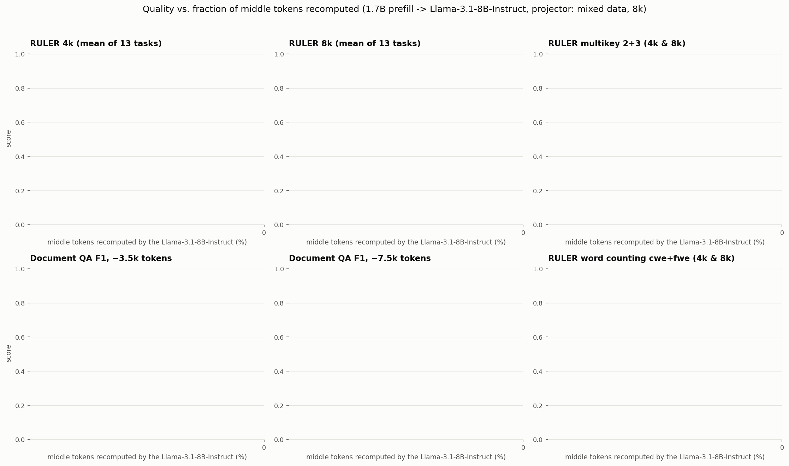

# 选择性重算实验

GPU：NVIDIA L40S；生成：2026-11-03 10:42:17；projector：混合数据 8k（第 12000 步）。小模型：1.7B，大模型：Llama-3.1-8B-Instruct。开头 8 个和最后 64 个 token 始终由大模型计算；“重算比例”是中间部分由大模型重新计算的 token 占比。“丢弃其余”配置的选择方式与对应的重算配置完全相同，只是没选中的中间 token 被丢掉而不是用投影 KV 补上；SpecPrefill 是原论文方法（小模型打分，按 32 token 一块保留整段 prompt 的一部分，不强制保留开头和结尾，不用 projector），它的比例是整段 prompt 保留的比例。

## 总表

| 配置 | 实际重算比例（RULER 8k） | RULER 4k | RULER 8k | 问答 F1 4k | 问答 F1 8k | 大海捞针 |
|---|---|---|---|---|---|---|
| 混合，不重算 | - | - | - | - | - | - |

## 首 token 延迟（毫秒，L40S，所有方法都用 CUDA graph：固定形状的阶段整段回放，只有选择步骤 eager）

| 配置 | 4096 | 8192 | 16384 | 32768 |
|---|---|---|---|---|
| Llama-3.1-8B-Instruct 单独 | 374.3（1.00 倍） | 846.5（1.00 倍） | 1919.4（1.00 倍） | 4702.3（1.00 倍） |
| 混合，不重算 | 182.8（2.05 倍） | 391.2（2.16 倍） | 913.9（2.10 倍） | 2151.9（2.19 倍） |
| 1.7B 注意力 10%，按句子 | 212.7（1.76 倍） | 489.9（1.73 倍） | 1199.0（1.60 倍） | 3044.1（1.54 倍） |
| 1.7B 注意力 20%，按句子 | 256.4（1.46 倍） | 593.6（1.43 倍） | 1475.7（1.30 倍） | 4001.3（1.18 倍） |
| 丢弃其余（不投影）：1.7B 注意力 20%，按句子 | 181.1（2.07 倍） | 403.2（2.10 倍） | 956.3（2.01 倍） | 2360.5（1.99 倍） |
| SpecPrefill 保留整段 10% | 223.9（1.67 倍） | 432.5（1.96 倍） | 961.8（2.00 倍） | 2228.2（2.11 倍） |
| SpecPrefill 保留整段 20% | 256.7（1.46 倍） | 502.7（1.68 倍） | 1104.6（1.74 倍） | 2598.2（1.81 倍） |
| SpecPrefill 保留整段 30% | 289.8（1.29 倍） | 575.5（1.47 倍） | 1282.6（1.50 倍） | 3019.8（1.56 倍） |

括号内是相对 Llama-3.1-8B-Instruct 单独（同样用 CUDA graph）的加速比。graph 与 eager 的首 token logits 最大相对差（4096 token）：Llama-3.1-8B-Instruct 单独 0.0e+00，混合，不重算 0.0e+00，1.7B 注意力 10%，按句子 0.0e+00，1.7B 注意力 20%，按句子 0.0e+00，丢弃其余（不投影）：1.7B 注意力 20%，按句子 0.0e+00，SpecPrefill 保留整段 10% 0.0e+00，SpecPrefill 保留整段 20% 0.0e+00，SpecPrefill 保留整段 30% 2.8e-02。
