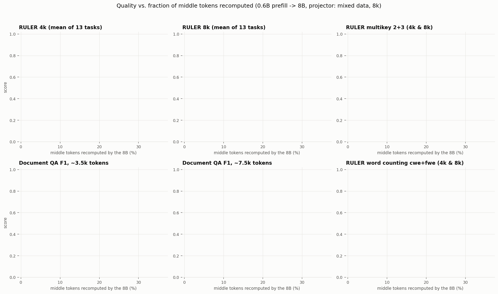

# 选择性重算实验

GPU：NVIDIA L40S；生成：2026-11-04 15:53:37；projector：混合数据 8k（第 12000 步）。小模型：0.6B，大模型：8B。开头 8 个和最后 64 个 token 始终由大模型计算；“重算比例”是中间部分由大模型重新计算的 token 占比。“丢弃其余”配置的选择方式与对应的重算配置完全相同，只是没选中的中间 token 被丢掉而不是用投影 KV 补上；SpecPrefill 是原论文方法（小模型打分，按 32 token 一块保留整段 prompt 的一部分，不强制保留开头和结尾，不用 projector），它的比例是整段 prompt 保留的比例。

## 总表

| 配置 | 实际重算比例（RULER 8k） | RULER 4k | RULER 8k | 问答 F1 4k | 问答 F1 8k | 大海捞针 |
|---|---|---|---|---|---|---|
| 8B 单独 | 全部 | - | - | - | - | - |
| 0.6B 单独 | - | - | - | - | - | - |
| 混合，不重算 | - | - | - | - | - | - |
| 0.6B 注意力 10%，按句子 | - | - | - | - | - | - |
| 0.6B 注意力 20%，按句子 | - | - | - | - | - | - |
| 丢弃其余（不投影）：0.6B 注意力 20%，按句子 | - | - | - | - | - | - |
| SpecPrefill 保留整段 10% | - | - | - | - | - | - |
| SpecPrefill 保留整段 20% | - | - | - | - | - | - |
| SpecPrefill 保留整段 30% | - | - | - | - | - | - |

## QuALITY（4 选 1，按首 token 的字母 logits 判分；问题和选项始终在大模型计算的尾部里）

题数：全部 2086（hard 1065），文章 < 4k token 的 555，其余 1531；准确率的标准误约 ±0.011。

| 配置 | 重算比例 | 全部 | hard | 4k 全部 | 4k hard | 8k 全部 | 8k hard |
|---|---|---|---|---|---|---|---|
| 8B 单独 | 100.0% | 0.756 | 0.685 | 0.840 | 0.762 | 0.726 | 0.667 |
| 0.6B 单独 | 0.0% | 0.287 | 0.264 | 0.324 | 0.286 | 0.273 | 0.258 |
| 混合，不重算 | 0.0% | 0.613 | 0.526 | 0.706 | 0.587 | 0.579 | 0.511 |
| 0.6B 注意力 10%，按句子 | 10.2% | 0.708 | 0.625 | 0.795 | 0.694 | 0.676 | 0.609 |
| 0.6B 注意力 20%，按句子 | 20.2% | 0.732 | 0.657 | 0.820 | 0.714 | 0.700 | 0.644 |
| 丢弃其余（不投影）：0.6B 注意力 20%，按句子 | 20.2% | 0.709 | 0.626 | 0.811 | 0.748 | 0.672 | 0.597 |
| SpecPrefill 保留整段 10% | 10.0% | 0.540 | 0.476 | 0.591 | 0.524 | 0.522 | 0.464 |
| SpecPrefill 保留整段 20% | 20.0% | 0.595 | 0.533 | 0.674 | 0.587 | 0.567 | 0.520 |
| SpecPrefill 保留整段 30% | 30.1% | 0.624 | 0.547 | 0.715 | 0.626 | 0.590 | 0.529 |
