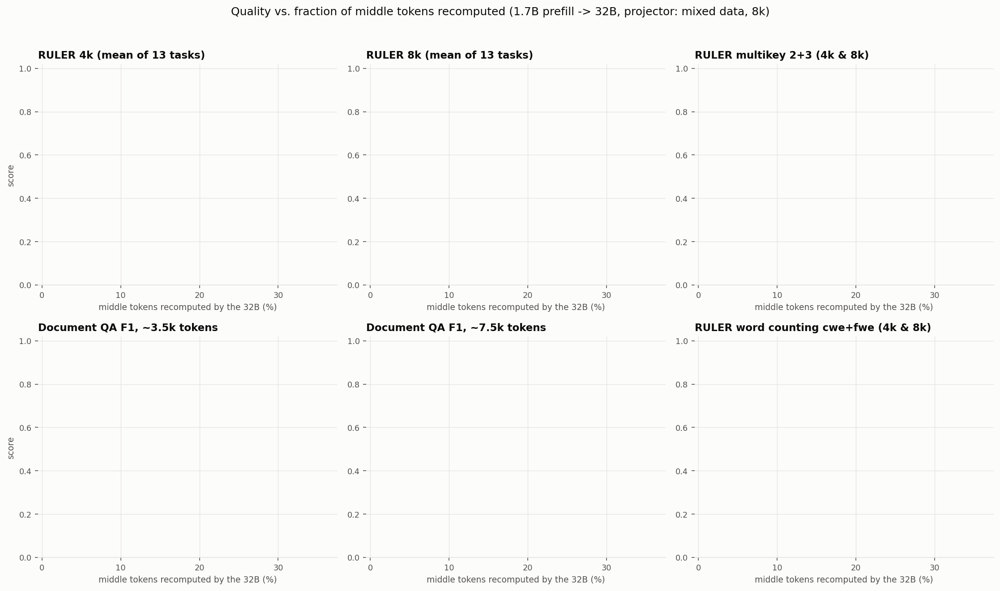

# 选择性重算实验

GPU：NVIDIA H100 80GB HBM3；生成：2026-11-03 18:21:37；projector：混合数据 8k（第 12000 步）。小模型：1.7B，大模型：32B。开头 8 个和最后 64 个 token 始终由大模型计算；“重算比例”是中间部分由大模型重新计算的 token 占比。“丢弃其余”配置的选择方式与对应的重算配置完全相同，只是没选中的中间 token 被丢掉而不是用投影 KV 补上；SpecPrefill 是原论文方法（小模型打分，按 32 token 一块保留整段 prompt 的一部分，不强制保留开头和结尾，不用 projector），它的比例是整段 prompt 保留的比例。

## 总表

| 配置 | 实际重算比例（RULER 8k） | RULER 4k | RULER 8k | 问答 F1 4k | 问答 F1 8k | 大海捞针 |
|---|---|---|---|---|---|---|
| 32B 单独 | 全部 | - | - | - | - | - |
| 1.7B 单独 | - | - | - | - | - | - |
| 混合，不重算 | - | - | - | - | - | - |
| 1.7B 注意力 10%，按句子 | - | - | - | - | - | - |
| 1.7B 注意力 20%，按句子 | - | - | - | - | - | - |
| 丢弃其余（不投影）：1.7B 注意力 20%，按句子 | - | - | - | - | - | - |
| SpecPrefill 保留整段 10% | - | - | - | - | - | - |
| SpecPrefill 保留整段 20% | - | - | - | - | - | - |
| SpecPrefill 保留整段 30% | - | - | - | - | - | - |

## QuALITY（4 选 1，按首 token 的字母 logits 判分；问题和选项始终在大模型计算的尾部里）

题数：全部 2086（hard 1065），文章 < 4k token 的 555，其余 1531；准确率的标准误约 ±0.011。

| 配置 | 重算比例 | 全部 | hard | 4k 全部 | 4k hard | 8k 全部 | 8k hard |
|---|---|---|---|---|---|---|---|
| 32B 单独 | 100.0% | 0.849 | 0.783 | 0.897 | 0.811 | 0.831 | 0.776 |
| 1.7B 单独 | 0.0% | 0.554 | 0.478 | 0.667 | 0.587 | 0.513 | 0.452 |
| 混合，不重算 | 0.0% | 0.696 | 0.596 | 0.807 | 0.709 | 0.656 | 0.569 |
| 1.7B 注意力 10%，按句子 | 10.2% | 0.796 | 0.715 | 0.874 | 0.796 | 0.768 | 0.696 |
| 1.7B 注意力 20%，按句子 | 20.2% | 0.823 | 0.744 | 0.890 | 0.806 | 0.798 | 0.729 |
| 丢弃其余（不投影）：1.7B 注意力 20%，按句子 | 20.2% | 0.793 | 0.711 | 0.872 | 0.782 | 0.765 | 0.694 |
| SpecPrefill 保留整段 10% | 10.0% | 0.645 | 0.551 | 0.741 | 0.621 | 0.611 | 0.534 |
| SpecPrefill 保留整段 20% | 20.0% | 0.725 | 0.648 | 0.814 | 0.699 | 0.692 | 0.636 |
| SpecPrefill 保留整段 30% | 30.1% | 0.779 | 0.707 | 0.859 | 0.762 | 0.750 | 0.694 |
