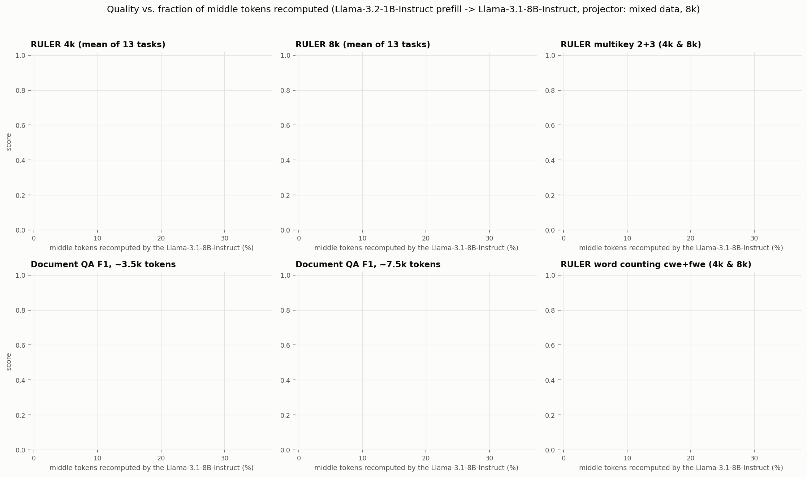

# 选择性重算实验

GPU：NVIDIA L40S；生成：2026-11-06 14:11:35；projector：混合数据 8k（第 12000 步）。小模型：Llama-3.2-1B-Instruct，大模型：Llama-3.1-8B-Instruct。开头 8 个和最后 64 个 token 始终由大模型计算；“重算比例”是中间部分由大模型重新计算的 token 占比。“丢弃其余”配置的选择方式与对应的重算配置完全相同，只是没选中的中间 token 被丢掉而不是用投影 KV 补上；SpecPrefill 是原论文方法（小模型打分，按 32 token 一块保留整段 prompt 的一部分，不强制保留开头和结尾，不用 projector），它的比例是整段 prompt 保留的比例。

## 总表

| 配置 | 实际重算比例（RULER 8k） | RULER 4k | RULER 8k | 问答 F1 4k | 问答 F1 8k | 大海捞针 |
|---|---|---|---|---|---|---|
| Llama-3.1-8B-Instruct 单独 | 全部 | - | - | - | - | - |
| Llama-3.2-1B-Instruct 单独 | - | - | - | - | - | - |
| 混合，不重算 | - | - | - | - | - | - |
| Llama-3.2-1B-Instruct 注意力 10%，按句子 | - | - | - | - | - | - |
| Llama-3.2-1B-Instruct 注意力 20%，按句子 | - | - | - | - | - | - |
| 丢弃其余（不投影）：Llama-3.2-1B-Instruct 注意力 20%，按句子 | - | - | - | - | - | - |
| SpecPrefill 保留整段 10% | - | - | - | - | - | - |
| SpecPrefill 保留整段 20% | - | - | - | - | - | - |
| SpecPrefill 保留整段 30% | - | - | - | - | - | - |

## QuALITY（4 选 1，按首 token 的字母 logits 判分；问题和选项始终在大模型计算的尾部里）

题数：全部 2086（hard 1065），文章 < 4k token 的 555，其余 1531；准确率的标准误约 ±0.011。

| 配置 | 重算比例 | 全部 | hard | 4k 全部 | 4k hard | 8k 全部 | 8k hard |
|---|---|---|---|---|---|---|---|
| Llama-3.1-8B-Instruct 单独 | 100.0% | 0.732 | 0.652 | 0.829 | 0.752 | 0.696 | 0.627 |
| Llama-3.2-1B-Instruct 单独 | 0.0% | 0.331 | 0.293 | 0.342 | 0.316 | 0.327 | 0.288 |
| 混合，不重算 | 0.0% | 0.570 | 0.476 | 0.701 | 0.621 | 0.522 | 0.441 |
| Llama-3.2-1B-Instruct 注意力 10%，按句子 | 10.2% | 0.648 | 0.549 | 0.759 | 0.650 | 0.607 | 0.525 |
| Llama-3.2-1B-Instruct 注意力 20%，按句子 | 20.2% | 0.685 | 0.586 | 0.787 | 0.670 | 0.647 | 0.566 |
| 丢弃其余（不投影）：Llama-3.2-1B-Instruct 注意力 20%，按句子 | 20.2% | 0.671 | 0.575 | 0.762 | 0.631 | 0.638 | 0.561 |
| SpecPrefill 保留整段 10% | 10.0% | 0.541 | 0.451 | 0.640 | 0.539 | 0.506 | 0.430 |
| SpecPrefill 保留整段 20% | 20.0% | 0.608 | 0.515 | 0.686 | 0.587 | 0.579 | 0.497 |
| SpecPrefill 保留整段 30% | 30.1% | 0.646 | 0.560 | 0.730 | 0.641 | 0.615 | 0.540 |
