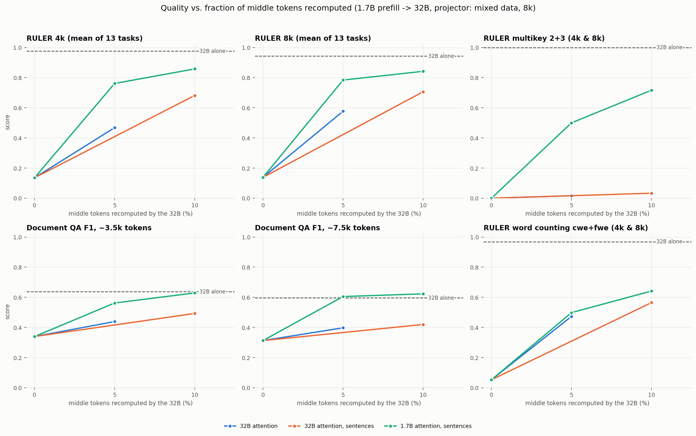

# 选择性重算实验

GPU：NVIDIA H100 80GB HBM3；生成：2026-10-15 08:09:26；projector：混合数据 8k（第 12000 步）。小模型：1.7B，大模型：32B。开头 8 个和最后 64 个 token 始终由大模型计算；“重算比例”是中间部分由大模型重新计算的 token 占比。

## 总表

| 配置 | 实际重算比例（RULER 8k） | RULER 4k | RULER 8k | 问答 F1 4k | 问答 F1 8k | 大海捞针 |
|---|---|---|---|---|---|---|
| 32B 单独 | 全部 | 0.976 | 0.943 | 0.638 | 0.596 | 1.000 |
| 1.7B 单独 | 0.0% | 0.892 | 0.868 | 0.552 | 0.515 | 1.000 |
| 混合，不重算 | 0.0% | 0.136 | 0.138 | 0.340 | 0.313 | 0.911 |
| 32B 注意力 5% | 5.0% | 0.468 | 0.577 | 0.439 | 0.398 | 0.978 |
| 32B 注意力 10%，按句子 | 10.2% | 0.682 | 0.706 | 0.493 | 0.420 | 1.000 |
| 1.7B 注意力 5%，按句子 | 5.1% | 0.761 | 0.784 | 0.562 | 0.605 | 1.000 |
| 1.7B 注意力 10%，按句子 | 10.1% | 0.858 | 0.842 | 0.629 | 0.623 | 1.000 |

## RULER 4096，按任务类型

| 配置 | 检索 | 汇总 | 变量追踪 | 问答 | 平均 |
|---|---|---|---|---|---|
| 32B 单独 | 1.00 | 0.97 | 1.00 | 0.87 | 0.976 |
| 1.7B 单独 | 0.98 | 0.81 | 1.00 | 0.57 | 0.892 |
| 混合，不重算 | 0.16 | 0.05 | 0.00 | 0.20 | 0.136 |
| 32B 注意力 5% | 0.48 | 0.50 | 0.56 | 0.33 | 0.468 |
| 32B 注意力 10%，按句子 | 0.73 | 0.57 | 1.00 | 0.43 | 0.682 |
| 1.7B 注意力 5%，按句子 | 0.84 | 0.58 | 0.76 | 0.63 | 0.761 |
| 1.7B 注意力 10%，按句子 | 0.90 | 0.70 | 0.96 | 0.80 | 0.858 |

RULER 4096 全部子任务

| 配置 | cwe | fwe | niah_multikey_1 | niah_multikey_2 | niah_multikey_3 | niah_multiquery | niah_multivalue | niah_single_1 | niah_single_2 | niah_single_3 | qa_1 | qa_2 | vt |
|---|---|---|---|---|---|---|---|---|---|---|---|---|---|
| 32B 单独 | 0.99 | 0.96 | 1.00 | 1.00 | 1.00 | 1.00 | 1.00 | 1.00 | 1.00 | 1.00 | 0.93 | 0.80 | 1.00 |
| 1.7B 单独 | 0.78 | 0.84 | 1.00 | 0.87 | 1.00 | 0.98 | 0.98 | 1.00 | 1.00 | 1.00 | 0.73 | 0.40 | 1.00 |
| 混合，不重算 | 0.01 | 0.09 | 0.13 | 0.00 | 0.00 | 0.02 | 0.05 | 0.73 | 0.33 | 0.00 | 0.20 | 0.20 | 0.00 |
| 32B 注意力 5% | 0.41 | 0.58 | 0.67 | 0.07 | 0.00 | 0.80 | 0.40 | 1.00 | 0.93 | 0.00 | 0.40 | 0.27 | 0.56 |
| 32B 注意力 10%，按句子 | 0.41 | 0.73 | 0.87 | 0.07 | 0.00 | 1.00 | 0.92 | 1.00 | 1.00 | 1.00 | 0.53 | 0.33 | 1.00 |
| 1.7B 注意力 5%，按句子 | 0.49 | 0.67 | 1.00 | 1.00 | 0.00 | 1.00 | 0.72 | 1.00 | 1.00 | 1.00 | 0.87 | 0.40 | 0.76 |
| 1.7B 注意力 10%，按句子 | 0.61 | 0.80 | 1.00 | 1.00 | 0.33 | 1.00 | 0.85 | 1.00 | 1.00 | 1.00 | 1.00 | 0.60 | 0.96 |

## RULER 8192，按任务类型

| 配置 | 检索 | 汇总 | 变量追踪 | 问答 | 平均 |
|---|---|---|---|---|---|
| 32B 单独 | 1.00 | 0.96 | 1.00 | 0.67 | 0.943 |
| 1.7B 单独 | 0.98 | 0.68 | 0.97 | 0.57 | 0.868 |
| 混合，不重算 | 0.13 | 0.06 | 0.00 | 0.33 | 0.138 |
| 32B 注意力 5% | 0.57 | 0.45 | 1.00 | 0.50 | 0.577 |
| 32B 注意力 10%，按句子 | 0.76 | 0.56 | 1.00 | 0.50 | 0.706 |
| 1.7B 注意力 5%，按句子 | 0.86 | 0.42 | 1.00 | 0.73 | 0.784 |
| 1.7B 注意力 10%，按句子 | 0.94 | 0.58 | 1.00 | 0.63 | 0.842 |

RULER 8192 全部子任务

| 配置 | cwe | fwe | niah_multikey_1 | niah_multikey_2 | niah_multikey_3 | niah_multiquery | niah_multivalue | niah_single_1 | niah_single_2 | niah_single_3 | qa_1 | qa_2 | vt |
|---|---|---|---|---|---|---|---|---|---|---|---|---|---|
| 32B 单独 | 0.99 | 0.93 | 1.00 | 1.00 | 1.00 | 1.00 | 1.00 | 1.00 | 1.00 | 1.00 | 0.80 | 0.53 | 1.00 |
| 1.7B 单独 | 0.61 | 0.76 | 1.00 | 0.87 | 1.00 | 1.00 | 0.95 | 1.00 | 1.00 | 1.00 | 0.67 | 0.47 | 0.97 |
| 混合，不重算 | 0.03 | 0.09 | 0.07 | 0.00 | 0.00 | 0.07 | 0.02 | 0.53 | 0.33 | 0.00 | 0.40 | 0.27 | 0.00 |
| 32B 注意力 5% | 0.15 | 0.76 | 0.93 | 0.00 | 0.00 | 0.95 | 0.72 | 1.00 | 1.00 | 0.00 | 0.60 | 0.40 | 1.00 |
| 32B 注意力 10%，按句子 | 0.18 | 0.93 | 1.00 | 0.07 | 0.00 | 1.00 | 1.00 | 1.00 | 1.00 | 1.00 | 0.67 | 0.33 | 1.00 |
| 1.7B 注意力 5%，按句子 | 0.17 | 0.67 | 1.00 | 1.00 | 0.00 | 1.00 | 0.88 | 1.00 | 1.00 | 1.00 | 0.87 | 0.60 | 1.00 |
| 1.7B 注意力 10%，按句子 | 0.36 | 0.80 | 1.00 | 1.00 | 0.53 | 1.00 | 0.98 | 1.00 | 1.00 | 1.00 | 0.87 | 0.40 | 1.00 |

## 问答 F1

| 配置 | squad 4k | hotpot 4k | trivia 4k | squad 8k | hotpot 8k | trivia 8k |
|---|---|---|---|---|---|---|
| 32B 单独 | 0.665 | 0.644 | 0.603 | 0.619 | 0.526 | 0.642 |
| 1.7B 单独 | 0.611 | 0.541 | 0.503 | 0.599 | 0.393 | 0.552 |
| 混合，不重算 | 0.235 | 0.281 | 0.504 | 0.175 | 0.201 | 0.563 |
| 32B 注意力 5% | 0.366 | 0.382 | 0.569 | 0.295 | 0.259 | 0.638 |
| 32B 注意力 10%，按句子 | 0.470 | 0.444 | 0.564 | 0.334 | 0.292 | 0.634 |
| 1.7B 注意力 5%，按句子 | 0.651 | 0.500 | 0.536 | 0.709 | 0.450 | 0.656 |
| 1.7B 注意力 10%，按句子 | 0.750 | 0.550 | 0.586 | 0.733 | 0.448 | 0.688 |

## 首 token 延迟（毫秒，H100，eager，不含 CUDA graph）

| 配置 | 4096 | 8192 | 16384 |
|---|---|---|---|
| 32B 单独 | 602.7（1.00 倍） | 1280.6（1.00 倍） | 3022.6（1.00 倍） |
| 1.7B 单独 | 51.0（11.83 倍） | 109.7（11.68 倍） | 258.6（11.69 倍） |
| 混合，不重算 | 134.8（4.47 倍） | 238.8（5.36 倍） | 476.4（6.34 倍） |
| 1.7B 注意力 5%，按句子 | 179.5（3.36 倍） | 341.2（3.75 倍） | 799.2（3.78 倍） |
| 1.7B 注意力 10%，按句子 | 201.9（2.98 倍） | 447.9（2.86 倍） | 1085.6（2.78 倍） |
| 32B 注意力 5% | 250.4（2.41 倍） | 430.0（2.98 倍） | 961.4（3.14 倍） |

括号内是相对 32B 单独的加速比。
