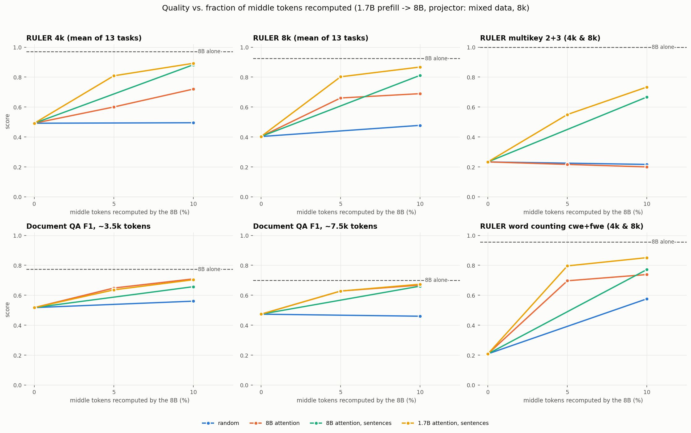

# 选择性重算实验

GPU：NVIDIA H100 80GB HBM3；生成：2026-10-14 20:42:28；projector：混合数据 8k（第 12000 步）。小模型：1.7B，大模型：8B。开头 8 个和最后 64 个 token 始终由大模型计算；“重算比例”是中间部分由大模型重新计算的 token 占比。

## 总表

| 配置 | 实际重算比例（RULER 8k） | RULER 4k | RULER 8k | 问答 F1 4k | 问答 F1 8k | 大海捞针 |
|---|---|---|---|---|---|---|
| 8B 单独 | 全部 | 0.970 | 0.924 | 0.774 | 0.700 | 1.000 |
| 1.7B 单独 | 0.0% | 0.892 | 0.868 | 0.552 | 0.515 | 1.000 |
| 混合，不重算 | 0.0% | 0.492 | 0.403 | 0.517 | 0.474 | 0.989 |
| 随机 10% | 10.0% | 0.495 | 0.478 | 0.560 | 0.460 | 0.922 |
| 8B 注意力 5% | 5.0% | 0.600 | 0.660 | 0.648 | 0.628 | 1.000 |
| 8B 注意力 10% | 10.0% | 0.720 | 0.689 | 0.709 | 0.668 | 1.000 |
| 8B 注意力 10%，按句子 | 10.1% | 0.882 | 0.812 | 0.657 | 0.661 | 1.000 |
| 1.7B 注意力 5%，按句子 | 5.1% | 0.809 | 0.802 | 0.636 | 0.628 | 1.000 |
| 1.7B 注意力 10%，按句子 | 10.1% | 0.892 | 0.867 | 0.704 | 0.674 | 1.000 |

## RULER 4096，按任务类型

| 配置 | 检索 | 汇总 | 变量追踪 | 问答 | 平均 |
|---|---|---|---|---|---|
| 8B 单独 | 1.00 | 0.97 | 1.00 | 0.83 | 0.970 |
| 1.7B 单独 | 0.98 | 0.81 | 1.00 | 0.57 | 0.892 |
| 混合，不重算 | 0.67 | 0.26 | 0.00 | 0.27 | 0.492 |
| 随机 10% | 0.56 | 0.64 | 0.12 | 0.27 | 0.495 |
| 8B 注意力 5% | 0.62 | 0.78 | 0.32 | 0.47 | 0.600 |
| 8B 注意力 10% | 0.69 | 0.84 | 1.00 | 0.60 | 0.720 |
| 8B 注意力 10%，按句子 | 0.94 | 0.87 | 1.00 | 0.60 | 0.882 |
| 1.7B 注意力 5%，按句子 | 0.88 | 0.85 | 0.72 | 0.53 | 0.809 |
| 1.7B 注意力 10%，按句子 | 0.92 | 0.93 | 1.00 | 0.70 | 0.892 |

RULER 4096 全部子任务

| 配置 | cwe | fwe | niah_multikey_1 | niah_multikey_2 | niah_multikey_3 | niah_multiquery | niah_multivalue | niah_single_1 | niah_single_2 | niah_single_3 | qa_1 | qa_2 | vt |
|---|---|---|---|---|---|---|---|---|---|---|---|---|---|
| 8B 单独 | 0.99 | 0.96 | 1.00 | 1.00 | 1.00 | 1.00 | 1.00 | 1.00 | 1.00 | 1.00 | 0.93 | 0.73 | 1.00 |
| 1.7B 单独 | 0.78 | 0.84 | 1.00 | 0.87 | 1.00 | 0.98 | 0.98 | 1.00 | 1.00 | 1.00 | 0.73 | 0.40 | 1.00 |
| 混合，不重算 | 0.33 | 0.20 | 0.93 | 0.67 | 0.07 | 0.65 | 0.62 | 0.93 | 0.93 | 0.53 | 0.27 | 0.27 | 0.00 |
| 随机 10% | 0.53 | 0.76 | 0.73 | 0.40 | 0.07 | 0.63 | 0.67 | 0.87 | 0.87 | 0.27 | 0.27 | 0.27 | 0.12 |
| 8B 注意力 5% | 0.71 | 0.84 | 0.87 | 0.07 | 0.33 | 0.83 | 0.70 | 1.00 | 0.93 | 0.27 | 0.67 | 0.27 | 0.32 |
| 8B 注意力 10% | 0.79 | 0.89 | 1.00 | 0.20 | 0.20 | 0.98 | 0.83 | 1.00 | 1.00 | 0.27 | 0.80 | 0.40 | 1.00 |
| 8B 注意力 10%，按句子 | 0.85 | 0.89 | 1.00 | 1.00 | 0.53 | 1.00 | 1.00 | 1.00 | 1.00 | 1.00 | 0.80 | 0.40 | 1.00 |
| 1.7B 注意力 5%，按句子 | 0.78 | 0.91 | 1.00 | 1.00 | 0.20 | 1.00 | 0.90 | 1.00 | 1.00 | 0.93 | 0.73 | 0.33 | 0.72 |
| 1.7B 注意力 10%，按句子 | 0.89 | 0.98 | 1.00 | 1.00 | 0.40 | 1.00 | 0.93 | 1.00 | 1.00 | 1.00 | 0.87 | 0.53 | 1.00 |

## RULER 8192，按任务类型

| 配置 | 检索 | 汇总 | 变量追踪 | 问答 | 平均 |
|---|---|---|---|---|---|
| 8B 单独 | 1.00 | 0.94 | 1.00 | 0.57 | 0.924 |
| 1.7B 单独 | 0.98 | 0.68 | 0.97 | 0.57 | 0.868 |
| 混合，不重算 | 0.53 | 0.15 | 0.00 | 0.33 | 0.403 |
| 随机 10% | 0.55 | 0.51 | 0.05 | 0.37 | 0.478 |
| 8B 注意力 5% | 0.69 | 0.62 | 1.00 | 0.43 | 0.660 |
| 8B 注意力 10% | 0.70 | 0.64 | 1.00 | 0.53 | 0.689 |
| 8B 注意力 10%，按句子 | 0.89 | 0.68 | 1.00 | 0.53 | 0.812 |
| 1.7B 注意力 5%，按句子 | 0.87 | 0.75 | 1.00 | 0.50 | 0.802 |
| 1.7B 注意力 10%，按句子 | 0.94 | 0.77 | 1.00 | 0.60 | 0.867 |

RULER 8192 全部子任务

| 配置 | cwe | fwe | niah_multikey_1 | niah_multikey_2 | niah_multikey_3 | niah_multiquery | niah_multivalue | niah_single_1 | niah_single_2 | niah_single_3 | qa_1 | qa_2 | vt |
|---|---|---|---|---|---|---|---|---|---|---|---|---|---|
| 8B 单独 | 0.97 | 0.91 | 1.00 | 1.00 | 1.00 | 1.00 | 1.00 | 1.00 | 1.00 | 1.00 | 0.60 | 0.53 | 1.00 |
| 1.7B 单独 | 0.61 | 0.76 | 1.00 | 0.87 | 1.00 | 1.00 | 0.95 | 1.00 | 1.00 | 1.00 | 0.67 | 0.47 | 0.97 |
| 混合，不重算 | 0.17 | 0.13 | 0.73 | 0.20 | 0.00 | 0.50 | 0.50 | 0.87 | 0.93 | 0.53 | 0.47 | 0.20 | 0.00 |
| 随机 10% | 0.40 | 0.62 | 0.80 | 0.40 | 0.00 | 0.50 | 0.50 | 0.87 | 1.00 | 0.33 | 0.47 | 0.27 | 0.05 |
| 8B 注意力 5% | 0.41 | 0.82 | 1.00 | 0.27 | 0.20 | 0.98 | 0.77 | 1.00 | 1.00 | 0.27 | 0.60 | 0.27 | 1.00 |
| 8B 注意力 10% | 0.50 | 0.78 | 1.00 | 0.27 | 0.13 | 1.00 | 0.95 | 1.00 | 1.00 | 0.27 | 0.73 | 0.33 | 1.00 |
| 8B 注意力 10%，按句子 | 0.51 | 0.84 | 1.00 | 1.00 | 0.13 | 1.00 | 1.00 | 1.00 | 1.00 | 1.00 | 0.67 | 0.40 | 1.00 |
| 1.7B 注意力 5%，按句子 | 0.63 | 0.87 | 1.00 | 1.00 | 0.00 | 1.00 | 0.93 | 1.00 | 1.00 | 1.00 | 0.73 | 0.27 | 1.00 |
| 1.7B 注意力 10%，按句子 | 0.67 | 0.87 | 1.00 | 1.00 | 0.53 | 1.00 | 1.00 | 1.00 | 1.00 | 1.00 | 0.80 | 0.40 | 1.00 |

## 问答 F1

| 配置 | squad 4k | hotpot 4k | trivia 4k | squad 8k | hotpot 8k | trivia 8k |
|---|---|---|---|---|---|---|
| 8B 单独 | 0.873 | 0.739 | 0.710 | 0.751 | 0.586 | 0.762 |
| 1.7B 单独 | 0.611 | 0.541 | 0.503 | 0.599 | 0.393 | 0.552 |
| 混合，不重算 | 0.443 | 0.447 | 0.663 | 0.483 | 0.220 | 0.719 |
| 随机 10% | 0.519 | 0.506 | 0.657 | 0.485 | 0.233 | 0.662 |
| 8B 注意力 5% | 0.719 | 0.519 | 0.707 | 0.772 | 0.378 | 0.735 |
| 8B 注意力 10% | 0.827 | 0.601 | 0.700 | 0.772 | 0.484 | 0.749 |
| 8B 注意力 10%，按句子 | 0.762 | 0.573 | 0.637 | 0.789 | 0.509 | 0.685 |
| 1.7B 注意力 5%，按句子 | 0.661 | 0.537 | 0.710 | 0.760 | 0.449 | 0.675 |
| 1.7B 注意力 10%，按句子 | 0.820 | 0.614 | 0.677 | 0.780 | 0.506 | 0.735 |

## 首 token 延迟（毫秒，H100，eager，不含 CUDA graph）

| 配置 | 4096 | 8192 | 16384 | 32768 |
|---|---|---|---|---|
| 8B 单独 | 157.3（1.00 倍） | 338.1（1.00 倍） | 786.3（1.00 倍） | 2036.2（1.00 倍） |
| 1.7B 单独 | 50.9（3.09 倍） | 109.5（3.09 倍） | 256.3（3.07 倍） | 688.3（2.96 倍） |
| 混合，不重算 | 91.9（1.71 倍） | 177.7（1.90 倍） | 378.2（2.08 倍） | 910.5（2.24 倍） |
| 1.7B 注意力 5%，按句子 | 105.2（1.50 倍） | 205.1（1.65 倍） | 462.4（1.70 倍） | 1222.3（1.67 倍） |
| 1.7B 注意力 10%，按句子 | 108.6（1.45 倍） | 232.8（1.45 倍） | 556.0（1.41 倍） | 1496.1（1.36 倍） |
| 8B 注意力 5% | 129.0（1.22 倍） | 235.0（1.44 倍） | 518.7（1.52 倍） | 1307.3（1.56 倍） |
| 8B 注意力 10%，按句子 | 133.8（1.18 倍） | 267.9（1.26 倍） | 613.2（1.28 倍） | 1591.9（1.28 倍） |

括号内是相对 8B 单独的加速比。
