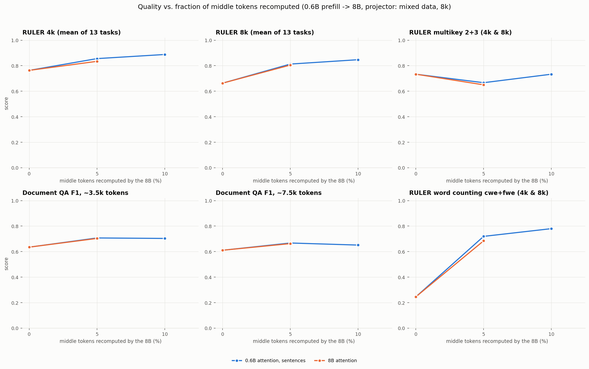

# 选择性重算实验

GPU：NVIDIA L40S；生成：2026-10-16 04:10:03；projector：混合数据 8k（第 12000 步）。小模型：0.6B，大模型：8B。开头 8 个和最后 64 个 token 始终由大模型计算；“重算比例”是中间部分由大模型重新计算的 token 占比。

## 总表

| 配置 | 实际重算比例（RULER 8k） | RULER 4k | RULER 8k | 问答 F1 4k | 问答 F1 8k | 大海捞针 |
|---|---|---|---|---|---|---|
| 混合，不重算 | 0.0% | 0.763 | 0.663 | 0.635 | 0.611 | 1.000 |
| 0.6B 注意力 5%，按句子 | 5.1% | 0.856 | 0.813 | 0.707 | 0.668 | 1.000 |
| 0.6B 注意力 10%，按句子 | 10.1% | 0.888 | 0.847 | 0.703 | 0.651 | 1.000 |
| 8B 注意力 5% | 5.0% | 0.834 | 0.805 | 0.703 | 0.663 | 1.000 |

## RULER 4096，按任务类型

| 配置 | 检索 | 汇总 | 变量追踪 | 问答 | 平均 |
|---|---|---|---|---|---|
| 混合，不重算 | 0.97 | 0.28 | 0.49 | 0.57 | 0.763 |
| 0.6B 注意力 5%，按句子 | 0.93 | 0.85 | 0.83 | 0.60 | 0.856 |
| 0.6B 注意力 10%，按句子 | 0.94 | 0.89 | 1.00 | 0.63 | 0.888 |
| 8B 注意力 5% | 0.90 | 0.78 | 0.79 | 0.63 | 0.834 |

RULER 4096 全部子任务

| 配置 | cwe | fwe | niah_multikey_1 | niah_multikey_2 | niah_multikey_3 | niah_multiquery | niah_multivalue | niah_single_1 | niah_single_2 | niah_single_3 | qa_1 | qa_2 | vt |
|---|---|---|---|---|---|---|---|---|---|---|---|---|---|
| 混合，不重算 | 0.07 | 0.49 | 1.00 | 0.93 | 0.93 | 0.98 | 0.95 | 1.00 | 0.93 | 1.00 | 0.80 | 0.33 | 0.49 |
| 0.6B 注意力 5%，按句子 | 0.81 | 0.89 | 1.00 | 1.00 | 0.47 | 1.00 | 0.93 | 1.00 | 1.00 | 1.00 | 0.73 | 0.47 | 0.83 |
| 0.6B 注意力 10%，按句子 | 0.89 | 0.89 | 1.00 | 1.00 | 0.53 | 1.00 | 0.97 | 1.00 | 1.00 | 1.00 | 0.80 | 0.47 | 1.00 |
| 8B 注意力 5% | 0.71 | 0.84 | 1.00 | 0.80 | 0.60 | 0.98 | 0.98 | 1.00 | 1.00 | 0.87 | 0.80 | 0.47 | 0.79 |

## RULER 8192，按任务类型

| 配置 | 检索 | 汇总 | 变量追踪 | 问答 | 平均 |
|---|---|---|---|---|---|
| 混合，不重算 | 0.86 | 0.21 | 0.40 | 0.47 | 0.663 |
| 0.6B 注意力 5%，按句子 | 0.90 | 0.59 | 1.00 | 0.60 | 0.813 |
| 0.6B 注意力 10%，按句子 | 0.93 | 0.67 | 1.00 | 0.63 | 0.847 |
| 8B 注意力 5% | 0.89 | 0.59 | 1.00 | 0.60 | 0.805 |

RULER 8192 全部子任务

| 配置 | cwe | fwe | niah_multikey_1 | niah_multikey_2 | niah_multikey_3 | niah_multiquery | niah_multivalue | niah_single_1 | niah_single_2 | niah_single_3 | qa_1 | qa_2 | vt |
|---|---|---|---|---|---|---|---|---|---|---|---|---|---|
| 混合，不重算 | 0.02 | 0.40 | 1.00 | 0.87 | 0.20 | 0.97 | 0.90 | 1.00 | 1.00 | 0.93 | 0.67 | 0.27 | 0.40 |
| 0.6B 注意力 5%，按句子 | 0.36 | 0.82 | 1.00 | 1.00 | 0.20 | 1.00 | 0.98 | 1.00 | 1.00 | 1.00 | 0.80 | 0.40 | 1.00 |
| 0.6B 注意力 10%，按句子 | 0.50 | 0.84 | 1.00 | 1.00 | 0.40 | 1.00 | 1.00 | 1.00 | 1.00 | 1.00 | 0.80 | 0.47 | 1.00 |
| 8B 注意力 5% | 0.38 | 0.80 | 1.00 | 0.80 | 0.40 | 0.98 | 0.97 | 1.00 | 1.00 | 0.93 | 0.73 | 0.47 | 1.00 |

## 问答 F1

| 配置 | squad 4k | hotpot 4k | trivia 4k | squad 8k | hotpot 8k | trivia 8k |
|---|---|---|---|---|---|---|
| 混合，不重算 | 0.736 | 0.561 | 0.608 | 0.712 | 0.406 | 0.714 |
| 0.6B 注意力 5%，按句子 | 0.848 | 0.629 | 0.643 | 0.786 | 0.464 | 0.752 |
| 0.6B 注意力 10%，按句子 | 0.838 | 0.589 | 0.683 | 0.720 | 0.482 | 0.752 |
| 8B 注意力 5% | 0.839 | 0.611 | 0.660 | 0.808 | 0.433 | 0.747 |
