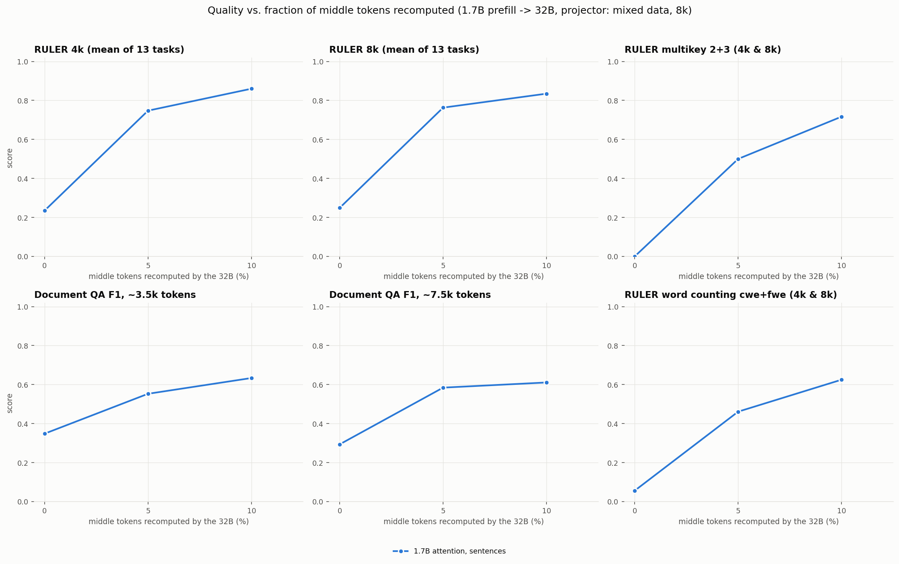

# 选择性重算实验

GPU：NVIDIA H100 80GB HBM3；生成：2026-10-16 07:33:12；projector：混合数据 8k（第 12000 步）。小模型：1.7B，大模型：32B。开头 8 个和最后 64 个 token 始终由大模型计算；“重算比例”是中间部分由大模型重新计算的 token 占比。

## 总表

| 配置 | 实际重算比例（RULER 8k） | RULER 4k | RULER 8k | 问答 F1 4k | 问答 F1 8k | 大海捞针 |
|---|---|---|---|---|---|---|
| 混合，不重算 | 0.0% | 0.235 | 0.249 | 0.348 | 0.294 | 0.967 |
| 1.7B 注意力 5%，按句子 | 5.1% | 0.747 | 0.763 | 0.553 | 0.584 | 1.000 |
| 1.7B 注意力 10%，按句子 | 10.1% | 0.860 | 0.835 | 0.634 | 0.611 | 1.000 |

## RULER 4096，按任务类型

| 配置 | 检索 | 汇总 | 变量追踪 | 问答 | 平均 |
|---|---|---|---|---|---|
| 混合，不重算 | 0.29 | 0.06 | 0.00 | 0.30 | 0.235 |
| 1.7B 注意力 5%，按句子 | 0.85 | 0.49 | 0.76 | 0.60 | 0.747 |
| 1.7B 注意力 10%，按句子 | 0.90 | 0.71 | 0.96 | 0.80 | 0.860 |

RULER 4096 全部子任务

| 配置 | cwe | fwe | niah_multikey_1 | niah_multikey_2 | niah_multikey_3 | niah_multiquery | niah_multivalue | niah_single_1 | niah_single_2 | niah_single_3 | qa_1 | qa_2 | vt |
|---|---|---|---|---|---|---|---|---|---|---|---|---|---|
| 混合，不重算 | 0.03 | 0.09 | 0.33 | 0.00 | 0.00 | 0.18 | 0.15 | 0.87 | 0.73 | 0.07 | 0.27 | 0.33 | 0.00 |
| 1.7B 注意力 5%，按句子 | 0.37 | 0.60 | 1.00 | 1.00 | 0.00 | 1.00 | 0.78 | 1.00 | 1.00 | 1.00 | 0.73 | 0.47 | 0.76 |
| 1.7B 注意力 10%，按句子 | 0.62 | 0.80 | 1.00 | 1.00 | 0.33 | 1.00 | 0.87 | 1.00 | 1.00 | 1.00 | 1.00 | 0.60 | 0.96 |

## RULER 8192，按任务类型

| 配置 | 检索 | 汇总 | 变量追踪 | 问答 | 平均 |
|---|---|---|---|---|---|
| 混合，不重算 | 0.32 | 0.05 | 0.00 | 0.30 | 0.249 |
| 1.7B 注意力 5%，按句子 | 0.85 | 0.44 | 0.95 | 0.63 | 0.763 |
| 1.7B 注意力 10%，按句子 | 0.94 | 0.54 | 0.99 | 0.63 | 0.835 |

RULER 8192 全部子任务

| 配置 | cwe | fwe | niah_multikey_1 | niah_multikey_2 | niah_multikey_3 | niah_multiquery | niah_multivalue | niah_single_1 | niah_single_2 | niah_single_3 | qa_1 | qa_2 | vt |
|---|---|---|---|---|---|---|---|---|---|---|---|---|---|
| 混合，不重算 | 0.01 | 0.09 | 0.33 | 0.00 | 0.00 | 0.28 | 0.18 | 0.93 | 0.80 | 0.00 | 0.40 | 0.20 | 0.00 |
| 1.7B 注意力 5%，按句子 | 0.23 | 0.64 | 0.93 | 1.00 | 0.00 | 1.00 | 0.90 | 1.00 | 1.00 | 1.00 | 0.80 | 0.47 | 0.95 |
| 1.7B 注意力 10%，按句子 | 0.35 | 0.73 | 1.00 | 1.00 | 0.53 | 1.00 | 0.98 | 1.00 | 1.00 | 1.00 | 0.87 | 0.40 | 0.99 |

## 问答 F1

| 配置 | squad 4k | hotpot 4k | trivia 4k | squad 8k | hotpot 8k | trivia 8k |
|---|---|---|---|---|---|---|
| 混合，不重算 | 0.283 | 0.276 | 0.486 | 0.139 | 0.244 | 0.498 |
| 1.7B 注意力 5%，按句子 | 0.599 | 0.508 | 0.552 | 0.655 | 0.473 | 0.625 |
| 1.7B 注意力 10%，按句子 | 0.742 | 0.561 | 0.598 | 0.695 | 0.473 | 0.665 |
