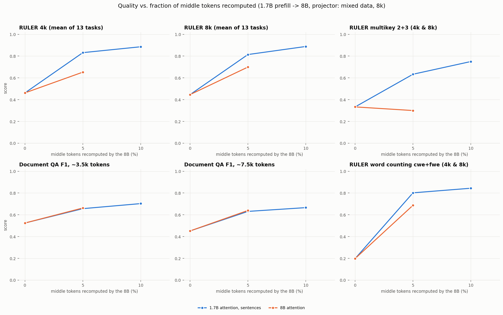

# 选择性重算实验

GPU：NVIDIA L40S；生成：2026-10-16 04:42:51；projector：混合数据 8k（第 12000 步）。小模型：1.7B，大模型：8B。开头 8 个和最后 64 个 token 始终由大模型计算；“重算比例”是中间部分由大模型重新计算的 token 占比。

## 总表

| 配置 | 实际重算比例（RULER 8k） | RULER 4k | RULER 8k | 问答 F1 4k | 问答 F1 8k | 大海捞针 |
|---|---|---|---|---|---|---|
| 混合，不重算 | 0.0% | 0.462 | 0.446 | 0.525 | 0.452 | 0.989 |
| 1.7B 注意力 5%，按句子 | 5.1% | 0.832 | 0.814 | 0.656 | 0.631 | 1.000 |
| 1.7B 注意力 10%，按句子 | 10.1% | 0.886 | 0.888 | 0.703 | 0.666 | 1.000 |
| 8B 注意力 5% | 5.0% | 0.652 | 0.699 | 0.663 | 0.640 | 1.000 |

## RULER 4096，按任务类型

| 配置 | 检索 | 汇总 | 变量追踪 | 问答 | 平均 |
|---|---|---|---|---|---|
| 混合，不重算 | 0.62 | 0.25 | 0.04 | 0.23 | 0.462 |
| 1.7B 注意力 5%，按句子 | 0.93 | 0.85 | 0.72 | 0.47 | 0.832 |
| 1.7B 注意力 10%，按句子 | 0.92 | 0.91 | 1.00 | 0.67 | 0.886 |
| 8B 注意力 5% | 0.69 | 0.75 | 0.37 | 0.53 | 0.652 |

RULER 4096 全部子任务

| 配置 | cwe | fwe | niah_multikey_1 | niah_multikey_2 | niah_multikey_3 | niah_multiquery | niah_multivalue | niah_single_1 | niah_single_2 | niah_single_3 | qa_1 | qa_2 | vt |
|---|---|---|---|---|---|---|---|---|---|---|---|---|---|
| 混合，不重算 | 0.30 | 0.20 | 0.87 | 0.73 | 0.07 | 0.55 | 0.65 | 0.93 | 0.93 | 0.27 | 0.20 | 0.27 | 0.04 |
| 1.7B 注意力 5%，按句子 | 0.77 | 0.93 | 1.00 | 1.00 | 0.53 | 1.00 | 0.92 | 1.00 | 1.00 | 1.00 | 0.53 | 0.40 | 0.72 |
| 1.7B 注意力 10%，按句子 | 0.87 | 0.96 | 1.00 | 1.00 | 0.40 | 1.00 | 0.95 | 1.00 | 1.00 | 1.00 | 0.87 | 0.47 | 1.00 |
| 8B 注意力 5% | 0.69 | 0.82 | 0.87 | 0.07 | 0.53 | 0.85 | 0.82 | 1.00 | 1.00 | 0.40 | 0.67 | 0.40 | 0.37 |

## RULER 8192，按任务类型

| 配置 | 检索 | 汇总 | 变量追踪 | 问答 | 平均 |
|---|---|---|---|---|---|
| 混合，不重算 | 0.58 | 0.15 | 0.04 | 0.40 | 0.446 |
| 1.7B 注意力 5%，按句子 | 0.87 | 0.75 | 1.00 | 0.57 | 0.814 |
| 1.7B 注意力 10%，按句子 | 0.95 | 0.77 | 1.00 | 0.70 | 0.888 |
| 8B 注意力 5% | 0.73 | 0.62 | 1.00 | 0.50 | 0.699 |

RULER 8192 全部子任务

| 配置 | cwe | fwe | niah_multikey_1 | niah_multikey_2 | niah_multikey_3 | niah_multiquery | niah_multivalue | niah_single_1 | niah_single_2 | niah_single_3 | qa_1 | qa_2 | vt |
|---|---|---|---|---|---|---|---|---|---|---|---|---|---|
| 混合，不重算 | 0.16 | 0.13 | 0.87 | 0.47 | 0.07 | 0.45 | 0.55 | 0.93 | 1.00 | 0.33 | 0.53 | 0.27 | 0.04 |
| 1.7B 注意力 5%，按句子 | 0.63 | 0.87 | 1.00 | 1.00 | 0.00 | 1.00 | 0.95 | 1.00 | 1.00 | 1.00 | 0.80 | 0.33 | 1.00 |
| 1.7B 注意力 10%，按句子 | 0.68 | 0.87 | 1.00 | 1.00 | 0.60 | 1.00 | 1.00 | 1.00 | 1.00 | 1.00 | 0.87 | 0.53 | 1.00 |
| 8B 注意力 5% | 0.44 | 0.80 | 1.00 | 0.40 | 0.20 | 0.98 | 0.80 | 1.00 | 1.00 | 0.47 | 0.67 | 0.33 | 1.00 |

## 问答 F1

| 配置 | squad 4k | hotpot 4k | trivia 4k | squad 8k | hotpot 8k | trivia 8k |
|---|---|---|---|---|---|---|
| 混合，不重算 | 0.493 | 0.423 | 0.658 | 0.455 | 0.201 | 0.699 |
| 1.7B 注意力 5%，按句子 | 0.725 | 0.577 | 0.667 | 0.743 | 0.446 | 0.705 |
| 1.7B 注意力 10%，按句子 | 0.840 | 0.609 | 0.660 | 0.771 | 0.482 | 0.745 |
| 8B 注意力 5% | 0.713 | 0.584 | 0.690 | 0.737 | 0.447 | 0.735 |
