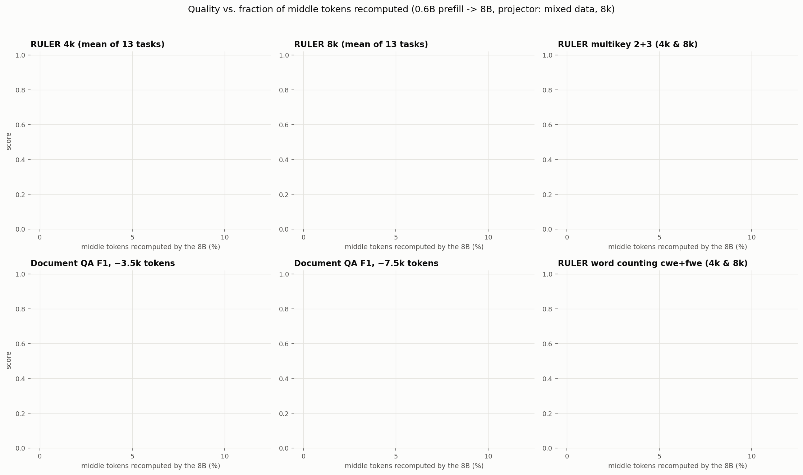

# 选择性重算实验

GPU：NVIDIA L40S；生成：2026-10-21 21:28:04；projector：混合数据 8k（第 12000 步）。小模型：0.6B，大模型：8B。开头 8 个和最后 64 个 token 始终由大模型计算；“重算比例”是中间部分由大模型重新计算的 token 占比。

## 总表

| 配置 | 实际重算比例（RULER 8k） | RULER 4k | RULER 8k | 问答 F1 4k | 问答 F1 8k | 大海捞针 |
|---|---|---|---|---|---|---|
| 8B 单独 | 全部 | - | - | - | - | - |
| 混合，不重算 | - | - | - | - | - | - |
| 0.6B 注意力 5%，按句子 | - | - | - | - | - | - |
| 0.6B 注意力 10%，按句子 | - | - | - | - | - | - |
| 8B 注意力 5% | - | - | - | - | - | - |

## GSM8K（8-shot，对话轮次形式）

| 配置 | 准确率 | 遵守 #### 格式 |
|---|---|---|
| 8B 单独 | 0.907 | 0.593 |
| 混合，不重算 | 0.860 | 0.500 |
| 0.6B 注意力 5%，按句子 | 0.900 | 0.707 |
| 0.6B 注意力 10%，按句子 | 0.920 | 0.693 |
| 8B 注意力 5% | 0.873 | 0.620 |

## 代码下一行补全

| 配置 | 4k 精确匹配 | 4k 相似度 | 8k 精确匹配 | 8k 相似度 |
|---|---|---|---|---|
| 8B 单独 | 0.230 | 0.613 | 0.290 | 0.639 |
| 混合，不重算 | 0.130 | 0.542 | 0.250 | 0.597 |
| 0.6B 注意力 5%，按句子 | 0.180 | 0.606 | 0.320 | 0.648 |
| 0.6B 注意力 10%，按句子 | 0.160 | 0.613 | 0.300 | 0.644 |
| 8B 注意力 5% | 0.180 | 0.628 | 0.310 | 0.634 |
