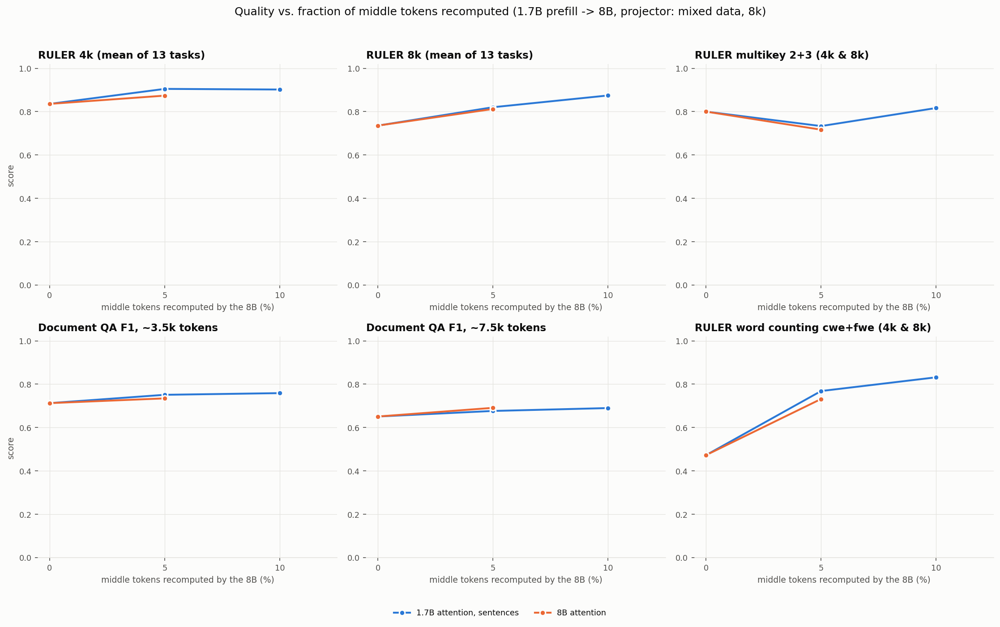

# 选择性重算实验

GPU：NVIDIA H100 80GB HBM3；生成：2026-10-22 18:41:36；projector：混合数据 8k（第 12000 步）。小模型：1.7B，大模型：8B。开头 8 个和最后 64 个 token 始终由大模型计算；“重算比例”是中间部分由大模型重新计算的 token 占比。

## 总表

| 配置 | 实际重算比例（RULER 8k） | RULER 4k | RULER 8k | 问答 F1 4k | 问答 F1 8k | 大海捞针 |
|---|---|---|---|---|---|---|
| 混合，不重算 | 0.0% | 0.836 | 0.735 | 0.713 | 0.651 | 1.000 |
| 1.7B 注意力 5%，按句子 | 5.1% | 0.905 | 0.820 | 0.751 | 0.676 | 1.000 |
| 1.7B 注意力 10%，按句子 | 10.1% | 0.902 | 0.874 | 0.759 | 0.690 | 1.000 |
| 8B 注意力 5% | 5.0% | 0.874 | 0.812 | 0.734 | 0.691 | 1.000 |

## RULER 4096，按任务类型

| 配置 | 检索 | 汇总 | 变量追踪 | 问答 | 平均 |
|---|---|---|---|---|---|
| 混合，不重算 | 0.98 | 0.61 | 0.56 | 0.63 | 0.836 |
| 1.7B 注意力 5%，按句子 | 0.98 | 0.83 | 0.92 | 0.67 | 0.905 |
| 1.7B 注意力 10%，按句子 | 0.95 | 0.90 | 1.00 | 0.67 | 0.902 |
| 8B 注意力 5% | 0.94 | 0.80 | 0.84 | 0.70 | 0.874 |

RULER 4096 全部子任务

| 配置 | cwe | fwe | niah_multikey_1 | niah_multikey_2 | niah_multikey_3 | niah_multiquery | niah_multivalue | niah_single_1 | niah_single_2 | niah_single_3 | qa_1 | qa_2 | vt |
|---|---|---|---|---|---|---|---|---|---|---|---|---|---|
| 混合，不重算 | 0.55 | 0.67 | 1.00 | 1.00 | 0.87 | 0.97 | 0.98 | 1.00 | 1.00 | 1.00 | 0.87 | 0.40 | 0.56 |
| 1.7B 注意力 5%，按句子 | 0.79 | 0.87 | 1.00 | 1.00 | 0.87 | 1.00 | 0.98 | 1.00 | 1.00 | 1.00 | 0.93 | 0.40 | 0.92 |
| 1.7B 注意力 10%，按句子 | 0.92 | 0.89 | 1.00 | 1.00 | 0.60 | 1.00 | 0.98 | 1.00 | 1.00 | 1.00 | 0.93 | 0.40 | 1.00 |
| 8B 注意力 5% | 0.78 | 0.82 | 1.00 | 0.93 | 0.67 | 1.00 | 0.98 | 1.00 | 1.00 | 0.93 | 0.93 | 0.47 | 0.84 |

## RULER 8192，按任务类型

| 配置 | 检索 | 汇总 | 变量追踪 | 问答 | 平均 |
|---|---|---|---|---|---|
| 混合，不重算 | 0.89 | 0.34 | 0.64 | 0.57 | 0.735 |
| 1.7B 注意力 5%，按句子 | 0.88 | 0.71 | 1.00 | 0.60 | 0.820 |
| 1.7B 注意力 10%，按句子 | 0.96 | 0.76 | 1.00 | 0.60 | 0.874 |
| 8B 注意力 5% | 0.88 | 0.66 | 1.00 | 0.60 | 0.812 |

RULER 8192 全部子任务

| 配置 | cwe | fwe | niah_multikey_1 | niah_multikey_2 | niah_multikey_3 | niah_multiquery | niah_multivalue | niah_single_1 | niah_single_2 | niah_single_3 | qa_1 | qa_2 | vt |
|---|---|---|---|---|---|---|---|---|---|---|---|---|---|
| 混合，不重算 | 0.16 | 0.51 | 0.93 | 0.87 | 0.47 | 1.00 | 0.92 | 0.93 | 1.00 | 1.00 | 0.73 | 0.40 | 0.64 |
| 1.7B 注意力 5%，按句子 | 0.61 | 0.80 | 1.00 | 1.00 | 0.07 | 1.00 | 0.98 | 1.00 | 1.00 | 1.00 | 0.73 | 0.47 | 1.00 |
| 1.7B 注意力 10%，按句子 | 0.67 | 0.84 | 1.00 | 1.00 | 0.67 | 1.00 | 0.98 | 1.00 | 1.00 | 1.00 | 0.80 | 0.40 | 1.00 |
| 8B 注意力 5% | 0.55 | 0.78 | 1.00 | 0.93 | 0.33 | 0.97 | 0.93 | 1.00 | 1.00 | 0.87 | 0.73 | 0.47 | 1.00 |

## 问答 F1

| 配置 | squad 4k | hotpot 4k | trivia 4k | squad 8k | hotpot 8k | trivia 8k |
|---|---|---|---|---|---|---|
| 混合，不重算 | 0.783 | 0.644 | 0.710 | 0.746 | 0.517 | 0.690 |
| 1.7B 注意力 5%，按句子 | 0.878 | 0.665 | 0.710 | 0.808 | 0.506 | 0.715 |
| 1.7B 注意力 10%，按句子 | 0.876 | 0.670 | 0.730 | 0.768 | 0.566 | 0.735 |
| 8B 注意力 5% | 0.862 | 0.652 | 0.690 | 0.784 | 0.548 | 0.740 |
