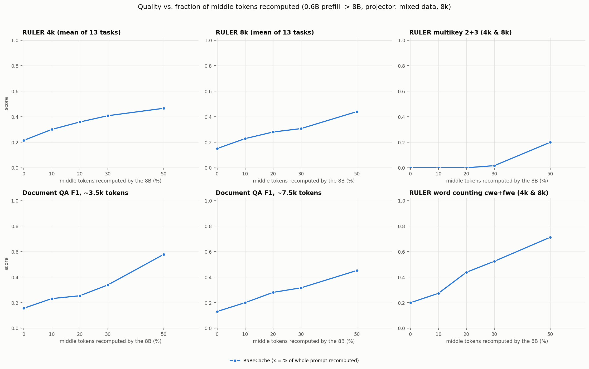
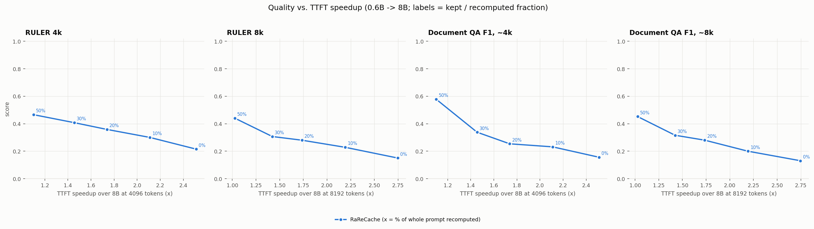

# 选择性重算实验

GPU：NVIDIA L40S；生成：2026-10-27 22:31:23；projector：混合数据 8k（第 12000 步）。小模型：0.6B，大模型：8B。开头 8 个和最后 64 个 token 始终由大模型计算；“重算比例”是中间部分由大模型重新计算的 token 占比。“丢弃其余”配置的选择方式与对应的重算配置完全相同，只是没选中的中间 token 被丢掉而不是用投影 KV 补上；SpecPrefill 是原论文方法（小模型打分，按 32 token 一块保留整段 prompt 的一部分，不强制保留开头和结尾，不用 projector），它的比例是整段 prompt 保留的比例。

## 总表

| 配置 | 实际重算比例（RULER 8k） | RULER 4k | RULER 8k | 问答 F1 4k | 问答 F1 8k | 大海捞针 |
|---|---|---|---|---|---|---|
| RaReCache 重算整段 0% | 0.0% | 0.215 | 0.151 | 0.156 | 0.131 | 0.756 |
| RaReCache 重算整段 10% | 10.0% | 0.301 | 0.228 | 0.232 | 0.200 | 0.700 |
| RaReCache 重算整段 20% | 20.0% | 0.359 | 0.280 | 0.254 | 0.280 | 0.711 |
| RaReCache 重算整段 30% | 30.0% | 0.408 | 0.307 | 0.338 | 0.316 | 0.789 |
| RaReCache 重算整段 50% | 50.0% | 0.466 | 0.440 | 0.578 | 0.452 | 0.789 |

## RULER 4096，按任务类型

| 配置 | 检索 | 汇总 | 变量追踪 | 问答 | 平均 |
|---|---|---|---|---|---|
| RaReCache 重算整段 0% | 0.23 | 0.24 | 0.07 | 0.20 | 0.215 |
| RaReCache 重算整段 10% | 0.29 | 0.30 | 0.68 | 0.17 | 0.301 |
| RaReCache 重算整段 20% | 0.29 | 0.48 | 0.95 | 0.20 | 0.359 |
| RaReCache 重算整段 30% | 0.28 | 0.57 | 0.99 | 0.47 | 0.408 |
| RaReCache 重算整段 50% | 0.31 | 0.75 | 1.00 | 0.53 | 0.466 |

RULER 4096 全部子任务

| 配置 | cwe | fwe | niah_multikey_1 | niah_multikey_2 | niah_multikey_3 | niah_multiquery | niah_multivalue | niah_single_1 | niah_single_2 | niah_single_3 | qa_1 | qa_2 | vt |
|---|---|---|---|---|---|---|---|---|---|---|---|---|---|
| RaReCache 重算整段 0% | 0.01 | 0.47 | 0.60 | 0.00 | 0.00 | 0.20 | 0.18 | 0.13 | 0.20 | 0.53 | 0.27 | 0.13 | 0.07 |
| RaReCache 重算整段 10% | 0.13 | 0.47 | 0.60 | 0.00 | 0.00 | 0.45 | 0.25 | 0.20 | 0.33 | 0.47 | 0.20 | 0.13 | 0.68 |
| RaReCache 重算整段 20% | 0.37 | 0.60 | 0.60 | 0.00 | 0.00 | 0.32 | 0.30 | 0.40 | 0.33 | 0.40 | 0.20 | 0.20 | 0.95 |
| RaReCache 重算整段 30% | 0.46 | 0.69 | 0.53 | 0.07 | 0.00 | 0.35 | 0.28 | 0.40 | 0.33 | 0.27 | 0.53 | 0.40 | 0.99 |
| RaReCache 重算整段 50% | 0.69 | 0.82 | 0.33 | 0.27 | 0.00 | 0.33 | 0.35 | 0.67 | 0.33 | 0.20 | 0.67 | 0.40 | 1.00 |

## RULER 8192，按任务类型

| 配置 | 检索 | 汇总 | 变量追踪 | 问答 | 平均 |
|---|---|---|---|---|---|
| RaReCache 重算整段 0% | 0.14 | 0.16 | 0.04 | 0.23 | 0.151 |
| RaReCache 重算整段 10% | 0.19 | 0.25 | 0.45 | 0.27 | 0.228 |
| RaReCache 重算整段 20% | 0.19 | 0.39 | 0.91 | 0.23 | 0.280 |
| RaReCache 重算整段 30% | 0.20 | 0.47 | 0.96 | 0.23 | 0.307 |
| RaReCache 重算整段 50% | 0.33 | 0.67 | 0.93 | 0.40 | 0.440 |

RULER 8192 全部子任务

| 配置 | cwe | fwe | niah_multikey_1 | niah_multikey_2 | niah_multikey_3 | niah_multiquery | niah_multivalue | niah_single_1 | niah_single_2 | niah_single_3 | qa_1 | qa_2 | vt |
|---|---|---|---|---|---|---|---|---|---|---|---|---|---|
| RaReCache 重算整段 0% | 0.01 | 0.31 | 0.13 | 0.00 | 0.00 | 0.03 | 0.10 | 0.20 | 0.40 | 0.27 | 0.27 | 0.20 | 0.04 |
| RaReCache 重算整段 10% | 0.10 | 0.40 | 0.33 | 0.00 | 0.00 | 0.23 | 0.18 | 0.27 | 0.40 | 0.07 | 0.20 | 0.33 | 0.45 |
| RaReCache 重算整段 20% | 0.25 | 0.53 | 0.40 | 0.00 | 0.00 | 0.20 | 0.15 | 0.27 | 0.40 | 0.07 | 0.13 | 0.33 | 0.91 |
| RaReCache 重算整段 30% | 0.39 | 0.56 | 0.33 | 0.00 | 0.00 | 0.32 | 0.17 | 0.27 | 0.53 | 0.00 | 0.27 | 0.20 | 0.96 |
| RaReCache 重算整段 50% | 0.65 | 0.69 | 0.20 | 0.53 | 0.00 | 0.40 | 0.25 | 0.67 | 0.53 | 0.07 | 0.40 | 0.40 | 0.93 |

## 问答 F1

| 配置 | squad 4k | hotpot 4k | trivia 4k | squad 8k | hotpot 8k | trivia 8k | 平均 4k | 平均 8k |
|---|---|---|---|---|---|---|---|---|
| RaReCache 重算整段 0% | 0.119 | 0.158 | 0.191 | 0.110 | 0.089 | 0.193 | 0.156 | 0.131 |
| RaReCache 重算整段 10% | 0.190 | 0.220 | 0.285 | 0.179 | 0.161 | 0.260 | 0.232 | 0.200 |
| RaReCache 重算整段 20% | 0.186 | 0.263 | 0.314 | 0.216 | 0.234 | 0.391 | 0.254 | 0.280 |
| RaReCache 重算整段 30% | 0.300 | 0.322 | 0.393 | 0.291 | 0.242 | 0.415 | 0.338 | 0.316 |
| RaReCache 重算整段 50% | 0.623 | 0.490 | 0.620 | 0.463 | 0.322 | 0.571 | 0.578 | 0.452 |

## GSM8K（8-shot，对话轮次形式）

| 配置 | 准确率 | 遵守 #### 格式 |
|---|---|---|
| RaReCache 重算整段 0% | 0.400 | 0.007 |
| RaReCache 重算整段 10% | 0.500 | 0.007 |
| RaReCache 重算整段 20% | 0.500 | 0.047 |
| RaReCache 重算整段 30% | 0.613 | 0.093 |
| RaReCache 重算整段 50% | 0.707 | 0.473 |

## 代码下一行补全

| 配置 | 4k 精确匹配 | 4k 相似度 | 8k 精确匹配 | 8k 相似度 |
|---|---|---|---|---|
| RaReCache 重算整段 0% | 0.050 | 0.381 | 0.060 | 0.410 |
| RaReCache 重算整段 10% | 0.030 | 0.378 | 0.070 | 0.433 |
| RaReCache 重算整段 20% | 0.030 | 0.430 | 0.090 | 0.460 |
| RaReCache 重算整段 30% | 0.030 | 0.450 | 0.100 | 0.475 |
| RaReCache 重算整段 50% | 0.080 | 0.520 | 0.170 | 0.555 |

## 首 token 延迟（毫秒，L40S，eager，不含 CUDA graph）

| 配置 | 4096 | 8192 | 16384 | 32768 |
|---|---|---|---|---|
| 8B 单独 | 387.8（1.00 倍） | 903.0（1.00 倍） | 2063.3（1.00 倍） | 5038.9（1.00 倍） |
| 混合，不重算 | 143.0（2.71 倍） | 294.7（3.06 倍） | 697.1（2.96 倍） | 1734.7（2.90 倍） |
| 0.6B 注意力 10%，按句子 | 172.7（2.25 倍） | 399.3（2.26 倍） | 1004.3（2.05 倍） | 2719.2（1.85 倍） |
| 0.6B 注意力 20%，按句子 | 217.5（1.78 倍） | 501.3（1.80 倍） | 1312.4（1.57 倍） | 3781.9（1.33 倍） |
| SpecPrefill 保留整段 10% | 231.6（1.67 倍） | 349.4（2.58 倍） | 692.6（2.98 倍） | 1637.1（3.08 倍） |
| SpecPrefill 保留整段 30% | 296.3（1.31 倍） | 494.0（1.83 倍） | 1050.4（1.96 倍） | 2469.5（2.04 倍） |
| RaReCache 重算整段 0% | 154.4（2.51 倍） | 328.8（2.75 倍） | 771.5（2.67 倍） | 1886.0（2.67 倍） |
| RaReCache 重算整段 10% | 183.8（2.11 倍） | 411.7（2.19 倍） | 1034.5（1.99 倍） | 2797.7（1.80 倍） |
| RaReCache 重算整段 20% | 223.2（1.74 倍） | 520.4（1.74 倍） | 1355.3（1.52 倍） | 3862.0（1.30 倍） |
| RaReCache 重算整段 30% | 266.5（1.46 倍） | 634.9（1.42 倍） | 1711.8（1.21 倍） | 4898.3（1.03 倍） |
| RaReCache 重算整段 50% | 352.1（1.10 倍） | 879.4（1.03 倍） | 2417.4（0.85 倍） | 6969.9（0.72 倍） |

括号内是相对 8B 单独的加速比。
